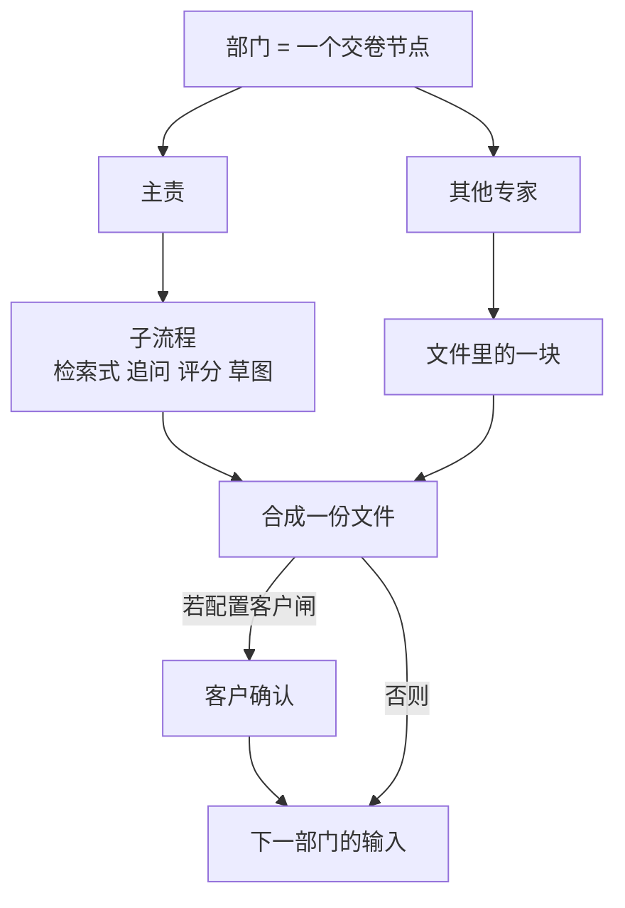
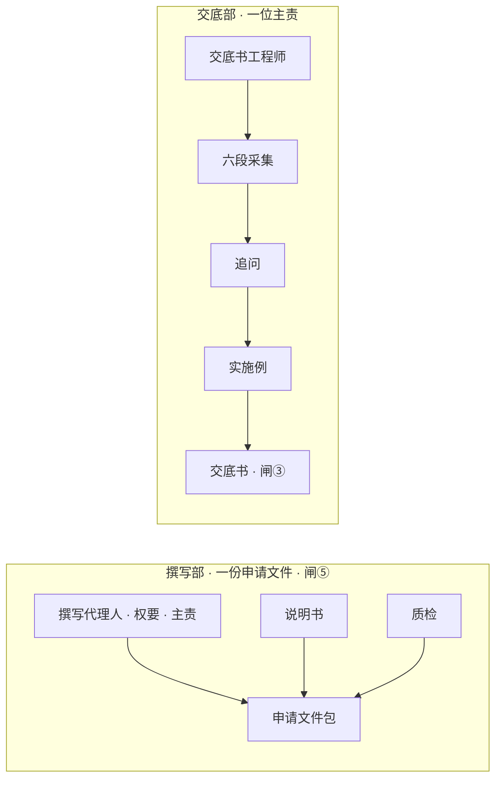
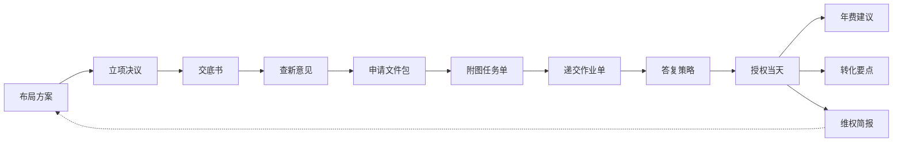

# 专利业务壳 · 信息架构（D3）

> **状态**：2026-10-19 起草，同日补上同一页怎么看见部门之间的交接和部门里面的路径。左栏是部门（查新部、撰写部），不是某某师。流程节点是案子当前这道工序，日常任务挂在部门里、不另占一行。前研和授权后各收成一行。**不改样机。**  
> **上游**：[agent-scope-slice](./agent-scope-slice.md)。露出状态不得改。  
> **替换的设计**（代码仍是旧的，D5 才动）：[agent-biz-case-ia](./agent-biz-case-ia.md) 的「左栏 = 7 个席」；[agent-dept-expert-team](./agent-dept-expert-team.md) 的「侧栏 = 本案节点，仅撰写展开」。两栏、单一主 CTA、单一进度这三刀保留。  
> **入口副本**：[docs/superpowers/specs/2026-10-19-agent-case-ia-v2.md](../../superpowers/specs/2026-10-19-agent-case-ia-v2.md)（仅指针；改正文只改本文）。

---

## 0. 直接回答

**一个负责交卷的流程节点对应一个部门；它可以映射零个或一个客户确认闸。**

**咱们说的节点，就是部门。** 像一家公司里的科室：查新部、撰写部、年费部。平台替没有知产部的中小企业配这套虚拟编制。左栏一项是部门名，带「部」。不是某一个人，也不写「查新检索员」「撰写代理人」。

部门展开之后才看见人。人的职称可以是某某师、某某员。部门里只有一位专家时，左栏仍写部门名，人在展开后的第一行。

| 左栏 · 部门 | 展开后的专家 |
|-------------|----------------|
| 查新部 | 查新检索员（主责），覆盖度复核无头像 |
| 撰写部 | 撰写代理人（主责，展开行写权要），说明书，质检无头像 |
| 年费部 | 年费管家（主责），价值评估师 |
| 交底部 | 交底书工程师（主责）。只有这一位，左栏仍叫交底部 |

**流程节点**是这一件案子正在办的那道工序，由一个部门承办。左栏的部门同时就是这件案子的流程节点：查新部承办「查新」这道工序，交出产物，并在配置客户闸时进入相应确认。右栏标题写工序名（查新）。第一行写部门之间交的文件，第二行写这个部门里面的路径。

人在这一页上分得清两种交互。部门之间的交接，部门收着也能看见：已完成的部门下面有文件名，当前这一次写成「文件名 → 接收部门」。部门里面的路径，展开这个部门才出现在左栏。右栏把两层叠成两行。写法见 §3.5。

**日常任务**不推进到下一个部门。点开部门后，排在部内路径下面，单独一块，标题就叫「日常任务」。没有任务的部门不显示这块。不在左栏再占一行。到期时，部门行右侧写「待办」，仍然不是新的一行。竞品部收在前研里面。盯梢到期时，收起的「前研」一行写「待办」。展开前研之后，「待办」只留在竞品部那一行。

| 部门 | 日常任务 | 不是什么 |
|------|----------|----------|
| 竞品部 | 持续盯梢 | 不是另一次立项 |
| 递交部 | 期限台账 | 不是齐套那一次交卷 |
| 年费部 | 每年缴费提醒 | 提醒本身不是闸⑦；要缴还是放弃仍走年费确认 |
| 审查答复部 | — | 每一通答复是流程节点的循环，不是日常任务 |

点一条日常任务，进入该部门主责会话里的这一块。没有「确认这一份」。不改变当前工序落在哪个部门。部门还锁定时不写「待办」；年费待办按每个缴费年度的期限规则生成。

两类人看同一栏部门名，不靠角色切换换称呼。

**子流程不是专家。** 子流程是这个部门把那一份文件做出来的步骤。步骤默认算主责自己的活。只有下面两种才在部门里再挂一位专家：

| 条件 | 结果 | 例子 |
|------|------|------|
| 这一步交出另一类文件，下一站或客户会单独点名 | 单独一位专家 | 说明书相对于权要 |
| 这一步可以否决主责的稿，打回重做 | 单独一位专家 | 质检、覆盖度复核、图注校对、齐套检查 |
| 其余步骤是主责顺着做完 | 不单列人 | 检索式、六段采集、评分、理由分类、草图 |

多位专家挂在**这一份文件的块**上，不另开一条子流程，也不另开一个闸。主责把块合成一份再交卷。

部门之间的协作是：**下一部门把上一部门交出来的那份文件当作输入。** 不是把子流程派给别的部门的人。



撰写部是「一块一位专家」的例子。交底部是「步骤都不单列人」的例子。



---

## 1. 四个对象

交卷和客户确认的唯一权威在 [agent-product-definition §5.1](./agent-product-definition.md#51-权限产物与状态契约)：代理人可以交卷/修改，案子授权的技术负责人可以确认/退回。

| 对象 | 是什么 | 不是什么 |
|------|--------|----------|
| **部门** | 一个交卷单位。可含多个产物块，只产生一个交卷事件，并映射零个或一个客户确认闸 | 客户公司的科室；也不是 Pack 里每一个内部循环 |
| **专家** | 部门里对某一块负责的人。主责有且仅有一位，负责交卷 | 每一个子步骤；也不是可以各自找客户确认的人 |
| **子流程** | 主责或某位专家自己的步骤顺序 | 导航上的人 |
| **交接** | 部门与部门之间传递的那份文件。接不上时用退回，回头标记单独占一行 | 组队讨论 |

两个 Pack 节点如果合并成一个交卷单位和一份产物，可以合成**一个部门、多名专家**。年费管家和价值评估师是这一例：共同产出年费建议，闸⑦，价值评估师是部门里的专家。

两个 Pack 节点如果各有独立交卷产物或生命周期工序，就分别作为部门；是否配置客户确认闸不改变这个边界。行业分析师和竞争情报员是这一例。创新教练和专利挖掘师也是。

F5 里的交底、查新、撰写、附图、递交是五个前后相接的部门，不是一个「申请部」下面的五位专家。

---

## 2. 按规则列出的编制

「不单列」的步骤写在这里，避免以后又把它们画成专家。

| 部门 | 主责（交卷） | 部内其他专家 | 不单列的子流程 |
|------|----------------|--------------|----------------|
| 行业洞察部 | 行业分析师 | — | 定界、扫描、空白点 |
| 竞品部 | 竞争情报员 | — | 定名单、扫描、分级 |
| 创新激发部 | 创新教练 | — | 痛点、提问、收束 |
| 专利挖掘部 | 专利挖掘师 | — | 拆系统、挖点、排序 |
| 布局部 | 布局策略师 | — | 目标、主题簇、国别节奏 |
| 立项部 | 立项评审 | — | 区别特征、三轴评分、报价 |
| 交底部 | 交底书工程师 | — | 六段采集、追问、实施例。追问是主责自己的循环 |
| 查新部 | 查新检索员 | 覆盖度复核 | 检索式、逐篇对比、三性成文 |
| 撰写部 | 撰写代理人（行上写权要） | 说明书、质检 | 特征表 |
| 附图部 | 附图工程师 | 图注校对 | 图号清单、草图 |
| 递交部 | 流程管家 | 齐套检查 | 形式审查。期限台账是日常任务，不是子流程 |
| 审查答复部 | OA 答复代理 | — | 理由分类、答复起草。创造性问题拉的是查新部，不在本部门再设一位专家 |
| 年费部 | 年费管家 | 价值评估师 | 期限与滞纳金计算 |
| 成果转化部 | 转化顾问 | — | 对象、范围、对价 |
| 维权部 | 无效维权顾问 | — | 事实、权利要求对照、是否回到布局 |

自由实施（FTO）仍是辅席，不进这张部门表。案子助手不占部门。

---

## 3. 案子上的信息放哪

保留两栏。左栏是生命周期，右栏是当前这一步。不设第三栏。右栏只有一个主按钮：还没有文件时是「开始写这一份」，待确认时是「确认这一份」。主责会话里的提交按钮是「交卷」，会话里没有确认按钮。默认主作业走到撰写部时，整页见 §3.5。

前研点开才列出行业洞察部、竞品部、创新激发部、专利挖掘部、布局部。授权后点开才列出年费部、成果转化部、维权部。年费部一行里包含价值评估师，不再单独占一行。年费部在授权前锁定；每个缴费年度按期限规则生成缴费待办，不因授权当天立即生成。

左栏每个主作业部门有一个点：未到、进行中、待确认、已完成、退回、协助中。主作业同时只有一个当前工序；授权后的 F7/F8/F9 是独立工作项，可并行进行。技术负责人和代理人都看见。当前这一次部门交接写在左栏那一行和右栏第一行。部内路径写在右栏第二行。写法见 §3.5。

进行中的是主作业当前工序，同一时间只有一个主作业部门。协助中表示这个部门被旁路拉去补材料：它不是当前工序，不新开闸。补完回到已完成。授权后工作项不受这条单工序限制，各自保存进行中、待确认、已完成或退回。审查答复部拉查新部时，审查答复部保持进行中，查新部从已完成改成协助中。

### 3.1 技术负责人

左栏每一项是部门名：查新部、撰写部。前研、授权后默认各一行。不出现检索式、追问、图注这些词，也不把某某师写成左栏标题。

右栏第一行是部门之间的交接，第二行是部内路径，底下是这一份文件。撰写部展开后，权要、质检、说明书各占一行，三块同属闸⑤。确认和退回都在这份文件上，不在会话里。点头像会进入会话，两边点法相同。

### 3.2 代理人

左栏部门名两边相同。默认展开点是进行中、待确认或退回的部门。展开后先是部内路径；有日常任务时，路径下面再放一块「日常任务」。点协助中的查新部时，左栏展开查新部，右栏第二行仍是「部内  答复策略」，当前工序仍是审查答复部。其他部门保持一行，已完成的那一行下面用小字写交出的文件名。

展开后主责在第一行，带头像和细环。说明书有自己的会话，也带头像。价值评估师带头像，点进去进入年费主责会话，停在价值评估这一块，不另开一位专家的真会话。覆盖度复核、质检、图注校对、齐套检查不占人头像。有文件可核时，行上标过或未过；这一份还没写出来时，行上标未核。点这块进入主责会话的对应位置。样机除说明书外不新开真会话。

右栏第一行有三种句子，见 §4。左栏怎么把同一次交接写成一行，见 §3.5。审查答复遇到创造性问题时，用旁路句拉查新部或撰写部，不在本部门加一位专家。

### 3.3 专家头像

每位专家可以设定一枚头像，记在编制上，不随案子更换。部门不是人，部门行不放头像。

头像用来在当前步骤的两三个人里分开谁负责哪一块。点头像进入会话，两边相同。确认按钮不在会话里。

| 出现的位置 | 尺寸 | 谁看见 |
|------------|------|--------|
| 左栏，当前部门展开后、有头像的专家 | 20px 圆，名字在右侧 | 两边。主责、说明书、价值评估师 |
| 右栏，有头像的文件块 | 24px 圆 | 两边。权要、说明书；年费步骤里的价值评估师。校验块在有文件可核时写「过 / 未过」，还没有文件时写「未核」 |
| 该专家的会话顶栏 | 32px 圆 | 进入会话的人 |
| 校验角色：覆盖度复核、质检、图注校对、齐套检查 | 不放头像 | 有文件可核时写过或未过，还没有文件时写未核。点进去是主责会话里的这一块 |
| 收起的步骤、前研一行、授权后一行 | 不放 | 两边都不放 |

主责的圆外加一圈细环，标出交卷的人。未设定头像时，用该专家 id 固定的默认插画，刷新不变，不出现裂图。用图形或插画，不用真人照片，避免看起来像事务所通讯录。

有文件时，这些块列在右栏第二行下面。主责、说明书、价值评估师用 24px。校验块只标「过」「未过」或「未核」。

同一位专家在左栏、文件块、会话顶栏用同一枚头像。名字不省。一行里是「头像 + 名字」，不把行撑成名片。

### 3.4 文件接不上时

文件接不上时，页面用退回。右栏第一行用退回句。回头标记单独占一行，写在被退回的部门和下游之间。组队讨论不占一行。案子页不放组队讨论。退回不另开一个闸。旧样机里的组队群聊不进入这套案子信息架构。

---

## 3.5 同一页上看见外部交互和内部交互

外部交互是部门把一份文件交给下一个部门。内部交互是这个部门里面把这一份写出来、校验过。两层都在原来的两栏里。左栏仍是部门名。

下面这张是默认主作业走到撰写部的一页。撰写部的状态是进行中，部门已展开。撰写部没有日常任务，所以没有那一块。

```text
┌──────────────────────────────┬────────────────────────────────────────┐
│ 左栏                          │ 右栏 · 撰写                             │
│ ▸ 前研                        │ 查新意见 → 要交：申请文件包             │
│ ● 立项部              已完成  │ 部内  权要 · 质检 未核 · 说明书         │
│     立项决议                  │                                        │
│ ● 交底部              已完成  │ 还没有申请文件包。                      │
│     交底书                    │                                        │
│ ● 查新部              已完成  │  [ 开始写这一份 ]                       │
│     查新意见 → 撰写部         │                                        │
│ ▾ 撰写部              进行中  │                                        │
│     (头像·环) 权要            │                                        │
│     质检 未核                 │                                        │
│     (头像) 说明书             │                                        │
│ ○ 附图部              未到    │                                        │
│ ○ 递交部              未到    │                                        │
│ ○ 审查答复部          未到    │                                        │
│ ▸ 授权后              锁定    │                                        │
└──────────────────────────────┴────────────────────────────────────────┘
```

「查新意见 → 撰写部」是左栏上唯一带箭头的一行。立项决议、交底书只有文件名。权要、质检、说明书在撰写部下面各占一行。

| 画面上的东西 | 哪一层 |
|--------------|--------|
| 交底部下面的「交底书」 | 外部。这份已经交出。这一行是文件名 |
| 「查新意见 → 撰写部」 | 外部。当前这一次交接，交进撰写部 |
| 权要 | 内部。展开撰写部后单独一行，带头像和细环 |
| 质检 未核 | 内部。单独一行。这一份还没写出来，校验还没开始 |
| 说明书，带头像 | 内部。同一闸里的第二份文件 |
| 右栏第一行 | 外部。和左栏那条箭头是同一份文件 |
| 右栏以「部内」开头的第二行 | 内部。把左栏展开后的各行收成一行 |

### 外部交互

收起部门也能看见。已完成的部门，名字下面用小字写它交出的文件。交底部下面是「交底书」。小字用交接句里的短名。未到的部门还没有文件，名字下面留空。前研、授权后收成一行时，里面各部门的文件先不露。

当前这一次交接，左栏有一行：文件名、箭头、接收部门。撰写部进行中时，这行写在查新部下面，是「查新意见 → 撰写部」。右栏第一行是接收的那一边：「查新意见 → 要交：申请文件包」。

这一行只写正在发生的这一次。更早交出的文件留着小字，只写文件名。

退回时，回头标记单独占一行，写在被退回的部门和它下游之间。附图部发现图注和权要对不上时，这一行是「退回撰写部」，写在撰写部和附图部之间。撰写部的点是「退回」，附图部的点是「未到」。右栏第一行是「退回撰写部：图注与权要不一致」。

旁路时，主线仍是上一份交进进行中的部门。审查答复部进行中时，这一行是「递交作业单 → 审查答复部」。查新部留在主队列原来的位置，点是「协助中」。主队列顺序是立项部、交底部、查新部、撰写部、附图部、递交部、审查答复部。进行中的审查答复部默认展开，展开后里面一行写「补检索」。右栏第一行是「递交作业单 → 要交：答复策略 · 另拉查新部」，第二行是「部内  答复策略」。点开协助中的查新部，右栏这两行保持不动，左栏展开查新部。

### 内部交互

部内路径只在这个部门展开之后出现在左栏。展开后每人一行，缩进在部门名下面。部内各行写名字和校验标记，行上不放箭头。

主责行带头像和细环，写出这一份。校验行单独占一行，不放头像。部门的点仍是未到、进行中、待确认、已完成、退回、协助中。未核、过、未过写在校验行上。有文件可核时，校验行标「过」或「未过」。部门进行中、这一份还没写出来时，校验行标「未核」。撰写部展开后是三行：权要（主责）、质检（标未核、过或未过）、说明书。说明书自己带头像，和权要、质检同属闸⑤，停在本部门里面。

有头像的另一位仍按 §2：说明书进自己的会话；价值评估师写在年费建议里，点进去是年费主责会话的那一块。检索式、六段采集、草图在主责会话的办理过程里，不出现在这条路径上。

有日常任务的部门，路径下面另起一块，标题写「日常任务」。这块和路径分开，停在本部门里面。撰写部没有日常任务，上面那张图里不出现这块。递交部展开、已经有递交作业单可核时，多出来的是：

```text
▾ 递交部              进行中
    (头像·环) 递交作业单
    齐套检查 未过
    ┌ 日常任务 ┐
    │ 期限台账 │
    └──────────┘
```

点文件小字、当前交接、未核、过或未过、日常任务的结果，见交互说明 §1.1。

### 右栏两行

当前部门的右栏，第一行是部门之间，第二行是这个部门里面。第二行把左栏展开后的各行收成一行。撰写部进行中、还没有申请文件包时，第二行是「部内  权要 · 质检 未核 · 说明书」，主按钮是「开始写这一份」。质检在有文件可核之后才标「过」或「未过」。有文件时，第二行下面列出块。主责、说明书、价值评估师用 24px。校验块只标「过」「未过」或「未核」。质检未过时这一份还不能交。质检过了、主责在会话里点「交卷」之后，这一部门变为待确认，主按钮换成「确认这一份」，仍在案子右栏。

没有校验、也没有第二份文件的部门，第二行只写主责在写的那一份。审查答复部是「部内  答复策略」。

### 两种例外

退回。回头标记单独占一行，写在撰写部和附图部之间。点是退回的撰写部默认展开。文件已经在，质检标「过」。右栏不另加主按钮。改稿打开主责会话，会话里点「交卷」。

```text
┌──────────────────────────────┬────────────────────────────────────────┐
│ ▾ 撰写部              退回    │ 右栏 · 撰写                             │
│     (头像·环) 权要            │ 退回撰写部：图注与权要不一致             │
│     质检 过                   │ 部内  权要 · 质检 过 · 说明书            │
│     (头像) 说明书             │                                        │
│ ← 退回撰写部                  │                                        │
│ ○ 附图部              未到    │                                        │
└──────────────────────────────┴────────────────────────────────────────┘
```

旁路。主队列顺序仍是立项部、交底部、查新部、撰写部、附图部、递交部、审查答复部。查新部留在原位，点是协助中。审查答复部进行中，默认展开，里面一行写「补检索」。当前外部交接是「递交作业单 → 审查答复部」。

```text
┌────────────────────────────────┬──────────────────────────────────────────┐
│ ● 立项部              已完成    │ 右栏 · 审查答复                           │
│     立项决议                    │ 递交作业单 → 要交：答复策略 · 另拉查新部   │
│ ● 交底部              已完成    │ 部内  答复策略                            │
│     交底书                      │                                          │
│ ● 查新部              协助中    │                                          │
│     查新意见                    │                                          │
│ ● 撰写部              已完成    │                                          │
│     申请文件包                  │                                          │
│ ● 附图部              已完成    │                                          │
│     附图任务单                  │                                          │
│ ● 递交部              已完成    │                                          │
│     递交作业单 → 审查答复部     │                                          │
│ ▾ 审查答复部          进行中    │                                          │
│     补检索                      │                                          │
└────────────────────────────────┴──────────────────────────────────────────┘
```

---

## 4. 部门协作怎么走

以默认主作业为例。每一行是一次文件交接。右栏第一行只写当前这一步的一种句子。左栏交接行、回头标记和右栏第二行的写法见 §3.5。三种句式：

| 句式 | 何时 | 例子 |
|------|------|------|
| 正向 | 上一份已经确认，本步正在做 | 交底书 → 要交：查新意见 |
| 退回 | 本步或下步把文件打回上游 | 退回撰写部：图注与权要不一致 |
| 旁路 | 主输入仍是上一份，另拉一个部门补材料 | 递交作业单 → 要交：答复策略 · 另拉查新部 |

左栏被退回的部门标成「退回」，两部之间单独一行写回头标记。被旁路拉到的部门标成「协助中」，留在原来那一行。当前工序仍是发起旁路的那个部门。短要求写在进行中部门展开后的一行里。审查答复拉查新部时，这一行是「补检索」，右栏第一行仍是上面这句旁路句。补完后协助中回到已完成。

左栏只标当前这一次交接。下面这张图用来核对文件从哪一份交到哪一份。



| 上一部门交出 | 下一部门用来 |
|--------------|----------------|
| 布局方案（只有走了前研才有） | 立项只处理方案里点过名的件 |
| 立项决议 | 交底按冻结的范围问 |
| 交底书 | 查新按其中的特征检索 |
| 查新意见 | 撰写定权要边界；覆盖度没过则先不交出去 |
| 申请文件包 | 附图按权要用词列图；质检没过则先不交出去 |
| 附图任务单 | 递交做齐套；图注和权要不一致则退回撰写部，不往递交交 |
| 递交作业单 | 审查答复等官方意见 |
| 答复策略 | 提交；新一通仍是审查答复部。授权当天 F7/F8/F9 同时解锁，互不等待 |
| 年费建议 | 放弃则归档 |
| 转化要点 | 授权当天就可以做 |
| 维权简报里的布局漏洞 | 回到布局部，再过闸① |

---

## 5. 交互说明

点击、空态、确认和退回写在 [agent-interaction](./agent-interaction.md)。下面几条已收进该文：

1. 左栏一项是一个部门。专家只挂在当前部门下，并且只挂 §2 表里的人。  
2. 子流程出现在该专家的办理过程里，不出现在左栏。  
3. 技术负责人的撰写三块是同一闸里的状态，不是三个部门。  
4. 部门之间的这一次交接写成左栏一行（文件名、箭头、接收部门）和右栏第一行。部内路径写在部门展开后和右栏第二行。左栏只标当前这一次。  
5. 专家头像按 §3.3：只有主责、说明书、价值评估师用头像。校验行在有文件可核时显示过或未过，还没有文件时显示未核。  
6. 右栏第一行能写正向、退回、旁路，与左栏当前交接是同一次外部交接。被旁路拉到的部门标成协助中，短要求写在进行中部门展开后的一行。前研和授权后在左栏各收成一行。日常任务在部内路径下面，单独一块。  
7. 已完成部门下面的文件名、当前交接、未核、过或未过、日常任务的点法，见交互说明 §1.1。确认仍只在案子右栏。
