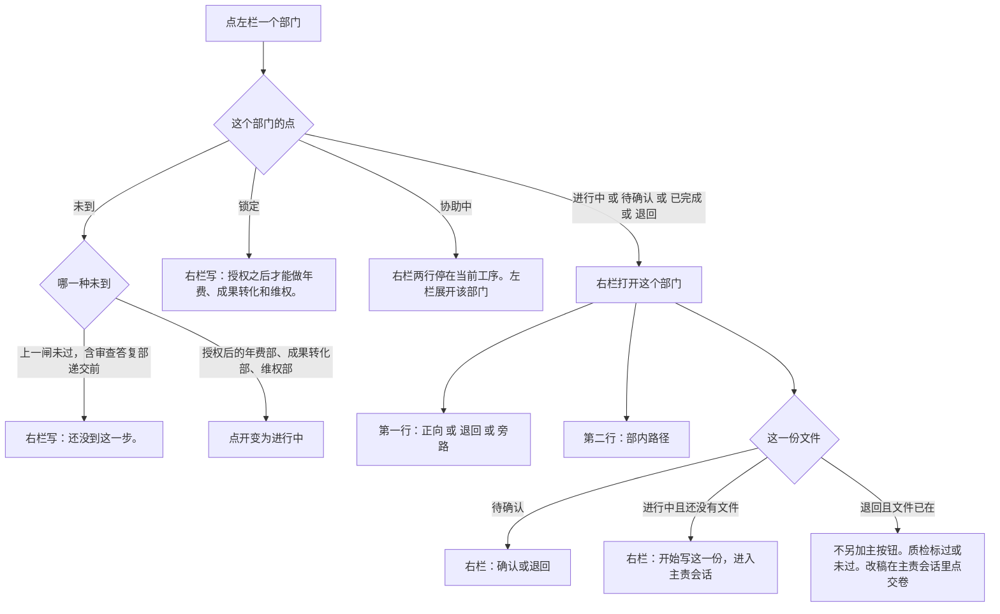

# 专利业务壳 · 交互说明与验收（D4）

> **状态**：2026-10-19 起草，同日补上文件名、连线、过/未过、日常任务的点法。点击、空态、确认、退回、验收句。**不改样机。**  
> **上游**：[agent-case-ia-v2](./agent-case-ia-v2.md)。左栏用部门名（查新部），三种交接句、头像规则、两层怎么叠不得改。  
> **入口副本**：[docs/superpowers/specs/2026-10-19-agent-interaction.md](../../superpowers/specs/2026-10-19-agent-interaction.md)（仅指针；改正文只改本文）。

---

## 0. 这一页怎么用

左栏看部门走到哪，也看当前这一次文件交到了谁。右栏标题是这道工序的短名。第一行是部门之间的交接，第二行是部内路径。专家只从点开的部门展开。校验角色不装成另一个可聊天的人。两类人点法相同，页面不按角色分叉。页面长什么样见信息架构 §3.5。

点文件小字、当前交接、未核、过或未过、日常任务，见 §1.1。这些点击不把进行中改到别的部门。

---

## 1. 左栏

默认收成三组。左栏写部门名：立项部、交底部、查新部、撰写部、附图部、递交部、审查答复部。不写「检索员」「代理人」。右栏标题写这道工序的短名（查新、撰写）。

| 组 | 默认 | 点组名 |
|----|------|--------|
| 前研 | 一行「前研」。开案选择「还没定保护哪些点」时五个部门默认展开，见 §4 | 展开行业洞察部、竞品部、创新激发部、专利挖掘部、布局部 |
| 主作业 | 七个部门都列出 | 点某个部门，右栏切到该部门承办的工序 |
| 授权后 | 一行「授权后」，授权前带锁定 | 授权前点了，右栏写「授权之后才能做年费、成果转化和维权。」授权当天展开年费部、成果转化部、维权部；三部各自成为可开启的工作项。点开任一部只改变页面焦点，不改变其他工作项状态 |

每一步左侧一个点：

| 点 | 含义 | 点这一行 |
|----|------|----------|
| 未到 | 上一闸还没过 | 右栏：「还没到这一步。」审查答复部在递交完成前用这一句 |
| 进行中 | 正在做这一份 | 打开工作面。行下展开部内路径 |
| 待确认 | 主责已交卷 | 打开文件和确认 |
| 已完成 | 闸已过 | 打开那一份已确认的文件，只读 |
| 退回 | 被打回这一步 | 打开文件，第一行用退回句。右栏不另加主按钮。改稿打开主责会话，点「交卷」 |
| 协助中 | 被当前工序旁路拉来补材料 | 右栏停在当前工序。第一行仍是「递交作业单 → 要交：答复策略 · 另拉查新部」。第二行仍是「部内  答复策略」。左栏展开查新部。补检索在审查答复部主责会话里做。没有新的确认按钮。做完查新部回到已完成 |

审查答复部在递交完成前是未到，右栏写「还没到这一步。」授权前点「授权后」，右栏写「授权之后才能做年费、成果转化和维权。」授权之后，年费部、成果转化部、维权部都可以独立点开并并行工作；点开任一部只改变页面焦点。成果转化部和维权部的右栏不用「还没到这一步。」

默认展开点是进行中、待确认或退回的部门。点协助中的查新部，左栏展开查新部。右栏第一行仍是「递交作业单 → 要交：答复策略 · 另拉查新部」，第二行仍是「部内  答复策略」。

年费部在授权后组里占一行。价值评估师不另占一行，出现在年费部展开后的专家里。年费部授权前锁定、不显示「待办」；每个缴费年度按期限规则生成缴费待办，不因授权当天立即生成。有日常任务的部门，展开后部内路径在上、「日常任务」一块在下。竞品部收在前研里面。盯梢到期时，收起的「前研」一行写「待办」。展开前研之后，「待办」只留在竞品部那一行。已完成的部门，名字下面有交出的文件名。当前交接写成一行：文件名、箭头、接收部门。画法见信息架构 §3.5。

### 1.1 文件名、当前交接、未核、过/未过、日常任务

下面几处都在案子页上。确认按钮仍只在案子右栏、这一份待确认时出现。这些点击不把进行中改到别的部门。

| 点到 | 结果 |
|------|------|
| 已完成部门下面、没有箭头的文件小字，例如交底部的「交底书」 | 右栏打开这一份已确认的文件，只读。和点「交底部」这一行相同。不进会话 |
| 带箭头的当前交接「查新意见 → 撰写部」 | 右栏打开接收的这一边（撰写部）。第一行是「查新意见 → 要交：申请文件包」。不进会话 |
| 回头标记「退回撰写部」 | 右栏打开撰写部。第一行是退回句。这一行写在撰写部和附图部之间 |
| 审查答复部展开后的「补检索」 | 右栏停在进行中的审查答复部。第一行是「递交作业单 → 要交：答复策略 · 另拉查新部」。第二行是「部内  答复策略」。查新部仍是协助中，留在原来那一行 |
| 「未核」「过」或「未过」 | 进入该部门主责会话的这一块。还没有文件时质检标「未核」。有文件可核、标成「未过」时，进入撰写部主责会话的质检。会话里没有「确认这一份」 |
| 日常任务，例如「期限台账」 | 进入该部门主责会话的这一块。当前工序停在原来的部门。没有「确认这一份」。这块没有箭头连到案子文件 |

要读上一份已确认的全文，点那个部门的名字。带箭头的那一行是当前交接，写成文件名、箭头、接收部门，点它去接收的这一边。

---

## 2. 右栏两行

第一行是部门之间。三种句子在同一位置，一次只出现一种。第二行是部内路径，和第一行同时在。第二行把左栏展开后的各行收成一行，以「部内」开头。撰写部在信息架构 §3.5 那一页、还没有申请文件包时，写「部内  权要 · 质检 未核 · 说明书」。有文件可核之后，第二行才把质检写成「过」或「未过」。没有校验、也没有第二份文件的部门，第二行只写主责在写的那一份。退回和旁路写在第一行。第二行只写这个部门里面的路径。有文件时，第二行下面列出块。主责、说明书、价值评估师用 24px 头像。校验块只标「过」「未过」或「未核」。

| 句式 | 句子 | 左栏 |
|------|------|------|
| 正向 | `{上一份} → 要交：{这一份}` | 本步进行中或待确认 |
| 退回 | `退回{部门}：{一句原因}` | 被退回的部门标成退回。回头标记「退回{部门}」单独占一行，写在该部门和下游之间 |
| 旁路 | `{上一份} → 要交：{这一份} · 另拉{部门}` | 被拉的部门标成协助中，留在原来那一行。短要求写在进行中部门展开后的一行。审查答复拉查新部时，这一行是「补检索」，右栏第一行用这句 |

没有上一份文件时，第一行是「这一步没有上一份文件 → 要交：{短名}」。默认开案写「这一步没有上一份文件 → 要交：立项决议」。第二种进入的行业洞察部写「这一步没有上一份文件 → 要交：全景报告」。

退回原因来自退回的人写下的那一句，不由系统编。旁路的「另拉」只在信息架构写过的地方出现：审查答复拉查新部或撰写部；附图把图注问题退回撰写部时用退回句，不用旁路句。

---

## 3. 点专家

| 点到 | 结果 |
|------|------|
| 主责（带头像和细环） | 进入主责会话。会话里的提交按钮是「交卷」。没有「确认这一份」 |
| 说明书 | 进入说明书自己的会话。同样没有确认按钮 |
| 价值评估师 | 进入年费主责会话，停在价值评估这一块。行上写「写在年费建议里」 |
| 覆盖度复核、质检、图注校对、齐套检查 | 无头像。还没有文件时标「未核」。有文件可核时标「过」或「未过」。点这块进入主责会话的这一块。见 §1.1 |

技术负责人和代理人点同一处，进同一个会话。代理人负责交卷和改稿；只有案子授权的技术负责人可以确认或退回。确认按钮只出现在案子右栏的待确认文件上，不出现在会话里。页面不设「我是技术负责人 / 我是代理人」切换，权限由案子授权关系判定。

子流程（检索式、追问、图号、草图）只出现在主责会话的办理过程里，左栏没有这些行。

---

## 4. 空态

| 场合 | 右栏 |
|------|------|
| 刚开案，默认「已有一件技术」 | 立项部为进行中。第一行是「这一步没有上一份文件 → 要交：立项决议」。第二行是「部内  立项决议」。文件区：「还没有立项决议。」主按钮是「开始写这一份」，点进去是立项主责会话 |
| 开案选择「还没定保护哪些点」 | 前研五个部门默认展开。行业洞察部是进行中。竞品部、创新激发部、专利挖掘部、布局部是未到。行业洞察部第一行是「这一步没有上一份文件 → 要交：全景报告」。第二行是「部内  全景报告」。主按钮是「开始写这一份」。闸①确认之后，五部收成一行「前研」，立项部变为进行中 |
| 点了未到的步 | 「还没到这一步。」没有主按钮。审查答复部在递交完成前是未到，用这一句 |
| 点了锁定的授权后 | 「授权之后才能做年费、成果转化和维权。」 |
| 授权当天 | 年费部、成果转化部、维权部同时解锁并可并行开启。点开任一部只改变页面焦点，不重置其他工作项。年费提醒是独立日常任务，缴纳/放弃仍需闸⑦。成果转化部和维权部授权后不用「还没到这一步。」还没有文件时，第一行是「这一步没有上一份文件 → 要交：转化要点」或「这一步没有上一份文件 → 要交：维权简报」，主按钮是「开始写这一份」 |
| 待确认 | 文件可读。主按钮是「确认这一份」。次按钮是「退回」。这两个按钮不在专家会话里 |
| 已完成 | 文件只读。第一行仍用正向句，不另写第四种。第二行是这个部门的部内路径。有文件时，第二行下面列出块 |
| 退回 | 左栏默认展开点是退回的部门。第一行是退回句。文件已经在时，质检标「过」或「未过」。右栏不另加主按钮。改稿打开主责会话，在会话里点「交卷」 |
| 前研没收过、人仍从立项开始 | 前研保持收起的一行 |
| 点开前研或授权后里的某一步 | 与主作业同构：第一行是部门之间，第二行是部内路径，下面是该步那一份文件。有闸的步在待确认时出现「确认这一份」。没有文件时主按钮是「开始写这一份」 |

---

## 5. 确认和退回

操作权限以 [agent-product-definition §5.1](./agent-product-definition.md#51-权限产物与状态契约) 为准：代理人交卷/改稿，案子授权的技术负责人确认/退回。页面不因按钮位置而授予权限。

主按钮在待确认时只有「确认这一份」，位置在案子右栏。专家会话里始终没有这个按钮。

确认之后：这一部门变为已完成，名字下面出现交出的文件名。下一部门从「未到」变为「进行中」，左栏当前交接改到这一对之间，右栏切到下一步的空态。确认查新意见之后，案子进入撰写部。查新不继续写的回路记在用户旅程和产品定义里。这一轮主路径上不单列这个选择的按钮、部门点或回头标记。

退回要先写一句原因才能提交。被退回的步骤变为「退回」，它下游已经完成的点改回「未到」。第一行切到退回句，左栏在两部之间单独一行写回头标记。退回不另开一个闸。左栏默认展开点是退回的部门。右栏不另加主按钮。改稿打开主责会话，在会话里点「交卷」。文件已经在时，质检标「过」或「未过」。

附图发现用词和权要不一致：不出现递交的确认。第一行是 `退回撰写部：图注与权要不一致`。撰写部变为退回，附图部变为未到。左栏在这两部之间单独一行写回头标记「退回撰写部」。

---

## 6. 验收句

改原型时，下面每句都要能在页面上指给人看。

1. 左栏默认能看见「前研」一行、七个主作业步骤、「授权后」一行。看不见十五个部门同时铺开。开案选择「还没定保护哪些点」时，前研五个部门默认展开，只有行业洞察部是进行中，第一行是「这一步没有上一份文件 → 要交：全景报告」。闸①确认后收成一行「前研」，立项部变为进行中。默认开案的第一行是「这一步没有上一份文件 → 要交：立项决议」。  
2. 左栏写查新部、撰写部、年费部。不写查新检索员、撰写代理人。职称只出现在部门展开后的专家行。期限、盯梢、年费提醒出现在部门里面，不另占左栏一行。  
3. 当前步是撰写时，行下能看见权要、说明书和质检。质检没有头像。采集、追问、检索式不在左栏。  
4. 右栏第一行在进行中是「上一份 → 要交：这一份」，在退回时是「退回某部门：原因」。审查答复拉查新部时，第一行是「递交作业单 → 要交：答复策略 · 另拉查新部」，第二行是「部内  答复策略」。点开协助中的查新部，右栏这两行保持不动，左栏展开查新部。查新部的点是「协助中」，审查答复部仍是「进行中」。  
5. 待确认时，案子右栏有一个主按钮「确认这一份」。专家会话里没有这个按钮。点头像进入会话，不按角色改变点击结果。  
6. 授权前点「授权后」，右栏写「授权之后才能做年费、成果转化和维权。」授权当天三部同时解锁，各自状态独立；点开只切换页面焦点。年费待办在对应年度的缴费期限到达时生成，不因授权当天立即出现；缴纳/放弃仍走闸⑦。左栏不另有一行「价值评估」。案子页没有「组队讨论」入口。审查答复部在递交完成前是未到，右栏写「还没到这一步。」  
7. 点开前研里的布局部，或授权后的年费部，右栏仍是第一行部门之间、第二行部内路径，下面是这一份文件，和主作业同一套页面。  
8. 点开有日常任务的部门，部内路径下面有一块「日常任务」。点任务不出现确认按钮，当前工序停在原来的部门。  
9. 已完成的交底部下面有小字「交底书」。查新部下面有一行「查新意见 → 撰写部」，这是左栏唯一带箭头的一行。点「交底书」打开只读的交底书，撰写部仍是进行中。点「查新意见 → 撰写部」，右栏第一行是「查新意见 → 要交：申请文件包」。  
10. 撰写部展开后，权要、质检、说明书各占一行。说明书有头像。还没有申请文件包时，质检标「未核」，第二行是「部内  权要 · 质检 未核 · 说明书」。右栏第一行是部门之间的句子。  
11. 附图部把稿退回撰写部时，左栏在撰写部和附图部之间单独一行写「退回撰写部」，撰写部默认展开，质检标「过」或「未过」，右栏第一行是「退回撰写部：图注与权要不一致」，右栏不另加主按钮。审查答复部进行中、查新部协助中时，审查答复部展开，里面一行写「补检索」。查新部留在原位。右栏第一行是「递交作业单 → 要交：答复策略 · 另拉查新部」，第二行是「部内  答复策略」。点开查新部时这两行保持不动，左栏展开查新部。  
12. 有文件可核、质检标「未过」时，点「未过」进入主责会话的质检一块。点日常任务进入主责会话的那一块。两处都没有「确认这一份」，进行中的部门不变。
