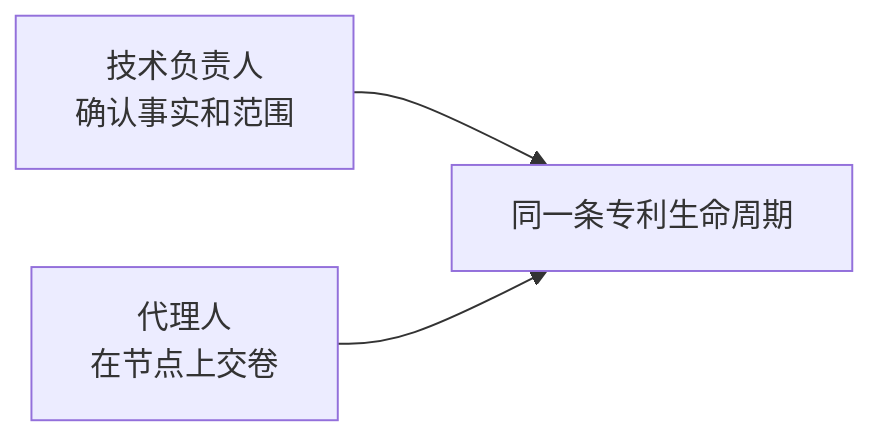
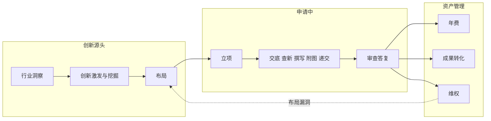

# 专利业务壳 · 产品定义（用户、画像、范围在册）

> **状态**：2026-10-19 裁定，同日按总评修订。本文钉用户、画像和全生命周期名单。画面以 [agent-scope-slice](./agent-scope-slice.md)、[agent-case-ia-v2](./agent-case-ia-v2.md)、[agent-interaction](./agent-interaction.md) 为准。实现状态不在本文声明，以 D4 验收句和 `REVIEW.md` 为准。  
> **节点权威**：[patent-pack-design](../domain-packs/patent-pack-design.md)（F1–F9 · 16 席 · HITL×8）。  
> **阅读顺序**：先看本文 §1–§4 知道给谁用。改原型时从交互说明的验收句往回对，不要按 2026-09-29「侧栏=本案节点」做。那条只描述今天的样机。  
> **入口副本**：[docs/superpowers/specs/2026-10-19-agent-product-definition.md](../../superpowers/specs/2026-10-19-agent-product-definition.md)（仅指针；改正文只改本文）。

---

## 0. 本文在设计流程中的位置

按产品设计顺序写，不跳步。

| 步 | 内容 | 状态 |
|----|------|------|
| 1 | 问题与产品是什么 | 本文 §1–§2 |
| 2 | 用户与非默认用户 | 本文 §3 |
| 3 | 用户画像 | 本文 §4 |
| 4 | 要完成的事（生命周期 SOP 全量在册） | 本文 §5 |
| 5 | 实现边界 | 本文 §6 |
| 6 | 用户旅程（技术负责人一条、代理人一条） | **已写** · [agent-user-journeys](./agent-user-journeys.md) |
| 7 | 范围切片：哪些阶段进主路径、哪些仍折起 | **已写** · [agent-scope-slice](./agent-scope-slice.md) |
| 8 | 信息架构：步骤、站内多名专家、上下游交接 | **已写** · [agent-case-ia-v2](./agent-case-ia-v2.md) |
| 9 | 交互说明与验收句 | **已写** · [agent-interaction](./agent-interaction.md) |
| 10 | 改原型 | 交互说明通过之后 |

§5 的节点全部在册。哪些出现在主作业、哪些收成前研或授权后，见 [agent-scope-slice](./agent-scope-slice.md)。

---

## 1. 问题

中小企业通常没有知识产权部门。一件技术要从「有个点子」走到「授权之后还要不要维持、能不能转化」，中间是一整条专利生命周期，他们自己没有科室能接住。

大企业多有知产部，自有流程和人员，不是这套默认壳要服务的人。

撰写申请文件和审查答复在中国是许可执业事项。中小企业最后仍要委托有资质的专利代理机构递交。代理人因此是第一波会天天用这套工具的人。

---

## 2. 产品是什么

平台按**专利生命周期 SOP** 工作，替没有知产部的中小企业把这条链跑完。

- 中小企业这边的人提供技术事实，并在闸口确认：做不做、范围、交底、权利要求、是否继续花年费、是否签转化。
- 代理人（及所内检索、附图、流程岗位）在对应节点上干活、交卷。
- 左栏一项是部门，像公司里的科室：查新部、撰写部、年费部。不是某某师。某某师是部门展开后的专家职称。
- 流程节点是这一件案子的工序，由对应部门承办。一个部门是一个交卷单位，可包含多个产物块，并映射零个或一个客户确认闸。壳内操作确认（如附图确认、递交授权）与客户 HITL 闸分开记录。
- 日常任务挂在部门里（盯梢、期限、年费提醒），不另开一个部门，也不代替那个闸。
- 部门之间的协作是下一部吃上一部交出来的文件。接不上时用退回打回该部门主责改稿再交。
- 技术负责人拥有客户确认权；代理人及所内岗位拥有交卷和修改权，但不能代替客户确认。确认权按案子授权关系判定，不靠页面上的角色切换。

买卖上的起步仍是代理机构（机构自带资质）。中小企业是这条链要服务的主用户。大企业知产部若以后要用，走同一套 SOP 的私有化，不另做一套默认壳。

---

## 3. 用户

| 角色 | 是谁 | 在产品里干什么 |
|------|------|----------------|
| **主用户** | 中小企业里管技术的人：创始人、研发负责人、发明人。公司没有知产部，也常常没有成建制的知产流程 | 开案子、补技术事实、在闸口确认 |
| **第一波用户** | 专利代理人，以及所内配合的检索、附图、流程人员 | 在节点上检索、撰写、齐套、答复；交卷等人确认 |
| **以后再谈** | 大企业知产部经理 | 不进默认壳。有知产部的公司用自有编制；若采购，是后期私有化，不是现在这张画面 |

屏幕前默认同时能坐下两类人，看的是同一套部门名、同一次点击。主用户要看清走到哪个部门、确认什么。代理人在当前部门里把文件做完并交卷。收起时，两边都看见已完成部门交出的文件，以及当前这一段的部门交接。当前部门展开后，两边都看见部内那条路径。

---

## 4. 用户画像

画像用岗位，不用虚构姓名。事实来自 2026-10-19 的产品裁定，以及 [patent-pack-design](../domain-packs/patent-pack-design.md) 的生命周期。没有访谈引语。

### 4.1 主用户 · 中小企业技术负责人

| 项 | 内容 |
|----|------|
| 岗位 | 创始人、研发负责人或发明人。头衔可能是技术总监，也可能就是老板兼工程师 |
| 情境 | 公司没有知识产权部门。手头有技术方案，想保护，不知道从查新做到年费、转化要经过哪些步 |
| 要完成的事 | 把这一件技术送进专利生命周期，并在该自己拍板的地方拍板 |
| 看懂什么 | 当前部门、上一步交来的那份文件、这一步要自己确认的那一句 |
| 成功 | 知道案子走到哪个部门、自己刚确认了什么、下一步哪个部门接着干 |

### 4.2 第一波用户 · 专利代理人

| 项 | 内容 |
|----|------|
| 岗位 | 有专利代理执业资格的代理人。所里可能还有检索、制图、流程，小所常常一人兼多站 |
| 情境 | 受托办理中小企业的申请、答复，以及企业暂时还走不到的前研与授权后事项。第一波每天打开的是这套工具 |
| 要完成的事 | 按 SOP 在节点上产出可交给下一站、可给客户确认的文件 |
| 看懂什么 | 当前站里多名专家各交什么（权要、说明书、质检等分工）；上一站递来的文件；交卷后是否需要客户确认及下一步是什么 |
| 成功 | 需要客户决策的交卷进入对应闸；无需客户闸的部门按既定转换继续。站内分工可见。文件接不上时，页面用退回。退回不另开一个闸 |

### 4.3 两张画像怎么共用一条链

同一套 F1–F9。技术负责人走确认。代理人走部门里的交卷。左栏两边都是部门名。收起时两边都看见当前这一段的文件交接。展开后两边都看见这一站的部内路径。组织架构全图不作为开案主路径。

---

## 5. 生命周期在册（全量）

以下全部记录在案。表里的「节点」是 Pack 里的人，不是左栏标题。左栏写部门名，见范围切片。最后一列是画面状态，细则在范围切片。名单与 [patent-pack-design §1、§4.1](../domain-packs/patent-pack-design.md) 一致。

授权当天，年费部、成果转化部、维权部都解除锁定，成为三个可独立开启的授权后工作项。它们可以并行存在；“当前部门”只表示页面焦点，不表示其他授权后工作项被锁住。

| 阶段 | Flow | 节点 | 人确认的闸 | 画面 |
|------|------|------|------------|------|
| 创新源头 | F1 行业洞察 | 行业分析师 | — | 前研，默认可展开 |
| 创新源头 | F1 / F9 | 竞争情报员 | — | 前研，默认可展开 |
| 创新源头 | F2 创新孵化 | 创新教练（创新激发） | — | 前研，默认可展开 |
| 创新源头 | F2 创新孵化 | 专利挖掘师 | — | 前研，默认可展开 |
| 创新源头 | F3 布局策划 | 布局策略师 | ① 布局拍板 | 前研，默认可展开 |
| 申请中 | F4 立项决策 | 立项评审 | ② 立项 | 主作业 |
| 申请中 | F5 新申请 | 交底书工程师 | ③ 交底确认 | 主作业 |
| 申请中 | F5 / F6 | 查新检索员 | ④ 查新结论 | 主作业 |
| 申请中 | F5 / F6 | 撰写代理人 | ⑤ 权项确认 | 主作业 |
| 申请中 | F5 / F6 | 附图工程师 | 壳内附图确认 | 主作业 |
| 申请中 | F5–F7 | 流程管家（递交、期限） | 壳内递交授权 | 主作业 |
| 申请中 | F6 OA 循环 | OA 答复代理 | ⑥ 答复策略 | 主作业。递交完成前为未到，右栏写「还没到这一步。」 |
| 资产管理 | F7 授权后管理 | 年费管家、价值评估师 | ⑦ 年费缴纳 | 授权前锁定。左栏一行，价值评估不另占一行 |
| 资产管理 | F8 转化变现 | 转化顾问（专利成果转化） | ⑧ 转化签约 | 授权前锁定 |
| 资产管理 | F9 维权防御 | 无效维权顾问 | — | 授权前锁定；授权后可独立开启 |

回路也在册，本期不画进主路径：立项放弃可回到创新孵化；查新不乐观可换方向或调布局；维权发现的布局漏洞回到布局策划；年费低价值可放弃并归档。

辅席自由实施（FTO）在册为辅席，与无效维权不是同一个节点。案子助手是编排，不占 16 席。

HITL×8 在册：①布局 ②立项 ③交底 ④查新 ⑤权项 ⑥答复策略 ⑦年费 ⑧转化签约。闸的个数与「部门个数」脱钩，此条维持 [agent-dept-expert-team](./agent-dept-expert-team.md) 的裁定。

### 5.1 权限、产物与状态契约

| 对象 | 规则 |
|------|------|
| 交卷 | 部门主责提交本部门产物；代理人可代替所内岗位交卷，但不能代替客户确认。交卷后的具体状态由该部门的闸映射决定 |
| 确认 / 退回 | 存在客户 HITL 闸时，由案子授权的技术负责人确认或退回；退回必须带原因，回到同一部门重交，不新增闸 |
| 产物 | 一个部门可有多个产物块，但只生成一个部门交卷事件；产物块校验结果可阻止交卷 |
| 主作业状态 | 主作业同时只有一个当前工序：未到、进行中、待确认、已完成、退回、协助中 |
| 授权后状态 | F7、F8、F9 是彼此独立的工作项，可同时进行；页面的当前焦点不改变其他工作项状态 |
| 审计 | 确认、退回、重交和授权后工作项开启都记录操作者、时间、产物版本和原因 |

映射契约的字段为：`部门 → 产物块 → 交卷事件 → 客户闸（0..1）→ 确认人 → 下游状态`。D2 列出当前产物和闸的部分映射；各部门的提交动作、无客户闸时的转换、授权确认操作和下游状态，须在 D5 逐行对齐 IAM/domain contracts 后才能视为实现契约。下游文档不得另起一套状态或闸键。撤回已确认产物、恢复被退回工作和并行修改冲突也列为 D5 前置决策。

---

## 6. 实现边界

设计已经写到交互说明。D5 需要把旧样机的侧栏、查新顺序、前研入口和授权后工作项按 D3/D4 验收句核对；本节不再作为实现现状的声明。

不为大企业知产部做管理视图。案子页不设角色切换，点击规则见交互说明 §3。

---

## 7. 下一步与产出

D0 到 D4 都已写完。改原型只读 D3 和 D4。本文 §1–§4 回答给谁用。

| # | 产出 | 回答什么 | 状态 | 预定路径 |
|---|------|----------|------|----------|
| D0 | 产品定义（本文） | 用户、画像、SOP 全量在册、本期不动什么 | **已写** | 本文 |
| D1 | 用户旅程 | 技术负责人从「有个技术点」到各闸确认；代理人从接案到交卷。两条旅程，同一 SOP。旅程里点名 F1–F9，含创新激发、挖掘、布局、年费、成果转化、维权 | **已写** | [agent-user-journeys.md](./agent-user-journeys.md) |
| D2 | 范围切片 | 主路径现在露出哪些阶段；其余阶段如何在册但先折起。切片必须引用 §5 全表，不能只写查新到 OA | **已写** | [agent-scope-slice.md](./agent-scope-slice.md) |
| D3 | 信息架构 | 步骤怎么呈现；点进当前站如何看到多名专家；上下游文件如何交接。此时才决定侧栏是节点还是部门 | **已写** | [agent-case-ia-v2.md](./agent-case-ia-v2.md) |
| D4 | 交互说明与验收 | 关键画面、空态、确认、退回；验收句能让中小企业看懂步骤、让代理人看见站内分工 | **已写** | [agent-interaction.md](./agent-interaction.md) |
| D5 | 原型改动 | 只实现 D3/D4 点名的画面 | 未开始 | 代码；改前先改对应规格 |

D4 已写。D5 改原型前以交互说明的验收句为准。
