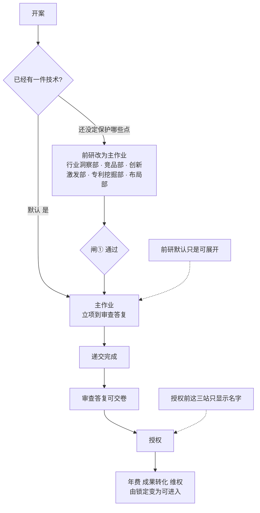

# 专利业务壳 · 范围切片（D2）

> **状态**：2026-10-19 起草，同日修订。决定主路径露出什么、什么折起、什么锁定。左栏怎么收，见信息架构。**不改样机。**  
> **上游**：[agent-product-definition](./agent-product-definition.md) §5 全表 · [agent-user-journeys](./agent-user-journeys.md)。顺序以旅程为准，即 Pack 的 F1–F9。  
> **下游**：D3 信息架构只许使用本文的露出状态，不得另起一组「默认 7 站」。  
> **入口副本**：[docs/superpowers/specs/2026-10-19-agent-scope-slice.md](../../superpowers/specs/2026-10-19-agent-scope-slice.md)（仅指针；改正文只改本文）。

---

## 0. 范围切片是什么

范围切片回答：生命周期里每一站，开案之后处在下面三种状态的哪一种。

| 状态 | 含义 |
|------|------|
| **主作业** | 当前这种案子要往下做的队列。技术负责人按这个顺序看到「下一步」，代理人在这里交卷 |
| **可展开** | 生命周期上看得见、叫得上名字。不挡主作业。人点开才进入 |
| **锁定** | 生命周期上看得见，标明还不能进。条件满足后变为可展开或主作业 |

这三种状态画成左栏的三组：前研、主作业、授权后。



---

## 1. 四条裁定

旅程 §5 的四个问题在此定死。

### 1.1 默认从「已有一件技术」进入

中小企业开案时，多数已经有一件要保护的技术，没有知产部去做行业洞察。

| 开案选择 | 主作业从哪开始 | F1–F3 |
|----------|----------------|-------|
| **已有一件技术**（默认） | F4 立项 | 可展开，叫「前研」。不做完也能立项 |
| **还没定保护哪些点** | F1 行业洞察 | 前研变为这一案的主作业，做完布局闸①才进入立项 |

两条都把 F1–F9 画在同一条生命周期上。默认选择不把创新激发、专利挖掘、布局从产品里拿掉，只是不挡这一件的申请。

### 1.2 年费、成果转化、维权开案就可见，授权前锁定

开案时就能看见 F7 年费、F8 成果转化、F9 维权，标明「授权后」。授权前不能进入，也不产生闸⑦⑧。

| 阶段 | 何时可进入 |
|------|------------|
| F7 年费（含价值评估） | 本案已授权。价值评估不单独成闸，写进年费建议 |
| F8 成果转化 | 本案已授权。不要求先办过年费 |
| F9 维权 | 本案已授权。不要求先办过成果转化。要改保护网时回到布局闸① |

授权当天，年费部、成果转化部、维权部同时解除锁定，成为三个可独立开启的授权后工作项。它们可以并行存在；“当前部门”只是页面焦点，不会把另外两个工作项改回未到。成果转化部和维权部的右栏不用「还没到这一步。」还没有文件时，第一行是「这一步没有上一份文件 → 要交：转化要点」或「这一步没有上一份文件 → 要交：维权简报」，主按钮是「开始写这一份」。

### 1.3 顺序按 Pack，不按现样机

主作业顺序：

```text
立项部 → 交底部 → 查新部 → 撰写部 → 附图部 → 递交部 → 审查答复部
```

现样机把查新放在立项前面。那是只露出中间一段时的旧顺序。产品顺序改回 Pack。样机留到 D5 再改。

闸② 立项确认的是「这一件按已定范围往下做」。查新不继续写的回路记在用户旅程和产品定义里。这一轮主路径上，确认查新意见之后案子进入撰写部。

### 1.4 谁看见站内多名专家

| 谁 | 看见什么 |
|----|----------|
| 两边相同 | 收起时看见已完成部门的文件名，以及当前这一段连线。展开后看见部内路径。右栏第一行是部门之间，第二行是部内。采集、追问、检索式、三性成文、图号、草图是子流程，不在左栏单列 |
| 技术负责人要完成的事 | 读这一份文件，在待确认时确认或退回。撰写三块合成一次闸⑤ |
| 代理人要完成的事 | 在专家会话里把块写完，由主责交卷。会话里没有确认按钮 |

左栏默认三组：前研收成一行，主作业逐站，授权后收成一行。年费和价值评估是同一站。专家名单以 [agent-case-ia-v2](./agent-case-ia-v2.md) §2 为准。

---

## 2. 全表切片

与产品定义 §5 同一张名单。默认开案选择 =「已有一件技术」。选「还没定保护哪些点」时，仅 F1–F3 从可展开改为主作业，其余不变。

| 阶段 | 部门 | 闸 | 默认状态 | 承办人看见的文件 | 部门里的专家 |
|------|------|----|----------|------------------|----------------|
| F1 行业洞察 | 行业洞察部 | — | 可展开（前研） | 全景报告 | 仅主责 |
| F1 / F9 | 竞品部 | — | 可展开（前研） | 竞品简报 | 仅主责。日常任务：盯梢 |
| F2 创新孵化 | 创新激发部 | — | 可展开（前研） | 方向清单 | 仅主责 |
| F2 创新孵化 | 专利挖掘部 | — | 可展开（前研） | 挖掘提案 | 仅主责 |
| F3 布局策划 | 布局部 | ① | 可展开（前研） | 布局方案 + 闸① | 仅主责 |
| F4 立项 | 立项部 | ② | **主作业** | 立项决议 + 闸② | 仅主责 |
| F5 交底 | 交底部 | ③ | **主作业** | 交底书 + 闸③ | 仅主责。采集 / 追问 / 实施例写在办理过程里 |
| F5 查新 | 查新部 | ④ | **主作业** | 查新意见 + 闸④ | 主责 + 覆盖度复核。检索式和三性成文是主责的子流程 |
| F5 撰写 | 撰写部 | ⑤ | **主作业** | 申请文件包；包内标出权要、说明书、质检 | 权要主责、说明书、质检 |
| F5 附图 | 附图部 | 附图确认 | **主作业** | 附图任务单 + 确认 | 主责 + 图注校对。图号和草图是主责的子流程 |
| F5 递交 | 递交部 | 递交授权 | **主作业** | 递交作业单 + 授权 | 主责 + 齐套检查。日常任务：期限台账。形式审查是主责的子流程 |
| F6 审查答复 | 审查答复部 | ⑥ | **主作业**。递交完成前为未到，右栏写「还没到这一步。」 | 答复策略 + 闸⑥ | 仅主责。创造性问题旁路拉查新部，不在本部门加人 |
| F7 授权后 | 年费部 | ⑦ | 锁定，至授权。左栏一行 | 授权后有年费建议 + 闸⑦；到年度缴费期限才生成待办 | 年费管家 + 价值评估师，同写年费建议 |
| F8 转化 | 成果转化部 | ⑧ | 锁定，至授权 | 授权后才是转化要点 + 闸⑧ | 仅主责 |
| F9 维权 | 维权部 | — | 锁定，至授权；授权后可独立开启 | 授权后可进入，文件是维权简报。改布局则回到布局部闸① | 仅主责 |

不在上表、仍然在册：

| 项 | 切片 |
|----|------|
| 自由实施（FTO） | 辅席。不进默认生命周期，不进主作业。代理人可从案子里另开 |
| 案子助手 | 编排。不占一站 |
| 回路（放弃立项、查新不乐观、维权回到布局、年费放弃归档） | 规则，不是额外的站 |

审查答复部在递交完成前留在主作业队列里，点是未到，右栏写「还没到这一步。」授权后那一组在授权前是锁定，右栏写「授权之后才能做年费、成果转化和维权。」授权后 F7/F8/F9 各自维护自己的状态和产物；审查答复进行中若旁路拉查新部，查新部标成协助中，当前工序仍是审查答复部。

---

## 3. 默认主作业队列

技术负责人打开一件「已有技术」的新案子，队列只有这些，顺序固定：

```text
立项部 → 交底部 → 查新部 → 撰写部 → 附图部 → 递交部 → 审查答复部
```

前研（行业洞察部、竞品部、创新激发部、专利挖掘部、布局部）收在队列之外，打开后按 F1 → F2 → F3 做，布局部闸① 通过才允许把新的一件放进立项部。

授权后（年费部、成果转化部、维权部）收在队列之外，授权前只显示部门名。年费部授权前不显示缴费待办。

---

## 4. 交给 D3 的边界

这三种状态画成左栏三组：前研、主作业、授权后。D3 按这个画，不改这张切片。

必须同时满足：

1. 技术负责人不用打开前研，也能把一件技术从立项做到审查答复。  
2. 创新激发、专利挖掘、布局、年费、成果转化、维权在案子上叫得上名字。  
3. 代理人进入当前主作业站时，能看见 §2 表里该站的专家，并看见交到下一站的文件名。  
4. 撰写的权要、说明书、质检对技术负责人是同一闸里的三块，不是三个入口。  
5. 组织架构全图仍然不是开案主路径。
