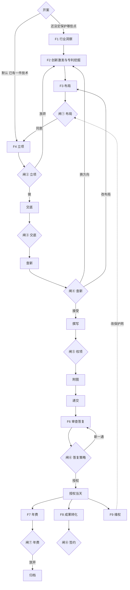
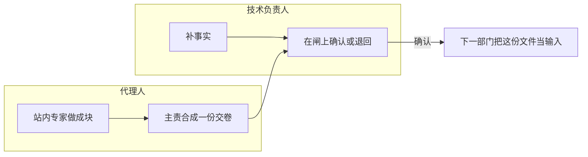

# 专利业务壳 · 用户旅程（D1）

> **状态**：2026-10-19 起草，同日修订文首。两条旅程，同一套 F1–F9。主路径露出哪些阶段已由 [agent-scope-slice](./agent-scope-slice.md) 决定。本文不画页面。  
> **上游**：[agent-product-definition](./agent-product-definition.md)（用户与画像）。节点与闸以 [patent-pack-design](../domain-packs/patent-pack-design.md) 为准。  
> **入口副本**：[docs/superpowers/specs/2026-10-19-agent-user-journeys.md](../../superpowers/specs/2026-10-19-agent-user-journeys.md)（仅指针；改正文只改本文）。

---

## 0. 什么是用户旅程

用户旅程写的是：**一个已经确定的人，为了办成一件事，从进入到离开，依次经历哪些步。**

每一步只记五件事：

| 记什么 | 含义 |
|--------|------|
| 情境 | 他为什么站在这一步 |
| 他做的事 | 他本人要完成的动作 |
| 交给他的文件 | 上一站或这一站交出来、他能读的那一份 |
| 拍板 | 有闸时，他确认或退回的那一句；没有闸就写「不拍板」 |
| 离开 | 什么条件算这一步走完，下一步是谁 |

旅程用来对齐「人怎么把事办完」。它不画页面。左栏是部门名（查新部），不是某某师。工序和日常任务的分法在信息架构。

本文有两条旅程，走同一条 SOP：

| 旅程 | 人 | 他要办成的事 |
|------|----|----------------|
| A | 中小企业技术负责人（主用户） | 从「有个技术点」走到该自己确认的每一闸 |
| B | 专利代理人（第一波用户） | 从接案走到每一站交卷 |

一件案子可以不从 F1 走进来。默认是已经有一件技术，从立项进入。前研收在一行里，不挡主作业。细则在范围切片。

现样机把查新放在立项前面。旅程和范围切片都按 Pack：立项之后才是交底、查新。样机顺序留到改原型时再动。

---

## 1. 共用的阶段骨架

下面是整条生命周期，回路也画在这张图里。默认案子从立项进入。F1 到闸①只在开案选择「还没定保护哪些点」时要走。橙框是要技术负责人拍板的闸。

同一条链上，两人做的事不同：

回路：

| 从 | 到 | 什么时候 |
|----|----|----------|
| F4 立项 | F2 创新孵化 | 评分过低，放弃这一件，换方向 |
| F5 查新 | F2 或 F3 | 查新不乐观，换方向或改布局 |
| F6 | F5 | 驳回后走复审或重新申请 |
| F7 | 归档 | 价值低，决定不再缴年费 |
| F9 | F3 | 维权里发现布局漏洞，回到布局 |

---

## 2. 旅程 A · 技术负责人

**人**：创始人、研发负责人或发明人。公司没有知产部。  
**要办成的事**：这件技术该不该保护、保护到哪一步、授权之后还要不要维持、能不能拿去转化，都在该自己说话的闸上说完。  
**他不做的事**：检索、写权利要求、画图、算期限、代代理人执业。

他全程要维持的一句话是：**现在走到哪一步，上一份文件说了什么，这一下要我点头还是退回。**

### A1 · 有个技术点（进入）

| 项 | 内容 |
|----|------|
| 情境 | 手头有方案、样机或一个想保护的点。不知道先做检索还是先写交底 |
| 他做的事 | 用自己的话写下：保护什么、材料齐不齐、急不急 |
| 交给他的文件 | 还没有。系统据此铺开后面的阶段骨架 |
| 拍板 | 不拍板 |
| 离开 | 默认案子停在立项部，进行中，按钮是「开始写这一份」。开案选择「还没定保护哪些点」时，改停在行业洞察部 |

A2、A3、A4 只在开案选择「还没定保护哪些点」时走。默认案子从 A1 离开后停在立项部。

### A2 · F1 行业洞察

| 项 | 内容 |
|----|------|
| 进入 | 只属于开案选择「还没定保护哪些点」 |
| 情境 | 还没定要在哪条赛道上保护。想先知道玩家和空白 |
| 他做的事 | 看全景报告和竞品简报，确认「我们说的就是这块市场」 |
| 交给他的文件 | 全景报告、竞品简报 |
| 拍板 | 不拍板。不同意范围就退回重做全景报告或竞品简报 |
| 离开 | 他认可赛道边界。下一步是创新孵化 |
| 节点 | 行业分析师、竞争情报员 |

### A3 · F2 创新孵化（创新激发、专利挖掘）

| 项 | 内容 |
|----|------|
| 进入 | 只属于开案选择「还没定保护哪些点」 |
| 情境 | 赛道清楚了，技术方案还散，不知道哪几个点值得申请 |
| 他做的事 | 回答创新教练的问题；看挖掘提案，指出哪个点是自己真正做了的 |
| 交给他的文件 | 方向清单、挖掘提案 |
| 拍板 | 不拍板。点错了就改提案，不在这里决定「申请」 |
| 离开 | 他认下方向清单和挖掘提案。下一步是布局 |
| 节点 | 创新教练（创新激发）、专利挖掘师 |

### A4 · F3 布局策划 · 闸①

| 项 | 内容 |
|----|------|
| 进入 | 只属于开案选择「还没定保护哪些点」 |
| 情境 | 候选点有了，要决定先申请哪几件、什么主题、哪些先不做 |
| 他做的事 | 读布局方案，确认保护网是不是自己的生意 |
| 交给他的文件 | 布局方案 |
| 拍板 | **闸① 布局拍板**：同意这张网，或退回改主题 |
| 离开 | 方案确认后，才允许对其中一件开立项 |
| 节点 | 布局策略师 |

### A5 · F4 立项 · 闸②

| 项 | 内容 |
|----|------|
| 情境 | 这一件要往下做。要决定做还是放弃 |
| 他做的事 | 看范围、区别和是否值得继续花钱 |
| 交给他的文件 | 立项决议 |
| 拍板 | **闸② 立项**：做，冻结范围；或不做，回到创新孵化换方向 |
| 离开 | 选「做」之后，进入这一件的新申请 |
| 节点 | 立项评审 |

### A6 · F5 交底 · 闸③

| 项 | 内容 |
|----|------|
| 情境 | 范围已定，文件还缺实施例、结构、效果，写不出发明 |
| 他做的事 | 按追问补事实。不知道的就写不知道，不编 |
| 交给他的文件 | 交底书 |
| 拍板 | **闸③ 交底确认**：这份交底写的是我们的方案 |
| 离开 | 确认后交给查新 |
| 节点 | 交底书工程师 |

### A7 · F5 查新 · 闸④

| 项 | 内容 |
|----|------|
| 情境 | 交底已确认。要知道公开文献里有没有挡路的 |
| 他做的事 | 读查新意见里和自己方案有关的结论 |
| 交给他的文件 | 查新意见 |
| 拍板 | **闸④ 查新结论**：接受结论并继续写；或结论不乐观，回到创新孵化 / 布局，不进入撰写 |
| 离开 | 接受后，撰写按这份结论和交底起稿 |
| 节点 | 查新检索员 |

### A8 · F5 撰写 · 闸⑤

| 项 | 内容 |
|----|------|
| 情境 | 要看到权利要求和说明书是不是还在自己确认过的范围内 |
| 他做的事 | 读申请文件。范围被写大或写丢了，就退回 |
| 交给他的文件 | 申请文件包（权要、说明书） |
| 拍板 | **闸⑤ 权项确认** |
| 离开 | 确认后才做附图冻结和递交准备 |
| 节点 | 撰写代理人。站内会拆成权要、说明书、质检几块交给他看；他仍只确认这一份申请文件包 |

### A9 · F5 附图与递交

| 项 | 内容 |
|----|------|
| 情境 | 权要已经确认。图必须和权要里的词是同一套；齐套之后才谈递交 |
| 他做的事 | 看图号和名称是否是自己的结构；递交前再确认「可以委托代理人递出」 |
| 交给他的文件 | 附图任务单、递交作业单 |
| 拍板 | 附图确认；递交授权。这两处是壳上的确认，Pack 的八个收费闸里没有单独编号 |
| 离开 | 授权递交后，案子进入已递交，等审查 |
| 节点 | 附图工程师、流程管家 |

### A10 · F6 审查答复 · 闸⑥

| 项 | 内容 |
|----|------|
| 情境 | 审查意见来了。可能有多通 |
| 他做的事 | 看意见在问什么、建议的答复会不会改掉已经确认的保护范围。改范围要他再次点头 |
| 交给他的文件 | 答复策略 |
| 拍板 | **闸⑥ 答复策略**。每一通要改权利要求或说明书，都再经他确认 |
| 离开 | 选定答复策略并提交。新一通回到本步。授权当天，年费、成果转化、维权三个工作项同时解锁并可独立并行 |
| 节点 | OA 答复代理。要补检索或补实施例时旁路拉查新部或撰写部，对方是协助中，当前工序仍是审查答复 |

授权之前，左栏上年费部、成果转化部、维权部是锁定。

### A11 · F7 授权后 · 闸⑦ 年费

| 项 | 内容 |
|----|------|
| 情境 | 授权之前这一行在左栏锁定。授权当天，年费工作项解锁；每个缴费年度到期时进入待处理 |
| 他做的事 | 看年费建议，对照自己的产品还在不在卖 |
| 交给他的文件 | 年费建议 |
| 拍板 | **闸⑦ 年费缴纳**：缴，或放弃并归档 |
| 离开 | 缴则保持有效，到下一年再进入待处理。放弃则归档。成果转化部和维权部在授权当天也解锁，互不等待 |
| 节点 | 年费管家、价值评估师 |

### A12 · F8 成果转化 · 闸⑧

| 项 | 内容 |
|----|------|
| 情境 | 授权当天即可独立进入成果转化部，不依赖年费处理状态。专利要许可、转让或作价。中小企业这边往往还没有法务 |
| 他做的事 | 看转化要点：给谁、什么范围、什么对价，是不是自己能接受的 |
| 交给他的文件 | 转化要点 |
| 拍板 | **闸⑧ 转化签约**：同意按转化要点往下签，或退回改条件 |
| 离开 | 他确认的是转化要点。合同由律师另出 |
| 节点 | 转化顾问 |

### A13 · F9 维权防御

| 项 | 内容 |
|----|------|
| 情境 | 授权当天就可以进入维权部。被人侵权，或自己的专利被提无效，或发现对手的专利挡了产品 |
| 他做的事 | 提供产品事实和时间线；看维权简报里要不要改自己的布局 |
| 交给他的文件 | 维权简报 |
| 拍板 | 这一步 Pack 没有单独的收费闸。要改保护网时，回到闸① |
| 离开 | 意见成立后，布局漏洞回到 F3 布局策划 |
| 节点 | 无效维权顾问。与自由实施（FTO）不是同一步 |

---

## 3. 旅程 B · 专利代理人

**人**：有执业资格的代理人。所里可以有检索、制图、流程；小所一人兼多站。  
**要办成的事**：每一站交出一份下一站能接着用、客户能确认的文件。  
**他要维持的一句话是：这一站里谁写哪一块，文件交到下一站没有，客户还没确认的那一闸是哪一个。**

代理人可以在 F1 就被委托做前研，也可以客户已经把技术点送进来之后，从 F4 或 F5 接案。进入点与旅程 A 相同，规则仍由 D2 定。

### B0 · 接案

| 项 | 内容 |
|----|------|
| 情境 | 中小企业委托。对方没有知产部，材料常常是口头、图纸、一段聊天 |
| 他做的事 | 确认委托范围：只做新申请，还是含布局、年费、转化。把技术负责人已写的事实收进案子 |
| 交给他的文件 | 客户的原始材料 |
| 拍板 | 不替客户拍闸①到闸⑧ |
| 离开 | 案子有委托人、有进入的阶段、有待补的事实清单 |

### B1 · 各站作业（F1–F9）

每一站由主责汇总本部门产物并交卷；是否等待客户确认取决于该部门是否配置客户闸。无客户闸的站按该站的业务转换交接到下一步，逐部门的状态转换在 D5 契约中定义。

| 阶段 | 站内专家 | 主责交出去的文件 | 下一站用它做什么 | 客户闸 |
|------|----------|------------------|------------------|--------|
| F1 行业洞察 | 行业分析师、竞争情报员 | 全景报告、竞品简报 | 创新教练用来收束方向 | 无 |
| F2 创新激发 | 创新教练 | 方向清单 | 挖掘师拿去拆申请点 | 无 |
| F2 专利挖掘 | 专利挖掘师 | 挖掘提案 | 布局策略师拿去排保护网 | 无 |
| F3 布局 | 布局策略师 | 布局方案 | 立项只处理网里点过名的件 | ① 客户拍板后才立项 |
| F4 立项 | 立项评审 | 立项决议 | 交底按冻结的范围问 | ② |
| F5 交底 | 交底书工程师。采集、追问、实施例是子流程，不单列人 | 交底书 | 查新部按交底里的特征检索 | ③ |
| F5 查新 | 查新检索员、覆盖度复核。检索式和三性成文是子流程 | 查新意见 | 撰写部按结论定权要边界 | ④ 不继续写的回路记在上文。这一轮主路径确认后进入撰写部 |
| F5 撰写 | 撰写代理人（行上写权要）、说明书、质检 | 申请文件包 | 附图部按权要用词列图号 | ⑤ |
| F5 附图 | 附图工程师、图注校对。图号和草图是子流程 | 附图任务单 | 递交部做齐套 | 附图确认后才齐套 |
| F5 递交 | 流程管家、齐套检查。形式审查是子流程。期限台账是日常任务 | 递交作业单 | 审查答复部等官方意见 | 递交授权 |
| F6 审查答复 | OA 答复代理。旁路拉查新部或撰写部时，对方标成协助中，不在本部门加人 | 答复策略 | 提交后等下一通或授权 | ⑥ 每一通改范围都再交 |
| F7 年费 | 年费管家、价值评估师 | 年费建议 | 放弃则归档。授权当天成果转化部和维权部就可以打开 | ⑦ |
| F8 成果转化 | 转化顾问 | 转化要点 | 按转化要点往下签 | ⑧ |
| F9 维权 | 无效维权顾问 | 维权简报 | 有布局漏洞则交回布局策略师 | 回到闸① |

站与站的协作就是上表「交出去的文件 → 下一站用它做什么」。只有配置客户闸的站才等待客户确认；无客户闸的站按既定转换交给下一步。文件接不上（例如附图用词和权要不一致）时，页面用退回，改完仍由该站主责再交卷。退回不另开一个客户闸。

### B2 · 交卷与退回

| 项 | 内容 |
|----|------|
| 情境 | 到达配置了客户闸的站，产物齐了，需要客户拍板 |
| 他做的事 | 主责交卷；若该站有客户闸则等待客户确认。客户退回时按批注修改，再交同一闸 |
| 交给他的文件 | 有闸时是客户确认或退回批注；无闸时是按既定业务转换交给下一步的产物 |
| 拍板 | 客户闸由案子授权的技术负责人确认；代理人不代点。无客户闸的站不等待客户拍板 |
| 离开 | 有闸时客户确认后、无闸时该站业务转换完成后，下一步才能使用产物 |

---

## 4. 两条旅程在闸上怎么会合

| 闸 | 技术负责人 | 代理人 |
|----|------------|--------|
| ① 布局 | 这张保护网是不是我的生意 | 交出布局方案，等拍板再拆件立项 |
| ② 立项 | 这一件做还是放弃 | 交出立项决议，放弃则把案子送回创新孵化 |
| ③ 交底 | 写的是不是我们的方案 | 追问事实，交底确认前不送去检索 |
| ④ 查新 | 结论是否接受、还写不写 | 回路记在上文：不继续写就送回孵化或布局。这一轮主路径确认查新意见后进入撰写部 |
| ⑤ 权项 | 保护范围还在不在已确认的交底里 | 权要、说明书、质检合成一份申请文件包再交 |
| 附图 / 递交 | 图是不是我的结构；可否递出 | 图词与权要不一致就退回撰写部，不直接递交 |
| ⑥ OA | 答复改不改已确认的范围 | 每一通单独交答复策略 |
| ⑦ 年费 | 还缴不缴 | 价值评估写进年费建议，缴纳与否等客户 |
| ⑧ 转化 | 转化要点能不能接受 | 交出转化要点。合同由客户另行签约 |

---

## 5. 交给 D2 的问题（已回答）

答案在 [agent-scope-slice](./agent-scope-slice.md)。

1. 默认从「已有一件技术」进入，主作业从 F4 立项开始。F1–F3 可展开，不挡主作业。另有开案选择「还没定保护哪些点」，此时前研改为主作业。  
2. 年费、成果转化、维权开案就在生命周期上可见，授权前锁定。授权当天 F7/F8/F9 同时解锁并可独立并行；年费每年度到期才进入待处理。  
3. 产品顺序按 Pack：立项 → 交底 → 查新 → 撰写 → 附图 → 递交。样机上查新在立项前的旧顺序留到改原型时再动。  
4. 当前步骤展开后，两边都看见这一站的专家。子流程不单列。撰写的权要、说明书、质检仍是一次确认。确认按钮在案子右栏，不在专家会话里。页面不按角色换一套点击。
