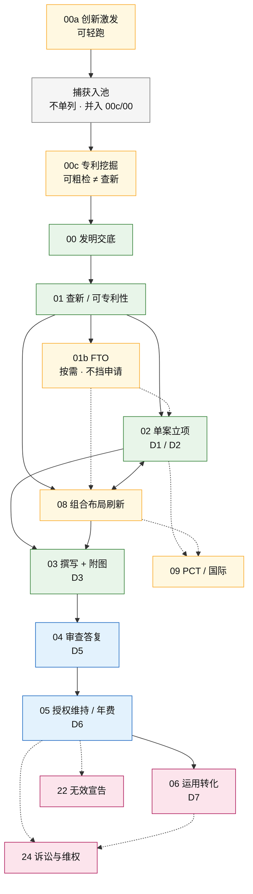
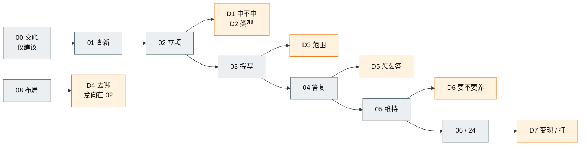

# 专利生命周期 · 业务逻辑文档

> 2026-10-20 重写。**这份文档的目标读者是要把这件事做成产品的人**，不是要读代码的人。
> 原则：**先业务，后实现**。业务逻辑以法条、行业实践、决策模型为准（来源总表见 [sources.md](sources.md)）；原型实现只在每篇现状差距里作为成本参考出现（模板节号是 §14；00 的差距在该篇 §19），**不是设计依据**。

## 人读导览（约 10 分钟）

> **给非实现读者**：先看懂「整条业务怎么走、每站干什么」，再按需下钻规则。实现细节（StageId、handoff、代码路径）可后读。

### 一页主链（中国发明 · 拿专利默认路径）

> **怎么读这张图**：实线箭头 = 默认主链；虚线箭头 = 条件触发或支线（不挡「拿专利」）。颜色：绿=业务必经，蓝=法律必经（递交后程序），黄=条件触发，灰=捕获（不单列）。

**图注（白话）**

| 颜色 / 线型 | 含义 | 节点例子 |
|---|---|---|
| 绿实线 | **业务必经**：代理所/企业质控，不做就不合格 | 00 交底、01 查新、02 立项、03 撰写 |
| 蓝实线 | **法律必经**：法条/程序卡死，产品不能「业务跳过」 | 04 答复、05 年费（递交齐套等同层） |
| 黄 + 虚线 | **条件触发**：碰到才做，不挡申请主链 | 00a 激发、01b FTO、08 布局、09 PCT |
| 粉虚线 | **支线**：维权/无效等，不挡「拿专利」 | 22 无效、24 诉讼；06 运用偏后段 |
| 灰 | **捕获**：入池，默认不单列成节点 | 并入 00c / 00 入口 |

边界口诀：激发=还有什么方向；挖掘=申什么；布局=整盘怎么护；查新=能不能授权；FTO=能不能安全卖；立项=这一案怎么定。**查新 ≠ FTO。** 02 与 08 可同会，但必须两份产出（单案决策书 + 布局图）。

### D1–D7 落在哪一站（一眼）

> 七个真决策落在主链上的位置。详细「谁建议 / 谁拍板」见 [decision-rights.md §3](decision-rights.md)。

### 建议阅读顺序

1. **本页导览**（你正在读）— 主链图 + 三层图例 + D1–D7 落点  
2. [business-spine.md §1](business-spine.md) — 业务本质与默认主链（§1.3）  
3. [**product-vision.md**](product-vision.md) — **产品理念**（权威 SHA **`f180716`** · 目标=尽快把专利申下来；品类 H1=虚拟知产公司 / VIRTUAL IP COMPANY；外挂=轻副标（旁注曾跟 `5248975`）；公司/部门/专家叙事；§6 信息架构）  
4. [**product-pages.md**](product-pages.md) — **逐页怎么设计**（MVP 14 + 扩展 12）+ [**product-logic.md**](product-logic.md)（怎么卖）  
5. [**sources.md**](sources.md) — **业务逻辑参考来源总表**（法定/程序/官费/讨论依据；明确不以原型为准）  
6. **本页下方「节点」表** — 扫一眼每站定位  
7. **单个节点的 §0 + §0.1** — 一句话定位 + **Mermaid 图 / 规则速查(A法定·B程序·C商业·D质量) / 进入·完成·推进判据 / 硬闸 / 依据**  
8. 需要落地再读该节点 §4 规则编号与 §5 法律底座全文  

深度母本仍是 spine 全文 + 各节点规格；冲突时以 spine 业务模型为准。讨论工作稿见下方「工作稿」表。

---
## 再读这些（总纲 / 产品 / 决策权）

| 文档 | 内容 |
|---|---|
| [**business-spine.md**](business-spine.md) | **业务总纲**：三个转换 / 六类主体 / 五层对象 / 五类规则 / 三套时钟 / 四个口袋 / 七个决策点 / 12 条失败模式 |
| [**product-vision.md**](product-vision.md) | **产品理念**（权威 SHA **`f180716`**）：目标=尽快把专利申下来；品类 H1=虚拟知产公司 / VIRTUAL IP COMPANY；外挂=轻副标（旁注曾跟 `5248975`）；公司/部门/专家叙事；**§6 信息架构（跟齐 pages MVP 15；工作台=部门页）** |
| [**product-logic.md**](product-logic.md) | **产品逻辑**：能力→产品映射 / SKU / 失败模式 / 打包定价 / **§0.2 外挂包装与七部映射** / **§5.4 叙事套装** / 路线图 |
| [**product-pages.md**](product-pages.md) | **逐页设计规格**（跟齐 vision **`f180716`**）：MVP **15** + 扩展 **12**；Hero 开篇目标句+品类 H1；公司页「当前站→距可递交」；§5.13 不单列归属 |
| [**spec/**](spec/README.md) | **机器可读层**（生成物）：1026 条规则 / 117 条决策权 / schema，供模型与工具消费 |
| [**decision-rights.md**](decision-rights.md) | **决策权 · 例外 · 冲突裁决**：四种权力 / L1–L4 分级 / D1–D7 落人 / 法定与内部例外 / 五条裁决原则 / 七条红线 |

## 工作稿（讨论中，未合并进 spine）

| 文档 | 内容 |
|---|---|
| [2026-10-23-main-chain-from-discussion.md](working/2026-10-23-main-chain-from-discussion.md) | 讨论主链工作稿：激发/挖掘/布局顺序、法律·业务必经 vs 条件触发、与 nodes 对照；**合成方向已确认**（骨架取 B、主链前段取 A）；定稿后合并进 business-spine |
| [2026-10-23-product-vision-company-dept-expert.md](working/2026-10-23-product-vision-company-dept-expert.md) | 产品理念工作底稿（**正式文已升格为** [product-vision.md](product-vision.md)） |
| [2026-10-23-lifecycle-audit-and-optimize.md](working/2026-10-23-lifecycle-audit-and-optimize.md) | lifecycle 审计与优化 backlog；P0 已落地；**L5–L10 本轮推进**（00a/00c 正式文、Nc 默认不单列、术语、D4 意向、债清单） |
| [2026-10-23-implementation-debt.md](working/2026-10-23-implementation-debt.md) | 实现债：代码仍强制 `research_report.fto` 等（只列路径，不改 apps） |
| [2026-10-23-node-diagrams-rules-basis.md](working/2026-10-23-node-diagrams-rules-basis.md) | 全节点补图+规则类别+判定+依据；覆盖清单与 ⚠ 待复核项 |
| [2026-10-23-product-pages-and-logic-align.md](working/2026-10-23-product-pages-and-logic-align.md) | 产品逻辑收口 + product-pages 逐页规格对齐记 |
| [2026-10-23-full-extension-page-specs.md](working/2026-10-23-full-extension-page-specs.md) | 扩展 12 页逐页规格写全（合计 26） |

## 节点（产品级规格 · 每站含图）

默认主链与法律/业务/条件三层必经见 [business-spine.md §1.3](business-spine.md)；术语三译名见 [§1.4](business-spine.md)。捕获默认不单列见 [§1.3.1](business-spine.md) ⚠。

**人读约定（2026-10-23）**：下列每个业务节点与横切文档均在文首提供 **§0.1 人读：图 · 判定 · 依据**（Mermaid + A/B/C/D 规则速查 + 进入/完成/推进下一站 + 硬闸 + 调研依据）。法定条号/金额凡标 ⚠ 须按当期官方文本复核；不编造未核到的法条号。

### 节点编号约定（2026-10-23）

- **两位数字**为主号（`00` 交底、`01` 查新…）；**同号字母后缀**表示同段并列/辅篇（先例：`00b`、`01b`）。
- 交底前段：`00a` 创新激发 →（捕获不单列）→ `00c` 专利挖掘 → `00` 交底 → `00b` 发明点链 → `01`…
- **旧 id 弃用**：曾用 `Ni` / `Nm`（及规则前缀 `RNi-` / `RNm-`）已统一为 `00a` / `00c`（`R00a-` / `R00c-`）。文内若见旧 id，以本表为准。
- **Nc** 仅表示「捕获」概念，**默认不单列成文件**。

| 编号 | 节点 | 业务定位 | StageId |
|---|---|---|---|
| [00a](nodes/00a-inspire.md) | 创新激发 | 方向清单（条件触发/可轻）；席 `expert-inspire` | —（proposal） |
| **Nc** | 捕获（不单列） | 入池并入 00c/00 提报入口 ⚠ 可改 | — |
| [00c](nodes/00c-mining.md) | 专利挖掘 | 申什么 / 拆几案 / 分级（可粗检，≠01）；席 `expert-mining` | —（pre_intake） |
| [00](nodes/00-inventor-disclosure.md) | 发明交底 | 技术事实 → 可撰写材料；权属/署名/奖酬/公开时点在此定死 | — |
| [00b](nodes/00b-invention-point-chain.md) | 发明点翻译链 | 交底 → 初审 → 检索 → 发明点 → 权项 → 说明书 | — |
| [01](nodes/01-research.md) | 检索与可专利性 | 可专利性证据（**业务必经**）；FTO 初评仅为可选附件 | `pre_research` |
| [01b](nodes/01b-fto.md) | FTO 自由实施分析 | **条件触发**（上市/定型等），不堵申请主链 | — |
| [02](nodes/02-decision.md) | 立项与预算 | **D1/D2** 决策 + 报价委托 | `decision` |
| [03](nodes/03-drafting.md) | 撰写（单案） | **D3**；单案权利边界成型（≠组合布局） | `drafting` |
| [04](nodes/04-prosecution.md) | 审查答复 | D5 决策；权利边界的第一次谈判 | `prosecution` |
| [05](nodes/05-maintenance.md) | 授权维持 | D6 决策；长期负债管理 | `maintenance` |
| [06](nodes/06-commercialization.md) | 运用转化 | D7 决策；把权利变成现金流 | `commercialization` |
| [07](nodes/07-monitoring.md) | 监控预警 | 发现侵权与被侵权 | `monitoring` |
| [08](nodes/08-layout.md) | 布局洞察 | **组合**前瞻规划（轴外；可与 02 同会） | — |
| [09](nodes/09-pct-international.md) | 国际布局 | 地域维度的保护 | — |
| [22](nodes/22-invalidation.md) | 无效宣告（补建） | 反向程序；消灭他人权利 | — |
| [23](nodes/23-termination-recovery.md) | 终止与恢复（补建） | 权利状态的终局与救济 | — |
| [24](nodes/24-litigation.md) | 诉讼与维权（补建） | 侵权判定 + 救济实现；四条救济轨道 | — |
| [25](nodes/25-claim-chart.md) | 权利比对表（共享对象） | FTO / 诉讼 / 无效共用一套结构与推导规则 | — |

14–21 不是缺号的节点。那 8 篇是按原型逐行写的 Flow 精读，已放在 [archive/flow-reads/](archive/flow-reads/)，不代表业务设计。

## 横切能力（每个节点都要用）

| 编号 | 能力 | 作用 |
|---|---|---|
| [10](nodes/10-handoff-state-machine.md) | 交接与审批 | 责任如何传递、以什么为凭据 |
| [11](nodes/11-docket-engine.md) | 期限引擎 | 三套时钟中的法定时钟 |
| [12](nodes/12-billing-engagement.md) | 商务与结算 | 四个口袋的钱 |
| [13](nodes/13-agents.md) | 智能体与角色位 | 自动化的边界在哪 |

## 参考篇

| 文档 | 内容 |
|---|---|
| [**sources.md**](sources.md) | **业务逻辑参考来源总表**：法定 / 程序 / 官费与费减 / WIPO 方法 / 讨论与 spine / **明确非依据**（原型与 archive） |
| [product-pages.md](product-pages.md) | 产品逐页设计规格（跟齐 vision `f180716`；MVP15+扩展12；目标=尽快把专利申下来；品类 H1=虚拟知产公司 / VIRTUAL IP COMPANY） |
| [industry-reality.md](industry-reality.md) | 法定期限 / 官费 / 程序补遗（含 2023 细则新增：奖酬、宽限期、保密审查、非正常申请）；**01 与 01b 分节** |
| [business-spine.md §1.4](business-spine.md) | **术语**：权项结构 / 组合布局 / 单案国别；查新≠FTO；激发≠挖掘 |
| [_TEMPLATE.md](_TEMPLATE.md) | 节点文档写作标准（17 节结构、编号规则、8 条纪律、最低篇幅） |
| [archive/flow-reads/](archive/flow-reads/README.md) | **归档**：Flow 精读；**不代表业务**；与主链冲突句已加横幅 |

## 文档结构（17 节）

| 节 | 内容 |
|---|---|
| 0 | 一句话讲清这个节点（含产品化三条件） |
| 1 | 节点定位与产品边界（是/不是、上下游契约、独立产品形态） |
| 2 | 角色与权限矩阵 |
| 3 | 业务对象（字段级 schema） |
| 4 | 业务规则（编号 `R<节点>-xx`，带现状列） |
| 5 | 法律底座 / 行业规则（规则 + 产品落点 + 失败后果） |
| 6 | 状态机（含当前实现偏差） |
| 7 | 闸门与条件 |
| 8 | 步骤序列 / 工作流 |
| 9 | 写回与命令 |
| 10 | 期限与 SLA（法定 / 业务 / 与 docket 的关系） |
| 11 | 边界与失败场景 |
| 12 | 指标（可验收的尺子） |
| 13 | 产品化切分建议（分层、定价锚点、竞品空位） |
| 14 | 现状差距表（**参考，非设计依据**） |
| 15 | 术语表 |
| 16 | 来源 |

## 写作纪律（摘要）

1. **业务优先**：先写业务上应该是什么，再谈代码怎么做。不得用「原型就这样」当理由。
2. **规则可测**：每条规则能写成测试用例；「应保证质量」不是规则。
3. **讲因果**：每条规则必须写清违反后的后果。
4. **不编造**：法条号、金额、比例必须有一手来源；查不到就标 ⚠「需复核」，不猜。
5. **分层归类**：规则必须标明属于法定 / 程序 / 商业 / 质量 / 数据哪一类（见总纲 §4）。
