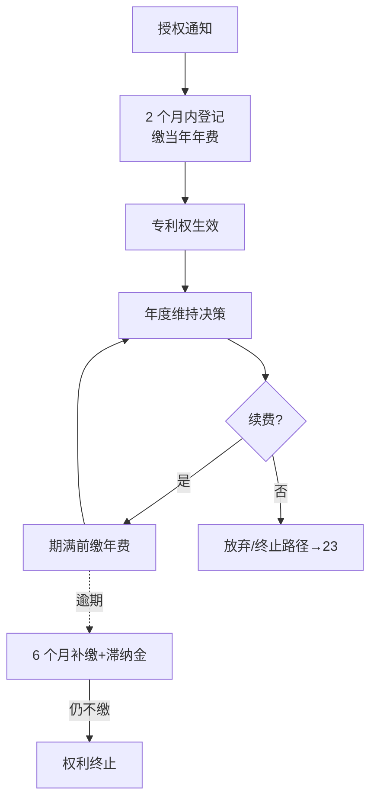

# 节点 05 · 授权维持（Maintenance）· 产品级业务规格

> **本文把「授权维持」从一张缴费清单，重写成一份可以照着做产品的业务规格。**
> 读者：新入职实习生 / 产品经理 / 后端 / 交付。读完后应能：独立设计维持台、写出年费引擎的接口、向客户讲清「为什么忘了缴费是最大的资产流失渠道」。
>
> 代码权威源：`apps/workbench/src/flows/maintain/MaintainFlow.tsx`（670 行）· `src/data/docketRules.ts`（`annuity` / `grant_registration` / `generateAnnuitySchedule` / `ANNUITY_FEES`）· `packages/domain/src/handoff.ts`（`REQUIRED_BEFORE_SUBMIT.maintain_annuity`）· `packages/domain/src/guardrails.ts`（`pay_unlock` / 发票阻塞）· `packages/domain/src/types/index.ts`（`DocketEvent` / `DocketEscalationLevel` / `PatentCase`）· `src/data/flowSteps.ts` · `src/utils/slaInbox.ts` · `src/utils/docketEscalate.ts` · `src/utils/billing.ts`
>
> 法律口径：《专利法》（2020 修正，2021-06-01 施行）·《专利法实施细则》（2023 修订，国务院令第 769 号，2024-01-20 施行）·《专利收费减缴办法》（财税〔2016〕78 号）· CNIPA 收费公告（第 594 号，2024-08-06）。
> **凡金额、比例、档位一律标 ⚠，表示必须按当期 CNIPA 收费表与官方文本复核后再入库。法条条号只写已核对到原文的；未核到的写「以官方文本为准」并标 ⚠。**

---

## 0. 一句话讲清这个节点

**授权维持 = 让一件已经拿到手的专利权，在最长 20 年（发明）/ 10 年（实用新型）/ 15 年（外观设计）里持续活下去，并且在「今年还要不要继续为它付钱」这个每年重复一次的问题上给出可审计的答案。**

它不是「代缴年费」。代缴是执行动作，维持是**资产存续决策 + 期限风控 + 权利状态治理**三合一。行业里最反直觉的一句话：**大多数专利不是被无效掉的，是忘缴年费掉的**——因为遗忘不需要任何人做任何决定。

产品化三条件：

1. **有独立买方**：持有 50 件以上专利组合的企业 IP 部门、代理所的年费代缴业务线。
2. **有独立价值**：一次误缴/漏缴的代价，是「恢复权利请求费 + 25% 年费滞纳金 + 律师时间」，或者干脆是整件专利。这个损失可以精确换算成钱（见 §12）。
3. **有独立边界**：输入是「专利号 + 授权日 + 申请日 + 类型 + 费减资质」，输出是「一张未来 N 年的缴费日程 + 每一次缴纳的凭证 + 一条权利状态变更流水」。不依赖撰写、答复、转化任何模块即可交付。

---


## 0.1 人读：图 · 判定 · 依据

> 本节给人读：一张图看清本站怎么走；规则按 **A 法定 / B 程序 / C 商业 / D 质量**；判定与硬闸禁止拍脑袋。细节与编号规则仍以下文全文为准。

### 本站流程（进 → 活动 → 闸 → 出 → 下一站）



### 规则速查（类别：A 法定 · B 程序/期限 · C 商业 · D 质量/合规）

| ID | 类别 | 规则（一句话） | 依据 |
|---|---|---|---|
| R05-A1 | B | 授权后 2 个月内办登记并缴当年年费，否则视为放弃 | 细则 60、114 |
| R05-A2 | A | 发明 20 / 实用 10 / 外观 15 年，自申请日起算 | 《专利法》42 |
| R05-A3 | B | 以后年费在上一年度期满前缴；逾期 6 个月可补缴+滞纳金 | 细则 115；法 43–44 |
| R05-C1 | C | 每年「还值不值得缴」须可审计 | 行业：遗忘是最大流失 |
| R05-D1 | D | 金额/减缴以当期收费表为准 | ⚠ CNIPA 收费公告 |

### 怎么判定 · 怎么推进

| 判据 | 条件（可检查） |
|---|---|
| **进入本站** | 收到授权及办理登记手续通知；或已获权进入年度维持循环。 |
| **本站完成** | 登记完成且证书/登记簿状态有效；或本年度年费已缴/已决放弃并留痕。 |
| **推进下一站** | 维持循环继续；放弃/终止/恢复 → 23；转化需求 → 06。 |

### 硬闸（禁止拍脑袋）

- **禁止**无决策人的「默认续费」隐式扣款不留痕（企业策略可默认，但须规则）。
- **禁止**把滞纳金期当成无成本宽限期。
- **禁止**使用过期收费表入库。

### 依据来源（调研摘要）

- 《专利法》42–44；细则 60、114、115（登记、年费、滞纳金按月 5% 等）。
- CNIPA「授权或驳回后相关事项」：两个月内办理登记。
- 费减政策与年费档位 ⚠ 须按当期公告，不在此写死金额。

⚠ 未核到当期官方原文的条号/金额/天数，部署前须按 CNIPA / 条约文本复核。

---
## 1. 节点定位与产品边界

### 1.1 在生命周期中的位置

```
审查答复(04) ──► 授权公告 ──► 【授权维持 05】──► 年费循环（每年一次，直至到期/终止/放弃）
                                  │
                                  ├──► 运用转化(06)：许可/转让/质押的前提是权利有效
                                  ├──► 监控预警(07)：维权的前提是权利有效
                                  └──► 终止/放弃/恢复（见 23-termination-recovery）
```

**关键结构事实**：维持节点是主轴上的**唯一一个「循环态」**。其余六个 Stage 都是「推进态」（做完就过站），只有 `maintenance` 会停在这里若干年，每年产生一次同类事件。这决定了它的产品形态必须是**日历驱动**，而不是**任务驱动**。

### 1.2 代码口径（照抄，不要另起一套）

| 项 | 值 | 权威源 |
|---|---|---|
| StageId | `maintenance` | `packages/contracts/src/keys.ts:8` |
| 阶段元数据 | 名称「授权维持」，runner `grant` 4 步（缴登记费→领证书→建年费计划→状态同步） | `packages/domain/src/stages.ts:148-172` |
| 路由 | `/workbench/maintain`、`/workbench/maintain/:caseId` | `apps/workbench/src/App.tsx:99-114` |
| 壳 | workbench :5174 | — |
| Flow key | `maintain` | `src/data/flowSteps.ts:54-60` |
| Flow 4 步 | 权利状态 / 年费日程 / 变更事项 / 审批交接 | `src/data/flowSteps.ts:58` |
| 产物键 | `maintain_annuity` | `packages/contracts/src/handoff.ts:30` |
| 产物中文名 | 「授权维持」 | `packages/contracts/src/handoff.ts:20` |
| 齐套 REQUIRED | `schedule`（年费计划）+ `budget`（官费/服务费确认），**共 2 项** | `packages/domain/src/handoff.ts:129-132` |
| 挂载 Agent | `agent-annuity`（tier `core`，HITL gate `pay_unlock`） | `src/data/agents.ts:188-211` |
| Full-check | **不适用**（`fullCheckScopeFor` 对 `agent-annuity` / `maintain_annuity` 返回 `null`） | `packages/domain/src/fullFilingCheck.ts:104-115` |
| 阶段清单 4 项 | 授权登记完成 / 证书归档 / 年费计划已建立 / 权利状态已更新 | `stages.ts:166-171` |

> **最容易写错的一处**：产物键是 `maintain_annuity`，**不是** `maintenance_record`——后者在 `HandoffArtifactKey` 里不存在。写错则 `getHandoff` 返回 `undefined`、守卫按 `drafting` 处理，看起来不报错，实际所有闸门失效。

### 1.3 它是什么 / 不是什么

| 是 | 不是 |
|---|---|
| 年费的**全周期日程**（到 20/10/15 年，不是 5 年） | 单次缴费动作 |
| 权利状态的**权威记录**（有效/终止/恢复/放弃/质押/许可/转让） | 单纯的一个下拉框 |
| 缴费前的**预算与审批**（企业确认官费 + 服务费） | 财务系统的付款实现 |
| 缴费后的**凭证与台账**（回执号、缴纳日、票据） | 发票开具（那是 12-billing） |
| 放弃/恢复的**决策入口**（成本 vs 剩余价值） | 放弃/恢复的完整流程（那是 23） |
| 著录项目变更的**登记与影响评估** | 变更请求书的撰写 |

### 1.4 上下游契约

| 方向 | 对象 | 契约 |
|---|---|---|
| 上游 | 审查答复（04） | 交出「授权公告日 + 专利号 + 申请日 + 类型 + 首年年费应缴额」；缺授权日则年费日历无法起算 |
| 上游 | 商务线（12） | 提供「代缴服务费单价」与「预算口径」；`engagement.quoteBudget` 在 c6 是「年费代缴服务 ¥1,200/年」（`src/data/cases.ts:274`） |
| 上游 | 组织主数据 | 专利权人主体、费减备案资质（个人/企业/事业单位，年度收入或应纳税所得额）⚠ |
| 下游 | 运用转化（06） | 只有 `有效` 状态才允许进入许可/转让/质押；`终止` 的专利不得出现在可许可资产清单 |
| 下游 | 监控预警（07） | 只有 `有效` 状态才有维权资格；终止后须从维权范围剔除 |
| 下游 | 期限引擎（11） | 每年一条 `annuity` DocketEvent；宽限期另建「宽限截止」事件（当前未建） |
| 横向 | 费用中心（12） | 每笔官费 + 服务费各开一张发票；`payInvoice` 是唯一结清入口 |

### 1.5 独立产品的形态

**产品名建议：年费管家 / Annuity Desk**

| 模块 | 能力 | 谁用 |
|---|---|---|
| 组合日历 | 全组合按到期日聚合、按案件筛选、按金额汇总 | IPR |
| 缴费引擎 | 按专利类型与年号自动取档、算费减、算滞纳金 | 代理流程岗 |
| 预算与审批 | 年度预算、逐案确认、超阈值升级 | IP 总监 / 财务 |
| 缴费执行 | 生成缴费清单、回执登记、票据归档 | 代理所 |
| 权利状态台账 | 有效/终止/恢复/放弃/质押/许可/转让 + 变更流水 | IPR / 法务 |
| 维持决策 | 成本 vs 剩余价值分层、放弃审批、恢复请求 | IP 总监 |

**不做的**：不做真实支付通道（对接财务系统或银行代扣）；不做无效程序（22）；不做诉讼（07/诉讼）；不做权利要求质量评价（那是 03 的产物）。

---

## 2. 角色与权限矩阵

| 角色 | 代码对应 | 能做什么 | 不能做什么 |
|---|---|---|---|
| 企业 IPR | `role: 'enterprise'` + `persona: 'enterprise_ip'` | 确认年费预算、批准缴费、确认缴费归档、发起放弃 | 不能直接改发票状态为已结清（须走 `payInvoice`） |
| IP 总监 / 预算 owner | 同上（`raciHint` 的 A 位） | 批准超预算、批准放弃 | 代码中无独立身份，与 IPR 同权 |
| 财务 | `role: 'enterprise'` | 付款解锁（`payInvoice`） | 不能改权利状态、不能批准策略 |
| 代理流程岗 | `role: 'agency'` + `persona: 'agency'` | 起草年费计划（`save_draft` / `submit`）、递交归档（`file`） | **不能付款**（`pay_unlock` 仅企业，`guardrails.ts:260-261`） |
| 代理师 | 同上 | 代办变更手续、代缴 | 不能替客户决定放弃/恢复 |
| 发明人 | `persona: 'inventor'` | 只读 | 不可进入工作台动作（`personaCanAccessWorkbench` 返回 false） |
| 专利委员会 | `persona: 'committee'` | 无 | 委员 Persona 全部 HITL 闸硬禁 |
| 系统 Agent | `agent-annuity` | 汇总年费窗口、估官费、写 Docket 预备 | 不能真实缴费；不能伪造回执 |

**当前实现的权限真相**（必读，避免误判为真鉴权）：

- `role`（enterprise / agency）+ `persona`（enterprise_ip / agency / inventor / committee）是**同一登录下的两个开关**，不是身份认证。
- 真正的硬闸只有三条：`pay_unlock` 仅企业（`guardrails.ts:260`）、Persona 禁则（`persona.ts:117-150`）、`canPerformHandoff` 的 role/mode 校验（`handoff.ts:197-277`）。
- 承揽模式（`fulfillmentMode`）会改变动作归属：`self_serve` 下企业可执行代理动作（`handoff.ts:222-224`）。
- 变更事项、价值分层、年费日程明细**没有任何角色级写权限**——谁能打开这个页面，谁就能改。

### 2.1 决策权（谁有权决定继续维持）

§2 回答「谁能操作」，本节回答「**谁能拍板**」。本节点的特殊性在于：它每年重复一次同一个决策，绝大多数情况下答案是「缴」，于是决策被退化成执行。**真正的决策只发生在「不缴」的那一刻**——而那一刻不可逆。

**四种权力，分别授予**：

| 权力 | 含义 | 本节点的载体 |
|---|---|---|
| 建议权 | 价值评分、成本测算、恢复可行性 | IPR、代理师、`agent-annuity` |
| 决定权 | 拍板续缴、放弃、恢复、变更 | IP 总监（分级，见表 2.1-B） |
| 否决权 | 单方面阻止处分 | 法务（质押/许可/共有）、财务（预算超限） |
| 知情权 | 被通知、可主张继续维持 | 业务部门、共有人、质权人、被许可人、发明人 |

#### 表 2.1-A 决策权分配（D6：要不要继续维持）

| 决策 | 建议权 | 决定权 | 否决权 | 依据 |
|---|---|---|---|---|
| 单件是否缴本年费 | IPR（价值分层） | IP 总监；额度内可下放 IPR | 财务（超预算）、法务（负担） | 剩余价值 vs 维持成本 |
| 批量放弃 | IPR + 系统评分 | 按表 2.1-B 分级 | 法务、财务 | 组合结构优化 |
| 年费预算总额 | IPR | IP 总监 + 财务 BP | CFO（超年度预算）⚠ | 组合规模 × 档位 |
| 是否申请费减备案 | 代理流程岗 | IPR | — | 主体资格与年度核验 ⚠ |
| 是否办理权利恢复 | 代理师 + IPR（成本测算） | IP 总监（超额度加签 CFO） | 法务 | 恢复成本 vs 权利价值 |
| 恢复理由的定性 | 代理师（事实与证据） | 法务（法律定性） | — | 举证可行性 |
| 著录项目变更（名称/地址/代理机构） | 代理流程岗 | IPR；涉主体变更加签法务 | — | 影响费减与送达 |
| 转让 / 质押中的专利如何维持 | 法务 + IPR | 权利人 + 受让方/质权人书面同意 | 受让方、质权人 | 合同与担保义务 |
| 放弃前的征询 | IPR | —（征询是义务，不是决策） | 共有人、质权人、被许可人 | 见 23 §2.1-D |

#### 表 2.1-B 放弃的额度分级

| 档 | 单次件数 | 年化维持成本 ⚠ | 批准人 | 附加要求 |
|---|---|---|---|---|
| A | ≤ 3 件 | ≤ ¥5 万 | IP 总监 | 逐件复核 |
| B | 4–20 件 | ¥5 万–50 万 | IP 总监 + 法务会签 | 逐件复核，负担核查 100% |
| C | 21–100 件 | ¥50 万–300 万 | 法务负责人 + CFO 联签 | 报 IP 委员会备案 |
| D | > 100 件 | > ¥300 万 | CEO / 董事会 | 单独决议，不得走批量流程 |

定档按「**件数与金额孰高**」，防止用「金额小」拆分规避审批。金额为内部阈值，可配置，**不得硬编码** ⚠。与 [23-termination-recovery.md](23-termination-recovery.md) §2.1-B 同表同档，两处不得各自定义。

#### 表 2.1-C 权限分离铁律

| # | 铁律 | 违反的后果 |
|---|---|---|
| 1 | **缴费是执行，可下放；放弃是处分，必须上收** | 执行层顺手把「不缴」当默认处理 |
| 2 | **财务只能执行付款与核销，不能决定放弃**，也不得代填放弃理由 | 越权处置资产 |
| 3 | **「到期未回复」不得解释为放弃**；默认应为继续缴费并升级 | 沉默被当成同意，权利不可逆丧失 |
| 4 | 代理师只有建议权与执行权，不能替客户决定放弃或恢复 | 责任错位，且代理所无处分权 |
| 5 | 放弃的发起人 ≠ 批准人，且不得是同一自然人的两个账号 | 四眼原则失效 |
| 6 | 同一人不得对同一决策同时持有建议权与否决权 | 制衡失效 |
| 7 | 系统只有执行权；任何状态改写必须来自人或官方通知，不得由超时自动推断 | 「系统自动放弃了」无法追责 |

> **一行话记住**：**忘了缴费是失误，忘了决定不缴也是失误——后者更贵，因为它连道歉的机会都没有。**

#### 表 2.1-D 放弃前的征询义务

| 对象 | 何时必须征询 | 形式 | 未征询的后果 |
|---|---|---|---|
| 共有人 | 放弃、转让、许可 | 书面同意（签章原件） | 对外放弃已生效，内部可被追责 |
| 质权人 | 放弃、转让、许可 | 书面同意 | 损害质权，银行可主张提前清偿 |
| 被许可人（独占/排他） | 放弃 | 书面通知 + 按合同取得同意 | 许可合同违约 |
| 被许可人（普通） | 放弃 | 书面通知 | 视合同条款可能违约 |
| 业务负责人 | 单件放弃 | 征询意见（可要求复议，不可否决合规） | 业务断供，事后扯皮 |
| 发明人 | 放弃 | 告知 | 奖酬与署名争议 |

#### 表 2.1-E 决策权规则

| ID | 规则 | 现状 |
|---|---|---|
| R05-55 | 每件年费决策须有具名决定人；系统不得以「无人反对」或「超时未回复」替代决定 | ❌ 状态靠 useState |
| R05-56 | 主动放弃的决定权归 IP 总监及以上，且发起人 ≠ 批准人；财务不得持有放弃的决定权与否决权 | ❌ 无对象 |
| R05-57 | 批量放弃按件数与年化维持成本**孰高**定档，B 档及以上须法务 + 财务联签 | ❌ |
| R05-58 | 共有 / 质押 / 已许可专利的放弃，须先完成征询并归档同意文件，否则闸门阻断 | ❌ 无质权人/许可字段 |
| R05-59 | 是否启动恢复由 IP 总监决定；恢复理由的法律定性以法务意见为准，代理师只负责事实与证据 | ❌ 无恢复分支 |
| R05-60 | 代理师与代理流程岗只能建议与执行，不得代客户决定放弃、恢复或转让 | ❌ 仅角色芯片 |
| R05-61 | 单件缴纳在年度预算额度内可下放至 IPR；超出额度须 IP 总监批准并记录理由 | ❌ |
| R05-62 | 著录项目变更涉及专利权人主体时，须法务会签并同步费减备案与发票抬头 | ❌ 仅自由文本 |
| R05-63 | 决策记录须含被否决的反对意见；只记结论视为未留痕 | ❌ 不落库 |
| R05-64 | 维持价值分层结论（继续 / 观察 / 拟放弃）须由 IP 总监签署；代理所或系统的评分只能作为输入，不得直接构成放弃依据 | ❌ 分层只写自由文本 |

---

## 3. 业务对象（字段级）

### 3.1 年费日程行 `MaintainScheduleRow`

权威源：`src/utils/slaInbox.ts:15-24`，种子 `src/data/workbenchSeeds.ts:465-512`。

| 字段 | 类型 | 必填 | 说明 |
|---|---|---|---|
| `id` | string | 系统 | `ms-<year>-<due>`，缺省由 `normalizeMaintainRow` 补（`slaInbox.ts:213-227`） |
| `year` | number | ✅ | 第几个专利年度（自申请日起算，**不是授权周年**） |
| `due` | string（ISO 日期） | ✅ | 到期日；缺失则该行不计入 `scheduleReady` |
| `amount` | string | ✅ | 展示金额（如「900 元」），**可与 `officialFee` 不一致**（已知缺陷） |
| `paid` | boolean | ✅ | 是否已缴；是 Inbox 过滤的唯一依据 |
| `officialFee` | number? | — | 官费数值，用于预算汇总；缺省时预算合计按 0 计 |
| `label` | string? | — | 备注（如「跨年补记·日程洞」） |

> **这个对象的问题**：`amount` 是字符串、`officialFee` 是数字，两者无绑定校验。用户在表格里改 `amount` 不会同步 `officialFee`，于是「预算合计」与「屏幕上看到的金额」可以相差任意值（`MaintainFlow.tsx:289-300` 只改 `amount`）。这是本节点最该先修的数据模型缺陷。

### 3.2 年费期限事件 `DocketEvent`（`ruleId = 'annuity'`）

权威源：`packages/domain/src/types/index.ts:462-476`，规则定义 `src/data/docketRules.ts:80-90`。

| 字段 | 类型 | 必填 | 说明 |
|---|---|---|---|
| `id` | string | 系统 | |
| `caseId` | string | ✅ | |
| `ruleId` | `DocketRuleId` | ✅ | 本节点只用 `annuity` / `grant_registration` |
| `triggerDate` | string | ✅ | 起算日（年费为「上一年度期满日」） |
| `dueDate` | string | ✅ | 应缴截止日 = `triggerDate + 12 月`（`computeDueDate`） |
| `status` | `upcoming \| due_soon \| overdue \| done` | ✅ | 4 态 |
| `officialFeeHint` | string | ✅ | 展示文案，当前全部带「示意」字样 |
| `escalationLevel` | `none \| reminded \| escalated_enterprise \| at_risk` | — | 4 级升级阶梯 |
| `atRisk` | boolean? | — | 事件级风险旗标，`mark_at_risk` 时同步案件 `risk='高'` |
| `receiptNo` / `note` | string? | — | 回执号 / 备注 |

**规则定义现状**（`docketRules.ts:80-90`）：`months: 12`、`graceMonths: 6`、`slaDefaultDays: 365`。

> ⚠ **代码事实**：`graceMonths` 这个字段在仓库里**只被声明、从未被任何计算消费**（全仓搜索只有两处赋值：`annuity` 的 6、`pct_national_entry` 的 2）。也就是说「6 个月宽限期」目前只是一句类型注释，没有任何地方用它算宽限截止日、滞纳金档位或终止日。

### 3.3 交接对象 `maintain_annuity`

权威源：`packages/domain/src/handoff.ts:129-132`、`packages/contracts/src/handoff.ts:20`。

| 项 | 值 |
|---|---|
| REQUIRED 项 | `schedule`（年费计划）· `budget`（官费/服务费确认） |
| 动作文案（delegated） | 提交年费计划 / 确认缴费 / 授权代缴 / 确认缴费归档 / 退回年费计划（`handoff.ts:330-336`） |
| 动作文案（self_serve） | 确认缴费归档（`handoff.ts:307-308`） |
| 7 态 | `drafting → submitted_to_enterprise → enterprise_review → approved → authorized_to_file → filed`，另有 `changes_requested` 回路 |
| 回执字段 | `receiptNo` + `filedAt`，`file` 动作二者必填（`HandoffActionBar.tsx:215-223`） |

> **与 06 的差异**：`monetize_terms` 批准前有 `legal_review` 硬闸，`maintain_annuity` **没有**。年费递交走的是「预算确认」而不是「法务已阅」——这是刻意的，但不是「无风险」：放弃、质押中的专利缴费，法律意义完全不同（见 §5.6、§11）。

### 3.4 费用对象 `CaseInvoice`

权威源：`packages/domain/src/types/index.ts:44-51`。

| 字段 | 类型 | 说明 |
|---|---|---|
| `id` / `title` / `amount` | string | |
| `status` | `待开票 \| 已开票 \| 已付款 \| 逾期` | 只有 `已付款` 后该笔才不算阻塞 |
| `due` | string | 到期日；`已开票` 且 `due < today` 时按逾期阻塞（`src/utils/billing.ts:15-26`） |
| `relatedStage` | string | 本节点为「授权维持」 |

### 3.5 缺失的权威对象：`PatentStatusRecord`

**当前代码里没有权利状态对象。** `status` 只是 `MaintainFlow` 的一个 `useState`（`MaintainFlow.tsx:63`），下拉四选一（有效 / 年费待缴 / 权利恢复中 / 终止），**不写回 `PatentCase`、不落库、刷新即回种子值**。

产品级必须有独立对象（字段与状态机见 [23-termination-recovery.md](23-termination-recovery.md) §3.1/§6）：`patentNo` / `status` / `statusSince` / `grantDate` / `expiryDate` / `lastAnnuityPaidYear` / `nextAnnuityDue` / `terminatedAt` / `terminationReason` / `recoveryDeadline` / `history[]`。

> **三层别混**：日程行（今年交多少钱）≠ 期限事件（哪天之前必须交）≠ 权利状态（这件专利现在算不算活的）。三者在代码里是三个孤立来源，没有任何一致性校验。

---

## 4. 业务规则（编号）

前缀 `R05-`。「现状」列：✅ 已实现 / ⚠ 部分 / ❌ 未实现。

### 4.1 年费计算

| ID | 规则 | 现状 |
|---|---|---|
| R05-01 | 年费年度自**申请日**起算，每年在申请日周年届满前缴纳 | ⚠ 代码用 `grantDate` 直接当 base（`MaintainFlow.tsx:326`） |
| R05-02 | 发明专利年费按**分段定额**：1–3 年、4–6 年、7–9 年、10–12 年、13–15 年、16–20 年，逐段递增 ⚠ | ⚠ `ANNUITY_FEES` 只有 10 个元素（`docketRules.ts:304`） |
| R05-03 | 实用新型 10 年、外观设计 15 年，年费档位与发明不同 ⚠ | ❌ 单一发行档，无类型分支 |
| R05-04 | 年费档位表必须来自单一配置源，不得在 UI 里硬编码 | ⚠ 数组在 `docketRules.ts`，金额文案在 `CNIPA_FEE_HINTS`（`handoff.ts:397-404`），种子在 `workbenchSeeds.ts`，三处不一致 |
| R05-05 | 生成日程必须覆盖**全保护期**（20/10/15 年），而非固定 5 年 | ❌ 默认 `years=5`（`MaintainFlow.tsx:326`） |
| R05-06 | 年号超出档位表长度时禁止静默取最后一档，须报配置错误 | ❌ `Math.min(year-1, len-1)` 会把第 11–20 年全算成第 10 年值（`docketRules.ts:314`） |
| R05-07 | 金额字段为字符串时，必须同步结构化数值，否则预算不得汇总 | ❌ `amount` 与 `officialFee` 脱钩 |

### 4.2 缴纳与宽限

| ID | 规则 | 现状 |
|---|---|---|
| R05-10 | 逾期未缴的，自应缴期满之日起 **6 个月**内可补缴，同时缴滞纳金 | ⚠ 规则有 `graceMonths: 6`，无任何计算消费 |
| R05-11 | 滞纳金按**每超过 1 个月加收当年全额年费的 5%** 递增，最高至 25% ⚠ | ❌ 无滞纳金对象、无计算函数 |
| R05-12 | 宽限期届满仍未缴（含滞纳金）的，专利权**自应缴期满之日起终止** | ❌ 无终止分支 |
| R05-13 | 终止后可在收到终止通知起 **2 个月内**请求恢复，须缴恢复权利请求费 ⚠ | ❌ 无恢复分支（见 23） |
| R05-14 | 分期/部分缴纳视为未缴足，同样进入宽限与滞纳计算 | ❌ 无部分缴纳概念 |
| R05-15 | 缴费凭证（回执号 + 缴纳日 + 金额 + 年度）必须与日程行一一对应 | ⚠ 只有交接级 `receiptNo`，无逐行凭证 |

### 4.3 费减

| ID | 规则 | 现状 |
|---|---|---|
| R05-20 | 费减须**先备案后享受**，未备案的按全额计 | ❌ 无资质字段 |
| R05-21 | 减缴比例：**单个**申请人/专利权人 **85%**；**两个以上**共同申请/共有 **70%** ⚠ | ❌ 无计算 |
| R05-22 | 备案条件按上年度收入/应纳税所得额判定，年度变化须重新备案 ⚠ | ❌ 无资质有效期 |
| R05-23 | 权利转移（转让/继承）后费减资格须重新核验，可能失效 | ❌ 无联动 |
| R05-24 | 开放许可实施期间年费可另享减缴（**15%**，不重复享受其他优惠）⚠ | ❌ 未建模 |

> ⚠ **一处常见的行业误传**：很多资料写「个人 85%、单位 70%」。按《专利收费减缴办法》（财税〔2016〕78 号）第四条，划分依据是**申请人数量**不是主体类型：单个个人或单个单位都是 85%，两个以上共同才是 70%。产品文案如照抄旧口径，会在企业单申请人场景下少收 15%。**上线前必须按当期官方文本复核。**

### 4.4 权利状态与变更

| ID | 规则 | 现状 |
|---|---|---|
| R05-30 | 权利状态至少覆盖：有效 / 年费待缴 / 宽限中 / 终止 / 恢复中 / 放弃 / 质押 / 已许可 / 已转让 | ⚠ 仅 4 个下拉值，无质押/许可/转让 |
| R05-31 | 状态变更须写 `PatentStatusRecord.history`，含变更日、原因、操作人、依据文件 | ❌ 状态不落库 |
| R05-32 | 已质押的专利，缴费、转让、许可、放弃均须质权人书面同意 | ❌ 无质权人字段 |
| R05-33 | 已许可的专利放弃维持，可能构成许可合同违约，须先核合同 | ❌ 无检查 |
| R05-34 | 著录项目变更（发明人/申请人/代理机构）须登记并留痕，且影响费减资格与送达地址 | ⚠ 只有自由文本 `{type, date, detail}`（`MaintainFlow.tsx:80-84`） |
| R05-35 | 变更事项必须持久化，不得只存在于页面 state | ❌ `changes` 不落库，刷新丢失 |
| R05-36 | 专利权人名称变更必须同步发票抬头与费减备案主体 | ❌ 无联动 |

### 4.5 闸门与审批

| ID | 规则 | 现状 |
|---|---|---|
| R05-40 | 提交/批准/授权/归档前，日程每行必须有 `due` 与 `amount` | ✅ `scheduleReady`（`MaintainFlow.tsx:128-129`） |
| R05-41 | 提交/授权/归档前，必须确认官费与代缴服务费 | ✅ `budgetReady`（`:130`） |
| R05-42 | 预算确认必须基于**非零**官费；官费为 0 时不得视为已确认 | ❌ `feeEstimate.official >= 0` 恒真，等于只校验一个勾选框 |
| R05-43 | 任何「已缴」标记都必须经发票 `payInvoice` 命令，不得由 UI 直接改写 | ✅ 「确认缴纳」按钮故意禁用并弹错（`MaintainFlow.tsx:342-359`） |
| R05-44 | 付款解锁仅企业角色可执行 | ✅ `guardrails.ts:260-261` |
| R05-45 | 命令级与按钮级必须同源校验（防直调） | ⚠ 命令路径未传 `handoffStatus`，见 §7 |

### 4.6 写回

| ID | 规则 | 现状 |
|---|---|---|
| R05-50 | 年费日程是 Inbox 与 Flow 的**单一数据源** | ✅ `getMaintainSchedule` / `upsertMaintainSchedule`（`AppContext.tsx:1447-1468`） |
| R05-51 | 归档时把日程摘要写入 Drive，供全局检索 | ✅ `appendCaseDriveItem`（`MaintainFlow.tsx:653-658`） |
| R05-52 | 归档时写入年费 Docket 事件并核销期限 | ❌ 只写 Drive，不建/不核销 Docket |
| R05-53 | 日程更新不得覆盖已有缴费记录 | ⚠ 重新生成会整表替换（`commitSchedule`） |
| R05-54 | 每次缴纳须追加一条审计，不得覆盖 | ✅ `payInvoice` 写 audit（`AppContext.tsx:2742-2748`） |

### 4.7 例外情形

年费这件事上，「例外」几乎全部集中在两个字：**来不及**。来不及缴费、来不及决定、来不及恢复。系统若只会按正常流程卡人，用户就会转账、打电话、线下补办，然后系统里留下一片空白。

| # | 例外 | 例外条件 | 谁批准 | 风险 | 留痕 |
|---|---|---|---|---|---|
| E1 | 宽限期已过、仍在恢复期 | 收到终止通知起 2 个月内 ⚠，且属不可抗力或其他正当理由 | IP 总监（超额度加签 CFO） | 理由不被认可则权利永久丧失 | 必留：理由材料 + 缴费凭证 + 恢复费 1,000 元 ⚠ |
| E2 | 代理机构失误导致逾期 | 我方或受托方流程过失，非客户过错 | IP 总监 + 法务 | 可向代理机构追责，但权利能否救回仍取决于官方 | 必留：失误过程说明 + 内部追责记录 |
| E3 | 系统付款失败 | 已发起付款、银行或财务系统未到账，且有付款指令凭证 | IPR + 财务 | 以**到账日**为准，不以发起日为准 | 必留：付款指令 + 银行流水 + 到账日 |
| E4 | 共有 / 质押 / 许可专利的处置 | 征询已启动但一方回复慢 | 不得批准，只能延期决策至宽限内 | 逾期未缴 → 终止；逾期未答 → 不得视为同意 | 必留：征询函 + 送达凭证 + 回复期限 |
| E5 | 同族部分放弃 | 同族内保留核心国家，放弃边缘国家 | 按表 2.1-B | 放弃后该国的维权与许可渠道同时关闭 | 必留：同族处置对照表 + 市场依据 |
| E6 | 到期后发现侵权 | 放弃或终止后才发现对方实施 | 不改变已生效的终止，只能评估重新申请或其他权利基础 | 终止期间实施不构成侵权；恢复后亦不可追溯 ⚠ | 必留：发现时间 + 权利基础评估 |
| E7 | 恢复请求被拒 | 理由不被认可或材料不全 | 官方裁量，无内部批准 | 权利终局丧失，进入诉讼的可行性极低 | 必留：驳回通知 + 组合影响重评 |

**E1 的判断项（唯一需要单独建模的例外）**：

| 判断项 | 问什么 | 结论 |
|---|---|---|
| 是否仍在恢复期内 | 终止通知日 + 2 个月 ⚠ | 已过 → 无救济，不得立项 |
| 理由是哪一类 | 不可抗力（障碍消除起算）vs 正当理由（收到通知起算） | 决定举证材料与起算点，两者不可混用 |
| 「忘了缴」能否作为理由 | — | **不能**。行业最贵的一句误解 |
| 补缴是否完整 | 年费 + 滞纳金（最高 25% ⚠）+ 恢复费 ⚠ | 只缴年费 = 未缴足 = 仍不恢复 |
| 恢复后的追溯力 | 终止期间他人实施是否侵权 | **不构成侵权**，须主动告知客户 |

#### 表 4.7-B 本节点红线

| 红线 | 原因 |
|---|---|
| 未经权利人书面决定即放弃（含「到期未回复」推定） | 无授权处分他人资产 |
| 财务代填放弃理由或代为发起放弃 | 越权处置 |
| 质押/许可专利未征询即放弃 | 违约，且损害质权 |
| 用滞纳金抵作服务费或摊入年费金额 | 缴费不足 → 仍终止 |
| 事后补造缴款凭证或回执号 | 诚信问题 |

> **例外不是豁免**：四件（依据、批准人、风险、有效期）缺一即违规。例外率若持续升高，先查是不是提醒链路坏了，而不是收紧审批。

### 4.8 规则冲突与裁决

本节点的冲突有个共同结构：**一方看钱，一方看权利，一方看关系**。三条都不假，冲突在于谁来排优先级。

**五类真实冲突**：

| # | 冲突 | 典型表现 | 裁决 | 裁决人 |
|---|---|---|---|---|
| C1 | 省钱 vs 布局需要 | 财务要求砍掉 30% 年费，IP 总监认为其中有 5 件是谈判筹码 | **组合层面权衡，单件服从组合**；砍掉的件须逐件写明失去的是什么（地域、排他、谈判位） | IP 总监 + 财务联签 |
| C2 | 业务要用 vs 法务认为价值低 | 业务说「这款产品明年上市要靠它」，法务评估其为防御性弱专利 | **业务主张须落到可验证的使用事实**（产品线、上市时间、竞品对照）；无事实支撑则按评估结论执行，但保留复议 | 业务负责人可要求复议，不可否决合规 |
| C3 | 恢复成本高 vs 正在维权 | 恢复费 + 滞纳金 + 律师费已超专利本身估值，但该专利正在诉讼中 | **优先看「是否在诉、是否影响诉请」**：在诉则恢复，费用按诉讼成本口径立项，而非按专利估值口径 | IP 总监 + 法务，超额度加签 CFO |
| C4 | 批量效率 vs 逐件复核 | 300 件组合想用规则批量放掉「低分」专利 | **批量只用于发起，不用于结论**：每件须有独立的价值评分与负担核查，不得以「评分低」单条理由放弃 | 按表 2.1-B 定档，B 档以上逐件复核 |
| C5 | 自动催缴 vs 客户要求不打扰 | 客户要求「只在必要时联系」，系统仍按 T-90 发提醒 | **法定硬期限的提醒不可关闭**（宽限、终止、恢复窗口）；商业性提醒可按客户偏好降频 | IPR 决定频率，硬期限提醒强制 |

**裁决顺序（自上而下适用）**：

| 序 | 原则 | 含义 | 本节点例 |
|---|---|---|---|
| 1 | **权利存续优先于成本节约** | 终止不可逆，省钱可逆 | 争议未决时先缴，事后再议 |
| 2 | **不可逆优先于可逆** | 放弃 / 终止 / 恢复窗口先处理 | 先做放弃决策，再优化催缴文案 |
| 3 | **法定义务优先于客户偏好** | 征询、告知、期限不可跳过 | C5 的硬期限提醒 |
| 4 | **事实优先于主张** | 业务说「要用」须有可验证事实 | C2 |
| 5 | **组合优先于单件** | 单件最优让位于组合结构 | C1 |
| 6 | **逐件留痕优先于批量效率** | 批量发起可以，结论必须逐件 | C4 |

> **最重要的一条**：**「到期未回复」永远不等于「放弃」。** 默认动作必须是「缴费 + 升级到人」，而不是「标记放弃」。这一条比其他所有规则加起来更能保护资产——因为它的失效方式是静默的。

**冲突规则补遗**：

| ID | 规则 | 现状 |
|---|---|---|
| R05-65 | 偏离 §4.7 任一条例外的操作，须记录依据、批准人、风险、有效期四项，缺项不得执行 | ❌ |
| R05-66 | 系统在未获明确决定时，默认动作为「继续缴费并升级」，不得置为放弃或终止 | ❌ 无决策对象 |
| R05-67 | 批量放弃的每一件须有独立价值评分与负担核查（共有/质押/许可），规则只用于发起 | ❌ |
| R05-68 | 冲突裁决须记录所适用原则序号（§4.8 表）与双方意见，不得只记结论 | ❌ |
| R05-69 | 恢复立项须同时评估「在诉状态」，在诉案件按诉讼成本口径而非专利估值口径决策 | ❌ |
| R05-70 | §4.7-B 红线五项为硬阻断，不提供特批入口 | ❌ |
| R05-71 | 费减资格的年度核验结果是缴费金额的前置输入；未核验不得按减免档位出账 | ❌ 无资质对象 |
| R05-72 | 终止一旦登记，须在同一事务内自动生成恢复窗口期限并通知权利人；不得等到人工发现 | ❌ 无终止态 |
| R05-73 | 同族处置须以对照表形式决策（国家 / 市场 / 维持成本 / 在诉状态），禁止逐件孤立地放弃 | ❌ 无家族视图 |
| R05-74 | 客户「不打扰」偏好只作用于商业性提醒；宽限、终止、恢复窗口三类硬期限提醒不可关闭 | ❌ 无偏好模型 |

---

## 5. 法律底座 / 行业规则

### 5.1 年费制度（《专利法实施细则》第一百一十五条）

**规则**：

- 授予专利权**当年**的年费，在办理登记手续时缴纳（细则第一百一十四条）；逾期未缴或未缴足，**视为未办理登记手续**，即拿不到专利权。
- 授予专利权**当年以后**的年费，应当**在上一年度期满前**缴纳。
- 未缴或未缴足的，官方通知专利权人自应缴期满之日起 **6 个月内**补缴，同时缴滞纳金。

**产品落点**：

- 年费日程必须以「上一年度期满日」为 trigger，不是授权日。
- 日程必须同时存在两个日期字段（或两条事件）：`dueDate`（正常截止）与 `graceEndDate`（宽限截止 = due + 6 月）。
- 首年年费不进「年度循环」，它是**授权登记的一部分**（`grant_registration` 规则，`docketRules.ts:70-79`），不要与 `annuity` 混成一条。

**失效后果**：把首年年费当成年度循环第一行，会导致登记期限（2 个月）被误当作年度到期日，授权登记逾期 → 视为放弃取得专利权，前面所有投入归零。

### 5.2 滞纳金（同一章，按逾期月数阶梯）

**规则**：滞纳金按**每超过规定缴费时间 1 个月，加收当年全额年费的 5%** 计算；宽限 6 个月，因此实际上限为 **25%** ⚠（按月取整，不足一月按一月计）。

| 逾期月数 | 1 | 2 | 3 | 4 | 5 | 6 |
|---|---|---|---|---|---|---|
| 滞纳金（占当年全额年费）⚠ | 5% | 10% | 15% | 20% | 25% | 25%（已满档） |

**产品落点**：滞纳金必须是**独立费用项**，可单独开票、单独入账，不能摊进年费金额（否则审计时无法解释「为什么今年年费比去年贵 25%」）。

**失效后果**：只缴年费不缴滞纳金 = 未缴足 = 仍进终止程序。这是实务中最常见的「以为交了其实没交」。

### 5.3 宽限期与终止（《专利法》第四十四条）

**规则**：专利权在期限届满前终止的情形有且仅有两种——（一）**没有按照规定缴纳年费**；（二）专利权人**书面声明放弃**。终止由国务院专利行政部门登记和公告。

**产品落点**：

- `terminated` 必须是**独立状态**，不是 `risk='高'` 的副作用。当前代码把风险旗标与权利状态混在一起（`docketEscalate.ts:218-221` 只会把案件 `risk` 提到「高」）。
- 终止日 = 应缴期满日（不是宽限届满日、不是公告日）。这个日期差直接影响「终止期间他人实施是否侵权」的判断。
- 终止须触发三处联动：06 可许可资产清单剔除、07 维权范围剔除、12 停止后续年费发票。

**失效后果**：状态不落库 → 组合看板里已终止的专利仍显示「有效」→ 对外许可谈判时把死专利当活专利报价，构成缔约过失风险。

### 5.4 权利恢复（细则第六条）

**规则**：两种理由、两套期限，别混。

| 理由 | 请求期限 | 起算点 | 举证 |
|---|---|---|---|
| **不可抗力**（不可抗拒的事由） | 2 个月 | 障碍消除之日 | 须证明客观障碍存在且导致延误 ⚠ |
| **正当理由** | 2 个月 | 收到官方通知之日 | 须说明合理理由 ⚠ |

**实务要点**：「忘了缴」**不是**正当理由。代理机构内部失误能否构成正当理由，实务有争议 ⚠。

**产品落点**：

- 恢复请求必须同时补办耽误的手续（补缴年费 + 滞纳金）并缴恢复权利请求费 ⚠。
- 恢复获批后权利视为**连续存在**，但**终止期间他人的实施不构成侵权**——系统应在恢复成功后明确提示这一点，避免客户误判可以追溯索赔。
- 恢复窗口 = 终止通知日 + 2 个月，必须在终止发生的那一刻就自动生成这条期限。

**失效后果**：终止后没有自动生成「恢复窗口」期限，等于放弃最后一次救活机会。这是维持产品最贵的一个缺陷。

### 5.5 费减（《专利收费减缴办法》财税〔2016〕78 号 + 2019 年条件调整 + 2024 年公告第 594 号）

**规则要点**：

- 减缴对象与比例：**单个**个人或单位减缴 **85%**；**两个以上**共同申请人或共有专利权人减缴 **70%**，且须各自符合条件 ⚠。
- 备案条件（2019 年调整后）：个人上年度月均收入低于 **5000 元**（年收入低于 6 万元）；企业上年度**应纳税所得额低于 100 万元**；事业单位、社会团体、非营利性科研机构可直接适用 ⚠。
- 减缴范围含申请费、实审费、复审费与**年费**（2018 年起年费减缴期限延长至自授权当年起 10 年）⚠。
- 须先在专利事务服务系统办理**费减备案**，未备案不得减缴。
- 开放许可实施期间另有 **15%** 年费减免，且不与上述减缴重复享受 ⚠。

**产品落点**：费减不是「一次性打勾」，而是**带有效期的资质对象**：`{主体, 类型, 备案号, 有效期起止, 依据文件, 年度核验记录}`。每年算费前必须重新判定「这一年是否仍在减缴期内」。

**失效后果**：资质过期仍按减免后金额缴费 → 实缴不足 → 进入滞纳程序，且客户以为已经缴清。

### 5.6 权利状态与处分限制

| 状态 | 成立方式 | 对维持的影响 |
|---|---|---|
| 有效 | 授权公告 + 按期缴费 | 正常年费循环 |
| 终止 | 未缴年费（法 44-1） | 停止计费，进入恢复窗口 |
| 放弃 | 书面声明（法 44-2） | 立即停止计费，不可恢复 |
| 恢复 | 恢复请求获批 | 补缴年费 + 滞纳金 + 恢复费 ⚠ |
| 质押 | 质押登记（《专利权质押登记办法》） | 缴费不受限，但**转让/许可/放弃须质权人同意** |
| 许可备案 | 许可合同备案 | 不影响缴费；放弃可能构成违约 |
| 转让 | 转让合同 + 登记（法第十条） | 变更缴费主体与费减资格；**转让自登记之日起生效** |

**产品落点**：这七种状态不是「一个下拉框的选项」，而是**四个正交维度**：法律存续（有效/终止/放弃）、负担（质押）、许可（独占/排他/普通）、权属（自有/已转让）。用单枚举建模必然丢信息。

### 5.7 著录项目变更的影响面

| 变更类型 | 手续 | 连带影响 |
|---|---|---|
| 发明人变更 | 著录项目变更申报 + 证明 | 影响奖酬归属；须核实署名真实性 |
| 专利权人变更（名称/地址） | 著录项目变更申报 | 影响费减备案主体、发票抬头、官方送达地址 |
| 专利权人变更（转让） | 转让合同 + 登记 | 自登记生效；费减资格重核；许可关系不受影响但须通知被许可人 |
| 代理机构变更 | 著录项目变更申报 | 影响所有后续期限的送达对象；年费催缴通知可能发错人 |

**失效后果**：代理机构变更未登记，官方通知仍发往原代理机构 → 年费提醒无人接收 → 逾期终止。这是「非技术原因」导致权利丧失的典型链条。

---

## 6. 状态机

### 6.1 权利状态机（设计目标，当前未实现）

```
                    ┌──────────── 恢复请求获批 + 补缴 ────────────┐
                    │                                            │
授权公告 ──► 有效 ──┬──► 年费待缴（due 已过，宽限内）──► 宽限中 ──┴──► 终止 ──►（2 个月内）恢复请求
                    │                              │
                    │                              └──► 补缴 + 滞纳金 ──► 有效
                    ├──► 放弃（书面声明）──► 已放弃（终态）
                    └──► 保护期届满 ──► 到期（终态，进公有领域）
```

### 6.2 合法迁移表

| 当前态 | 可迁往 | 谁做 | 出口条件 |
|---|---|---|---|
| 有效 | 年费待缴 | 系统（自动，按 due 过期） | 无 |
| 年费待缴 | 宽限中 | 系统（自动，逾期 ≥ 1 日） | 无 |
| 宽限中 | 有效 | 缴费 + 滞纳金入账 | 发票 `已付款` |
| 宽限中 | 终止 | 系统（宽限 6 个月届满） | 无 |
| 有效 / 年费待缴 | 终止 | 系统（宽限期满未缴） | 无 |
| 终止 | 恢复中 | 权利人/代理 | 提交恢复请求 + 恢复费 ⚠ |
| 恢复中 | 有效 | 官方 | 补缴完成 + 获批 |
| 恢复中 | 终止 | 官方驳回 | — |
| 有效 | 已放弃 | 权利人（双人复核） | 书面声明；质押/许可须先解除限制 |
| 有效 | 到期 | 系统 | 申请日 + 20/10/15 年 |
| 终止 / 已放弃 / 到期 | — | — | 终态 |

### 6.3 交接状态机（`maintain_annuity`，已实现）

```
drafting ──submit──► submitted_to_enterprise ──start_review──► enterprise_review ──approve──► approved
    ▲                        │                       │                                   │
    └── save_draft ◄── changes_requested ◄── request_changes ◄───────────────────────────┘
                                                                              authorize ──► authorized_to_file ──file──► filed
```

迁移规则来自 `handoff.ts:147-186`（`TRANSITIONS`）；`approve` 允许从 `submitted_to_enterprise` 直接进入（可跳过 `start_review`）。

### 6.4 当前实现的偏差（逐条点名）

| # | 偏差 | 证据 |
|---|---|---|
| 1 | 权利状态是页面 `useState`，不是案件字段 | `MaintainFlow.tsx:63`、`:234-239` |
| 2 | 状态下拉只有 4 个值，缺「放弃/质押/许可/已转让/到期」 | `MaintainFlow.tsx:235-238` |
| 3 | 变更事项不落库，刷新即回种子 | `MaintainFlow.tsx:80-84` 无任何写回 |
| 4 | 案卷摘要 `draft` 也不落库，`saveDraft` 只写 handoff note | `MaintainFlow.tsx:88`、`HandoffActionBar.tsx:396` |
| 5 | 授权日、下次年费日、年费年度、金额均不落库；日程固定 5 年且以 `grantDate` 为 base | `MaintainFlow.tsx:64-67,326` |
| 6 | `startYear` 与 `due` 脱钩：`year=2` 时首行 due 仍是 base 日 | `docketRules.ts:313,317` |
| 7 | `addMonths` 经 `toISOString()` 转换，东八区会产生「少一天」 | `docketRules.ts:108-112` |
| 8 | 归档成功只写 Drive，不建/不核销 Docket 事件 | `MaintainFlow.tsx:641-662` |
| 9 | 任何一次 handoff 成功都会 `markChecklistDone(caseId)` 把**全部**清单项（含可选）置为完成 | `MaintainFlow.tsx:643`、`AppContext.tsx:2158-2167` |

---

## 7. 闸门与条件（代码对齐）

**唯一入口原则**：任何 UI 都要过 `evaluateGuardrails`（`guardrails.ts:225`），按钮级 disabled 只是「提前告知」，不构成放行依据。

| 闸门 / blocker 码 | 触发条件 | 文案 | 代码位置 |
|---|---|---|---|
| `pay_unlock` | 动作 `pay` 且非企业 | 「仅企业可付款解锁」 | `guardrails.ts:260-261` |
| `pay_unlock` | 未关联案件 | 「请先关联案件」 | `guardrails.ts:407-408` |
| `pay_unlock` | 案件无任何发票 | 「无待付发票 · 请先去费用中心」 | `guardrails.ts:410-412` |
| `pay_unlock` | 交接状态已 `filed` | 「已归档」 | `guardrails.ts:414-416` |
| `persona` | 付款族动作 Persona 被禁 | 「代理 Persona：该闸仅企业可确认」等 | `guardrails.ts:236-241`、`persona.ts:117-150` |
| `persona` | 交接动作 Persona 被禁 | 按 `personaBlocksHandoffAction` | `guardrails.ts:251-256` |
| `enterprise` | HITL 闸非企业 | 「仅企业可批准 / 授权 / 付款解锁」 | `guardrails.ts:262-272` |
| `invoice` | agency 执行 authorize 且存在阻塞发票 | 「存在逾期发票，请先结清」 | `guardrails.ts:275-285`、`billing.ts:28-32` |
| 本地：必填项 | 提交/批准/授权/递交时缺 `schedule` 或 `budget` | 「提交前缺少必填项：年费计划」 | `HandoffActionBar.tsx:121-140` |
| 本地：日程 | `scheduleReady` 为假 | 「请完善年费日程（到期日与金额）」 | `MaintainFlow.tsx:619` |
| 本地：预算 | `budgetReady` 为假 | 「请确认官费与代缴服务费」 | `MaintainFlow.tsx:620-623` |
| 本地：回执 | `file` 时回执号或递交日为空 | 「递交归档须同时填写回执号与递交日」 | `HandoffActionBar.tsx:215-223` |

**发票阻塞的真实语义**（`src/utils/billing.ts:7-33`）：`逾期` 一律阻塞；`已开票` 且 `due < today` 时也阻塞（`overdueStopEnabled` 默认为真）。注意阻塞只作用于 **agency 的 submit / file**，对企业的 approve 只提示不停审（`HandoffActionBar.tsx:374-385`）。

### 7.1 三处不一致（必须知道）

| # | 问题 | 位置 |
|---|---|---|
| 1 | Flow 的「待付款发票」是 `待开票/已开票/逾期` 三类；`pay_unlock` 判的是「有无任何发票」。全付清的案件里按钮仍可点 | `MaintainFlow.tsx:132-135` vs `guardrails.ts:410-412` |
| 2 | 命令级 `payInvoice` 未传 `handoffStatus`，「已归档」闸永不生效；按钮级传了。直调命令可绕过 | `AppContext.tsx:2719-2731` vs `MaintainFlow.tsx:551-557` |
| 3 | `feeEstimate.official >= 0` 与 `agencyFee >= 0` 恒真，预算闸实际只等于一个 checkbox | `MaintainFlow.tsx:130` |

---

## 8. 步骤序列 / 工作流

### 8.1 Flow 四步（`stepsForFlow('maintain')`）

| 步 | 名称 | 谁做 | 产出 | 完成条件（`progressStep`） |
|---|---|---|---|---|
| 0 | 权利状态 | 代理/企业 | 状态、授权日、下次年费日、年费年度与金额 | `status` 有值即算（恒真） |
| 1 | 年费日程 | 代理 | 日程表 + 预算确认 | `schedule.length > 0 \|\| budgetConfirmed` |
| 2 | 变更事项 | 代理 | 变更条目列表 | 任一 `type` 或 `detail` 非空 |
| 3 | 审批交接 | 双方 | handoff 推进 + 回执 | handoff ∈ `submitted/enterprise_review/approved/authorized_to_file/filed` |

进度取 `Math.max(step, progressStep, storedStepIndex)`（`MaintainFlow.tsx:193`）——即进度**只增不减**，退回状态不会让 stepper 回退。

### 8.2 一次完整年度循环（产品应有的顺序）

| # | 活动 | 提前量 | 责任 | 失败回退 |
|---|---|---|---|---|
| 1 | 生成年度缴费清单（含滞纳金预估） | T-90 天 | 系统 | 用上年档位兜底并标记 ⚠ |
| 2 | 通知客户确认（含放弃选项） | T-90 天 | 代理 | 升级到企业 IP |
| 3 | 企业预算审批 / 开票 | T-60 天 | 企业 | 分级升级（§10.2） |
| 4 | 缴费（官费） | T-30 天 | 代理 | 转加急 |
| 5 | 回执登记 + 日程行置 `paid` | T-15 天 | 代理 | 手工补录并留痕 |
| 6 | 权利状态复核（官方公告核对） | T-7 天 | IPR | — |
| 7 | 归档（`file`）+ 写 Drive + 核销 Docket | T-0 | 代理 | — |

> **顺序很重要**：第 3 步（预算）必须在第 1 步（清单）之后、且清单金额已复核。当前代码允许先点「已确认官费与代缴服务费」再生成日程——`budgetConfirmed` 不校验日程是否存在，只校验 `nextAnnuity` 非空（`MaintainFlow.tsx:130`）。

### 8.3 放弃决策（产品应补的分支）

| 步 | 内容 | 输出 |
|---|---|---|
| 1 | 取「维持成本」= 剩余年限 × 逐年官费 + 服务费 ⚠ | 数字 |
| 2 | 取「剩余价值」= 自实施收益 / 许可费 / 防御价值 / 谈判筹码 | 分层（高/观察/低） |
| 3 | 分层结论 + 理由写回（当前已做，写入 `feeNotes` + Drive） | 审计记录 |
| 4 | 低价值 → 发起放弃声明（双人复核） | 见 23 |
| 5 | 放弃前检查：质押？已许可？共有？ | 阻断或放行 |

当前代码只做到第 3 步，且第 3 步写的是 `engagement.feeNotes` **整字段覆盖**（`MaintainFlow.tsx:389-391`），会把 c6 种子里的「第1年已缴；第5年代缴待付」直接冲掉。

---

## 9. 写回与命令

| 动作 | CommandName | 写入对象 | 跨口 |
|---|---|---|---|
| 保存草稿 | `saveDraft` | `handoffs.maintain_annuity`（status/note/versions） | 否 |
| 提交年费计划 | `submitHandoff` | handoff → `submitted_to_enterprise` | 否 |
| 确认缴费（批准） | `approveHandoff` | handoff → `approved` | 否 |
| 授权代缴 | `authorizeFile` | handoff → `authorized_to_file` | 否 |
| 确认缴费归档 | `fileResponse` | handoff → `filed` + `receiptNo` / `filedAt` | 否 |
| 退回 | `requestChanges` | handoff → `changes_requested` + 批注 | 否 |
| 付款解锁 | `payInvoice` | `CaseInvoice.status = '已付款'` + audit | 否（费用中心同源） |
| 日程持久化 | （非命令）`upsertMaintainSchedule` | `maintainSchedulesByCase[caseId]` | 否，但 Dashboard / Inbox 共读 |
| 价值分层 | （非命令）`updateEngagement` + `appendCaseDriveItem` | `engagement.feeNotes` + Drive | 否 |
| 期限办结 | `docketComplete` | `DocketEvent.status = 'done'` | 否 |
| 期限升级 | `docketEscalate` | `DocketEvent.escalationLevel` / `atRisk` | 否 |
| Agent 侧工具 | `list_annuity_schedule` / `estimate_official_fees` / `write_docket_event` | 前两者仅产出 artifact（`TOOL_TO_COMMAND` 为 `null`）；`write_docket_event` 被映射到 `fileResponse`（`commands.ts:168`） | 否 |

**跨口口径**：维持全流程在 workbench :5174 内完成；mid :5173 的 CaseDetail 只读展示年费行（`src/pages/CaseDetail.tsx:920` 读 `getMaintainSchedule`）。无跨口同步需求。

> **一个隐性风险**：`write_docket_event` 在合同表里被映射成 `fileResponse`（`packages/contracts/src/commands.ts:168`），意味着 Agent 说「写期限事件」实际执行的是「递交归档」。这条映射会让 Agent 的产物语义与命令语义错位，产品化时应拆成独立命令。

---

## 10. 期限与 SLA

### 10.1 法定硬期限

| 期限 | 长度 | 起算 | 后果 |
|---|---|---|---|
| 首年年费 + 登记费 | 2 个月 | 收到授权通知书/办理登记手续通知书 | 视为未办理登记，拿不到专利权 |
| 后续年费 | 上一年度期满前 | 上一年度期满日 | 进入 6 个月宽限 |
| 宽限期 | 6 个月 | 应缴期满日 | 届满终止，滞纳金最高 25% ⚠ |
| 恢复窗口（正当理由） | 2 个月 | 收到终止通知 | 逾期不可恢复 |
| 恢复窗口（不可抗力） | 2 个月 | 障碍消除日 | 同上 ⚠ |
| 保护期 | 发明 20 年 / 实用新型 10 年 / 外观 15 年 | 申请日 | 到期进公有领域 |
| 许可合同备案 | 3 个月 | 合同生效日 | 不得对抗善意第三人 ⚠ |
| 转让生效 | 登记之日 | — | 未登记不生效（法第十条） |

### 10.2 业务 SLA（软，可配置）

| SLA | 建议值 | 当前代码 |
|---|---|---|
| 年费到期前首次提醒 | T-90 天 | ❌ 无 |
| Inbox 进入「即将到期」 | T-30 天 | ✅ `MAINTAIN_SOON_DAYS = 30`（`slaInbox.ts:37`） |
| 逾期判定 | due < today | ✅ `slaInbox.ts:131-141` |
| 客户确认 SLA | 10 个工作日 | ❌ |
| 缴费执行 SLA | T-30 天前完成 | ❌ |
| 回执登记 SLA | 缴费后 3 个工作日 | ❌ |

### 10.3 与 Docket 引擎的关系

**已覆盖**：`annuity`（12 月 + `graceMonths: 6`）、`grant_registration`（2 月）。

**缺的四条**（全部是硬法规）：

| 缺口 | 为什么必须有 |
|---|---|
| `annuity_grace_end`（宽限截止 = due + 6 月） | 终止的触发点，没有它系统不知道哪天算死 |
| `annuity_surcharge`（滞纳金档位） | 每月 5% ⚠，要能算进缴费清单 |
| `patent_termination`（终止登记） | 触发状态改正 + 三处联动 |
| `patent_recovery`（恢复窗口 = 终止通知 + 2 月） | 最后救活机会 |

**升级阶梯**（已实现，`docketEscalate.ts:44-57`）：`none → reminded → escalated_enterprise → at_risk`，每步只暴露下一步；`mark_at_risk` 同时把案件 `risk` 提到「高」（`:129-131`）。阶梯只能从 `overdue` / `due_soon` 进入（`:33-41`）。

> ⚠ 阶梯的语义是「谁该动」，不是「法律后果」。`at_risk` 之后没有任何「终止」动作——这是 §14 差距 #2。

---

## 11. 边界与失败场景

| # | 场景 | 正确处置 | 现状 |
|---|---|---|---|
| 1 | 客户 12 月 28 日发邮件说「今年这件不缴了」，而 due 是 1 月 3 日 | 书面放弃声明 + 双人复核；确认无质押/许可 | ❌ 无放弃分支 |
| 2 | 第 5 年年费已进宽限第 4 个月 | 缴费清单自动含 20% 滞纳金 ⚠ | ❌ 无滞纳金 |
| 3 | 财务在宽限最后一天打款，到账晚 2 天 | 系统按到账日判定，触发终止 + 自动开恢复窗口 | ❌ |
| 4 | 专利权人名称变更（并购后改名），未办著录变更 | 阻断缴费前提醒：发票抬头与费减主体不一致 | ⚠ 只有自由文本 |
| 5 | 年费已缴但回执号填错 | 允许更正并留痕，不得覆盖原记录 | ❌ 直接覆盖 |
| 6 | 代理所给的年费金额是减免后金额，但资质已过期 | 算费前校验资质有效期，过期按全额并告警 | ❌ 无资质对象 |
| 7 | 专利已质押给银行，客户想放弃；或已独占许可给 A，权利人要放弃 | 阻断，要求质权人同意书 / 核对许可合同违约风险 | ❌ 无质押/许可状态 |
| 8 | 外观设计专利第 11 年，档位表只到第 10 年 | 报配置错误，禁止用第 10 年金额兜底 | ❌ 静默兜底 |
| 9 | 用户手工把年费金额改成 1 元 | 金额改动须走复核，不得直接进预算 | ❌ 可直接改 |
| 10 | 一次交接成功后，4 项 checklist 全变绿 | 只置完成与本次动作相关的项 | ❌ 全量 mark |
| 11 | 案件已归档 `filed`，但仍有未付发票 | 归档不回滚，但发票阻塞下一次同案委托 | ⚠ 仅 agency 侧阻塞 |
| 12 | 系统时区不是东八区，生成的 due 日期少一天 | 日期计算统一用本地日历，禁用 `toISOString()` 切日 | ❌ `docketRules.ts:108-112` |
| 13 | 组合 300 件，要按「未来 90 天到期金额」排预算；或问「还剩几年、总共还要交多少」 | 组合级金额聚合 + 剩余年限与累计成本 ⚠ | ❌ 只有扁平列表与 5 年日程 |

---

## 12. 指标（产品化的验收尺子）

| 指标 | 定义 | 健康区间 | 说明 |
|---|---|---|---|
| **年费按期缴纳率** | 在 due 前完成缴费的件数 / 应缴件数 | > 98% | 低于 95% 说明提醒链路失效 |
| **滞纳发生率** | 进入宽限期的件数 / 应缴件数 | < 2% | 每一次都是钱 + 风险 |
| **权利意外终止数** | 因未缴年费终止的件数 / 年 | 0 | 唯一允许的终止是「主动放弃」 |
| **恢复成功率** | 恢复获批 / 恢复请求 | > 80% | 低说明证据准备不足 |
| **平均滞纳成本** | 滞纳金总额 / 滞纳件数 ⚠ | 越低越好 | 直接换算成钱 |
| **单位年费成本** | 官费 + 服务费 / 维持件数 / 年 ⚠ | 与组合结构相关 | 用于预算与外包议价 |
| **弃维持率** | 主动放弃件数 / 到期应缴件数 | 3%–10% | 过低=不做组合管理，过高=前端质量差 |
| **日程完整率** | 有完整 due+amount 的日程行 / 全部行 | 100% | 硬指标 |
| **状态准确率** | 与官方公告一致的案件数 / 抽查数 | 100% | 季度抽查 |
| **缴费到回执时长** | 中位数工作日 | < 3 | 反映代缴执行效率 |

> 卖产品时优先讲 **「年费按期缴纳率」** 与 **「权利意外终止数」**：前者是运营质量，后者是纯损失，都能直接换算成钱（一次终止 ≈ 重新申请的全部成本 + 市场窗口损失）。

---

## 13. 产品化切分建议

| 层 | 内容 | 是否可独立交付 |
|---|---|---|
| L1 日历层 | 组合年费日历 + 到期提醒 + 金额展示 | 是（最低配，可白牌） |
| L2 计算层 | 按类型/年号/费减/滞纳金的精确算费 ⚠ | 是（差异化，数据即壁垒） |
| L3 执行层 | 缴费清单、回执登记、票据归档、对账 | 是（代理所买单） |
| L4 状态层 | 权利状态台账、变更留痕、质押/许可/转让联动 | 是（法务/IP 总监买单） |
| L5 决策层 | 维持成本 vs 剩余价值分层、放弃审批、恢复决策 | 是（最高价值，最难做） |

**定价锚点**：按「维持件数 / 年」计价最自然（每件 X 元），或「官费 + 服务费」的百分比，或按组合规模分档。企业侧常以「省下的滞纳金与恢复费」作为 ROI 论证。

**竞品参照系**：CPA Global / Dennemeyer / Anaqua 的年费模块强在**全球多局代缴**与**汇率/多币种**，弱在中国本地法规细节（费减备案、开放许可减免、恢复窗口）；国内代理所自建系统强在执行、弱在组合决策与状态治理。**「中国法规精确 + 组合决策 + 状态治理」是空位。**

---

## 14. 现状差距表（代码 vs 本文）

| # | 差距 | 严重度 | 影响 |
|---|---|---|---|
| 1 | `ANNUITY_FEES` 只到第 10 年且与官方分段不符；日程固定 5 年 | **高** | 第 11–20 年金额静默错误、无法算累计成本（`docketRules.ts:304,314`） |
| 2 | 无「终止 / 放弃 / 恢复」三态与动作 | **高** | 权利死了系统不知道（见 23） |
| 3 | `graceMonths` 只声明不消费；无滞纳金计算（每月 5% ⚠） | **高** | 宽限截止、滞纳金、终止日全无，缴费清单少算 |
| 4 | 无费减资质对象与减缴计算 | **高** | 多收或少收 85%/70% ⚠ |
| 5 | 权利状态 / 授权日 / 变更事项 / 条款均不落库 | **高** | 刷新即丢，无法审计 |
| 6 | `amount`（字符串）与 `officialFee`（数值）脱钩 | 中 | 预算合计失真 |
| 7 | 归档不建 / 不核销 Docket 事件 | 中 | 期限与缴纳两张皮 |
| 8 | 预算闸实际只校验一个 checkbox（`>= 0` 恒真） | 中 | 空确认可通过审批 |
| 9 | 命令级 `payInvoice` 缺 `handoffStatus`；Flow 与 guardrail 对「待付发票」口径不一 | 中 | 可绕过按钮级校验、按钮可用性错误 |
| 10 | `addMonths` 用 `toISOString()` 切日，东八区差一天 | 中 | 到期日错一天，边界案件出事 |
| 11 | `markChecklistDone` 全量置绿；价值分层覆盖 `feeNotes` 整字段 | 中 | 进度失真、冲掉历史备注 |
| 12 | 无质押/许可/转让状态；无组合级金额聚合；角色芯片非真鉴权 | 中 | 处分限制无法校验，交付不可用 |

**优先补的三件事**（按投入产出比）：

1. **年费引擎重建**（差距 1、3、4）——三张表（发明/实用新型/外观）+ 费减 + 滞纳金，全是纯函数，投入小、直接决定金额正确性；金额错是本产品唯一不可接受的错。
2. **权利状态对象落地**（差距 2、5、12）——一张 `PatentStatusRecord` + 状态机 + 落库，接上 23 的终止/恢复，让「死亡」第一次被系统感知。
3. **状态与日程的写回补全**（差距 5、6、7、8）——否则前面两条都是纸上作业；顺带修 `amount/officialFee` 双写与预算闸。

---

## 15. 术语表

| 术语 | 含义 |
|---|---|
| 年费 / annuity | 授权后为维持专利权有效而按年缴纳的官费 |
| 年费年度 | 自**申请日**起算的第 N 个年度，不是授权周年 |
| 滞纳金 / 宽限费 | 逾期补缴年费时加收的款项，每月 5% ⚠，上限约 25% ⚠ |
| 宽限期 / grace | 应缴期满后可补缴的 6 个月，届满即终止 |
| 终止 / lapse | 因未缴年费或书面放弃导致权利在期限届满前消灭 |
| 恢复 / restoration | 终止后一定期限内请求恢复权利，须缴费并举证 |
| 费减 / fee reduction | 符合条件的主体经备案后按比例减缴官费 ⚠ |
| 开放许可 | 权利人声明以明确许可费许可任何人实施，可享年费减免 ⚠ |
| 授权登记 | 授权公告前缴纳登记费与首年年费的手续，逾期视为放弃 |
| 著录项目变更 | 发明人、申请人/专利权人、代理机构等登记事项的变更 |
| 维持价值分层 | 对每件专利做「继续付费 / 观察 / 拟放弃」的内部结论 |
| `maintain_annuity` | 本节点的交接产物键（**不是** `maintenance_record`） |

---

## 16. 来源

**法规与官方文件**（链接均为检索阶段确认可达的官方页；引用条号以官方最新文本为准）：

- [《中华人民共和国专利法》（2020 年修正）· CNIPA](https://www.cnipa.gov.cn/art/2020/11/23/art_97_155167.html)——第四十四条（终止）、第十条（转让登记生效）、第十二条（实施许可）
- [《中华人民共和国专利法实施细则》（2023 年修订，2024-01-20 施行）· CNIPA](https://www.cnipa.gov.cn/art/2023/12/21/art_98_189197.html)——第六条（权利恢复）、第一百一十四条（授权当年年费）、第一百一十五条（年费与滞纳金）
- [国家知识产权局关于调整部分专利收费标准和减缴政策的公告（第 594 号）](https://www.cnipa.gov.cn/art/2024/8/6/art_74_194102.html)——开放许可年费减免 15%、期限补偿请求费
- [关于印发《专利收费减缴办法》的通知（财税〔2016〕78 号）· 财政部](https://www.mof.gov.cn/gp/xxgkml/szs/201608/t20160803_2510603.htm)——减缴比例与范围
- [国家知识产权局关于调整专利收费减缴条件和商标注册收费标准的公告（2019）](https://www.cnipa.gov.cn/art/2019/8/5/art_2073_143050.html)——备案条件调整
- [专利收费标准 国内部分（发改委/知识产权局）](https://www.ndrc.gov.cn/xxgk/zcfb/tz/201702/W020190905516315968441.pdf)——年费分段档位 ⚠
- [国家知识产权局关于《专利权质押登记办法》的公告（第 461 号）](https://www.cnipa.gov.cn/art/2021/11/16/art_74_171449.html)
- [关于执行新的行政事业性收费标准的公告（第 244 号）](https://www.cnipa.gov.cn/art/2020/11/17/art_2468_154949.html)——登记费等收费标准

**行业实务参照**：

- [CNIPA 咨询答复：专利产生滞纳金几天就要交百分之五](https://www.cnipa.gov.cn/jact/front/mailpubdetail.do?transactId=486237&sysid=6)
- [CNIPA 咨询答复：年费滞纳金](https://www.cnipa.gov.cn/jact/front/mailpubdetail.do?transactId=457022&sysid=6)
- [最高人民法院知识产权法庭：未足额缴纳专利年费及滞纳金导致专利权终止于法有据](https://ipc.court.gov.cn/zh-cn/news/view-1637.html)

**仓内交叉引用**：[23-termination-recovery.md](23-termination-recovery.md)（终止/放弃/恢复规格）· [11-docket-engine.md](11-docket-engine.md)（期限引擎与升级阶梯）· [12-billing-engagement.md](12-billing-engagement.md)（发票与付款解锁）· [../industry-reality.md](../industry-reality.md)（行业对照 §2.2 / §2.6 / §6）

> ⚠ **与仓内既有文档的一处冲突**：`industry-reality.md` §6 给出的「第 4 年 1200 / 第 5 年 1700 / 第 6 年 2200 / 第 7 年 3000」是**逐年年号递增**表；按检索到的官方收费口径，发明专利年费是**分段定额**（1–3 年 900 / 4–6 年 1200 / 7–9 年 2000 / 10–12 年 4000 / 13–15 年 6000 / 16–20 年 8000）⚠。本文以分段定额为准，落地前须再按当期 CNIPA 收费表逐项复核，两处口径必须统一到同一张表。
