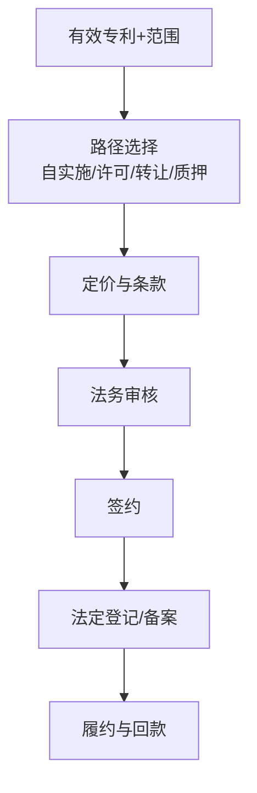

# 节点 06 · 运用转化（Commercialization）· 产品级业务规格

> **本文把「运用转化」从五个路径芯片 + 一张 Term Sheet 表单，重写成一份可以照着做产品的业务规格。**
> 读者：新入职实习生 / 产品经理 / 后端 / 交付。读完后应能：独立设计转化台、给出许可/转让/质押的字段与闸门、向客户讲清「一件专利能换多少钱、凭什么」。
>
> 代码权威源：`apps/workbench/src/flows/monetize/MonetizeFlow.tsx`（400 行）· `src/data/workbenchSeeds.ts`（`monetizeSeed`，:514-558）· `packages/domain/src/handoff.ts`（`REQUIRED_BEFORE_SUBMIT.monetize_terms` / `legal_review` 闸）· `packages/domain/src/guardrails.ts:363-378` · `packages/domain/src/types/index.ts`（`LegalReviewStatus` / `MilestoneStatus` / `PatentCase.linkedAlertId`）· `src/data/flowSteps.ts:61-67` · `packages/domain/src/stages.ts:174-206` · `src/data/agents.ts:213-237`
>
> 法律口径：《专利法》（2020 修正）·《专利法实施细则》（2023 修订，2024-01-20 施行）·《专利权质押登记办法》（局令第 461 号）·《民法典》合同编技术合同章 · GB/T 42748-2023《专利评估指引》· CNIPA《专利资产评估指导意见》。
> **凡金额、费率、比例一律标 ⚠，表示须按当期官方文本或可比交易复核。法条只写已核对到的；未核到的写「以官方文本为准」。**

---

## 0. 一句话讲清这个节点

**运用转化 = 把「一件已经有效的专利权」变成现金流或战略筹码，并在四条路径（自实施 / 许可 / 转让 / 质押融资）里选出对的那条，把条款谈成、把登记办完、把钱收回来。**

它不是「签个合同」。它是**资产定价 + 交易结构设计 + 法定登记 + 履约跟踪**四合一。行业里最反直觉的一句话：**许可合同签了不备案，等于没签（对第三人而言）**——权利还在你手里，但你打不赢善意受让人。

产品化三条件：

1. **有独立买方**：有对外许可/转让业务的企业 IP 运营部门、高校院所的技术转移中心（TTO）、代理所的运营服务线。
2. **有独立价值**：一次许可定价偏差 1 个百分点，在一份 5 年期、年销售额 1 亿的合同上就是 500 万 ⚠。定价与条款的可比数据是硬资产。
3. **有独立边界**：输入是「专利号 + 权利要求范围 + 剩余期限 + 法律稳定性 + 同族覆盖」，输出是「路径选择 + Term Sheet + 登记凭证 + 里程碑履约表」。不依赖撰写、答复即可独立交付；但它的前提是 05 的「权利有效」。

---


## 0.1 人读：图 · 判定 · 依据

> 本节给人读：一张图看清本站怎么走；规则按 **A 法定 / B 程序 / C 商业 / D 质量**；判定与硬闸禁止拍脑袋。细节与编号规则仍以下文全文为准。

### 本站流程（进 → 活动 → 闸 → 出 → 下一站）



### 规则速查（类别：A 法定 · B 程序/期限 · C 商业 · D 质量/合规）

| ID | 类别 | 规则（一句话） | 依据 |
|---|---|---|---|
| R06-A1 | A | 专利权可许可/转让；质权须登记 | 《专利法》相关许可/转让条款；《专利权质押登记办法》 |
| R06-A2 | A | 技术合同适用民法典合同编 | 《民法典》技术合同章 |
| R06-B1 | B | 许可备案影响对抗第三人 ⚠ 范围复核 | 行业+登记实务 ⚠ |
| R06-C1 | C | 定价须有评估或可比依据 | GB/T 42748 专利评估指引等 |
| R06-D1 | D | 未法务审核不得归档成交 | 产品 legal_review 闸 |

### 怎么判定 · 怎么推进

| 判据 | 条件（可检查） |
|---|---|
| **进入本站** | 专利权有效（05）；有明确标的权项与目标交易对手/场景。 |
| **本站完成** | 路径已选 + Term Sheet/合同 + 必要登记完成 + 里程碑表建立。 |
| **推进下一站** | 履约跟踪；或回到 07/24（侵权施压许可）；组合策略可回写 08。 |

### 硬闸（禁止拍脑袋）

- **禁止**无评估依据的「拍脑袋报价」作为唯一定价。
- **禁止**跳过法定登记环节宣称「已完成转让/质押」。
- **禁止**把无效/终止专利当有效标的成交。

### 依据来源（调研摘要）

- 《专利法》许可、转让、质押相关；《专利权质押登记办法》。
- GB/T 42748-2023《专利评估指引》；CNIPA 评估指导意见（行业）。
- 具体备案对抗效力与手续 ⚠ 按当期文本与登记指南复核。

⚠ 未核到当期官方原文的条号/金额/天数，部署前须按 CNIPA / 条约/法院文本复核。

---
## 1. 节点定位与产品边界

### 1.1 在生命周期中的位置

```
授权维持(05) ──► 【运用转化 06】──┬──► 自行实施（不产生交易，只产生内部收益核算）
                                  ├──► 许可（备案 3 个月内）
                                  ├──► 转让（登记生效）
                                  ├──► 质押融资（登记）
                                  ├──► 作价入股 / 专利池 / 标准必要专利
                                  └──► 维权诉讼（线索来自 07）
                                        ▲
监控预警(07) ── 侵权线索 / 竞品动态 ────┘
```

**结构事实**：转化是主轴上**唯一一个「多出口」节点**。其余节点是单线推进，转化是**路径分叉再收敛到同一个交接产物** `monetize_terms`。这决定了它的产品形态必须是「路径向导 + 分支条款 + 统一审批」，而不是一张通用表单。

### 1.2 代码口径（照抄）

| 项 | 值 | 权威源 |
|---|---|---|
| StageId | `commercialization` | `packages/contracts/src/keys.ts:9` |
| 阶段元数据 | 「运用转化」，两个 runner：`license`（4 步）、`litigation`（4 步，标注「示意·无独立 Flow」） | `packages/domain/src/stages.ts:174-206` |
| 路由 | `/workbench/monetize`、`/workbench/monetize/:caseId` | `apps/workbench/src/App.tsx:115-132` |
| Flow key | `monetize` | `src/data/flowSteps.ts:61-67` |
| Flow 4 步 | 选择路径 / 条款要点 / 里程碑 / 审批交接 | `src/data/flowSteps.ts:65` |
| 产物键 | `monetize_terms` | `packages/contracts/src/handoff.ts:31` |
| 产物中文名 | 「转化条款」 | `packages/contracts/src/handoff.ts:21` |
| 齐套 REQUIRED | `terms`（许可/转让核心条款）+ `party`（对方主体），**共 2 项** | `packages/domain/src/handoff.ts:133-136` |
| 挂载 Agent | `agent-monetize`（tier **beta**，HITL gate `approve_strategy`） | `src/data/agents.ts:213-237` |
| Full-check | **不适用**（`fullCheckScopeFor` 对本节点返回 `null`） | `packages/domain/src/fullFilingCheck.ts:104-115` |
| 阶段清单 | 4 项：转化路径已选定 / 协议或诉讼材料齐备 / 交易或维权已启动 / 成果落地跟踪中（c4 非必需） | `stages.ts:204-209` |
| 路径枚举（代码）/ 法务状态 | `['自行实施','许可','转让','作价入股','维权诉讼']` / `pending · reviewed · changes_requested` | `MonetizeFlow.tsx:22` · `types/index.ts:177` |

> **一处必须点名的口径差**：代码的路径枚举是**五条**（含「维权诉讼」），而任务口径与行业实务是**四条运用路径 + 诉讼**。质押融资在代码里**完全没有**，这是本节点最大的功能空白（§14 差距 #1）。

### 1.3 它是什么 / 不是什么

| 是 | 不是 |
|---|---|
| 路径选择的**决策支持**（哪条路回报最高、门槛最低） | 合同起草的全流程（合同正文由法务/律师出） |
| 交易**要件**的结构化（类型、地域、领域、排他、对价、期限） | 电子签章系统 |
| 法定**登记/备案**的办理与留痕 | 官方登记系统的替代品 |
| 履约**里程碑**跟踪（签约→验收→备案→收款） | 财务收款（走 12-billing） |
| 定价的**参照系**（成本/市场/收益 + 可比交易） | 评估机构出具的正式评估报告 |
| 维权**线索的接入口**（来自 07 的告警） | 诉讼本身（无独立 Flow，见 §8.4） |

### 1.4 上下游契约

| 方向 | 对象 | 契约 |
|---|---|---|
| 上游 | 授权维持（05） | 只有权利状态 `有效` 才可进入交易；终止/放弃的专利不得出现在可许可清单 |
| 上游 | 监控预警（07） | 侵权线索 `WatchAlert` 升级后写 `PatentCase.linkedAlertId`（`types/index.ts:238`） |
| 上游 | 撰写（03） | 提供权利要求范围（决定保护广度与定价） |
| 上游 | 商务线（12） | 服务费报价、发票；c3 的 `quoteBudget` 为「许可谈判包 ¥45,000」（`src/data/cases.ts:133`） |
| 下游 | 法务 | 合同审阅（代码里是薄状态，不是真法审） |
| 下游 | 官方 | 许可合同备案（3 个月内）、转让登记、质押登记 |
| 下游 | 财务 | 入门费/分成/里程碑款进账；发票线 `CaseInvoice.relatedStage = '运用转化'` |
| 回流 | 监控（07） | 许可地域内仍须监测侵权（被许可人可能更需要维权） |

### 1.5 独立产品的形态

**产品名建议：IP 运营台 / Deal Desk**

| 模块 | 能力 | 谁用 |
|---|---|---|
| 资产视图 | 可交易专利清单 + 权利范围 + 剩余期限 + 同族覆盖 | IP 运营 |
| 路径向导 | 四条路径的适配性打分（地域/领域/排他/期限/对价形式） | 商务 |
| 定价参照 | 成本法/市场法/收益法三算 + 可比交易 + 行业费率 ⚠ | 商务 / 财务 |
| 条款工作台 | Term Sheet 结构化字段 + 版本 + 差异对比 | 商务 / 法务 |
| 登记台账 | 许可备案 / 转让登记 / 质押登记的状态与凭证 | 代理 / 法务 |
| 履约跟踪 | 里程碑、收款节点、审计权、改进归属 | 商务运营 |
| 维权接入 | 从监控告警一键转谈判筹码 | 商务 |

**不做的**：不做合同正文的自动生成到可签署程度（beta 已诚实标注「批准 ≠ 合同 PDF/电子签」）；不做诉讼代理；不做资产评估报告的正式出具（那是持牌评估机构）。

---

## 2. 角色与权限矩阵

| 角色 | 代码对应 | 能做什么 | 不能做什么 |
|---|---|---|---|
| 商务 / BD | `persona: 'agency'` 或企业商务 | 选路径、填条款、加里程碑、起草 Term Sheet | 不能批准条款（须企业） |
| 企业决策人 | `persona: 'enterprise_ip'` | 批准条款、确认条款生效、归档 | 不能代替法务标记「已阅」以外的事 |
| 法务 | 代码中**无独立 persona**，只有 `case.legalReview` 状态 | 标记「法务已阅 / 法务退回」 | 无独立身份；能否点按钮取决于 `role === 'enterprise'` |
| 代理所 | `role: 'agency'` | 起草、提交、递交归档 | 不能 approve / authorize |
| 发明人 | `persona: 'inventor'` | 只读 | 全部动作禁用 |
| 专利委员会 | `persona: 'committee'` | 无 | 全部 HITL 闸硬禁 |
| 系统 Agent | `agent-monetize`（beta） | 生成条款骨架、费率对标、关联告警 | 无法务会签闸；不能假装完成签署 |

**当前实现的权限真相**：

- 法务**不是一个角色**，而是一个**案件级字段**。任何 `role === 'enterprise'` 的人都能把 `legalReview` 从 `pending` 点成 `reviewed`（`MonetizeFlow.tsx:324-347`），包括商务自己。这是「双人复核」的反面。
- `setLegalReview` 只写案件字段 + 一条 activity（`AppContext.tsx:1598-1618`），**不产生任何签名、不接受附件、不记录审阅意见**。
- 路径芯片、条款字段、里程碑的编辑**没有任何角色级限制**（只有 `isLitigation` 造成的禁用）。
- 承揽模式 `delegated` 下企业不能 `submit`/`file`（`handoff.ts:222-255`），自助模式下可以。

> 讲给实习生：**「法务已阅」这四个字在本系统里只是一个开关，不是法律意见。** 任何对外承诺都不能以此为由认为已完成法务审阅。

### 2.1 决策权

角色矩阵回答「谁能做什么」，不回答「谁说了算」。运用转化的每一个动作都在**处分资产**——把排他权给出去、把所有权卖出去、把专利押给银行——而且多数**不可逆**。这一节把 D7（怎么变现）落到具体的人与具体的级别。

**四种权能，不得混用**：

| 权能 | 定义 | 运用转化中的典型场景 | 系统落点 |
|---|---|---|---|
| 建议权 | 提出方案与定价，不产生约束力 | IP 部门建议路径与许可结构；财务给出费率区间与收益模型 | 建议记录可被采纳或驳回，驳回须给理由 |
| 决定权 | 拍板并对结果负责 | 业务与财务共同决定成交条件；法务终审条款 | 决议记录 + 决策人签署 + 时间戳 |
| 否决权 | 单方面阻止已作出的决定 | 法务否决合规风险交易；CFO 否决低于收益门槛的定价 | 一票否决，须书面说明理由 |
| 知情权 | 被动获知，不参与决策 | 财务知悉收款节点；发明人知悉其专利被许可；被许可人知悉转让 | 订阅与通知，不阻断流程 |

> **本节点的权力分配口径（与 22 不同，务必区分）**：**IP 部门建议、业务与财务共同决定、法务终审条款。** 22 是「客户决定、代理师对成立性负责」；06 没有外部代理人替客户承担商业风险，所以决定权必须留在企业内部，且必须是**业务（这笔生意要不要做）与财务（这笔生意划不划算）双签**，不能由任一方单独拍板。

**决策归属表**：

| 决策 | 建议权 | 决定权 | 否决权 | 级别与依据 |
|---|---|---|---|---|
| 选哪条变现路径（自实施 / 许可 / 转让 / 质押 / 入股 / 维权） | IP 部门（资产适配性）、商务（市场可达性） | 业务负责人 + 财务负责人 | 法务（合规）、CFO（收益不达门槛） | L3；路径变更须重走审批 |
| 许可类型（独占 / 排他 / 普通 / 交叉 / 分许可） | IP 部门、商务 | 业务负责人 | 法务（反垄断、FRAND 一致性） | **独占 = 资产处分 → L4**；排他 L3；普通 L2 |
| 许可费底线（入门费、提成率、最低保底） | 财务（收益模型）、IP 部门（价值评估） | 财务负责人 + 业务负责人 | CFO | L3；须在首次对外报价前书面批准 |
| 是否独家授权（领域独家 / 地域独家） | 商务 | 业务负责人 | 法务 | L4（实质等同独占，见上一行） |
| 转让是否报股东会 / 董事会 | 董秘、法务 | 按公司章程与金额分级 | 法务（权属瑕疵） | L4；决议纪要入卷 |
| 质押融资是否做、押哪些专利 | 财务、IP 部门 | CFO + 法务总 | 业务负责人（影响核心产品排他时） | L4 |
| 是否作价入股、作价多少 | 财务、持牌评估机构 | 董事会（须评估报告） | 法务（权属不清晰） | L4 |
| 谈判让步幅度上限 | 商务（测算）、财务（可承受区间） | 财务负责人 | 法务 | L2；超出上限须重新报批 |
| 合同签署人 | 法务（核定授权范围） | 法定代表人或其书面授权人 | — | L3；授权书入卷，不得代签 |
| 对方违约是否解约 / 是否索赔 | 法务、商务 | 法务总 | 业务负责人（客户关系） | L3；解约不可逆 |
| 许可是否备案、何时备案 | 代理、法务 | 法务（时限管理） | — | L1；生效起 3 个月内 ⚠ 硬期限 |

**分级口径（金额为示意 ⚠，须按企业授权制度配置，不得硬编码）**：

| 层级 | 条件 | 批准人 | 典型情形 |
|---|---|---|---|
| L1 | 可逆 + 低金额 | 经办人 | 备案提交、里程碑状态更新、附件归档 |
| L2 | 可逆 + 高金额 | 部门主管 | 普通许可的条款微调、SLA 内的报价调整 |
| L3 | 不可逆 + 低金额，或可逆 + 高金额 | 双人复核（发起人 ≠ 批准人） | 排他许可、单笔对价低于阈值 ⚠ 的转让 |
| L4 | 不可逆 + 高金额 | 高层 + 双人复核 + 决议纪要 | 独占许可、转让、质押、作价入股、跨境许可 |

> **一句话记住**：**独占许可与转让是资产处分，不是销售动作。** 它们一次性决定了「以后自己还能不能用、还能不能卖给别人」，所以哪怕金额很小，也按 L4 走。

**谈判底线的授权机制（本节点最容易出事的地方）**：

| 环节 | 规则 |
|---|---|
| 底线制定 | 谈判前由财务出具「最低可接受条件」：入门费下限、提成率下限、期限上限、地域上限、排他程度 ⚠ |
| 书面批准 | 底线须在**首次对外报价前**书面批准并锁定；口头同意的底线无效 |
| 让步梯度 | 批准时同时给出「可让区间」与「每让一步换回什么」（让费率换保底、让地域换期限、让期限换入门费） |
| 临场处置 | 超出授权幅度的要求 → **暂停谈判**，24 小时内 ⚠ 重新报批；不得「先答应、后补批」 |
| 事后留痕 | 每轮谈判记录：对方要求、我方回应、是否在授权幅度内、批准人 |

> **业务部门不得单独对外承诺许可条件。** 任何以邮件、即时消息、会议口头形式给出的类型、费率、期限、地域承诺，都构成要约的雏形；一旦对方据此投产备货，撤回的成本远高于当初多等一天审批。

---

## 3. 业务对象（字段级）

### 3.1 转化种子 `monetizeSeed`（当前唯一数据源）

权威源：`src/data/workbenchSeeds.ts:514-558`。这是**只读常量**，不是用户对象。

| 字段 | 类型 | 必填 | 说明 |
|---|---|---|---|
| `path` | 五值联合 | ✅ | 自行实施 / 许可 / 转让 / 作价入股 / 维权诉讼 |
| `counterpart` | string | ✅ | 交易对手（诉讼路径下 = 被诉方） |
| `territory` | string | — | 地域范围 |
| `exclusivity` | string | — | 排他性，**自由文本**（如「独占许可（产线检测设备领域）」） |
| `royalty` | string | ✅ | 对价/分成，**自由文本**（如「入门费 120 万 + 销售额 3%」） |
| `termYears` | string | — | 期限 |
| `paymentSchedule` | string | — | 付款安排 |
| `fieldLimit` | string | — | 领域限制 |
| `milestones` | `{id,label,due,done}[]` | — | 里程碑（注意：种子无 `status`，由组件现场补） |

> **关键判断**：`exclusivity` 与 `royalty` 是**自由文本**。这意味着系统无法回答「这是独占还是排他」「费率是多少」——所有下游计算（分成结算、排他冲突检测、备案要件校验）都无从下手。这是本节点最核心的数据模型缺陷（§14 差距 #2）。

### 3.2 里程碑 `MilestoneStatus`

权威源：`packages/domain/src/types/index.ts:249`。

| 值 | 中文 | 含义 |
|---|---|---|
| `pending` | 待办 | 未开始 |
| `in_progress` | 进行中 | 已启动 |
| `done` | 完成 | 已达成（组件会把 `done` 标志同步为 `true`，`MonetizeFlow.tsx:236`） |
| `overdue` | 逾期 | 超期未达成 |

组件内的里程碑对象为 `{id, label, due, done, status}`（`MonetizeFlow.tsx:51-56,105-108`），**没有责任人、没有交付物、没有依赖、没有付款金额**。

### 3.3 法务审阅状态 `LegalReviewStatus`

| 值 | 中文 | 闸门效果 |
|---|---|---|
| `pending` | 法务待审 | approve/authorize 阻断，文案「批准/确认条款前须法务已阅（非合同签署）」 |
| `reviewed` | 法务已阅 | 放行 |
| `changes_requested` | 法务退回 | 阻断，文案「法务已退回 · 请修订后再批准/确认条款」 |

权威源：`types/index.ts:177`；闸门在 `handoff.ts:253-266`（`canPerformHandoff`）与 `guardrails.ts:363-378`（`evaluateGuardrails`），两处**文案略有差异**（见 §7.1）。

### 3.4 缺失的权威对象（产品级必须新建）

| 对象 | 关键字段 | 为什么必须有 |
|---|---|---|
| `LicenseDeal` | 类型（独占/排他/普通/交叉/分许可）、地域、领域、期限、对价结构、最低保底、审计权、改进归属、终止条件、备案状态 | 现在全挤在 7 个自由文本字段里 |
| `AssignmentDeal` | 转让标的（全部/部分权项）、对价、登记号、登记生效日、交割条件 | 转让自登记生效，必须有登记号字段 |
| `PledgeDeal` | 出质人/质权人、担保债权额、质押登记号、期限、处置条款 | 质押影响后续处分，必须可查 |
| `Valuation` | 方法（成本/市场/收益）、关键假设、折现率、剩余期限、结论区间、评估机构 | 定价是转化的命门，现在零对象 |
| `RoyaltyBenchmark` | 行业、技术领域、费率区间、数据来源、样本日期 | 对标必须可追溯 |
| `Patent`（可交易视图） | 专利号、权项数、独权范围摘要、剩余期限、同族国别、法律稳定性评分、质押/许可状态 | 定价基础，当前分散在案件与日程里 |

> **单独立一节讲清楚：四种「给出去的东西」不是一回事**
>
> | | 你失去什么 | 你还保留什么 | 要不要登记 |
> |---|---|---|---|
> | **许可**（独占） | 自己也不能实施 | 所有权、处分权（受合同限制） | 备案（3 个月内） |
> | **许可**（排他） | 不能再许可他人 | 自己仍可实施 | 备案 |
> | **许可**（普通） | 只承诺不排斥被许可人 | 自己实施 + 继续许可他人 | 备案 |
> | **转让** | 所有权全部 | 无（除合同约定的回授） | **登记生效** |
> | **质押** | 处分受限（转让/许可/放弃须质权人同意） | 所有权、实施权、收费权 | 登记 |
> | **作价入股** | 所有权（作价出资给公司） | 股权 | 评估 + 转让登记 |

---

## 4. 业务规则（编号）

前缀 `R06-`。「现状」列：✅ 已实现 / ⚠ 部分 / ❌ 未实现。

### 4.1 路径选择

| ID | 规则 | 现状 |
|---|---|---|
| R06-01 | 路径至少覆盖：自行实施 / 许可 / 转让 / 质押融资；另有作价入股、专利池、标准必要专利 | ⚠ 缺质押融资 |
| R06-02 | 只有权利状态为 `有效` 的专利可进入许可/转让/质押 | ❌ 不校验 05 的状态 |
| R06-03 | 已质押的专利发起转让/许可/放弃，须先取得质权人同意 | ❌ 无质押对象 |
| R06-04 | 已独占/排他许可的专利，不得就同一地域、同一领域再次对外许可 | ❌ 无冲突检测 |
| R06-05 | 路径切换须保留原路径已填内容，不得静默清空 | ⚠ 切换芯片不重置字段，但也不提示 |
| R06-06 | 诉讼路径必须走 07 的「升级维权」，本台只做标记 | ✅ 灰化 + 跳转（`MonetizeFlow.tsx:156-172`） |
| R06-07 | 路径选择须记录决策理由（为什么是许可不是转让） | ❌ |

### 4.2 许可条款

| ID | 规则 | 现状 |
|---|---|---|
| R06-10 | 许可类型必须是**枚举**：独占 / 排他 / 普通 / 交叉 / 分许可 | ❌ 自由文本 |
| R06-11 | 独占许可必须显式确认「许可期内权利人自己也不得实施」 | ❌ 无二次确认 |
| R06-12 | 分许可须在合同中明确授权，否则被许可人无权再许可 | ❌ 无字段 |
| R06-13 | 许可合同应自生效之日起 **3 个月内**备案 | ❌ 无备案对象/期限 |
| R06-14 | 未备案的许可不得对抗善意第三人 | ❌ 无提示 |
| R06-15 | 许可期不得超过专利权剩余保护期 | ❌ 不校验 |
| R06-16 | 地域范围必须落在专利权有效地域内（中国专利只能许可中国境内实施） | ❌ 自由文本 |
| R06-17 | 对价必须结构化：入门费（一次性）/ 提成率（%净销售额）/ 最低保底 / 里程碑款 / 分期 | ❌ 单字段文本 |
| R06-18 | 提成基数必须定义（净销售额 / 毛利 / 台数），并约定审计权 | ❌ 无字段 |
| R06-19 | 改进成果归属必须约定（各自 / 共有 / 回授） | ⚠ 仅在 agent 模板里出现 |

### 4.3 转让

| ID | 规则 | 现状 |
|---|---|---|
| R06-20 | 转让须订立**书面合同**并向官方**登记**，**自登记之日起生效** | ❌ 无登记字段 |
| R06-21 | 转让标的可以是全部权项，也可以是部分权项（须明确） | ❌ 无字段 |
| R06-22 | 转让不影响已存在的许可关系，但须书面通知被许可人 | ❌ 无联动 |
| R06-23 | 转让后费减资格须重新核验（受让人资质决定减缴比例） | ❌ 无联动 |
| R06-24 | 共有专利转让须**全体共有人同意** | ❌ 无共有人模型 |
| R06-25 | 向外国人转让须依相关法律办理额外手续 ⚠ | ❌ |

### 4.4 质押融资

| ID | 规则 | 现状 |
|---|---|---|
| R06-30 | 质押须由出质人与质权人**共同**提出登记申请、共同签章 | ❌ 完全未建模 |
| R06-31 | 质押期间转让/许可须提交质权人同意证明，否则不予办理 | ❌ |
| R06-32 | 质押登记须记载担保债权额、期限、质押范围 | ❌ |
| R06-33 | 质押通常要求评估报告，评估结论决定融资额度 ⚠ | ❌ 无评估对象 |
| R06-34 | 债务违约时质权人可依法处置（折价/拍卖/变卖），须提前约定 | ❌ |

### 4.5 定价与评估

| ID | 规则 | 现状 |
|---|---|---|
| R06-40 | 至少支持三种方法：成本法 / 市场法 / 收益法 | ❌ |
| R06-41 | 收益法须显式给出：剩余经济寿命、预期现金流、折现率、技术贡献率 ⚠ | ❌ |
| R06-42 | 市场法须给出可比交易来源与调整因素（时间/地域/范围/排他性）⚠ | ❌ |
| R06-43 | 成本法须区分研发成本与重置成本，并说明为何不适用收益法 | ❌ |
| R06-44 | 评估结论必须记录假设与局限，不得只给一个数 | ❌ |
| R06-45 | 定价须参照可比费率区间，且标注数据来源与日期 ⚠ | ⚠ Agent 模板有 mock 区间（2–4%），无来源 |

### 4.6 审批与写回

| ID | 规则 | 现状 |
|---|---|---|
| R06-50 | approve / authorize 前必须 `legalReview === 'reviewed'` | ✅ 双重校验（`handoff.ts:253` + `guardrails.ts:363`） |
| R06-51 | 提交前必须填交易对手与对价 | ✅ `MonetizeFlow.tsx:366-368` |
| R06-52 | 诉讼路径豁免 `terms` / `party` 两项齐套 | ✅ `omitRequiredIds`（`MonetizeFlow.tsx:356`） |
| R06-53 | 法务标记人不得与商务批准人同一人 | ❌ |
| R06-54 | 法务审阅必须留附意见与附件 | ❌ 只有状态 |
| R06-55 | 归档时写入登记/备案凭证号 | ❌ 无字段 |
| R06-56 | 里程碑逾期须升级（进 Docket 或 Inbox） | ❌ 只标 `overdue` |

### 4.7 例外情形

规则说「不得」「必须」，业务上总有人要问「什么情况下可以」。不给合法出口，用户就绕过系统线下做，反而失去留痕。本节只收**有依据的例外**（法定 / 合同 / 内部），不收「客户强烈要求」。

| # | 例外 | 例外条件 | 谁批准 | 风险 | 留痕 |
|---|---|---|---|---|---|
| E1 | 许可对象是竞争对手 | 属交叉许可（我方也需要对方专利）、对方持有实施我方技术不可绕开的专利、或行业惯例（专利池 / SEP）⚠ | L4：业务负责人 + 法务总，法务须出反垄断会签意见 | 养大对手；技术路线外溢；一旦授出难以收回；可能触发横向垄断协议风险 | 必留：竞争影响评估 + 替代方案分析 + 领域与期限的收紧条款 |
| E2 | 政府 / 国企要求免费许可 | 有法律法规、政策文件、科研项目任务书或公共利益依据；或作为中标 / 准入的前提条件 | L4：法务总 + 业务负责人；涉及国有资产的须报出资人机构 ⚠ | 无偿处分资产，可能构成对股东的不当处分；示范效应导致其他方要求同等待遇 | 必留：要求方文件原文 + 决策纪要 + 是否可换取对价的说明 |
| E3 | 标准必要专利的 FRAND 义务 ⚠ | 该专利已向标准组织声明为必要专利并作出 FRAND 承诺，或已被纳入标准 | 法务（一致性审查），业务执行；费率突破区间须 L4 | **差别待遇本身即违约**；对不同被许可人给不同条件可能构成歧视；费率不透明引发反垄断关注 | 必留：费率对照表 + 同类被许可人条件一致性说明 + 承诺原文 |
| E4 | 质押期间拟转让 / 许可 | 取得质权人**书面同意**，或先行清偿债务并办理解押 | L4：法务 + CFO，双人复核 | 未经同意办理的转让/许可可能被认定无效或撤销；融资提前到期 | 必留：质权人同意书 + 质押登记状态截图 + 解押凭证 |
| E5 | 许可合同未备案但已履行 | 已超过生效起 3 个月 ⚠ 的法定期限，但双方已实际履行且无争议 | 法务（补办决策），L3 | 未备案不得对抗善意第三人；若期间专利被转让，被许可人可能失去实施权 | 必留：补办申请 + 对抗效力风险评估 + 已履行证据（付款、发货） |
| E6 | 对方要求先使用后签约 | 战略客户试产验证、紧急供货、招投标已中标待签 | L3：业务 + 法务会签 | 无合同实施 = 无对价依据、无保密约束、无终止机制；事后追讨对价缺乏筹码 | 必留：临时许可函或备忘录（含期限、对价追溯条款、保密义务）+ 补签期限 |
| E7 | 跨境许可的税务与外汇 | 许可费跨境支付、预提所得税、技术出口管制或外汇登记要求 | 财务（税务）+ 法务；金额超阈值 ⚠ 升级至 CFO | 税务成本吞掉毛利；外汇手续不合规导致款项无法汇出；受让方所在国限制 | 必留：税务测算表 + 外汇路径说明 + 税收协定适用依据 ⚠ |
| E8 | 共有人或合作方单独对外许可 | 共有专利、职务发明权属未决、合作研发协议约定不明 | 法务总（权属意见），L4 | 无权处分导致许可可撤销；共有人主张分成或起诉 | 必留：权属文件 + 共有人同意或追认 + 分成安排 |

**FRAND 例外的特殊性（唯一需要单独建模的例外）**：

FRAND 不是「可以免费许可」，也不是「必须给别人一样的价格」，而是**条件必须公平、合理、无歧视**。系统不能只存一个「FRAND = 是」的布尔值，否则下面三件事都做不了：

| 判断项 | 问什么 | 结论 |
|---|---|---|
| 是否已作承诺 | 是否向标准组织声明、承诺文本在哪 | 无承诺 → 不适用 FRAND，按普通许可定价 |
| 条件是否可解释 | 费率基数（整机价 / 最小可销售单元）、费率、上限是否书面化 ⚠ | 无法解释 → 不得对外报价 |
| 是否差别待遇 | 同类被许可人的地域、期限、量级是否可比；差异有无客观理由 | 无客观理由的差异 → 阻断，须 L4 复议 |

> 三项任一不成立，**不得以「这是 FRAND」为由压低条件或跳过审批**。反过来，也不能以「这是我们的核心专利」为由拒绝许可——拒绝许可在 SEP 场景下本身就是反垄断风险点。

**例外不是豁免**：每条例外都必须记录**批准人、批准时间、理由、有效期**，只对本交易生效。例外率异常升高（例如 E2 免费许可一年出现五次），说明定价或政策口径出了问题，要回改规则，而不是继续批例外。

### 4.8 规则冲突与裁决

转化节点是全线里冲突最密集的节点，因为它同时被三股力量拉扯：**业务要成交、财务要收益、法务要可控**。不预先给出裁决顺序，执行时就由「谁声音大」决定。

**六类真实冲突**：

| # | 冲突 | 典型表现 | 裁决 | 裁决人 |
|---|---|---|---|---|
| C1 | 许可收入快 vs 独占削弱自身竞争力 | 大客户要求领域独占，签了当年就有可观入门费，但该领域正是我方主打市场 | **先算「自实施收益」再比「许可收入」**：若自实施毛利高于许可费，则只给排他或普通；同一领域不得给独占。数字算不清时按保守方案（普通许可 + 高费率） | 业务负责人 + 财务共同决定，IP 部门出具自实施收益测算 |
| C2 | 转让一次性收益 vs 长期许可现金流 | 买方出价一次性买断，估值看似高于未来许可现值 | **按剩余保护期折现比较两种方案**，并计入转让后失去的维权主体资格与组合议价能力；折现率与假设须书面 ⚠ | CFO 决定，IP 部门出具许可现金流预测 |
| C3 | 业务要授权 vs 法务担心养大对手 | 销售已与对方谈妥，法务认为对方拿到技术后两年内会成为直接竞争者 | **合规与竞争风险优先**：法务可一票否决；被否决后业务可升级至 L4，但须书面接受「养大对手」的商业后果 | 法务否决，L4 复议 |
| C4 | 对方压价 vs 事先批准的底线 | 谈判现场对方以「预算只有这么多」施压，销售想当场让步 | **底线不得临场突破**：暂停谈判、24 小时内 ⚠ 重新报批；若确需让步，须换回等价条件（延长期限、缩小地域、加保底） | 财务负责人（底线）、业务负责人（是否继续谈） |
| C5 | 维权诉讼 vs 继续许可（既打又谈） | 对方既在侵权又在谈许可，边谈边卖；或在谈转让 | **先固定证据再谈**：谈判不停止取证与时效计算；谈判中作出的陈述不得构成对侵权行为的默示许可。可并行，但须同一决策人统管两条线，避免「前台谈、后台诉」自相矛盾 | 法务总统一牵头，业务与诉讼团队双线汇报 |
| C6 | 备案时限 vs 条款尚未定稿 | 合同生效日已定，但分成基数与审计权还在谈，3 个月 ⚠ 备案期在流逝 | **先按已定稿部分备案，补充协议另备**；不得为等条款拖过期限——备案是对抗要件，缺失不可事后弥补 | 法务决定备案时点，商务负责条款收敛 |

**裁决顺序（冲突无法自行消解时，自上而下适用）**：

| 序 | 原则 | 含义 | 例外 |
|---|---|---|---|
| 1 | **法定硬规则优先** | 转让登记生效、许可备案 3 个月 ⚠、质押须质权人同意，不可让渡 | 仅 §4.7 列明的例外可偏离 |
| 2 | **合规优先于成交** | 反垄断、FRAND、出口管制、国资审批未过，不得签约 | — |
| 3 | **不可逆优先于可逆** | 独占、转让、质押、入股先于普通许可与条款微调获得决策资源 | — |
| 4 | **资产保全优先于单笔收益** | 削弱自身实施能力或组合议价能力的交易，收益再高也让位于资产价值 | L4 书面决议可推翻，须说明补偿方案 |
| 5 | **书面授权优先于临场判断** | 未在授权幅度内的让步一律无效，事后补批不改变已作出的承诺效力 | — |
| 6 | **一致优先于局部最优** | 同一专利对不同被许可人的条件须可解释；FRAND 下更严 | 有客观差异理由并留痕 |
| 7 | **分歧留痕优先于表面一致** | 业务、财务、法务意见不一致时记录三方意见与最终决定人 | — |

> **最重要的一条**：C3 这类冲突不能靠「谁职级高」解决。法务对**合规与竞争风险**负责，业务对**成交与客户关系**负责。把两者压成一个签字，结果是法务被迫为一个自己判断会养大对手的交易背书，或业务被迫放弃一个本可控制风险的订单。**记录分歧比假装一致更有价值**——将来对方真的成了竞争对手，这份记录就是「当时谁主张了什么」的唯一证据。

### 4.9 决策权规则

以下规则使 §2.1 可执行、可审计。第一组是**权能分离与审批分级**：

| ID | 规则 | 现状 |
|---|---|---|
| R06-70 | 四种权能（建议 / 决定 / 否决 / 知情）须分别配置到人，不得合并为一个审批按钮 | ❌ |
| R06-71 | 独占许可、转让、质押、作价入股一律按 L4 处理：高层批准 + 双人复核 + 决议纪要 | ❌ |
| R06-72 | 业务部门不得单独对外承诺许可条件；未经书面授权的报价、意向、口头承诺不产生内部效力，且须在 24 小时内 ⚠ 上报 | ❌ |
| R06-73 | 谈判底线须在首次对外报价前书面批准并锁定；超出授权幅度的要求须暂停谈判并重新报批，**不得先答应后补批** | ❌ |
| R06-74 | 法务对合同条款有终审权；法务标记人不得与商务批准人同一人（另见 R06-53） | ❌ |
| R06-75 | 合同签署人须持与本次交易一致的书面授权；越权签署按效力待定处理，须追认或撤销 | ❌ |
| R06-76 | 转让须按公司章程与金额分级报董事会 / 股东会，决议纪要入卷 | ❌ |
| R06-77 | 质押融资须 CFO 与法务总双签，且须先取得评估结论 | ❌ |

第二组是**授权、留痕与专项校验**：

| ID | 规则 | 现状 |
|---|---|---|
| R06-78 | 作价入股须持牌评估机构出具报告 + 董事会决议，缺一不得办理 | ❌ |
| R06-79 | 对方违约是否解约、是否索赔由法务总决定；业务负责人可就客户关系行使否决权 | ❌ |
| R06-80 | 许可备案由法务负责时限管理，签约日即生成「生效 + 3 个月 ⚠」期限，逾期进入例外流程（E5） | ❌ |
| R06-81 | 决定人须预设 A/B 角，授权书事先签署；未获明确答复不得推进不可逆动作，沉默不构成同意 | ❌ |
| R06-82 | 每个决策须记录：决策人、时间、依据、备选方案、未采纳原因；决议记录一经签署不可编辑，修改须新建版本 | ❌ |
| R06-83 | 独占 / 排他许可批准前须出具「自实施收益 vs 许可费收入」对照测算，未出具不得进入 L4 决议（对应 C1） | ❌ |
| R06-84 | 同一交易中，谈判代表不得同时担任条款批准人；批准人须能看到完整谈判记录与每轮让步 | ❌ |
| R06-85 | 已作 FRAND 承诺的专利，须维护费率对照表；同类被许可人条件差异无客观理由的，阻断并提交 L4 复议（对应 E3） | ❌ |
| R06-86 | 跨境许可签约前须完成税务与外汇路径测算，测算未完成不得签署（对应 E7） | ❌ |

---

## 5. 法律底座 / 行业规则

### 5.1 许可（《专利法》第十二条）

**规则**：任何单位或个人实施他人专利，应当与专利权人订立**实施许可合同**，向专利权人支付专利使用费。被许可人**无权允许合同规定以外**的任何单位或个人实施该专利。

**产品落点**：

- 「无权允许合同规定以外的人实施」= **分许可必须明示授权**。系统应把「是否允许分许可」做成必填布尔，而不是文本。
- 许可类型三分（独占/排他/普通）在中国法下不是法定术语，而是**合同约定 + 司法解释**的产物，所以系统必须把「是否排除权利人自己」与「是否排除再许可他人」拆成两个独立布尔，而不是一个下拉。这是最容易被做错的地方：

| 类型 | 权利人自己可实施 | 可再许可他人 |
|---|---|---|
| 独占 | ❌ | ❌ |
| 排他（独家） | ✅ | ❌ |
| 普通 | ✅ | ✅（若合同允许） |

**失效后果**：把「独占」做成一个下拉但只存文本，合同起草时无法自动生成排他条款，签出一份「名为独占、实为普通」的合同，客户以为买断了市场，实际对手照卖。

### 5.2 许可备案（细则，**3 个月**内）

**规则**：专利权人与他人订立的专利实施许可合同，应当自**合同生效之日起 3 个月内**向国务院专利行政部门**备案** ⚠（条号以官方最新文本为准）。

**产品落点**：

- 备案不是生效要件，而是**对抗要件**：未备案不得对抗善意第三人。
- 系统必须在签约日自动生成一条备案期限（签约 + 3 个月），与 Docket 打通。
- 备案完成须回写登记号到案件，否则 07 的维权范围、06 的下一次许可冲突检测都缺依据。

**失效后果**：权利人在许可期内把专利转让给善意第三人，第三人不受该许可约束，被许可人无法继续实施——赔偿或退款，且可能触发许可合同的违约条款。

### 5.3 转让（《专利法》第十条）

**规则**：专利申请权和专利权可以转让。转让须订立**书面合同**，并向国务院专利行政部门**登记**，由其公告；**转让自登记之日起生效**。

**产品落点**：

- 「登记之日起生效」是**成立要件**，不是对抗要件。签了合同没登记 = 权利没转移。系统必须把「合同签署日」与「登记生效日」做成两个字段，且以登记生效日为准计算权属。
- 与许可的关系：转让后许可关系通常继续有效（买卖不破租赁的法理延伸），但须书面通知被许可人；系统应自动生成通知任务。
- 共有专利转让须全体共有人同意；向外国人转让另需办理手续 ⚠。

**失效后果**：以为签了合同就完成交割，未办登记，买方付了钱拿不到权利；若卖方期间再转让给第三人并先登记，买方只能主张违约，拿不回专利。

### 5.4 质押融资（《专利权质押登记办法》，局令第 461 号）

**规则要点**：

- 质押登记由**出质人与质权人共同**提出、共同签章。
- 质押期间，出质人转让或许可实施该专利，须提交**质权人同意**的证明，否则官方不予办理。
- 质押合同可约定年费缴纳、转让与实施许可等事项。

**产品落点**：

- 质押登记后，系统必须把该专利标记为「处分受限」，并在任何转让/许可/放弃动作前硬阻断，要求上传质权人同意书。
- 质押通常伴随评估报告；评估结论直接决定融资额度（一般为评估值的一定折扣 ⚠）。
- 风险处置：债务违约后质权人可折价/拍卖/变卖，须在合同中提前约定；系统应记录处置条款摘要。

**失效后果**：质押中的专利被拿去再许可，质权人权益受损，质押登记可能被撤销，融资提前到期。

### 5.5 作价入股与 patent pool / SEP

| 形态 | 法律基础 | 产品落点 |
|---|---|---|
| 作价入股 | 《公司法》非货币出资 + 资产评估 | 必须有评估报告 + 权属清晰 + 可依法转让；系统需要一个 `ContributionDeal` 对象 |
| 专利池（patent pool） | 合同联合许可 | 池内成员的许可条款一致性校验；反垄断合规提示 |
| 标准必要专利（SEP） | FRAND 承诺 | 费率必须符合公平、合理、无歧视原则；系统需 `FRAND` 标记与费率一致性检查 |

**行业惯例**：通信领域的 SEP 许可通常按**整机价格**或**最小可销售单元**计价，费率区间因组合而异 ⚠，须参照具体标准组织的专利政策与公开承诺。**不要在系统里硬编码任何"行业标准费率"**——每个池、每代标准的差异极大。

### 5.6 专利价值评估（GB/T 42748-2023《专利评估指引》 + CNIPA《专利资产评估指导意见》）

**三法对照**：

| 方法 | 适用场景 | 核心输入 | 主要局限 |
|---|---|---|---|
| **成本法** | 早期技术、无收益记录、防御性专利 | 研发投入、重置成本、贬值率 | 不反映未来收益；易高估低价值专利 |
| **市场法** | 有活跃可比交易 | 可比交易价格 + 调整系数（时间/地域/范围/排他） | 中国专利交易数据不透明，可比样本少 |
| **收益法** | 已实施或有明确许可预期 | 剩余经济寿命、现金流、折现率、技术贡献率 ⚠ | 假设敏感，一个折现率能差出一倍 |

**影响价值的因素**（按权重排序的经验值，非标准）：

| 因素 | 为什么重要 | 系统里对应字段 |
|---|---|---|
| 权利要求范围 | 决定能否覆盖对手产品，是价值的第一决定项 | 权项数、独权范围摘要、被绕开难度 |
| 剩余期限 | 直接决定收益年限 | 申请日 + 保护期（20/10/15） |
| 法律稳定性 | 是否容易被无效 | 无效历史、同族授权率、审查强度 |
| 同族覆盖 | 能否覆盖主要市场 | 同族国别清单 |
| 技术贡献率 | 专利技术在产品价值中的占比 ⚠ | 需评估人判断 |
| 实施证据 | 是否已产业化、有无销售额 | 自实施记录、许可记录 |

**失效后果**：只用成本法定价，把研发投入当价值，会把一件「研发花了 500 万但市场上无人需要」的专利报出 500 万，谈判一开始就失去可信度。

### 5.7 与技术秘密 / 开源的关系

| 关系 | 规则 | 产品落点 |
|---|---|---|
| 专利 vs 技术秘密 | 专利以公开换保护；技术秘密以保密维持价值。同一技术**不能既申请专利又主张秘密**（公开后即丧失秘密性） | 转化时应识别「许可标的里是否含未公开的 know-how」，know-how 许可须单独约定保密义务 |
| 专利 + 技术秘密打包 | 实务常见：专利许可 + 工艺参数/配方秘密许可 | 合同中须分列两部分对价，否则秘密部分无法单独主张违约 |
| 开源许可 | 若产品含 GPL 等传染性开源组件，专利许可可能受限（部分开源协议含专利授权条款） | 许可前的 FTO/合规检查应含开源扫描 |
| 开源对专利的挑战 | 开源社区公开的技术构成现有技术，可能影响后续专利的新颖性 | 与 01/02 联动，不属于本节点主流程 |

**产品落点**：转化台应有一个「标的范围」字段，明确本次交易含**专利权 / 技术秘密 / 商标 / 著作权**中的哪些，避免客户以为买了专利就拿到了全套技术。

---

## 6. 状态机

### 6.1 交易生命周期（设计目标，当前未实现）

```
评估 ──► 路径选定 ──► 条款谈判 ──► 法务审阅 ──► 内部批准 ──► 签约 ──► 登记/备案 ──► 履约中 ──► 完结
  │                       │            │                          │         │
  └──► 放弃转化           └──► 退回 ◄──┘                          └──► 违约处理
```

### 6.2 里程碑状态机（已实现，4 态）

```
pending ──► in_progress ──► done
   │             │
   └─────────────┴──► overdue（超期未达成）
```

迁移无守卫：任意状态可直跳任意状态；`done` 会把 `done` 标志置真（`MonetizeFlow.tsx:236`），退回 `pending` 时**不会**重置（同一行只改 `status`，`done: status === 'done'` 会正确置假——这点是对的）。

### 6.3 交接状态机（`monetize_terms`，已实现）

```
drafting ──submit──► submitted_to_enterprise ──start_review──► enterprise_review ──approve──► approved
    ▲                        │                       │                                   │
    └── save_draft ◄── changes_requested ◄── request_changes ◄───────────────────────────┘
                                                                              authorize ──► authorized_to_file ──file──► filed
```

与 `maintain_annuity` 完全同构（同一套 `TRANSITIONS`，`handoff.ts:147-186`），唯一差异是 **`approve` / `authorize` 多一道 `legal_review` 硬闸**。

### 6.4 当前实现的偏差（逐条点名）

| # | 偏差 | 证据 |
|---|---|---|
| 1 | 缺「质押融资」路径，五条路径里没有它 | `MonetizeFlow.tsx:22` |
| 2 | 路径默认值 `c3`，未选案件时静默使用 c3 的种子 | `MonetizeFlow.tsx:36,42` |
| 3 | 条款字段全部不落库，切案件即重置 | `MonetizeFlow.tsx:63-70`，无任何写回 |
| 4 | 里程碑不落库，刷新即回种子 | 同上 |
| 5 | 里程碑新增固定 `due = '2026-12-31'` | `MonetizeFlow.tsx:106` |
| 6 | 法务审阅可由同一人「自审自批」，无身份校验 | `MonetizeFlow.tsx:324-347` |
| 7 | 法务标记无意见、无附件、无时间戳以外的证据 | `AppContext.tsx:1598-1618` |
| 8 | 里程碑逾期无任何升级动作 | `MonetizeFlow.tsx:126` 只用于 step 判定 |
| 9 | 「关联监控告警」的候选是硬编码两项，非真实告警列表 | `MonetizeFlow.tsx:281-283` |
| 10 | 诉讼路径只豁免齐套项，仍可 approve/authorize/file 并把 `monetize_terms` 推到 `filed` | `MonetizeFlow.tsx:356-360` |
| 11 | 成功时 `markChecklistDone(caseId, ['c1','c2'])`，只置两项，与 05 的全量置绿不一致 | `MonetizeFlow.tsx:387` |
| 12 | 归档时无条件写「成果转化摘要.md」，不看路径 | `MonetizeFlow.tsx:388` |

---

## 7. 闸门与条件（代码对齐）

**唯一入口原则**：任何 UI 都要过 `evaluateGuardrails`（`guardrails.ts:225`）。Monetize 在 `validateBefore` 里显式调用，注释也写了「与 ConfirmBar / canPerform 同源【唯一入口】」（`MonetizeFlow.tsx:370`）。

| 闸门 / blocker 码 | 触发条件 | 文案 | 代码位置 |
|---|---|---|---|
| `legal_review` | approve/authorize 且 `legalReview !== 'reviewed'`，值为 `changes_requested` | 「法务已退回 · 请修订后再批准」 | `guardrails.ts:373-375` |
| `legal_review` | 同上，值为 `pending` / 未设置 | 「批准前须法务已阅（非合同签署）」 | `guardrails.ts:372-377` |
| （同源）`canPerformHandoff` | `handoffKey === 'monetize_terms'` 且 approve/authorize | 「法务已退回 · 请修订后再批准/确认条款」/「批准/确认条款前须法务已阅（非合同签署）」 | `handoff.ts:253-266` |
| `persona` | 动作 Persona 被禁 | 「委员 Persona：不可批准/授权；仅可 Intake 投票」等 | `guardrails.ts:236-257` |
| `enterprise` | HITL 闸非企业 | 「仅企业可批准」 | `guardrails.ts:262-272` |
| `invoice` | agency 执行 authorize 且存在阻塞发票 | 「存在逾期发票，请先结清」 | `guardrails.ts:275-285` |
| 本地：必填 `terms` | `royalty` 为空 | 「提交前缺少必填项：许可/转让核心条款」 | `HandoffActionBar.tsx:121-140` |
| 本地：必填 `party` | `counterpart` 为空 | 「提交前缺少必填项：对方主体」 | 同上 |
| 本地：提交校验 | submit 且非诉讼，对手或对价为空 | 「请填写交易对手与对价」 | `MonetizeFlow.tsx:366-368` |
| 内联错误 | 未法务已阅 | 同 `legalBlockedHint` | `MonetizeFlow.tsx:352-355` |

### 7.1 两处文案不一致（会导致用户困惑）

| 场景 | `handoff.ts` | `guardrails.ts` | `MonetizeFlow.tsx` |
|---|---|---|---|
| `pending` | 批准/确认条款前须法务已阅（非合同签署） | 批准前须法务已阅（非合同签署） | 批准/确认条款前须法务已阅（非合同签署） |
| `changes_requested` | 法务已退回 · 请修订后再批准/确认条款 | 法务已退回 · 请修订后再批准 | 法务已退回 · 批准前须法务已阅 |

同一件事三种说法。产品化时必须以 `guardrails.ts` 为准并删掉另两处副本，否则客服口径无法统一。

### 7.2 诉讼路径的闸门豁免（容易误解）

`omitRequiredIds={isLitigation ? ['terms','party'] : undefined}`（`MonetizeFlow.tsx:356`）只豁免**齐套清单**，不豁免 `legal_review` 闸，也不阻断 `file`。结果是：一条「维权诉讼」路径的案件，可以在不填任何条款的情况下被推到 `filed`，而产物键仍是 `monetize_terms`。**这在语义上是错的**（§14 差距 #6）。

---

## 8. 步骤序列 / 工作流

### 8.1 Flow 四步（`stepsForFlow('monetize')`）

| 步 | 名称 | 谁做 | 产出 | 完成条件（`progressStep`） |
|---|---|---|---|---|
| 0 | 选择路径 | 商务 | 路径芯片选中 | `path` 有值（恒真，默认即 c3 的路由） |
| 1 | 条款要点 | 商务 | 7 个字段 | `termsReady \|\| partyReady` |
| 2 | 里程碑 | 商务 | 里程碑列表 | 任一 `done` 或 `in_progress` |
| 3 | 审批交接 | 双方 | handoff + 法务状态 | handoff ∈ approved 族 |

**诉讼路径的步骤压缩**（`MonetizeFlow.tsx:120-125`）：「路径 → 备注 → 审批」，跳过里程碑；但 `progressStep` 的实现仍然会因 `partyReady || termsReady` 返回 1，逻辑上是「备注」这一步。

### 8.2 一次完整许可交易（产品应有的顺序）

| # | 活动 | 耗时（经验值） | 责任 | 失败回退 |
|---|---|---|---|---|
| 1 | 可许可资产盘点（权利有效？能否覆盖对手产品？） | 1–2 周 | IP 运营 | 剔除失效/无关专利 |
| 2 | 定价（三法交叉 + 可比交易） | 2–4 周 | 商务 + 外部评估 ⚠ | 缩小区间，先谈区间中位 |
| 3 | 接触与保密协议（NDA） | 1–2 周 | 商务 | — |
| 4 | Term Sheet 谈判（类型/地域/领域/费率/期限） | 2–6 周 | 商务 + 法务 | 退回重谈 |
| 5 | 法务审阅（合同正文） | 2–4 周 | 法务 | `changes_requested` |
| 6 | 内部批准（商务 + 法务 + 财务） | 1 周 | 决策人 | 退回 |
| 7 | 签署 | 1 周 | 授权代表 | — |
| 8 | 备案（生效起 3 个月内） | 1–2 周 | 代理 | 补正 |
| 9 | 履约跟踪（收款、审计权、里程碑） | 合同期 | 商务运营 | 违约处理 |

### 8.3 转让交易的差异点

| 步 | 与许可的差别 |
|---|---|
| 1 | 需先确认无质押、无独占许可冲突、共有人同意 |
| 2 | 定价通常一次性，不涉及持续分成 |
| 5 | 合同须明确「权项范围」「交割条件」「陈述与保证」 |
| 7 | 签署后**必须登记**才生效 |
| 8 | 登记完成回写登记号与生效日；通知被许可人；重核费减 |

### 8.4 诉讼路径（当前 stub）

`stages.ts:190-202` 定义了 4 步 runner（证据保全 → 发函/调解 → 立案 → 判决执行），全部标「示意」，**无独立 Flow**。转化台的做法是：路径芯片选「维权诉讼」→ 全链路灰化 → 提示「证据保全/发函/立案请走监控升级维权线索」→ 跳转 `/workbench/watch`（`MonetizeFlow.tsx:156-172`）。

**产品判断**：这个 stub 是诚实的，但把「诉讼」放进运用转化的路径枚举是**建模错误**——诉讼不是一种交易，是权利行使。建议在对内文档中把它标为「06 的出口之一，而非 06 的路径之一」，真正的诉讼节点见 [24-litigation.md](24-litigation.md)。

---

## 9. 写回与命令

| 动作 | CommandName | 写入对象 | 跨口 |
|---|---|---|---|
| 保存草稿 | `saveDraft` | `handoffs.monetize_terms` | 否 |
| 提交条款 | `submitHandoff` | handoff → `submitted_to_enterprise` | 否 |
| 确认条款（批准） | `approveHandoff` | handoff → `approved` | 否 |
| 确认条款生效 | `authorizeFile` | handoff → `authorized_to_file` | 否 |
| 归档转化协议 | `fileResponse` | handoff → `filed` + 回执 | 否 |
| 退回修改条款 | `requestChanges` | handoff → `changes_requested` + 批注 | 否 |
| 法务已阅 / 退回 | （非命令）`setLegalReview` | `PatentCase.legalReview` + activity | 否 |
| 关联监控告警 | （非命令）`setLinkedAlert` | `PatentCase.linkedAlertId` + activity | 否 |
| 产出摘要 | （非命令）`addArtifact` | `PatentCase.artifacts` | 否 |
| 对价开票 | `issueInvoice` / `payInvoice` | `CaseInvoice` | 否（12-billing 同源） |
| Agent 工具 | `draft_license_terms` / `benchmark_royalty` / `link_watch_alert` | 仅 artifact，`TOOL_TO_COMMAND` 全为 `null` | 否 |

> **注意**：`setLegalReview` 与 `setLinkedAlert` 都是**绕过命令总线的直写**（`AppContext.tsx:1429-1433, 1598-1618`），不进 `dispatchCommand` 的审计链格式，只追加一条 activity。这意味着：任何审计报表如果只读命令审计表，会**看不到法务状态变更**。

**跨口口径**：转化全流程在 workbench :5174 内；mid :5173 的 CaseDetail 只读展示 handoff 状态与产物。无跨口同步需求。

---

## 10. 期限与 SLA

### 10.1 法定/硬期限

| 期限 | 长度 | 起算 | 后果 |
|---|---|---|---|
| 许可合同备案 | **3 个月** | 合同生效日 | 未备案不得对抗善意第三人 ⚠ |
| 转让生效 | 登记之日 | — | 未登记不生效（法第十条） |
| 质押登记 | 出质人 + 质权人共同申请 | — | 未登记不得对抗善意第三人 ⚠ |
| 独占/排他许可期 | ≤ 专利权剩余保护期 | — | 超出部分无效 |
| 涉外转让手续 | 依相关规定 | — | 未办不得转让 ⚠ |

### 10.2 业务 SLA（软，可配置）

| SLA | 建议值 | 当前 |
|---|---|---|
| 线索到首次接触 | 10 个工作日 | ❌ |
| Term Sheet 定稿 | 30 天 | ❌ |
| 法务审阅周期 | 10 个工作日 | ❌ |
| 内部批准周期 | 5 个工作日 | ❌ |
| 签约到备案 | 30 天（法定上限 3 个月） | ❌ |
| 分成就绪对账 | 每季度 | ❌ |
| 里程碑逾期升级 | 逾期 7 天 | ❌ |

### 10.3 与 Docket 的关系

**当前零覆盖**：本节点在 docket 引擎里**没有一条规则**。`DocketRuleId` 的 7 个值（`docketRules.ts:3-10`）全是审查/维持侧。

**应补的四条**：

| 规则 | 起算 | 期限 |
|---|---|---|
| `license_recordal` | 许可合同生效日 | 3 个月 ⚠ |
| `assignment_registration` | 转让合同签署日 | 合同约定（无统一法定期限，但应尽快） |
| `pledge_registration` | 质押合同生效日 | 合同约定 |
| `royalty_reporting` | 每个结算周期 | 合同约定（通常季度） |

> 没有这四条，转化节点的所有「硬期限」都只存在于文档里。这是本节点与 05 的镜像问题：05 缺的是**年费循环的派生期限**，06 缺的是**交易侧的登记期限**。

---

## 11. 边界与失败场景

| # | 场景 | 正确处置 | 现状 |
|---|---|---|---|
| 1 | 一件实用新型被当作核心资产对外独占许可 | 先做稳定性评估（是否易被无效），并在合同中限额担保 | ❌ 无稳定性字段 |
| 2 | 客户想许可「中国专利」给一家要在越南设厂的厂商 | 校验地域：中国专利只覆盖中国境内制造/使用/销售/进口 | ❌ 地域是自由文本 |
| 3 | 独占许可签完 4 个月才想起备案 | 已超 3 个月，须补办并评估对抗效力 | ❌ 无备案期限 |
| 4 | 同一专利先许可 A（独占），后又许可 B | 阻断：排除冲突 | ❌ 无冲突检测 |
| 5 | 专利已质押给银行，商务擅自对外许可 | 阻断，要求质权人同意书 | ❌ 无质押对象 |
| 6 | 转让合同签了，双方都以为交割完成，未办登记 | 系统强制「登记生效日」为空时不得结案 | ❌ |
| 7 | 许可合同到期，被许可人继续销售 | 到期提醒 + 续约/追责分支 | ❌ 无到期事件 |
| 8 | 分成基数用「净销售额」但未定义扣减项；交易对手是境外主体 | 合同必须列明扣减项与审计权；外汇/税务合规提示 | ❌ 单字段文本 |
| 9 | 法务标记「已阅」但实际没看合同 | 强制上传审阅意见 + 附件 + 双人复核 | ❌ |
| 10 | 「维权诉讼」路径被推到 `filed`，产物却是转化条款 | 阻断：诉讼路径不得归档为条款 | ❌ |
| 11 | 作价入股未做评估就折股；SEP 费率对不同被许可人差异过大 | 强制评估报告 + 权属清晰证明；FRAND 一致性检查 | ❌ 无评估对象 |
| 12 | 许可标的含技术秘密但合同只写了专利；同族多国只许可一国；里程碑逾期 3 个月无人处理 | 强制「标的范围」多选 + 国别矩阵；里程碑逾期升级到商务负责人 | ❌ |

---

## 12. 指标（产品化的验收尺子）

| 指标 | 定义 | 健康区间 | 说明 |
|---|---|---|---|
| **许可转化率** | 达成许可的专利数 / 可许可专利数 | 5%–20% | 低说明资产与市场错配 |
| **许可收入 / 专利** | 年度许可收入 ÷ 维持中的专利数 ⚠ | 与组合质量强相关 | 最能换算成钱的指标 |
| **备案及时率** | 3 个月内完成备案 / 应备案 | > 95% | 低于此值等于埋雷 |
| **平均谈判周期** | 首次接触到签约的天数 | 60–120 天 | 过长说明条款或定价有问题 |
| **定价偏差** | 最终成交费率 ÷ 初始报价区间中位 | 0.8–1.2 | 偏离过大说明定价模型失真 |
| **里程碑按期率** | 按期完成的里程碑 / 全部 | > 85% | 反映履约管理强度 |
| **合同纠纷率** | 进入争议的合同 / 生效合同 | < 3% | 反映条款质量 |
| **转让登记完成率** | 已登记 / 已签约 | 100% | 硬指标，未登记 = 未生效 |
| **法务退回率** | `changes_requested` 次数 / 提交次数 | < 30% | 过高说明条款模板质量差 |
| **单件转化成本** | 谈判 + 法务 + 备案的总成本 ÷ 成交件数 ⚠ | — | 决定是否值得做小额许可 |

> 卖产品时优先讲 **「许可收入 / 专利」** 与 **「备案及时率」**：前者是老板看的数，后者是法务最怕的事。

---

## 13. 产品化切分建议

| 层 | 内容 | 是否可独立交付 |
|---|---|---|
| L1 台账层 | 可交易专利清单 + 交易记录 + 到期提醒 | 是（最低配） |
| L2 条款层 | 结构化 Term Sheet（类型/地域/领域/费率/期限/分许可） | 是（差异化） |
| L3 定价层 | 三法评估 + 可比交易 + 行业费率参照 ⚠ | 是（最值钱，但需要数据积累） |
| L4 登记层 | 许可备案 / 转让登记 / 质押登记的状态与凭证 | 是（合规刚需） |
| L5 履约层 | 里程碑、分成对账、审计权、违约处理 | 是（长期粘性） |

**定价锚点**：按「成交金额的百分比」或「可交易专利数 × 年费」；对高校 TTO 可做「成果转化项目制」。

**竞品参照系**：Anaqua / CPA Global 的 commercialization 模块偏「合同台账 + 版税计算」，缺中国本地登记要件（备案/登记/质押）；国内技术转移平台偏「成果发布 + 撮合」，缺条款结构化与定价模型。**「结构化条款 + 中国登记要件 + 定价参照」是空位。**

---

## 14. 现状差距表（代码 vs 本文）

| # | 差距 | 严重度 | 影响 |
|---|---|---|---|
| 1 | 完全无「质押融资」路径与对象 | **高** | 一条主流变现路径缺失 |
| 2 | 许可类型/费率/地域全为自由文本，无法计算 | **高** | 分成结算、冲突检测、备案校验全部做不了 |
| 3 | 无许可备案 / 转让登记 / 质押登记状态与期限 | **高** | 交易办完但不生效/不对抗 |
| 4 | 无价值评估对象与三法模型 | **高** | 定价全凭谈判，无参照 |
| 5 | 法务审阅是单字段状态，无意见/附件/双人复核 | **高** | 「已阅」可自批，法律风险 |
| 6 | 诉讼路径仍可归档为 `monetize_terms` | 中 | 语义错误，产物污染 |
| 7 | 条款与里程碑全不落库 | 中 | 刷新即丢，无法审计 |
| 8 | 无权利有效性前置校验（不读 05 的状态） | 中 | 可能拿已终止专利去谈 |
| 9 | 无许可冲突检测（同一专利重复独占许可） | 中 | 违约风险 |
| 10 | 关联告警是硬编码两项；里程碑逾期无升级；无责任人/交付物/付款金额 | 中 | 与 07 的联动是假的，履约失控无人知 |
| 11 | 三处 `legal_review` 文案不一致；默认案件 `c3` 静默兜底 | 低 | 客服口径混乱、误写案件 |
| 12 | `setLegalReview` / `setLinkedAlert` 绕过命令总线 | 中 | 审计报表漏项 |
| 13 | 无同族/地域矩阵、无 SEP/专利池/FRAND 字段、作价入股无评估与权属校验 | 中 | 多国许可与标准必要专利场景不可用 |

**优先补的三件事**（按投入产出比）：

1. **条款结构化**（差距 2、6）——把许可类型拆成两个布尔、费率拆成「入门费 + 提成率 + 保底 + 里程碑款」，是后面所有功能的地基，改动集中在 `monetizeSeed` 与 `MonetizeFlow` 的 7 个输入框。
2. **登记/备案期限接入 Docket**（差距 3）——`license_recordal` 等四条规则，纯配置 + 一张结果表，投入极小，直接消除「签了不生效」的硬风险。
3. **质押融资最小闭环**（差距 1、5）——`PledgeDeal` 对象 + 处分限制拦截，是唯一缺失的变现路径，也是银行/担保公司客户的入口。

---

## 15. 术语表

**交易结构**

| 术语 | 含义 |
|---|---|
| 运用转化 / commercialization | 把专利权变成收益或战略筹码的全部活动 |
| 自行实施 | 权利人自己制造/使用/销售，不产生对外交易 |
| 许可 / license | 授权他人在约定范围内实施，所有权不变 |
| 独占许可 | 仅被许可人可实施，权利人自己也不可实施 |
| 排他许可（独家） | 仅被许可人可实施，权利人自己仍可实施，不可再许可他人 |
| 普通许可 | 权利人可自行实施并继续许可他人 |
| 交叉许可 / cross-license | 双方互相许可，常用于专利池与和解 |
| 分许可 / sublicense | 被许可人再许可他人，须原合同明示授权 |
| 转让 / assignment | 所有权转移，**登记之日起生效** |
| 质押融资 | 以专利权出质获得贷款，须登记，处置受限 |
| 作价入股 | 以专利评估作价出资换取股权 |
| 专利池 / patent pool | 多个权利人联合对外一揽子许可 |

**估值与合规**

| 术语 | 含义 |
|---|---|
| 许可备案 | 许可合同向官方备案，未备案不得对抗善意第三人 |
| SEP / 标准必要专利 | 实施标准就必须使用的专利，须按 FRAND 许可 |
| FRAND | Fair, Reasonable, And Non-Discriminatory，公平合理无歧视 |
| Term Sheet | 条款清单，正式合同前的核心商务约定 |
| 提成率 / royalty rate | 按基数（净销售额等）计提的许可费比率 ⚠ |
| 技术贡献率 | 专利技术在产品价值中的占比，收益法的关键假设 ⚠ |
| 成本法 / 市场法 / 收益法 | GB/T 42748-2023 的三条评估路径 |

---

## 16. 来源

**法规与官方文件**：

- [《中华人民共和国专利法》（2020 年修正）· CNIPA](https://www.cnipa.gov.cn/art/2020/11/23/art_97_155167.html)——第十条（转让登记生效）、第十二条（实施许可）、第五十条至第五十三条（开放许可）
- [《中华人民共和国专利法实施细则》（2023 年修订，2024-01-20 施行）· CNIPA](https://www.cnipa.gov.cn/art/2023/12/21/art_98_189197.html)——许可合同备案（3 个月）等程序条款；条号以官方文本为准 ⚠
- [国家知识产权局关于《专利权质押登记办法》的公告（第 461 号）](https://www.cnipa.gov.cn/art/2021/11/16/art_74_171449.html)
- [专利权质押登记、专利实施许可合同备案办事指南 · CNIPA](https://www.cnipa.gov.cn/module/download/down.jsp?i_ID=159826&colID=1553)
- [《专利（申请）权转让合同模板及签订指引》《专利实施许可合同模板》· CNIPA](https://www.cnipa.gov.cn/art/2023/6/30/art_66_186012.html)
- [《专利评估指引》国家标准（GB/T 42748-2023）发布 · CNIPA](https://www.cnipa.gov.cn/art/2023/9/1/art_53_187168.html)
- [《专利资产评估指导意见》· CNIPA](https://www.cnipa.gov.cn/art/2020/4/20/art_435_43305.html)
- [《专利开放许可使用费估算指引（试行）》· CNIPA](https://www.cnipa.gov.cn/module/download/downfile.jsp?classid=0&showname=%E4%B8%93%E5%88%A9%E5%BC%80%E6%94%BE%E8%AE%B8%E5%8F%AF%E4%BD%BF%E7%94%A8%E8%B4%B9%E4%BC%B0%E7%AE%97%E6%8C%87%E5%BC%95%EF%BC%88%E8%AF%95%E8%A1%8C%EF%BC%89.pdf&filename=0bb96b92e3d44073902c469b5eaf19d5.pdf)
- [国家知识产权局关于全面推进专利开放许可制度实施工作的通知（2024-07）](https://www.cnipa.gov.cn/art/2024/7/16/art_75_193774.html)

**行业参照**：

- [WIPO：评估知识产权资产](https://www.wipo.int/zh/web/business/ip-valuation)——成本法 / 市场法 / 收益法的方法论说明
- [中国专利开放许可制度简介 · Marks & Clerk](https://www.marks-clerk.com/zh-hans/%E8%A7%82%E7%82%B9/%E6%9C%80%E6%96%B0%E8%A7%81%E8%A7%A3/102jv8z-%E4%B8%AD%E5%9B%BD%E4%B8%93%E5%88%A9%E5%BC%80%E6%94%BE%E8%AE%B8%E5%8F%AF%E5%88%B6%E5%BA%A6%E7%AE%80%E4%BB%8B/)

**仓内交叉引用**：[05-maintenance.md](05-maintenance.md)（权利有效是交易前提）· [07-monitoring.md](07-monitoring.md)（侵权线索与「升级维权」）· [12-billing-engagement.md](12-billing-engagement.md)（对价开票与收款）· [../archive/flow-reads/19-flow-monetize.md](../archive/flow-reads/19-flow-monetize.md)（已归档，不代表业务设计；运用以本文为准）· [../industry-reality.md](../industry-reality.md)（行业对照 §3 节点 06）

> ⚠ **所有金额与费率**：文中出现的 120 万 / 3% / 2.5% / 2–4% / 2800 万 / 12% 等均来自仓内 mock 种子或 Agent 演示文案，**不构成任何定价依据**。真实定价必须按当期可核验的可比交易与 GB/T 42748-2023 的方法论重新计算，并标注数据来源与日期。
