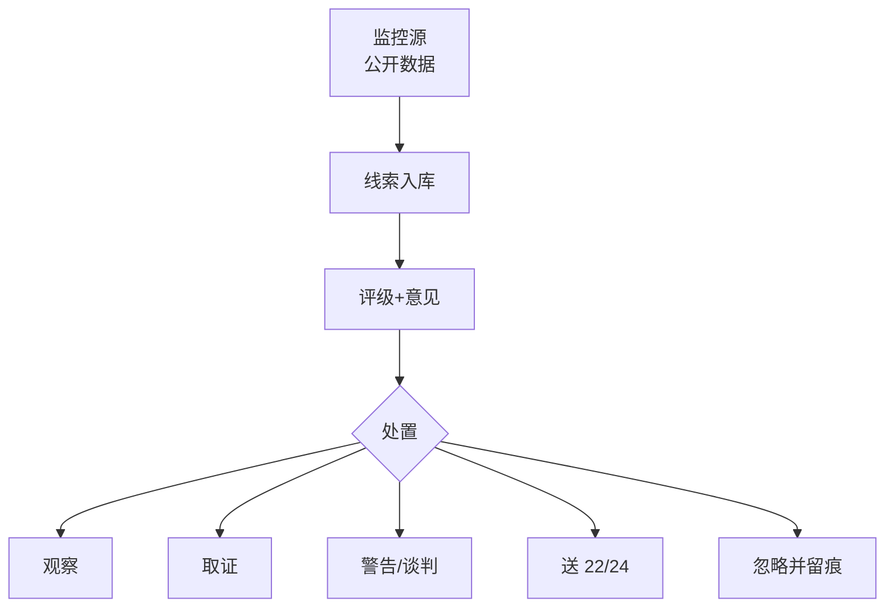

# 节点 07 · 监控预警（Monitoring / IP Watch）· 产品级业务规格

> **本节点是七阶段主轴里唯一「长驻不终结」的节点**：它不开案、不交官、不写权利要求，但它决定企业**什么时候从「守着权利」切换到「动用权利」**。
> 读者：新入职实习生 / 产品经理 / 后端 / 交付。读完应能：独立设计监控产品、写它的接口、向客户讲清它为什么值钱。
>
> 代码权威源：`packages/domain/src/types/index.ts`（`WatchAlert` / `WatchAlertStatus`）· `packages/domain/src/handoff.ts`（`REQUIRED_BEFORE_SUBMIT.watch_alert`）· `apps/workbench/src/flows/watch/WatchFlow.tsx` · `src/data/workbenchSeeds.ts`（`watchSeed`）· `src/utils/slaInbox.ts` · `src/utils/opsInbox.ts` · `src/data/agents.ts`（`agent-watch`）
> 法律口径以《专利法》（2020 修正）为准；凡金额、条号、程序天数均标 ⚠ 需按当期官方文本复核。

---

## 0. 一句话讲清这个节点

**监控 = 把「外部世界发生的事」翻译成「我方要不要动手」的决策队列。**

它监控的不是专利本身，而是**三个方向的外部变化**：对手又申请了什么、我的专利被谁引用了、市场上谁在卖与我方专利技术方案相同的东西。每一条变化进来时都只是一个「线索」，节点的工作是把它变成**有评级、有意见、有处置结论**的告警。

产品化视角下它能独立成产品，因为三条同时成立：

1. **有独立买方**：企业 IP 部门（自有专利被侵权）、法务（被诉风险）、市场/销售（竞品动向）。三者预算科目不同，但都买同一张收件箱。
2. **有独立价值**：监控失效不会立刻疼，疼的时候已经过了取证黄金期——**它的价值等于「少损失的钱」**，可折算（见 §12）。
3. **有独立边界**：输入是外部公开数据 + 自有专利清单，输出是 `watch_alert`，不依赖撰写、审查、年费任何模块即可交付。

> 讲给实习生的一句话：**FTO 是出门前看路，监控是走在路上看有没有人撞你。** 两者都用检索，但一个是事前预防，一个是事后发现。

---


## 0.1 人读：图 · 判定 · 依据

> 本节给人读：一张图看清本站怎么走；规则按 **A 法定 / B 程序 / C 商业 / D 质量**；判定与硬闸禁止拍脑袋。细节与编号规则仍以下文全文为准。

### 本站流程（进 → 活动 → 闸 → 出 → 下一站）



### 规则速查（类别：A 法定 · B 程序/期限 · C 商业 · D 质量/合规）

| ID | 类别 | 规则（一句话） | 依据 |
|---|---|---|---|
| R07-A1 | A | 侵权诉讼时效 3 年；诉前可申请行为/财产/证据保全 | 法 **74**；最高法专利纠纷规定 **17**；法 **72–73** ✅ |
| R07-B1 | B | 告警须有评级与处置结论才算出队 | 产品 watch_alert 齐套 |
| R07-C1 | C | 监控长驻不终结；非单案 Stage 终点 | 主轴设计 |
| R07-D1 | D | FTO≠监控：一事前一事后 | 与 01b 边界 |

### 怎么判定 · 怎么推进

| 判据 | 条件（可检查） |
|---|---|
| **进入本站** | 有监控对象清单（自有专利/对手/关键词）与数据源订阅。 |
| **本站完成** | 线索→告警：评级、意见、处置结论齐全并可审计。 |
| **推进下一站** | 按处置去 06/22/24/取证队列；忽略必须留痕。 |

### 硬闸（禁止拍脑袋）

- **禁止**只有线索标题没有处置结论做出队。
- **禁止**用监控结论代替 ClaimChart 侵权比对（须 25/24）。
- **禁止**静默丢弃告警无记录。

### 依据来源（调研摘要）

- 维权程序：法 **65** 及以下；赔偿计算见法 **71**；行政查处与司法并行。
- **诉讼时效**：法 **74**（3 年，自知道或应当知道侵权行为以及侵权人之日起算）；最高法《关于审理专利纠纷案件适用法律问题的若干规定》**第 17 条**（持续侵权时可判停止侵权，赔偿自起诉日起向前推算 3 年）。
- **诉前保全**：法 **72**（财产保全 / 责令或禁止一定行为）、法 **73**（证据保全）；知识产权行为保全审查见最高法《关于审查知识产权纠纷行为保全案件适用法律若干问题的规定》。
- 公证取证等为实务动作，管辖与担保要件按个案复核。抓取日 2026-10-23 Asia/Shanghai。

✅ 原 ⚠「诉讼时效 / 诉前保全条号」已闭环。

---
## 1. 节点定位与产品边界

### 1.1 在生命周期中的位置

```
自有专利授权(05) ────────────────┐
竞品新公开（外部） ───────────────┤
市场/展会/电商/招投标（外部）─────┼──► 【07 监控】──► 告警 ──► 处置
自有专利被引用（官方/第三方）─────┤        │                    │
                                 │        │                    ├─► 确认（继续观察）
无效威胁 / 被诉（外部）───────────┘        │                    ├─► 关闭（无动作）
                                          │                    ├─► 升级维权 ──► 06 转化（诉讼线）
                                          │                    └─► 生成调研案 ──► 01（反查 / 无效检索）
                                          └── 官方期限**不在此节点**：一律走 11 docket
```

**关键分工断言（代码里有明文）**：`WatchFlow` 页头副标题写着「监控办理 · 规则配置、告警收件箱与确认/升级/关闭 · **官方期限请走 Docket**」（`apps/workbench/src/flows/watch/WatchFlow.tsx:187`）。这条不是文案装饰，是这个节点的产品边界。

### 1.2 代码口径：StageId / 路由 / 壳 / 产物键

| 项 | 值 | 权威源 |
|---|---|---|
| StageId | `monitoring`（`STAGE_ORDER` 第 7 位） | `packages/domain/src/stages.ts:212` |
| 阶段名 | 「监控预警」/ 短名「监控」 | 同上 |
| 路由 | `/workbench/watch`、`/workbench/watch/:caseId`（深链 `?alert=<id>`） | `apps/workbench/src/App.tsx:132,140` |
| 壳 | workbench **:5174** | `packages/contracts/src/ports.ts:10` |
| 产物键 | `watch_alert`（标签「监控告警」） | `packages/contracts/src/handoff.ts:22` |
| Flow | `watch`，3 步：规则配置 → 告警处理 → 交接确认 | `src/data/flowSteps.ts:69-74` |
| Agent | `agent-watch`（tier `assist`） | `src/data/agents.ts:239-262` |
| SKU | `wb.stage.watch`，**默认已购** | `apps/workbench/src/lib/stageSku.ts:34,57-66` |

> **⚠ 与旧文档的冲突（必须纠正）**：本仓 `docs/lifecycle/README.md:18` 与旧版本篇都写过「监控预警 · :5185」。代码事实是：**`5185` 是 `apps/inspire`（创新激发）**（`packages/contracts/src/ports.ts:21`、`apps/inspire/vite.config.ts:7`、`apps/inspire/README.md:1`）。监控**没有**独立壳，数据面也不在 :5185。旧说法是端口串台，不应再作为规格引用。

### 1.3 它是什么 / 不是什么

| 是 | 不是 |
|---|---|
| 外部变化的**决策收件箱** | 官方期限提醒系统（那是 11 docket） |
| 侵权线索的**初步评级与分流器** | 侵权判定结论（判定须 claim chart + 法律意见） |
| 维权动作的**发起开关** | 维权程序本身（发函/投诉/诉讼在 06，无效在 22） |
| 监控**规则**的配置台 | 检索系统（检索在 01 / :5182） |
| 案件上的**常驻循环** | 有终态的流程（案件监控态可长期停留） |

### 1.4 上下游契约

| 方向 | 对象 | 契约 |
|---|---|---|
| 上游 | 自有专利清单（05 / `PatentCase`） | 提供被监控的权利基础；无有效专利则只做竞品监控 |
| 上游 | 检索/监控数据源（01 / :5182） | 提供新公开、引用、法律状态变化的原始命中 |
| 上游 | 市场/销售/展会现场（人） | 提供非专利渠道的侵权线索（展会、电商、招投标） |
| 下游 | 06 运用转化 | 「升级维权」建 `commercialization` 案（`fulfillmentMode: 'delegated'`） |
| 下游 | 01 立项前调研 | 「生成调研案」建 `pre_research` 案，用于反查可专利性/无效证据 |
| 下游 | 22 无效宣告 | 监控发现「威胁专利」后，无效是可选反制路径（当前仓内 22 未建模） |
| 横向 | 11 docket | **单向**：监控可引用 docket 事件，但不裁决期限 |
| 横向 | 12 商务 | 升级维权后费用走报价/发票；监控节点本身不产生费用 |

### 1.5 独立产品的形态

**产品名建议：监控中心 / IP Watch Center**

| 模块 | 能力 | 谁用 |
|---|---|---|
| 监控源接入 | 官方公布、商业数据库、电商爬取、招投标公告、展会名录 | IPR / IT |
| 规则引擎 | 关键词、竞品主体、IPC/CPC 分类号、权利要求相似度阈值 | IPR |
| 告警收件箱 | 分级、去重、聚合、SLA 计时 | IPR / 代理师 |
| 初判工作台 | claim chart 草稿、要素对照、风险分级 | 代理师 |
| 处置编排 | 确认 / 关闭 / 升级维权 / 生成调研案 | 企业 IP 经理 |
| 维权剧本库 | 律师函、警告函、协商、行政投诉、诉讼、无效 | 法务 / 律师 |
| 证据仓 | 公证购买、网页取证、展会取证的结构化归档 | 法务 |

**不做的**：不做官方期限管理（11）、不做 FTO 报告（01）、不做诉讼代理（06/律所）、不做无效请求书撰写（22）。

---

## 2. 角色与权限矩阵

| 角色 | 代码对应 | 能做什么 | 不能做什么 |
|---|---|---|---|
| 企业 IP 经理 | `role: 'enterprise'` | 填企业决策、升级维权、仅标记升级、关闭、审批交接 | 不能代填代理所意见（输入框 `disabled`） |
| 代理师 / 代理所 | `role: 'agency'` | 填代理所意见、确认告警、关闭、提交交接 | **看不到「升级维权」按钮**（仅 enterprise 渲染） |
| 法务 / 律师 | 无独立角色（靠 Persona 或外部） | 读告警、线下处理 | 仓内无角色映射 |
| 发明人 / 业务 | `persona: 'inventor'` | — | Persona 路由层直接挡在工作台外 |
| 专利委员会 | `persona: 'committee'` | — | `personaInboxMode` 为 `committee` 时**不进监控收件箱** |
| 监控 Agent | `agent-watch`（`assist`） | 扫描新公开、威胁评分、起草告警 | 不能自行升级维权；处置须人工确认 |

**当前实现的权限真相**（务必讲清，避免误以为是真鉴权）：

- 角色切换是**同一登录下的角色芯片**（`role: 'enterprise' | 'agency'`）+ Persona，不是 SSO / RBAC。
- 告警可见性是**纯函数过滤**，不是权限：`watchVisibleToActor` 按 role/persona/今日日期决定一条告警是否进收件箱（`src/utils/slaInbox.ts:82-101`）。真实产品这条必须是服务端授权。
- 双向字段隔离是**真做的**：代理所意见 `disabled={role === 'enterprise'}`，企业决策 `disabled={role === 'agency'}`（`WatchFlow.tsx:247,252`）。这是本节点最值得保留的设计——**意见与决策分属两个主体，不可互改**。
- 升级入口按角色不对称：`role === 'enterprise'` 才渲染「升级维权」主按钮，其他角色渲染「确认」（`WatchFlow.tsx:299-307`）；「仅标记已升级（不建案）」也只在 enterprise 下渲染（`WatchFlow.tsx:333-337`）。
- Agent 与工作台共用同一份告警台账；Agent 侧处置枚举被产品纪律钉死为「确认/升级/关闭」（`agents.ts:250,256`）。

### 2.1 决策权

角色矩阵回答「谁能做什么」，不回答「谁说了算」。监控节点的特殊性在于：**它本身不处分资产，但它决定「要不要开始处分」**——一条告警升级为维权，后面就是发函、起诉、无效，每一步都不可逆。所以这一节的权力分配必须把「发现」「评级」「决定动手」三件事拆开。

**四种权能，不得混用**：

| 权能 | 定义 | 监控中的典型场景 | 系统落点 |
|---|---|---|---|
| 建议权 | 提出判断与方案，不产生约束力 | 代理师出初判意见、定风险级别；IPR 建议升级 | 意见记录可被采纳或驳回，驳回须给理由 |
| 决定权 | 拍板并对结果负责 | 企业 IP 负责人决定升级、关闭、发函、公开谴责 | 决议记录 + 决策人签署 + 时间戳 |
| 否决权 | 单方面阻止已作出的决定 | 法务否决证据不足的发函；业务否决对重要客户的升级；合规否决跨境数据采集 | 一票否决，须书面说明理由 |
| 知情权 | 被动获知，不参与决策 | 业务部门知悉涉己客户的告警；发明人知悉其专利被引用；销售知悉竞品动向 | 订阅与通知，不阻断流程 |

> **本节点的核心铁律**：**监控人只负责「发现」与「评级」，不决定「是否维权」。** 发现与评级是事实判断与专业判断，维权的启动是商业决策。把两者交给同一个人，结果是监控员为了 KPI 滥报，或者为了省事瞒报——两种都致命。

**决策归属表**：

| 决策 | 建议权 | 决定权 | 否决权 | 级别与依据 |
|---|---|---|---|---|
| 监控规则怎么配（关键词、竞品名单、分类号、相似度阈值、地域与时间窗） | IPR、代理师 | IP 部门主管 | IT（数据可达性）、法务（合规） | L1（可逆）；变更须留痕 |
| 告警分级（高 / 中 / 低） | 代理师（初判）、系统（规则命中默认级） | 代理师定级、企业 IP 经理确认 | — | L2；级别上调须给理由 |
| 告警是否升级为维权 | 代理师、IPR | 企业 IP 负责人 | 法务（证据不足）、业务（重要客户 / 供应商） | L3（升级本身可逆，但一旦建案即产生成本） |
| 是否发出警告函 / 律师函 | 代理师（技术支撑）、律师（法律意见） | **法务总**（终审） | 业务（客户关系）、法务合规 | **L4（不可逆：影响商誉、触发确认不侵权之诉）** |
| 是否公开谴责 / 发新闻稿 / 行业通报 | 公关、法务 | 法务总 + 业务负责人双签 | 业务 | L4（对外发表声明不可收回） |
| 监控范围是否覆盖竞品 / 特定对手 | 业务、IPR | IP 部门主管 | 法务（跨境数据合规） | L2 |
| 误报如何处理（关闭、更正、撤回已发函） | 代理师 | IP 部门主管；已发函的误报须法务总决定补救 | 法务 | 误报关闭 L1；已发函补救 L4 |
| 监控是否外包 / 选哪家数据商 | IPR、采购 | IP 部门主管 + 采购 | 法务（数据处理协议）、IT（安全评估） | L2；涉外数据商须合规评估 |
| 是否对被诉 / 被警告作出应对（我方防御向） | 律师 | 法务总 | 业务 | L4（应诉与和解均不可逆） |

**分级口径（与 decision-rights §2.2 一致）**：

| 级别 | 条件 | 谁批 | 留痕 |
|---|---|---|---|
| L1 | 可逆 + 低金额 | 经办人（IPR / 代理师） | 系统记录 |
| L2 | 可逆 + 高金额 | 部门主管 | 审批流 + 理由 |
| L3 | 不可逆 + 低金额 | 双人复核（发起人 ≠ 批准人） | 双签 |
| L4 | 不可逆 + 高金额 | 高层 + 双人复核 | 双签 + 决议纪要 |

**发函的审批链（本节点唯一必须逐级走完的动作）**：

| 步 | 谁做 | 产出 | 缺这一步的后果 |
|---|---|---|---|
| 1 | 代理师 | 完整 claim chart（逐特征、含等同与排除分析） | 无对照的发函＝不当警告，可能反赔 |
| 2 | 律师 | 侵权成立性法律意见 + 确认不侵权之诉风险提示 | 对方催告后 1 个月 ⚠ 内不起诉，我方被动 |
| 3 | 业务 | 客户关系 / 供应链影响评估 | 把大客户告了，订单先没 |
| 4 | 法务总 | 终审签发 | 无终审的发函不产生内部效力，签字人自担责任 |
| 5 | 留档 | 函件正文、送达凭证、审批记录、claim chart 一并入卷 | 日后诉讼无法证明「已合理告知」，惩罚性赔偿基础缺失 |

> **业务部门可以要求「监控某个竞品」，但不能自行发函。** 这两件事经常被混为一谈：提监控需求是知情权与建议权的行使，成本只是几条规则；发函是处分商誉与诉讼主动权的不可逆动作。前者随时可做，后者必须走完上表五步。

---

## 3. 业务对象（字段级）

### 3.1 `WatchAlert`（告警，唯一持久对象）

权威源：`packages/domain/src/types/index.ts:183-195`。

| 字段 | 类型 | 必填 | 说明 |
|---|---|---|---|
| `id` | `string` | 系统 | seed 用 `al1/al2`；新建无 ID 生成器 |
| `title` | `string` | ✅ | 告警标题，也是「告警对象」的显示名 |
| `level` | `string` | ✅ | **自由字符串**（seed 用「高」「中」，判定函数兼容 `高xx`/`high`） |
| `status` | `WatchAlertStatus` | 系统 | 见 §3.2 |
| `note` | `string` | — | 告警说明（来源描述） |
| `agencyOpinion` | `string` | ✅（提交前） | 代理所意见，代理写 |
| `enterpriseDecision` | `string` | — | 企业处置决定，企业写 |
| `openedAt` | `string?` | — | 告警打开日（SLA 起点） |
| `slaDue` | `string?` | — | SLA 截止日；早于今日 = 超 SLA |

**⚠ 建模缺陷（真缺口，不是风格问题）**：

- `level` 是 `string` 而非枚举 → 无法做分级统计、无法做自动分级。级别文案由 seed 手写（`workbenchSeeds.ts:591,603`）。
- 对象里**没有任何监控类型字段**：分不出「竞品新申请 / 被引用 / 侵权线索 / 无效威胁 / 被诉」。三种业务语义全部压进 `title` 自由文本。
- 没有 `source`（数据源）、`matchedRecord`（命中的公开号/链接）、`evidence[]`（证据）、`relatedPatentNo`（我方被侵权的专利号）。
- 没有 `caseId` —— 归属靠外层 `Record<caseId, WatchAlert[]>` 容器（`AppContext.tsx:436`）。

### 3.2 `WatchAlertStatus`（四态 + 二过程态）

```ts
export type WatchAlertProcessStatus = '已确认' | '已升级' | '已关闭'
export type WatchAlertStatus = '待处理' | '处理中' | WatchAlertProcessStatus
```

来源：`types/index.ts:179-181`。注意 `待处理`/`处理中` 是**过程态**，后三个是**终态**。

### 3.3 监控规则（无类型，只活在 seed 里）

`watchSeed` 的 `rules` 是**内联匿名类型**（`src/data/workbenchSeeds.ts:560-577`）：

| 字段 | 类型 | 说明 |
|---|---|---|
| `id` | `string` | `wr1`… |
| `name` | `string` | 规则名 |
| `enabled` | `boolean` | 启停 |
| `threshold` | `string` | **纯文本阈值**，人读，机不可执行 |

seed 里三条规则的语义值得抄进产品：竞品新公开（标题/摘要命中 ≥2 关键词）、近似权利要求（独权相似度 > 70%）、侵权线索（产品参数匹配）——**这三条恰好对应本节点的三类监控**（`workbenchSeeds.ts:583-585`）。

### 3.4 三个容易混的东西

| 概念 | 落在哪 | 谁产生 | 会不会变成案件 |
|---|---|---|---|
| **告警** `WatchAlert` | 监控节点内存态 | 规则命中 | 不会（除非升级） |
| **docket 期限** `DocketEvent` | 11 节点 | 法定期限 | 不会 |
| **维权线索案** `PatentCase(stage='commercialization')` | 06 节点 | 告警升级 | 已经是案件 |

> 最容易错的一点：**告警不是案件**。老文档写过「`PatentCase.linkedAlertId`：案件 ↔ 告警溯源（回流 06 时携带）」。代码事实是：升级建案**不写** `linkedAlertId`（`WatchFlow.tsx:143-169` 的 `addCase` 入参没有该字段），`linkedAlertId` 只由 06 转化台的「关联监控告警」按钮写入（`apps/workbench/src/flows/monetize/MonetizeFlow.tsx:290-303`、`AppContext.tsx:1429-1433`）。**溯源靠人工点，不是自动带过去的**。

---

## 4. 业务规则（编号 `R07-xx`）

### 4.1 监控对象与规则配置

| ID | 规则 | 现状 |
|---|---|---|
| R07-01 | 监控必须按三类对象分别配置：①竞品新申请 ②自有专利被引用 ③侵权线索（市场/展会/电商/招投标） | ❌ 三类无类型，只靠规则名文案 |
| R07-02 | 每条监控规则必须绑定「命中后生成的告警类型 + 默认级别 + SLA 天数」 | ❌ 规则只有 `threshold` 文本 |
| R07-03 | 关键词与竞品主体为必填，二者至少一项非空 | ✅（`WatchFlow.tsx:174` 用作步骤推进判据） |
| R07-04 | 规则启用/关闭必须留痕（谁在何时改了什么） | ❌ 只改内存 state（`WatchFlow.tsx:212-216`） |
| R07-05 | 规则阈值必须可机判（数值 + 比较符），不接受自由文本 | ❌ 纯文本输入框 |
| R07-06 | 监控范围须声明地域与时间窗（如「中国 + 近 30 天新公开」） | ❌ |
| R07-07 | 同一被监控对象在 7 日内重复命中，必须合并为一条告警 | ❌ 无去重、无聚合 |
| R07-08 | 规则变更后应能回溯「这条告警当时是哪条规则命中的」 | ❌ |

### 4.2 告警分级

| ID | 规则 | 现状 |
|---|---|---|
| R07-10 | 级别必须是枚举（高/中/低 或 P1–P4），不接受自由文本 | ❌ `level: string` |
| R07-11 | 高风险 = 命中我方独权全部技术特征（全面覆盖成立）；中 = 部分特征重叠；低 = 仅技术领域相关 | ❌ 级别由 seed/人工手填 |
| R07-12 | 级别变更须记录变更人与理由 | ⚠ `patchWatchAlert` 可改 `level`，无留痕（`AppContext.tsx:1491-1510`） |
| R07-13 | 「高」级或超 SLA 的告警必须进入统一收件箱，且排在最前 | ✅ `watchVisibleToActor` + `opsInbox` 排序（`slaInbox.ts:95-101`、`opsInbox.ts:466-489`） |
| R07-14 | 涉及我方**在审**申请的引用告警，须回写该案的审查/布局判断 | ❌ |
| R07-15 | 涉及我方**已授权**专利的侵权告警，须绑定具体专利号与权利要求号 | ❌ 无字段 |

### 4.3 处置与响应剧本

| ID | 规则 | 现状 |
|---|---|---|
| R07-20 | 处置枚举固定为 确认 / 升级 / 关闭，不得只有「批准」 | ✅（`agents.ts:256`、`WatchFlow.tsx:100`） |
| R07-21 | 「升级」分两档：建案升级（建维权线索案）与仅标记升级（不建案），两档必须显式区分 | ✅（`WatchFlow.tsx:143` vs `:334`） |
| R07-22 | 关闭告警必须填写理由 | ❌ 关闭按钮无任何校验（`WatchFlow.tsx:308-314`） |
| R07-23 | 告警必须按级别路由到不同剧本：高→律师函/诉讼评估；中→协商/警告函；低→观察 | ❌ 无剧本对象 |
| R07-24 | 发函前必须完成权利要求对照（claim chart） | ⚠ 有「写入 Drive · claim_chart 草稿」按钮，产出为占位文件（`WatchFlow.tsx:258-274`） |
| R07-25 | 行政投诉（专利行政执法）与诉讼是**互斥优先**选择，须记录选择理由 | ❌ |
| R07-26 | 升级建案必须携带原告警 ID，形成溯源链 | ❌ 见 §3.4 |
| R07-27 | 升级建案的案件风险等级固定为「高」，办理模式为委托 | ✅（`WatchFlow.tsx:152`） |
| R07-28 | 同一告警不得重复建案（幂等） | ❌ 可重复点击生成多个案 |
| R07-29 | 无效宣告作为反制手段时，须记录「无效 vs 诉讼」的时间与成本比较 | ❌ 22 未建模 |

### 4.4 侵权判定与取证

| ID | 规则 | 现状 |
|---|---|---|
| R07-30 | 判定顺序固定：全面覆盖 → 等同 → 排除（禁止反悔 / 捐献） | ❌ 无判定引擎 |
| R07-31 | claim chart 必须逐特征列「我方权项 / 被诉方案 / 相同-等同-不同」三列 | ⚠ 表格固定两行（独权核心特征、应用场景），不可增行（`WatchFlow.tsx:276-296`） |
| R07-32 | 等同判定须记录「手段/功能/效果」三基本与「是否需创造性劳动」四项结论 | ❌ |
| R07-33 | 禁止反悔：须能检索该专利审查/无效程序中的限缩性修改与意见陈述 | ❌ 无审查档案数据 |
| R07-34 | 捐献：说明书中公开但未写入权项的技术方案，不得主张 | ❌ 无说明书结构化数据 |
| R07-35 | 取证方式必须结构化：公证购买 / 网页取证（含时间戳或公证）/ 展会取证 | ❌ 仅 `note` 自由文本 |
| R07-36 | 网页证据必须保存 URL + 抓取时间 + 内容快照三件套 | ❌ |
| R07-37 | 公证购买须记录购买人、地点、时间、票据、实物编号 | ❌ |
| R07-38 | 展会取证须在展期内完成（闭展后现场证据不可复得） | ❌ 无展期日历联动 |

### 4.5 合规与外部程序

| ID | 规则 | 现状 |
|---|---|---|
| R07-40 | 海关备案须在权利有效期内办理，备案到期前 6 个月提醒续展 | ❌ |
| R07-41 | 展会保护：参展前完成「是否有被诉风险 + 是否需现场投诉」双检查 | ❌ |
| R07-42 | 电商平台投诉须走「通知—删除」要件（权属证明 + 定位信息） | ❌ |
| R07-43 | 发警告函前须评估「确认不侵权之诉」反噬风险 | ❌ |
| R07-44 | 侵权诉讼时效 3 年，自知道或应当知道侵权行为**及侵权人**起算（法 **74**）；持续侵权赔偿推算见最高法专利纠纷规定 **17**；监控须记录「首次发现日」 | ⚠ 有 `openedAt` 但无「首次发现日」语义区分 |
| R07-45 | 收到警告函/被诉时，须在监控侧开一条**防御向**告警（方向：我方被指侵权） | ❌ 单向建模 |

### 4.6 时限与 SLA

| ID | 规则 | 建议值 | 现状 |
|---|---|---|---|
| R07-50 | 高风险告警首响 SLA | 2 个工作日 | ❌ `slaDue` 由 seed 写死 |
| R07-51 | 中风险告警首响 SLA | 5 个工作日 | ❌ |
| R07-52 | 低风险告警首响 SLA | 10 个工作日 | ❌ |
| R07-53 | `slaDue` 必须由 `openedAt + 级别对应天数` 计算，不得手填 | — | ❌ 无计算函数 |
| R07-54 | 超 SLA 自动升级到 IP 负责人（复用 `DocketEscalationLevel`） | — | ⚠ 只在收件箱标色，不升级 |
| R07-55 | 证据保全时效：发现侵权后 30 日内完成首轮取证 | 30 日 | ❌ |

### 4.7 写回与权限

| ID | 规则 | 现状 |
|---|---|---|
| R07-60 | 代理所意见只能由代理写，企业决策只能由企业写 | ✅（双向 `disabled`） |
| R07-61 | 提交交接前必须已填代理所意见且有风险级别 | ✅（`WatchFlow.tsx:357-364`） |
| R07-62 | 每次状态变更写 activity + Drive 条目 | ✅（`WatchFlow.tsx:105-110,157-162`） |
| R07-63 | 告警台账在交接批准后才允许写库（Agent 侧约束） | ⚠ 仅 Agent `guardrails` 文案，工作台直接写内存 |
| R07-64 | 告警关闭后不可重开 | ⚠ 迁移表无重开动作，但也没有「误关恢复」路径 |
| R07-65 | 非本案人员不得看到本案告警 | ❌ 仅靠 role/persona，无案级授权 |

### 4.8 例外情形

规则写得再严，业务现场总会出现「这次必须例外」。不给有依据的出口，用户就会用「先关掉再说」绕过系统，连留痕都没有。本节只收**有依据的例外**（法定 / 合同 / 内部），不收「客户强烈要求」。

| # | 例外 | 例外条件 | 谁批准 | 风险 | 留痕 |
|---|---|---|---|---|---|
| E1 | 告警发生在展会期间，取证窗口极短 | 展期仅数日，闭展后现场证据不可复得；标准取证流程（公证购买、审批）来不及 | 法务（事前授权或展期专班），IP 部门主管 | 仓促取证证据强度低；现场拍照可能侵犯展商权益或违反展馆规则 | 必留：展期日历 + 现场取证清单 + 取证人与时间 + 事后补强计划 |
| E2 | 对方是重要客户 / 供应商 | 对方为营收占比超阈值 ⚠ 的客户、关键物料独家供应商、或在谈重大合作 | 业务负责人 + 法务总，双签 | 维权动作直接冲击营收或供应链；可能触发对方的反向报复 | 必留：商务影响评估（金额、可替代性）+ 替代处置方案（协商、改设计、换供应商） |
| E3 | 告警涉及自家供应商 | 侵权产品由我方供应商制造，或供应商使用了我方专利而未获许可 | 法务 + 采购，IP 部门知情 | 追责供应商可能断供；不追责则可能被认定为默示许可或怠于维权 | 必留：供应合同中的知识产权条款审查 + 是否要求供应商整改或补签许可 |
| E4 | 误报导致误发函的补救 | 已发函但事后确认不侵权（权项解读错误、证据失效、对方有先用权等） | 法务总（L4），24 小时内 ⚠ 启动 | 对方可提确认不侵权之诉或商业诋毁索赔；商誉损失已经发生且不可撤 | 必留：撤回函 + 书面致歉范围界定 + 内部复盘 + 是否通知受影响第三方 |
| E5 | 跨境监控的数据合规限制 | 数据源位于境外，或采集行为涉及个人信息、跨境传输限制、当地法律禁止的抓取 ⚠ | 法务合规 + IT 安全，双签 | 违反当地法律或数据保护规则；证据在境外法院不可采 | 必留：数据来源合法性说明 + 传输路径 + 当地律师意见（如需） |
| E6 | 监控发现自家专利被他人提起无效 | 监控捕获无效请求受理信息或口审公告，而 22 节点尚未建模 | 企业 IP 负责人（转 22 处理），法务知情 | 答复期限错过即视为放弃意见，权利可能被全部无效 | 必留：无效请求书副本 + 答复期限 + 转 22 的交接记录 |
| E7 | 告警对应权利基础已灭失但仍需留证 | 专利已过期或已放弃，但侵权行为发生在权利有效期内、损害赔偿时效未过 ⚠ | 法务（时效判断） | 无权利基础即无诉权；但过早关闭会丢失已发生的损害赔偿请求权 | 必留：权利终止日 + 侵权发生时点 + 时效剩余计算 |
| E8 | 紧急情况下先取证后补审批 | 证据正在消失（店铺下架、展品撤展、网页删除），补审批会导致证据灭失 | 法务事前授权（值班授权人），24 小时内 ⚠ 补批 | 无授权取证可能被质疑合法性；费用事后可能不予报销 | 必留：紧急事由说明 + 取证时间戳 + 24 小时内补批记录 |

**误报补救的单独说明（唯一需要独立流程的例外）**：

误发函是本节点最贵的错误，因为它同时产生三个后果：商誉损害、确认不侵权之诉的被动、以及后续真侵权案件的可信度折损。补救不能只是「道个歉」。

| 步 | 动作 | 时限 | 谁做 |
|---|---|---|---|
| 1 | 冻结后续动作（停止催告、停止平台投诉） | 立即 | 法务 |
| 2 | 内部复核误报原因（权项解读 / 证据 / 权属） | 3 个工作日 ⚠ | 代理师 + IPR |
| 3 | 向对方发出书面撤回函，明确撤回范围（不扩大到其他主张） | 5 个工作日 ⚠ | 法务总签发 |
| 4 | 评估对方是否已提确认不侵权之诉；如已提，转入应诉 | 即时 | 律师 |
| 5 | 复盘并回写规则（哪条监控规则 / 哪一步比对出了问题） | 10 个工作日 ⚠ | IP 部门 |

> 第 5 步最容易被跳过，但它才是唯一能防止同类错误再发生的一步。**误报率指标（§12）不降，说明复盘没做。**

**例外不是豁免**：每条例外都须记录**批准人、批准时间、理由、有效期**，只对本条告警生效。例外率异常（例如 E2「重要客户」一年触发二十次）说明升级标准本身定错了，应回改规则，而不是继续批例外。

### 4.9 规则冲突与裁决

监控节点的冲突有一个共性：**速度与准确性直接对立**。侵权证据在消失，但判断需要时间；业务要安抚客户，法务要固定证据。这类冲突没有客观最优解，只能预先规定「谁的意见在什么条件下优先」。

**六类真实冲突**：

| # | 冲突 | 典型表现 | 裁决 | 裁决人 |
|---|---|---|---|---|
| C1 | 快速反应 vs 核实清楚 | 电商链接随时下架，claim chart 要三天才能做完 | **先做证据保全（低成本、可并行），再决定动作**。取证不等于发函；取证可立即做，发函必须等 claim chart 完成 | 代理师（取证）、法务（发函时点） |
| C2 | 业务要发函 vs 法务要谈判 | 销售被竞品抢单，要求立刻发律师函施压；法务认为对方可能成为客户，宜先谈 | **先发协商函（不主张侵权、仅主张权利存在），不发警告函**；协商函通常不构成侵权警告，因而不触发确认不侵权之诉的催告效果 ⚠ | 法务总决定函件性质，业务可要求加快节奏 |
| C3 | 监控范围广 vs 误报多 | 关键词放宽覆盖率上升，但误报率突破 40% | **以误报率阈值为准**：超过阈值必须先加否定词 / 提相似度阈值 / 加主体排除，再扩范围 | IP 部门主管，按 §12 指标考核 |
| C4 | 对手是客户 vs 必须维权 | 侵权方同时是占营收大头的客户，或关键供应商 | **先算「维权收益 − 客户流失损失」**；为正则维权，为负则协商或改设计。不得因为「是老客户」直接关闭（关闭须填理由，见 R07-22） | 业务负责人 + 法务总双签（对应 E2） |
| C5 | 公开 vs 保密 | 是否公开谴责、是否在行业媒体曝光侵权行为 | **默认不公开**：公开谴责须 L4 双签，且必须先完成取证与法律意见；保密方案（协商、平台投诉）能达成目的时，不得公开 | 法务总 + 业务负责人 |
| C6 | 代理师意见「建议起诉」 vs 企业决定「关闭」 | 代理师认为侵权明确，企业因商业原因关闭 | **记录分歧即可关闭，但高风险告警的关闭须二级审批**（R07-22 的加强版）；关闭理由与代理师意见必须同时留档 | 企业 IP 负责人，法务知情 |

**裁决顺序（自上而下适用）**：

| 序 | 原则 | 含义 | 例外 |
|---|---|---|---|
| 1 | **法定优先** | 诉讼时效、催告期、海关备案期、电商等待期，不得因内部流程延长 | 仅 §4.8 列明的例外可偏离 |
| 2 | **合规优先** | 证据合法性、数据来源合法性、跨境传输合规，优先于取证速度 | — |
| 3 | **不可逆优先** | 发函、公开谴责、起诉、和解四类不可逆动作，先获得决策资源与审批时间 | — |
| 4 | **证据时效优先于判定精度** | 证据可能灭失时，先固定证据（可并行、可补强），判定结论可以后出 | 不得以「先取证」为由跳过 claim chart 直接发函 |
| 5 | **事实判断归专业，商业判断归企业** | 侵权成立性、证据强度由代理师 / 律师定；是否维权、是否得罪客户由企业定 | 企业可否决，但须书面说明并承担后果 |
| 6 | **误报成本优先于漏报收益** | 发函的误报成本（诉讼、商誉）高于暂不动作的漏报成本时，选择不发 | 证据明确且损失持续扩大时升级 |
| 7 | **书面留痕优先于口头一致** | 任何偏离上述顺序的决定，必须有书面理由 | — |

> **最重要的一条**：C2 与 C4 是同一个病——把「商业关系」和「法律判断」压给同一个人。代理师对**是否构成侵权、证据够不够**负责；企业对接**要不要为此得罪一个客户**负责。混在一起的结果，要么是销售逼着法务发一封打不赢的函，要么是法务用「再观察观察」把一个正在流失的市场拖没了。**意见必须分开存，决定必须有人签。**

### 4.10 决策权规则

以下规则使 §2.1 可执行、可审计。第一组是**权能分离与发函审批链**：

| ID | 规则 | 现状 |
|---|---|---|
| R07-70 | 四种权能（建议 / 决定 / 否决 / 知情）须分别配置到人，不得合并为一个审批按钮 | ❌ |
| R07-71 | 监控人只负责发现与评级，不决定是否维权；升级决策须由企业 IP 负责人作出 | ❌ |
| R07-72 | 发警告函须法务总终审签发，且前置条件为完整 claim chart + 法律意见 + 业务影响评估（§2.1 五步链） | ❌ |
| R07-73 | 发函、公开谴责、起诉、和解四类不可逆动作一律 L4：双人复核 + 决议纪要，不得单人一键执行 | ❌ |
| R07-74 | 业务部门可提出监控某竞品的需求，但不得自行发函、自行投诉、自行联系对方 | ❌ |
| R07-75 | 告警分级由代理师定级、企业确认；级别上调须记录理由，降级须法务复核 | ❌ |
| R07-76 | 关闭高风险告警须二级审批，并同时保留代理师意见与关闭理由（对应 C6） | ❌ |
| R07-77 | 监控外包须签数据处理协议并通过安全评估；跨境数据源须法务合规会签（对应 E5） | ❌ |

第二组是**例外处置与留痕**：

| ID | 规则 | 现状 |
|---|---|---|
| R07-78 | 误报关闭为 L1；已发函后的误报补救为 L4，须在 24 小时内 ⚠ 启动（对应 E4） | ❌ |
| R07-79 | 防御向告警（我方被指侵权）的应诉、和解、反诉由法务总决定，业务有否决权 | ❌ |
| R07-80 | 决定人须预设 A/B 角；未获明确答复不得发函或起诉，沉默不构成同意 | ❌ |
| R07-81 | 每个决策须记录：决策人、时间、依据、备选方案、未采纳原因；意见与决议分别存储，不得互相覆盖 | ❌ |
| R07-82 | 紧急取证可先执行后补批，但须在 24 小时内 ⚠ 补批并说明证据灭失风险；未补批的取证费用不予报销、证据标记为「授权瑕疵」（对应 E8） | ❌ |
| R07-83 | 监控发现自家专利被提无效时，须自动转 22 并锁定答复期限；监控侧告警与无效案件双向关联（对应 E6） | ❌ |
| R07-84 | 发函前须核验目标专利当前法律状态（有效 / 已质押 / 已独占许可 / 已终止），权利基础灭失的不得发函 | ❌ |

---

## 5. 法律底座（产品护城河）

这一节是监控产品区别于「爬虫 + 关键词提醒」的地方。**没有这一节，产品只能卖几百块一年。**

### 5.1 侵权行为的法定类型（专利法第十一条）

**规则**：发明/实用新型授权后，未经许可，任何人不得为生产经营目的**制造、使用、许诺销售、销售、进口**其专利产品，或使用其专利方法及使用、许诺销售、销售、进口依该方法直接获得的产品。外观设计为制造、许诺销售、销售、进口（**不含「使用」**）。

**产品落点**：监控的「侵权线索」必须按这五种行为分类采集——制造（工厂/代工）、使用（下游用户）、许诺销售（展会样品、电商上架、宣传册）、销售（订单/发票）、进口（海关报关）。**许诺销售是最容易被忽略也最容易取证的一类**（展会摆样即构成）。

**失效后果**：只盯「销售」会漏掉展会与电商上架，等对方正式开卖时，你已经失去禁令的最佳时点。

### 5.2 侵权判定四原则（司法解释体系）

| 原则 | 内核 | 产品落点 | 失效后果 |
|---|---|---|---|
| **全面覆盖** | 被诉方案须包含权项记载的**全部**技术特征；缺一个即不落入 | claim chart 逐特征勾选，缺项自动判「不侵权」 | 漏检一个特征就误判侵权，发函即构成不当警告 |
| **等同** | 手段/功能/效果「三基本」+ 本领域技术人员无需创造性劳动即可联想 ⚠ 条号以现行文本为准 | claim chart 增加「等同」列与四要素结论 | 只做字面比对，放过改写型规避 |
| **禁止反悔** | 授权/无效程序中通过修改或意见陈述放弃的方案，诉讼中不得再主张 | 判定前强制调取审查档案 | 主张了已被放弃的范围，直接败诉 |
| **捐献** | 仅在说明书/附图中描述而未写入权项的方案，视为捐给公众 | 判定前比对说明书与权项差异 | 把说明书当权项用，主张不成立 |

> ⚠ 条号说明：上述规则见《最高人民法院关于审理侵犯专利权纠纷案件应用法律若干问题的解释》（法释〔2009〕21 号）第五、六、七条；该解释经 2020 年修正后**条号有位移**，引用时须按现行文本核对。等同特征定义见《关于审理专利纠纷案件适用法律问题的若干规定》相关条文。**不要在合同或对外材料里写死条号。**

### 5.3 行政执法与司法两条救济线（专利法第六十五条）

**规则**：侵权纠纷由当事人协商；不愿协商或协商不成，可向人民法院起诉，**也可以请求管理专利工作的部门处理**。管理部门处理时，认定侵权成立的可责令立即停止侵权行为；可就赔偿数额调解，调解不成另行起诉。行政处理**依请求启动，不主动依职权**。

**产品落点**：剧本库里「行政投诉」不是「诉讼的简化版」，而是**另一条独立路径**：周期短、成本低、只止不停（通常不判赔偿）、可 15 日内被诉至法院 ⚠ 天数需核。系统应让用户在选择时看到「周期/成本/能否拿到赔偿」三维对比。

**失效后果**：把行政投诉当万能药，客户拿不到赔偿；把诉讼当唯一路径，中小客户直接被成本劝退。

### 5.4 赔偿与惩罚性赔偿（专利法第七十一条）

**规则**：赔偿按「权利人实际损失 → 侵权人获利 → 许可费合理倍数」顺序确定；对**故意**且**情节严重**的，可按上述方法确定数额的**一倍以上五倍以下**确定赔偿；三者均难以确定的，适用法定赔偿，幅度为**三万元以上五百万元以下** ⚠ 金额按 2020 修正文本。

**产品落点**：告警里必须能挂「损失估算」字段，哪怕只是量级（十万/百万/千万）。**没有金额的告警不会被升级**——这是产品设计上的因果，不是财务细节。惩罚性赔偿的证据要求（故意 + 情节严重）反推监控必须留「已发函、已告知、仍继续」的时间线。

### 5.5 诉前禁令与诉讼时效（专利法第七十二、七十四条）

**规则**：有证据证明他人正在或即将实施侵权行为、不及时制止将造成难以弥补损害的，可在起诉前申请责令停止有关行为（第七十二条）。侵权诉讼时效**三年**，自知道或应当知道侵权行为**以及侵权人**之日起算（第七十四条）。

**产品落点**：`openedAt` 只有「告警打开日」，缺「首次发现日」。两者可能差几个月（线索躺在邮件里没人录）。**时效从「知道」起算，不是从「录系统」起算**——产品必须允许补录首次发现日，并据此算时效剩余。

### 5.6 警告函的反噬：确认不侵权之诉

**规则**：权利人发出侵权警告后，被警告人书面催告权利人行使诉权，自权利人收到催告之日起**一个月内**未起诉或未撤回警告的，被警告人可请求法院确认其行为不侵犯专利权 ⚠ 条号以现行司法解释为准。

**产品落点**：这是「发函」这个动作最大的隐性成本。剧本库中「律师函」必须前置一个检查项：**我方 claim chart 是否足以支撑到起诉**；支撑不了就只发协商函，不发警告函。系统应在发函动作上挂「若 1 个月内不起诉，对方可提确认不侵权之诉」的风险提示。

### 5.7 电商与展会：非诉讼渠道（高频、低成本）

| 渠道 | 规则要点 | 产品落点 |
|---|---|---|
| 电商平台 | 权利人通知 → 平台转送 → 反通知 → 等待期后终止措施；「合格通知」需权属证明 + 可定位商品信息 ⚠ 等待期天数按《电子商务法》现行条文核 | 告警动作里加「平台投诉」分支，附要件清单 |
| 展会 | 按《展会知识产权保护指引》（2022）在展期内向展会知识产权投诉机构投诉 | 展期日历 + 现场取证清单 |
| 海关 | 知识产权海关保护**备案**，有效期 **10 年**（剩余权利期不足 10 年则从权利期），期满前 **6 个月**可申请续展 | 备案到期作为独立 docket 事件 |

> ⚠ 注意名称：现行可援引的是国家知识产权局 2022 年印发的《展会知识产权保护指引》；早期「展会知识产权保护办法」的效力状态须另行核实，**不要混引**。

### 5.8 无效宣告作为防御手段（专利法第四十五、四十六条）

**规则**：自授权公告之日起，任何单位或个人可请求宣告专利权无效；无效决定对已作出的侵权处理可产生溯及影响。请求费按专利类型计（发明/实用新型/外观不同档）⚠ **金额须按当期收费表核对，且不适用费用减缴**；请求费须自提出请求之日起 **1 个月内**缴足，逾期视为未提出。

**产品落点（时机与成本）**：

- **时机**：收到警告函后、被诉后答辩期内、或作为谈判筹码时。被诉后提无效并可申请中止诉讼，是最常见的拖时间/翻盘手段。
- **成本结构**：官费（相对小）+ 代理费（相对大）+ 时间（数月到一年以上）。系统应能算「无效 vs 和解 vs 应诉」的三方案对比。
- **决策规则**：只有当「目标专利稳定性差」且「该专利构成实质障碍」时才提无效；纯粹为拖延的无效会被认定为恶意。

**失效后果**：把无效当常规武器，客户花钱买不到结果；该提不提，则被迫在侵权诉讼里硬扛。

### 5.9 与 FTO 的分工（同一套判定方法，两个方向）

| 维度 | FTO（01 / :5183） | 监控（07） |
|---|---|---|
| 时点 | 产品立项/上市**前** | 产品在售/在研**中** |
| 方向 | 我是否落入**他人**专利 | 他人是否落入**我**专利；以及我是否被指侵权 |
| 输出 | 风险分级 + 规避设计建议 | 告警 + 处置剧本 |
| 失败后果 | 上市即被诉 | 侵权持续、证据灭失、时效流逝 |
| 共用能力 | 权利要求比对、claim chart、等同判断 | 同左 |

> **产品含义**：FTO 与监控应共用同一个「权利要求比对引擎」，只是查询方向相反。仓内两者目前是两套实现（01 的 `research_report` vs 07 的占位 claim chart），这是可复用的最大浪费。

---

## 6. 状态机

### 6.1 告警状态机

```
        ┌──────── 确认 ────────► 已确认（终态）
        │
待处理 ─┼──────── 升级 ────────► 已升级（终态）
        │
        └──────── 关闭 ────────► 已关闭（终态）

处理中 ──（无入口）──► 只能被上述三动作覆盖
```

| 当前态 | 可迁往 | 谁做 | 业务含义 | 出口条件 |
|---|---|---|---|---|
| `待处理` | `已确认` | 代理/企业 | 已核实，继续观察 | 无（仅按钮点击） |
| `待处理` | `已升级` | 企业 | 转维权或仅标记 | 无（仅按钮点击） |
| `待处理` | `已关闭` | 代理/企业 | 误报或无需动作 | 无 |
| `处理中` | 任意终态 | 代理/企业 | 同 `待处理` | seed 初始态 |
| 终态 | — | — | 不可回退 | — |

### 6.2 交接状态机（`watch_alert` 的 7 态片段）

```
drafting → submitted_to_enterprise → enterprise_review → approved → authorized_to_file → filed
                    ↕                        ↕
              changes_requested  ◄───────────┘
```

动作中文名对齐业务（`packages/domain/src/handoff.ts:323-329`）：提交告警意见 / 确认风险评级 / 授权跟进维权 / 确认处置归档 / 退回告警意见。**这组命名是本节点最贴业务的一处设计**——它说的是「风险评级」和「跟进维权」，不是通用的「批准/授权」。

### 6.3 当前实现的偏差（逐条点名）

1. **`处理中` 不可达**：没有任何命令把告警置为 `处理中`，只有 seed 直接写了这个初值（`workbenchSeeds.ts:604`）。真实产品里「处理中」应是「已被某人认领」的显式动作。
2. **终态不可回退**：误点「关闭」即永久关闭，无重开、无撤销。
3. **`已确认` 与 `已关闭` 的业务差异没落地**：两者都只是改状态字符串，没有任何后续动作绑定（确认后不会排复查，关闭后不会归档理由）。
4. **`已升级` 两条路径不一致**：建案升级会同时写 Drive 条目并跳转；仅标记升级只改状态（`WatchFlow.tsx:334-336`），两者在台账上看不出区别。
5. **交接状态与告警状态两张皮**：告警全部关闭了交接仍可停在 `drafting`；交接 `filed` 了也不要求告警已处置。

---

## 7. 闸门与条件（代码对齐）

`evaluateGuardrails` 是唯一中央放行入口（`packages/domain/src/guardrails.ts`）。本节点在其上只命中通用闸，**没有专属闸**。

| 闸门 / blocker 码 | 触发条件 | 文案 | 代码位置 |
|---|---|---|---|
| `watch_alert` 齐套（3 项） | 提交/批准/授权/归档 前缺 `alert`/`risk`/`opinion` | `提交前缺少必填项：告警意见、风险评级…` | `handoff.ts:137-141` + `HandoffActionBar.tsx:120-140` |
| 提交前须有代理所意见 | `action === 'submit'` 且 `agencyOpinion` 为空 | `提交交接前须填写代理所意见` | `WatchFlow.tsx:359-362` |
| 提交前须有风险级别 | `action === 'submit'` 且 `level` 为空 | `请确认风险评级` | `WatchFlow.tsx:363` |
| `persona` | Persona 被禁执行该动作 | 按 `personaBlocksHandoffAction` | `guardrails.ts:252-256` |
| `enterprise` | 非企业调用企业专属闸 | `仅企业可批准` 等 | `guardrails.ts:262-272` |
| `sku`（工作台侧） | 未购 `wb.stage.watch` | `未购 SKU，不写交接` | `HandoffActionBar.tsx:104-107` |
| Full-check | **不适用**（本节点非申请递交） | — | `packages/domain/src/fullFilingCheck.ts:104-115` |

**关键判定口径（实习生最容易读错的一处）**：`alert`（告警意见）这一项在代码里是「宽进」的——

```ts
const alertReady = !!active && (active.status !== '待处理' || !!active.note?.trim()
  || !!active.agencyOpinion.trim() || !!active.enterpriseDecision.trim())
```

（`WatchFlow.tsx:115-120`）意思是：**只要告警已被处置过（状态不是待处理），或者随便哪个字段有点字，就算「告警意见」齐了**。所以一条被「关闭」的空告警也能让这一项变绿。真正的硬约束只剩「代理所意见非空」那一句（`validateBefore`）。这属于 UI 层校验，不在中央闸里——**换一个 UI 就绕过**。

---

## 8. 步骤序列 / 工作流

`FLOW_CATALOG.watch` 三步（`src/data/flowSteps.ts:69-74`）：

| # | 步骤 | 谁做 | 耗时 | 产出 | 失败回退 |
|---|---|---|---|---|---|
| 1 | 规则配置 | IPR + IT | 首次 1–3 天，之后按季复核 | 关键词、竞品名单、规则启停与阈值 | 命中率过低→扩词；噪声过高→加否定词/提阈值 |
| 2 | 告警处理 | 代理出意见 → 企业出决策 | 高风险 ≤2 工作日 | 每条告警：级别 + 代理意见 + 企业决策 + 状态 | 证据不足→挂起（当前无挂起态，只能关闭） |
| 3 | 交接确认 | 代理提交 → 企业确认 → 归档 | 1–3 工作日 | `watch_alert` 交接 + Drive 归档 | 退回重写（`changes_requested`） |

**每步完成条件（代码口径）**：

| 步骤 | 完成判据 | 位置 |
|---|---|---|
| 1 | 关键词或竞品至少一个非空，**或**已进入告警处理 | `WatchFlow.tsx:171-176` |
| 2 | 当前选中告警状态为 `已确认/已升级/已关闭` | 同上 |
| 3 | 交接状态进入 `submitted_to_enterprise` 及以后 | 同上 |

> ⚠ **判据只看「当前选中那一条」告警**：库里还有 5 条待处理，只要选中的那条关了，步骤就推进到 2。这是进度条的语义缺陷（见 §14）。

**离线子流程（产品必须补、代码完全没有）**：

```
线索进入 → 初筛（是不是同一个技术方案）→ 取证（公证/网页/展会）
        → claim chart 逐特征比对 → 四原则排除 → 定级
        → 剧本选择（函/协商/行政/诉讼/无效）→ 执行 → 结果回写告警
```

---

## 9. 写回与命令

| 动作 | 命令 / 函数 | 写入对象 | 是否跨口 |
|---|---|---|---|
| 改告警意见/决策/备注/级别 | `patchWatchAlert(caseId, alertId, patch)` | `watchAlertsByCase` 内存态 | 否 |
| 改告警状态 | `processWatchAlert(caseId, alertId, status)` | 同上 + `addActivity` | 否 |
| 升级建维权案 | `addCase({stage:'commercialization', …})` | `cases` | 否（同壳） |
| 生成调研案 | `addCase({stage:'pre_research', …})` | `cases` | 否 |
| 写 Drive 条目 | `appendCaseDriveItem(caseId, {kind,title,summary,source})` | `caseDriveItems` | 否 |
| 写 artifact | `addArtifact(caseId, '告警处理意见.md', '监控')` | `case.artifacts` | 否 |
| 交接动作 | `submitHandoff` / `approveHandoff` / `authorizeFile` / `fileResponse` | `case.handoffs.watch_alert` | 否 |
| Agent 侧处置 | `processWatchAlert`（经 `AgentContext`） | 同上 | 否 |

**跨口口径**：本节点全程在 workbench :5174 内完成，无跨口同步。中台 :5173 只读展示。**没有真实的「监控数据面」服务**——数据源是 seed（`watchSeed`，标注示意）。

**一个必须知道的实现细节**：`getWatchAlerts` 对**未在 seed 中出现的案件**会回落到 `watchSeed.c9`（`AppContext.tsx:1438`、`WatchFlow.tsx:38`）。也就是说**任何新案打开监控台，看到的都是无人机集群那两条告警**。演示可接受，交付不可。

---

## 10. 期限与 SLA

### 10.1 法定 / 硬期限

| 期限 | 长度 | 起算 | 后果 |
|---|---|---|---|
| 侵权诉讼时效 | 3 年 | 知道或应当知道侵权行为**及侵权人**之日 | 超期 → 丧失胜诉权（持续侵权的损害赔偿向前推算 3 年） |
| 确认不侵权之诉触发 | 1 个月 | 权利人收到书面催告之日 | 逾期未诉未撤 → 对方可提确认不侵权之诉 ⚠ 条号需核 |
| 电商反通知等待期 | 按《电子商务法》现行条文 ⚠ | 平台转送声明 | 期内未投诉/起诉 → 措施终止 |
| 海关备案有效期 | 10 年 | 备案生效日 | 到期未续展 → 备案失效 |
| 海关备案续展窗口 | 期满前 6 个月 | 备案期满日 | 错过 → 需重新备案 |
| 无效请求费缴纳 | 1 个月 | 提出无效请求之日 | 逾期 → 请求视为未提出 ⚠ 需核 |
| 行政裁决结案 | 立案后 3 个月（最长 6 个月）⚠ | 立案日 | 逾期 → 程序拖延，可诉至法院 |

### 10.2 业务 SLA（软，可配置）

高风险 2 工作日 / 中风险 5 工作日 / 低风险 10 工作日 / 首轮取证 30 日 / 发函前 claim chart 5 工作日。

### 10.3 与 docket 引擎的关系

| 关系 | 现状 |
|---|---|
| 官方期限 | **完全不进本节点**，全部走 11 docket ✅ 分工正确 |
| 监控 SLA | `slaDue` 是 seed 手填字段，**没有计算函数**，也没有对应 docket 规则 ❌ |
| 海关备案续展 | 无 docket 规则 ❌ |
| 诉讼时效 | 无 docket 规则 ❌ |
| 统一收件箱 | 监控告警与年费日程**已进同一个 `opsInbox`**（`src/utils/opsInbox.ts:465-489`），但 docket 事件在另一段逻辑里，三者未做跨类去重 ⚠ |

---

## 11. 边界与失败场景

| # | 场景 | 正确处置 | 现状 |
|---|---|---|---|
| 1 | 竞品上月在展会摆样，本月才被发现 | 展会取证窗口已过 → 转电商/宣传册取证，并标注「证据强度中」 | ❌ 无展期日历 |
| 2 | 电商店铺一夜下架，链接失效 | 立即网页取证（含时间戳），再走平台投诉 | ❌ 无取证动作 |
| 3 | 告警标题写着「发现近似公开案」，但没写公开号 | 强制要求 `matchedRecord` 可核验 | ⚠ 只有标题字符串 |
| 4 | 同一条侵权线索被三个渠道各报一次 | 去重合并为一条，附三来源 | ❌ |
| 5 | 代理写意见说「建议诉讼」，企业直接关闭 | 关闭须填理由，且高风险关闭需二级审批 | ❌ |
| 6 | 我方被对手发警告函 | 开防御向告警，1 个月内决定起诉或撤回；否则对方可提确认不侵权 | ❌ 单向建模 |
| 7 | 目标专利在无效程序中，诉讼被中止 | 告警挂「中止」标记，SLA 暂停 | ❌ |
| 8 | 客户要求「先发函吓一吓」，但没有 claim chart | 拒发警告函，改发协商函 | ❌ |
| 9 | 侵权方是我方大客户 | 升级前须过商务影响评估 | ❌ |
| 10 | 告警对应的专利已过期/已放弃 | 自动关闭并标注「权利基础灭失」 | ❌ 无权利状态联动 |
| 11 | 监控关键词命中的全是自家申请 | 规则加主体排除（申请人 ≠ 我方） | ❌ |
| 12 | 新案打开监控台看到别人的告警 | 无 seed 时应为空态 | ❌ 回落 `c9` |
| 13 | 告警积压 200 条无人处理 | 按级别 + SLA 排序，超期升级 | ⚠ 只排序不升级 |
| 14 | 同一条告警被重复「升级维权」 | 幂等：已有维权案则跳转而非新建 | ❌ |
| 15 | 展会前 3 天，客户问「我的产品会不会被查」 | 走 FTO 快筛（01/:5183），不是监控 | ⚠ 无跨节点引导 |

---

## 12. 指标（验收尺子）

| 指标 | 定义 | 健康区间 | 说明 |
|---|---|---|---|
| 告警首响时长 | `openedAt` → 首次处置 | 高 ≤2 工作日 | SLA 核心 |
| 超 SLA 告警占比 | 超期未处置 / 未关闭总数 | < 10% | 反映是否真有人看 |
| 误报率 | 关闭原因=「误报」/ 总告警 | < 40% | 过高说明规则太糙 |
| 升级转化率 | 升级数 / 高风险告警数 | 20%–50% | 过低=不敢维权，过高=滥诉 |
| 取证及时率 | 发现后 30 日内完成取证占比 | > 80% | 直接决定胜诉率 |
| claim chart 完成率 | 发函前有完整对照的占比 | 100% | 硬指标 |
| 平均发现滞后 | 侵权发生 → 首次发现 | < 90 天 | 越长，赔偿追溯越少 |
| 维权回收金额 | 判赔 + 和解金额 | — | **能换算成钱** |
| 监控成本 / 挽回损失 | 年监控投入 / 年维权回收 | < 1:5 | **能换算成钱** |

> 卖产品时优先讲「平均发现滞后」和「维权回收金额」：前者可以换算成「少损失的销售额」，后者直接是回款。

---

## 13. 产品化切分建议

| 层 | 内容 | 是否可独立交付 |
|---|---|---|
| L1 收件箱层 | 告警列表 + 分级 + SLA + 处置 | 是（最低配） |
| L2 规则层 | 关键词/竞品/分类号/相似度规则 + 去重聚合 | 是（差异化） |
| L3 比对层 | claim chart + 四原则排除 + 证据强度评分 | 是（护城河） |
| L4 剧本层 | 函/协商/行政/诉讼/无效 的路径选择与成本模型 | 是（法务买单） |
| L5 证据层 | 公证购买/网页/展会取证的结构化留痕 | 是（诉讼刚需） |
| L6 数据层 | 多源接入（官方、商业库、电商、招投标） | 依赖外部数据商 |

**定价锚点**：按「被监控专利件数」计价最自然（每件每年 X 元），叠加「维权项目」按案计费。纯 SaaS 席位制不适合，因为价值随组合规模线性增长。

**竞品参照系**：国外以 Anaqua / Clarivate（CompuMark/IP Watch）为主，强在数据源与组合管理，弱在中国行政执法/电商/展会这些本地渠道；国内工具强在爬取，弱在 claim chart 与四原则。**「中国救济渠道知识 + 权利要求比对」是空位。**

---

## 14. 现状差距表（代码 vs 本文）

| # | 差距 | 严重度 | 影响 |
|---|---|---|---|
| 1 | `WatchAlert` 无监控类型字段（竞品/引用/侵权/无效） | **高** | 三类业务压在一个标题里，无法分别统计与路由 |
| 2 | `level` 是自由字符串，非枚举 | **高** | 无法自动分级、无法做分级 SLA |
| 3 | `slaDue` 手填，无「openedAt + 级别」计算 | **高** | SLA 形同虚设 |
| 4 | 无监控规则类型，规则只活在 seed 匿名类型里 | **高** | 规则不可持久化、不可审计 |
| 5 | 升级建案不写 `linkedAlertId`，溯源断开 | **高** | 维权案查不到来源告警 |
| 6 | 未在 seed 的案件回落 `c9` 告警 | **高** | 数据串案，交付不可接受 |
| 7 | 关闭告警无理由、无审批 | 中 | 无法复盘、无法统计误报 |
| 8 | `处理中` 态不可达 | 中 | 无法表达「已认领」 |
| 9 | 终态不可重开 | 中 | 误操作不可恢复 |
| 10 | claim chart 固定两行、不可增行 | 中 | 无法承载真实逐特征比对 |
| 11 | 无证据对象（公证/网页/展会） | 中 | 诉讼阶段无据可用 |
| 12 | 升级/建案非幂等 | 中 | 重复建案 |
| 13 | 步骤进度只看当前选中告警 | 低 | 进度条失真 |
| 14 | 无防御向（我方被指侵权）告警 | 高 | 只有进攻，没有防守 |
| 15 | `docs/lifecycle/README.md` 标注监控壳 :5185（实为 inspire） | 低 | 文档误导，需更正 |
| 16 | 角色芯片非真鉴权 | 中 | 演示可接受，交付不可 |

**优先补的三件事**（按投入产出比）：

1. **告警类型 + 级别枚举 + SLA 计算**（差距 1、2、3）——三处小改，直接让台账可统计、可排序、可考核；不补这三条，后面所有指标都算不出来。
2. **升级溯源 + 幂等 + 去除 `c9` 回落**（差距 5、6、12）——这是「能不能交付」的底线，不是优化。
3. **证据对象 + claim chart 可扩展行**（差距 10、11）——决定产品能不能撑到诉讼环节，也是与爬虫类工具的分水岭。

---

## 15. 术语表

| 术语 | 含义 |
|---|---|
| IP Watch | 知识产权监控，区别于官方期限 docket 的业务监控 |
| 告警 / `WatchAlert` | 一次监控命中的结构化记录，有级别、有状态、有双向意见 |
| 竞品新申请监控 | 盯对手新公开的申请，判断技术路线与布局意图 |
| 引用监控 | 盯自有专利被谁引用，反推对手是否在跟进同一技术 |
| 侵权线索 | 市场上疑似实施我方专利的产品/行为，来自销售、展会、电商、招投标 |
| 许诺销售 | 以广告、展会展出、电商上架等方式表示可销售，**未成交也构成侵权** |
| 全面覆盖 | 被诉方案须包含权项全部技术特征才落入保护范围 |
| 等同特征 | 手段/功能/效果三基本 + 无需创造性劳动即可联想 |
| 禁止反悔 | 审查/无效中放弃的范围，诉讼中不得再主张 |
| 捐献原则 | 说明书公开但未写入权项的方案，视为捐给公众 |
| 确认不侵权之诉 | 被警告人催告后 1 个月内权利人未起诉，可主动请求法院确认不侵权 |
| 海关备案 | 在海关总署登记知识产权，便于口岸扣留，有效期 10 年 |
| 行政投诉 | 请求管理专利工作的部门处理侵权纠纷，**依请求启动** |
| 惩罚性赔偿 | 故意且情节严重时，按基数 1–5 倍判赔 |

---

## 16. 来源

法律与官方口径：

- [《中华人民共和国专利法》（2020 年修正）· CNIPA](https://www.cnipa.gov.cn/art/2020/11/23/art_97_155167.html) —— 第 11、65、71、72、74 条
- [《专利法实施细则》（2023 年修订，2024-01-20 施行）· CNIPA](https://www.cnipa.gov.cn/art/2023/12/21/art_98_189197.html)
- [《最高人民法院关于审理侵犯专利权纠纷案件应用法律若干问题的解释》· 最高法知识产权法庭](https://ipc.court.gov.cn/zh-cn/news/view-30.html) —— 全面覆盖 / 禁止反悔 / 捐献
- [最高法《关于审理侵犯专利权纠纷案件应用法律若干问题的解释（二）》解读 · CNIPA](https://www.cnipa.gov.cn/art/2016/3/22/art_66_28346.html)
- [最高法知识产权法庭：禁止反悔原则在专利侵权案件中的适用](https://ipc.court.gov.cn/zh-cn/news/view-6003.html)
- [《专利纠纷行政裁决和调解办法》· 司法部](https://www.moj.gov.cn/pub/sfbgw/flfggz/flfggzbmgz/202510/t20251017_526331.html) ⚠ 新规章，条号与期限须按现行文本复核
- [《专利行政执法办法》· CNIPA](https://www.cnipa.gov.cn/art/2013/10/23/art_74_27590.html)
- [《中华人民共和国知识产权海关保护条例》· 国家行政法规库](https://xzfg.moj.gov.cn/front/law/detail?LawID=52) —— 备案有效期与续展
- [《展会知识产权保护指引》（2022）· CNIPA](http://www.cnipa.gov.cn/art/2022/7/22/art_75_176738.html)
- [最高法《关于审理涉电子商务平台知识产权民事案件的指导意见》](https://www.court.gov.cn/zixun/xiangqing/254931.html)
- [《专利权无效宣告办事指南》· CNIPA](https://www.cnipa.gov.cn/attach/0/176fbe7880454ec5b1deff8ed416d52a.pdf) ⚠ 官费金额以当期收费表为准
- [最高法：知识产权惩罚性赔偿制度解读 · CNIPA](https://www.cnipa.gov.cn/art/2020/11/4/art_2198_154569.html)

行业实务：

- 确认不侵权之诉的受理条件与催告程序（实务综述，条号须按现行司法解释核对）
- 等同原则与捐献原则的适用限制（实务综述）
