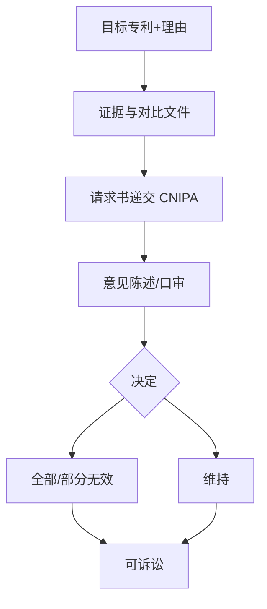

# 节点 22 · 无效宣告与异议程序（补建节点）

> **状态：仓内完全未建模。** 本文是补齐所需的产品级规格。
> 关联：[04-prosecution.md](04-prosecution.md)（授权前）· [05-maintenance.md](05-maintenance.md)（权利状态）· [07-monitoring.md](07-monitoring.md)（维权触发）· [../industry-reality.md](../industry-reality.md)
>
> 法律口径：《专利法》（2020 修正）第 45–46 条、第 65 条；《专利法实施细则》（2023 修订）无效宣告相关章节；《专利审查指南》第四部分。凡条号与费用标 ⚠ 需按当期官方文本复核。

---

## 0. 一句话讲清这个节点

**无效宣告是专利的「反向程序」：授权不等于稳固，任何人都可以在任何时候请求把一件已授权的专利全部或部分作废。**

它之所以能独立成产品，是因为它有**独立买方、独立价值、独立边界**：

- **独立买方**：被诉侵权方（防御性无效）、行业竞争者（清除障碍）、专利运营方（收购前尽职调查）。
- **独立价值**：一次成功的无效可以让对方索赔归零，或让自己的产品自由实施。单案价值常以百万计。
- **独立边界**：输入是「一件已授权专利 + 理由 + 证据」，输出是「无效宣告请求 + 口审 + 决定」，不依赖申请流程。

> 从产品视角看，这是整个生命周期里**唯一一个「攻击性」节点**。前面所有节点都在「获取权利」，这个节点在「消灭权利」。两条业务线的心智模型完全不同。

---


## 0.1 人读：图 · 判定 · 依据

> 本节给人读：一张图看清本站怎么走；规则按 **A 法定 / B 程序 / C 商业 / D 质量**；判定与硬闸禁止拍脑袋。细节与编号规则仍以下文全文为准。

### 本站流程（进 → 活动 → 闸 → 出 → 下一站）



### 规则速查（类别：A 法定 · B 程序/期限 · C 商业 · D 质量/合规）

| ID | 类别 | 规则（一句话） | 依据 |
|---|---|---|---|
| R22-A1 | A | 任何单位/个人可请求宣告专利权无效 | 《专利法》45 |
| R22-A2 | A | 无效决定可引致诉讼 | 《专利法》46 |
| R22-A3 | A | 理由通常含不具备三性、公开不充分、修改超范围等 | 审查指南第四部分；法 22、26、33 等 |
| R22-B1 | B | 请求须在期限内缴无效宣告费 | 细则费用章节 ⚠ |
| R22-D1 | D | 比对须走统一 ClaimChart（25） | 对象归一 |

### 怎么判定 · 怎么推进

| 判据 | 条件（可检查） |
|---|---|
| **进入本站** | 有已授权专利号 + 无效理由 + 证据起点；请求人主体适格。 |
| **本站完成** | 请求已受理推进；或已获决定并归档；口审记录完整。 |
| **推进下一站** | 决定后可循诉讼；与 24 交叉时策略协同；权利状态回写 05/23。 |

### 硬闸（禁止拍脑袋）

- **禁止**无证据的「感觉能无效」递交。
- **禁止**三处不同枚举的比对表并存（用 25）。
- **禁止**忽略优先审查/中止与侵权并行策略。

### 依据来源（调研摘要）

- 《专利法》45–46；审查指南第四部分无效宣告审查。
- 费用与期限 ⚠ 按当期收费表与指南。

⚠ 未核到当期官方原文的条号/金额/天数，部署前须按 CNIPA / 条约/法院文本复核。

---
## 1. 节点定位与产品边界

### 1.1 在生命周期中的位置

```
撰写(03) → 审查(04) → 授权 → 维持(05) ──┐
                                        │
                     ┌──────────────────┴──────────────────┐
                     │                                      │
              被诉侵权 / 遭遇障碍                    自有专利被挑战
                     │                                      │
                     ▼                                      ▼
             【无效他人专利】                        【防御自己的专利】
                     │                                      │
                     └──────────► 无效宣告程序 ◄────────────┘
                                       │
                          ┌────────────┼────────────┐
                          ▼            ▼            ▼
                      全部无效      部分无效      维持有效
                          │            │            │
                          ▼            ▼            ▼
                     权利自始不存在  权项缩小    权利存续
                          │                         │
                          └──► 行政诉讼（北京知识产权法院）──► 最高人民法院知识产权法庭
```

### 1.2 与相邻节点的边界

| 节点 | 关系 | 区别 |
|---|---|---|
| 04 审查答复 | 授权**前**的对抗 | 对手是审查员，程序在审查部门，目的是**获得**授权 |
| 22 无效宣告 | 授权**后**的对抗 | 对手是无效请求人，程序在复审无效审理部，目的是**消灭**权利 |
| 07 监控 | 发现侵权 | 监控回答「谁在用我的技术」，无效回答「他的专利该不该存在」 |
| 05 维持 | 权利状态管理 | 维持管理「权利还在不在」，无效是「权利本就不该在」 |
| 06 运用 | 许可/转让 | 转让/收购前的尽职调查必然包含无效风险检索 |

### 1.3 它是 / 不是

| 是 | 不是 |
|---|---|
| 对**已授权**专利的行政确权程序 | 对审查决定的救济（那是复审/行政诉讼） |
| 任何人在**任何时间**都可提起 | 只能在授权后特定期限内提（中国无此限制） |
| 理由**法定限定**（见 §5） | 可以拿任何理由挑战（如「技术不好」不能作为理由） |
| 结果**自始无效**（追溯力） | 从决定日起无效 |
| 一审级行政程序（复审无效审理部） | 司法程序（不服决定才进法院） |

### 1.4 独立产品的形态

**产品名建议：无效与确权工作台 / Invalidation & Defense Workbench**

| 模块 | 能力 | 谁用 |
|---|---|---|
| 无效检索 | 针对性现有技术检索（比申请前检索更深：非专利文献、公开使用、销售证据） | 代理师 / 检索员 |
| 理由构建 | 按法定理由组装证据链，评估每条理由的成立概率 | 代理师 |
| 证据管理 | 证据清单、公证、译文、公开时间证明 | 法务 / 代理师 |
| 口审准备 | 口审提纲、争点演练、对方可能反驳的预案 | 代理师 |
| 防御侧 | 自有专利被无效时的应对：修改权项、提交反证、主张维持 | 企业 IPR |
| 结果管理 | 决定书归档、行政诉讼期限跟踪、权利状态联动 | IPR |
| 组合影响分析 | 一件专利无效对同族/关联专利的影响 | IP 总监 |

**不做的**：不做申请流程（03）、不做侵权诉讼代理（法律业务，需律所资质）。

---

## 2. 角色与权限矩阵

| 角色 | 能做什么 | 不能做什么 |
|---|---|---|
| 无效请求人（客户） | 决定是否提起、确认理由与证据、授权代理 | 不能直接参与口审（须委托代理） |
| 专利代理师 | 撰写无效宣告请求书、检索、口审出庭 ⚠ 需核实代理师在无效程序中的出庭资格 | 不能替客户决定商业策略 |
| 律师 | 行政诉讼代理、侵权诉讼 | 非律师代理机构不能代理行政诉讼 |
| 专利权人（防御方） | 决定是否修改权项、提交意见陈述 | 修改受严格限制（见 §5.4） |
| 企业 IPR | 评估无效对业务的影响、决策投入 | 不直接撰写 |
| 合议组（官方） | 审理、口审、作出决定 | — |

> **产品权限设计的核心**：无效是**双向**业务。同一个产品要同时服务「请求人」和「专利权人」，两者看到的数据必须隔离，但共享同一套案卷。这是这个产品最特殊的架构约束。

### 2.1 决策权

角色矩阵回答「谁能做什么」，不回答「谁说了算」。无效程序涉及**实体处分**——放弃一项权利、支付一笔赔偿、承担一次败诉，每一个决策都必须落到具体的人，并区分四种权能。

**四种权能，不得混用**：

| 权能 | 定义 | 无效程序中的典型场景 | 系统落点 |
|---|---|---|---|
| 建议权 | 提出方案与理由，不产生约束力 | 代理师建议主攻创造性、建议放弃某条弱理由 | 建议记录可被采纳或驳回，驳回须给理由 |
| 决定权 | 作出最终选择并承担后果 | 客户决定是否提起、是否和解、是否上诉 | 决议记录 + 决策人签署 + 时间戳 |
| 否决权 | 单方面阻止他人已作出的决定 | 法务合规否决存在利益冲突的案件；业务负责人否决损害核心产品排他的权项修改 | 一票否决，须书面说明理由 |
| 知情权 | 被动获知，不参与决策 | 业务部门知悉涉诉专利进展；发明人知悉其专利被挑战 | 订阅与通知，不阻断流程 |

> **产品设计的硬约束**：审批流不能只有一个「审批人」角色。同一节点上「谁建议、谁决定、谁能否决、谁只需知道」必须分别配置，否则四种权能会退化成一个签字按钮。

**请求人侧的决策归属**：

| 决策 | 建议权 | 决定权 | 否决权 | 依据与条件 |
|---|---|---|---|---|
| 是否对某专利提无效 | 企业 IPR、代理师 | 企业 IP 负责人（重大案件报法务分管） | 法务合规（利益冲突、涉密） | 须命中触发事由之一：被诉侵权、自由实施受阻、收购尽调、许可谈判筹码；无触发事由不得立项 |
| 挑战范围（全部 / 部分） | 代理师 | 企业 IP 负责人 | 业务部门（部分无效已足够解除障碍时） | 与侵权诉讼的诉请范围对齐；优先「能解除障碍的最小范围」 |
| 选哪些理由 | 代理师（技术判断） | 客户（在代理师给出的可选集中选定） | 客户（理由会暴露自家销售/公开使用证据时可否决） | 代理师不得主张自己不相信的理由；每条理由须有证据链与比对图支撑（见 §3.2、§4） |
| 预算投入 | 代理师（工作量估算）、IPR | 按额度分级（见下表） | 财务 | 超阈值升级；不得拆分案件或拆分合同规避审批 |
| 和解 / 撤回 | 代理师、律师 | 客户授权代表（须有明确授权文件） | 法务 | 撤回不可逆，双人复核 + 书面确认 |
| 是否上诉（行政诉讼） | 律师、代理师 | 客户 | — | 决定日起 3 个月内 ⚠；期限压力下用预先授权（见本节末） |

**专利权人侧的决策归属**：

| 决策 | 建议权 | 决定权 | 否决权 | 依据与条件 |
|---|---|---|---|---|
| 修改权项 vs 硬扛 | 代理师 | 专利权人（IP 负责人 + 技术负责人会签） | 业务负责人（修改影响核心产品排他时） | 修改不得扩大范围；须评估修改后权项是否仍覆盖主要竞品 |
| 修改文本的具体取舍 | 代理师（技术层面） | 专利权人（重大取舍）；其余在委托范围内由代理师定 | 专利权人 | 把独权并入从权是常用路径，但每退一步都要算清剩余保护价值 |
| 是否放弃维持 | 代理师（提示后果） | 专利权人最高决策层 | 法务 | 不可逆，须双人复核 + 书面确认 |
| 是否另行起诉 / 反诉 | 律师 | 客户 | — | 与无效程序节奏协调，避免自相矛盾的主张 |

**知情权的最小集合**：业务部门（涉诉产品的市场影响）、发明人（其专利正被挑战这一事实）、财务（预算与官费支出）、法务（与诉讼的联动）。知情权不产生审批阻塞，但遗漏知情会导致「业务部门在判决之后才知道专利没了」。

**预算额度分级（金额为示意 ⚠，须按企业授权制度配置，不得硬编码）**：

| 层级 | 单案预算 | 批准人 | 典型情形 |
|---|---|---|---|
| L1 | ≤ 10 万元 ⚠ | 部门负责人 | 单件国内、单一理由、无需公证与翻译 |
| L2 | 10–50 万元 ⚠ | IP 总监 + 财务 BP | 多理由组合、需公证与译文、需口审演练 |
| L3 | 50–200 万元 ⚠ | 法务总 / CFO | 与侵权诉讼联动、需外部律师协同 |
| L4 | > 200 万元，或同族多国 ⚠ | 总经理 / 董事会授权 | 涉外平行程序、重大许可谈判筹码 |

**代理人的位置：可建议，不可替客户决定商业取舍**：

| 事项 | 代理师能否自主 | 说明 |
|---|---|---|
| 技术判断（理由成立性、证据强弱、口审策略） | ✅ 可自主，且应负责 | 这是专业判断，客户无能力替代 |
| 程序行为（文书格式、期限管理、答辩顺序） | ✅ 委托范围内自主 | 但改变请求范围、撤回请求除外 |
| 商业取舍（是否提、花多少钱、是否和解、是否放弃） | ❌ 仅建议 | 代理人不是风险承担者，不能替客户承担后果 |
| 对外签署产生实体处分效果的文书 | ❌ 须特别授权 | 无授权的签署效力待定，客户可追认或否认 |
| 转委托 | ❌ 须客户书面同意 | 转委托对象须具备相应资质 |

**期限压力下的临时授权**（起诉期、答复期临近而决策人失联）：

1. 立案时即预设 A/B 角决策人，授权书事先签署，不临时找人。
2. 期限前约定时点（建议 24 小时 ⚠，按企业制度定）仍未获答复 → 升级到 B 角，同时通知 A 角。
3. 事后 5 个工作日内补签追认；未追认的，案件标记为「授权瑕疵」，进入审计清单。
4. **沉默不构成同意**：未获明确答复不得推进任何不可逆动作。

---

## 3. 业务对象（字段级）

### 3.1 `InvalidationCase`（无效案件）

| 字段 | 类型 | 必填 | 说明 |
|---|---|---|---|
| `id` | string | 系统 | |
| `targetPatentNo` | string | ✅ | 被无效的专利号 |
| `targetTitle` | string | ✅ | 专利名称 |
| `targetOwner` | string | ✅ | 专利权人 |
| `side` | `'petitioner' \| 'patentee'` | ✅ | **本方立场**（请求人 / 专利权人） |
| `grounds` | `InvalidationGround[]` | ✅ | 无效理由（法定，见 §5.1） |
| `evidence` | `EvidenceItem[]` | ✅ | 证据清单 |
| `scope` | `'all' \| 'partial'` | ✅ | 请求全部无效 / 部分无效 |
| `claimsChallenged` | `string[]` | 条件 | 部分无效时指明挑战哪些权项 |
| `status` | `InvalidationStatus` | 系统 | 见 §6 |
| `filedAt` | string | 系统 | 请求日 |
| `decisionNo` | string | 系统 | 决定书编号 |
| `decisionDate` | string | 系统 | 决定日 |
| `decisionResult` | `'all_invalid' \| 'partial_invalid' \| 'maintained' \| 'withdrawn'` | 系统 | |
| `litigationDeadline` | string | 系统 | 行政诉讼起诉期限（决定日起 3 个月 ⚠） |
| `relatedCaseIds` | string[] | — | 关联的侵权诉讼案号 |

### 3.2 `InvalidationGround`（无效理由）

| 字段 | 类型 | 说明 |
|---|---|---|
| `code` | enum | 见 §5.1 的法定理由枚举 |
| `legalBasis` | string | 法条依据，如「专利法第 22 条第 3 款」 |
| `argument` | string | 论证要点 |
| `evidenceRefs` | string[] | 支撑该理由的证据 id |
| `claimCharts` | `string[]` | **该理由引用的比对图 id**（见下） |
| `strength` | `'strong' \| 'medium' \| 'weak'` | 内部评估，不对外 |

**理由成立性必须由比对图支撑，不能只写论证。** 三性与充分公开类理由，须引用 `purpose: 'invalidation'` 的 [ClaimChart](25-claim-chart.md)：

| 理由类型 | 比对图用途 | 判定规则 |
|---|---|---|
| 新颖性（22.2） | `invalid` + 单篇文献 | 全部要素 `identical` 才成立 |
| 创造性（22.3） | `invalid` + 组合文献 | 允许 `different`，须另附「为何显而易见」论证 |
| 26.3 / 26.4 | 不适用比对图 | 走说明书/权项文本分析 |

> **无效用途下禁止出现 `equivalent`**：等同是侵权概念，与新颖性/创造性无关（规则 R25-12）。

### 3.3 `EvidenceItem`（证据）

| 字段 | 类型 | 必填 | 说明 |
|---|---|---|---|
| `id` | string | 系统 | |
| `type` | `'patent' \| 'non_patent' \| 'public_use' \| 'sale' \| 'prior_art'` | ✅ | 证据类型 |
| `pubNo` | string? | 条件 | 专利文献必填 |
| `publicDate` | string | ✅ | **公开日**（决定能否作为现有技术的关键） |
| `url` | string? | 条件 | 可核验链接 |
| `notarized` | boolean | — | 是否公证 |
| `translation` | boolean | — | 外文证据是否附中文译文（**未附译文的证据可能不被采纳**） |
| `submittedAt` | string | — | 提交日（**逾期提交的证据可能不被考虑**） |

### 3.4 与既有对象的映射

| 现有对象 | 复用方式 |
|---|---|
| `DocketEvent` | 可复用，但需新增规则族（见 §10） |
| `HandoffStatus` 7 态 | **不完全适用**，无效是两造对抗，需独立状态机 |
| `CaseInvoice` | 可直接复用（官费 + 代理费） |
| `ResearchHit` | 可复用为证据的专利文献来源，但需扩展非专利文献类型 |

---

## 4. 业务规则（编号）

### 4.1 程序规则

| ID | 规则 | 现状 |
|---|---|---|
| R22-01 | 无效请求只能针对**已授权**且**仍有效**的专利；已终止的专利无无效实益（但有例外：追溯赔偿） | ❌ |
| R22-02 | 无效理由必须落在法定理由范围内（§5.1），超范围的理由不予考虑 | ❌ |
| R22-03 | 请求人可在**决定作出前**增加理由或补充证据，但受期限限制（通常为提出请求之日起 1 个月内补充 ⚠） | ❌ |
| R22-04 | 专利权人可在指定期限内修改权利要求（删除、合并、进一步限定），但**不得扩大保护范围** | ❌ |
| R22-05 | 无效宣告请求的审理采取**合议制**，可依申请或依职权进行**口头审理** | ❌ |
| R22-06 | 对无效决定不服的，可自收到决定之日起 **3 个月**内向北京知识产权法院起诉 ⚠ | ❌ |
| R22-07 | 无效决定生效后，**权利视为自始不存在**（追溯力），但已执行的判决/裁定一般不具有追溯力（显失公平除外） | ❌ |
| R22-08 | 同一专利的无效请求可重复提起，但**同一理由和证据**的组合通常不再审理 | ❌ |

### 4.2 证据规则

| ID | 规则 | 现状 |
|---|---|---|
| R22-10 | 证据必须是**申请日之前**公开的（抵触申请除外，其公开日可在后） | ❌ |
| R22-11 | 外文证据须在指定期限内提交**中文译文**，未提交部分视为未提出 | ❌ |
| R22-12 | 公开使用/销售证据须形成**完整证据链**（时间、地点、内容、公开性） | ❌ |
| R22-13 | 网络证据须公证或时间戳固定，否则真实性易被质疑 | ❌ |
| R22-14 | 证据之间须能**相互印证**，单一孤证证明力弱 | ❌ |

### 4.3 商业规则

| ID | 规则 | 现状 |
|---|---|---|
| R22-20 | 无效决策须评估「无效成功概率 × 商业收益」与「成本」 | ❌ |
| R22-21 | 被诉侵权时，无效常与侵权诉讼**并行**，需协调中止审理请求 | ❌ |
| R22-22 | 防御方须评估「修改权项保专利」vs「硬扛全部维持」的商业后果 | ❌ |
| R22-23 | 无效结果须联动更新组合内同族/关联专利的风险评级 | ❌ |

### 4.4 时限规则

| ID | 规则 | 建议值 | 现状 |
|---|---|---|---|
| R22-30 | 补充理由/证据期限 | 请求日起 1 个月 ⚠ | ❌ |
| R22-31 | 专利权人答复期限 | 通知书指定期限（通常 1 个月 ⚠） | ❌ |
| R22-32 | 口审通知到口审 | 通常 1 个月以上 ⚠ | ❌ |
| R22-33 | 行政诉讼起诉期限 | 决定日起 3 个月 ⚠ | ❌ |
| R22-34 | 无效程序平均周期 | 6–12 个月 ⚠（视复杂度） | ❌ |

### 4.5 例外情形

规则说「不得」，业务上总有人要问「什么情况下可以」。不给合法出口，用户就会绕过系统线下做，反而失去留痕。本节只收**有依据的例外**，不收「客户强烈要求」。

| # | 例外 | 例外条件 | 谁批准 | 风险 | 留痕 |
|---|---|---|---|---|---|
| E1 | 目标专利已终止仍提无效 | 存在可追溯的赔偿/许可费返还、或该专利仍被主张权利（含诉讼未结） | 企业 IP 负责人 + 外部律师会签 | 无实益被驳回，白付官费与代理费；已付费用通常不可追回 | 必留：实益判断意见书 + 终止日与主张事实的证据 |
| E2 | 证据逾期提交仍被考虑 | 属合议组依职权审查范围，或属于对请求人主张的明显反驳、公知常识性证据 ⚠ | 代理师判断 + 客户知情 | 期望落空，逾期证据一般不予考虑；依赖该证据的理由失效 | 必留：逾期原因说明 + 提交回执 |
| E3 | 专利权人逾期答复未被视为放弃 | 在指定期限内确有正当理由（不可抗力、送达瑕疵），或合议组另行指定期限 ⚠ | 代理师 + 专利权人 | 若不被接受，视为放弃意见，仅剩修改文本可依 | 必留：延期请求 + 送达凭证 + 理由材料 |
| E4 | 同一理由重复提起被受理 | 前案系**撤回/视为撤回**而非实体决定；或本次证据组合、权项范围与前案实质不同 | 代理师建议，客户决定 | 被以「一事不再理」驳回；重复立案还可能影响后续程序信誉 | 必留：前案决定/撤回文书 + 差异对照说明 |
| E5 | 部分无效后就剩余权项再次提起 | 出现新的证据、新的理由，或前案未涉及的权利要求 | 代理师建议，客户决定 | 被认定滥用程序；同族与关联案的风险敞口同时上升 | 必留：新证据来源与取得时点说明 |
| E6 | 涉外平行程序导致期限冲突 | 同一专利族在多国同时被挑战，法定期限重叠且无法同时满足 | 企业 IP 负责人 + 涉外律师 | 错过某一国的期限即为终局；各国程序规则差异大 ⚠ | 必留：各国期限清单 + 优先级决议 |

**E1 的实益判断（唯一需要单独建模的例外）**：

| 判断项 | 问什么 | 结论 |
|---|---|---|
| 权利是否已终止 | 终止日、终止原因（未缴年费 / 期限届满 / 放弃） | 期限届满 → 通常无实益 |
| 是否仍有在诉主张 | 有无未结侵权诉讼、行政查处、海关扣留 | 有 → 有实益，可继续 |
| 是否有已付款项 | 已支付的许可费、赔偿金、和解金 | 有 → 评估追回可能性（一般不可追溯，恶意除外，见 §5.3） |
| 是否有防御价值 | 对方是否可能以该专利再行主张 | 有 → 有实益 |

> 四项全为「否」，**不得立项**。三项中任一为「是」，可立项但须在案卷中记录判断依据。系统若只校验「专利状态 = 有效」，会误杀 E1，也会放过「有效但已无主张价值」的专利。

**例外不是豁免**：每条例外都必须记录**批准人、批准时间、理由、有效期**。例外不是全局开关，只对本案件生效，且必须在 §12 指标中可统计——例外率异常升高，说明规则本身定错了。

### 4.6 规则冲突与裁决

规则之间会打架。不预先给出裁决顺序，执行时就会由「谁声音大」决定。

**五类真实冲突**：

| # | 冲突 | 典型表现 | 裁决 | 裁决人 |
|---|---|---|---|---|
| C1 | 抢时间 vs 证据不足 | 侵权诉讼需要尽快提无效以争取中止审理，但关键证据尚在公证/翻译中 | **先提交已成立的理由与证据立案**，保留补充窗口；不得为等证据错过中止时机，也不得用未验证证据硬提 | 客户决定，代理师出具「最低可立案证据集」意见 |
| C2 | 客户要全无效 vs 代理师判断只能部分无效 | 客户希望「整件打掉」，代理师认为仅部分权项可破 | **以可成立的范围立案**，同时把「全无效」作为争取目标写入策略；不得为迎合客户编造理由 | 代理师对成立性负责，客户对目标负责；分歧留痕 |
| C3 | 补充期限已过 vs 新发现关键证据 | 请求日 1 个月 ⚠ 后才发现破坏性证据 | **优先评估能否并入现有理由**（属对现有主张的补强）；不能并入则考虑另案提起（见 E4/E5），不得指望逾期被采纳 | 代理师判断，客户决定是否另案 |
| C4 | 客户保密要求 vs 口审公开 | 口审涉及未公开产品参数、客户名单 | **先申请不公开审理**，并对证据做脱敏；无法脱敏的证据评估是否放弃使用 | 代理师提出，合议组决定；客户保留放弃该证据的权利 |
| C5 | 同族多国无效 vs 预算有限 | 五国同族，只能打两三个 | **按「主市场 > 主制造地 > 主要竞争对手所在地 > 其他」排序**，并优先选择**决定可被其他国家参考**的辖区 | 企业 IP 负责人，报 L3/L4 额度审批 |

**裁决顺序（冲突无法自行消解时，自上而下适用）**：

| 序 | 原则 | 含义 | 例外 |
|---|---|---|---|
| 1 | **法定硬规则优先** | 期限、理由法定范围、译文要求不可让渡（business-spine §4 A 类） | 仅 §4.5 列明的例外可偏离 |
| 2 | **不可逆决策优先** | 放弃、撤回、超期这类不可恢复的动作，先于可逆动作处理 | — |
| 3 | **有法定期限约束的优先** | 起诉期、答复期、补充期，先于无期限的内部事项 | 期限已无救济空间时降级 |
| 4 | **法律风险优先于商业偏好** | 成立性不足时，商业上「想打」不能替代证据 | 客户书面确认承担败诉后果，可继续但须留痕 |
| 5 | **专业判断优先于非专业偏好** | 理由成立性、证据强弱由代理师定；商业取舍由客户定 | 客户可否决，但须书面说明 |
| 6 | **最小必要原则** | 能解除障碍的最小挑战范围优先，避免过度攻击 | 存在重复侵权风险时扩大范围 |
| 7 | **书面留痕优先于口头一致** | 任何偏离上述顺序的决定，必须有书面理由 | — |

> **最重要的一条**：C2 这类冲突不能靠「谁职级高」解决。代理师对**成立性**负责，客户对**商业目标**负责。把两者混成一个签字，结果是代理师被迫写自己不相信的理由，或客户被迫接受一个打不赢的策略。

### 4.7 决策权规则

| ID | 规则 | 现状 |
|---|---|---|
| R22-40 | 任何无效立项须命中至少一条触发事由（被诉侵权 / 自由实施受阻 / 尽调 / 许可谈判），无触发事由不得立项 | ❌ |
| R22-41 | 四种权能（建议 / 决定 / 否决 / 知情）须分别配置到人，不得合并为一个审批按钮 | ❌ |
| R22-42 | 决定人必须是客户方人员；代理师、律师不得作为决定人出现在任何决议记录中 | ❌ |
| R22-43 | 预算审批按额度分级，超阈值自动升级；禁止拆分案件或拆分合同规避审批 | ❌ |
| R22-44 | 撤回、放弃维持、和解三类不可逆决策须双人复核 + 书面确认，单人操作不得生效 | ❌ |
| R22-45 | 法务合规对存在利益冲突的案件有一票否决权，否决须书面说明理由并进入审计清单 | ❌ |
| R22-46 | 决策人必须预设 A/B 角，授权书在立案时签署；B 角代行须在事后 5 个工作日内追认 | ❌ |
| R22-47 | 未获明确答复不得推进不可逆动作；沉默不构成同意 | ❌ |
| R22-48 | 专利权人修改权项须技术负责人与 IP 负责人会签；修改后须重新评估是否仍覆盖主要竞品 | ❌ |
| R22-49 | 涉及核心产品排他的权项修改，业务负责人有否决权 | ❌ |

### 4.8 代理人权限规则

| ID | 规则 | 现状 |
|---|---|---|
| R22-50 | 代理师对理由成立性、证据强弱、口审策略有专业决定权，客户不得直接指定「必须主张某条理由」而不留痕 | ❌ |
| R22-51 | 产生实体处分效果的文书（撤回、和解、放弃）须特别授权，无授权签署为效力待定 | ❌ |
| R22-52 | 转委托须客户书面同意，且受托方须具备相应资质 | ❌ |
| R22-53 | 代理师不得同时代理同一专利的请求人与专利权人；发现冲突须立即披露并退出 | ❌ |
| R22-54 | 代理师的建议与客户的决议须分别存储，不得覆盖；客户驳回建议须给理由 | ❌ |

### 4.9 留痕与审计规则

| ID | 规则 | 现状 |
|---|---|---|
| R22-60 | 每个决策须记录：决策人、时间、依据、备选方案、未采纳原因 | ❌ |
| R22-61 | 例外情形须记录批准人、理由、有效期，并按案件统计例外率 | ❌ |
| R22-62 | 规则冲突的裁决须记录适用的裁决原则序号（§4.6） | ❌ |
| R22-63 | 决议记录一经签署不可编辑，修改须新建版本并保留原版本 | ❌ |
| R22-64 | 请求人侧与专利权人侧的决策记录严格隔离，跨侧可见须经双方授权 | ❌ |

---

## 5. 法律底座

### 5.1 法定无效理由（专利法实施细则，⚠ 条号需复核）

无效宣告只能基于**法定理由**，这是与侵权诉讼最大的区别——法院不能随意判专利无效，必须走行政程序。

| 类别 | 典型理由 | 法条依据 |
|---|---|---|
| **客体** | 不属于发明创造、违反法律/公序良俗、科学发现、智力活动规则、疾病诊断治疗方法、动物植物品种、原子核变换方法 | 专利法 5、25 条 |
| **三性** | 缺乏新颖性、创造性、实用性 | 专利法 22 条 |
| **充分公开** | 说明书公开不充分，本领域技术人员无法实现 | 专利法 26.3 |
| **支持/清楚** | 权利要求得不到说明书支持、权利要求不清楚 | 专利法 26.4 |
| **修改超范围** | 修改超出原说明书和权利要求书记载的范围 | 专利法 33 条 |
| **重复授权** | 同样的发明创造被授予两项以上专利 | 专利法 9 条 |
| **主体资格** | 不属于职务发明却以单位名义申请、无权申请的人申请 | 专利法 6 条 |
| **保密审查** | 在中国完成的发明未经保密审查向外国申请，再在中国申请 | 专利法 19 条 |

**实务要点**：

- **最常用的是「三性」中的创造性**，其次是 26.3、26.4。
- 客体类理由（25 条）成功率较高但适用面窄。
- **理由必须与证据对应**：主张缺新颖性就要给单篇对比文件；主张缺创造性要给组合方案及「为何显而易见」的论证。

### 5.2 无效 vs 异议（术语辨析）

- **中国现行法没有「异议程序」**（1993 年修法时取消）。授权前只有「审查意见答复」，授权后只有「无效宣告」。
- 部分国家（如欧洲专利局）有 **Opposition** 程序，授权后 9 个月内可提。⚠ 涉外业务需按各国规定。
- **产品文案里不要写「异议」**，会误导。要么写「无效宣告」，要么明确标注是境外程序。

### 5.3 无效的追溯力

**核心规则**：被宣告无效的专利权**视为自始即不存在**。

但有一个重要例外：**在无效宣告决定前已经履行或强制执行的判决、调解书、已处理的纠纷**，一般不具有追溯力；**但因专利权人的恶意给他人造成的损失，应当赔偿**。

**产品落点**：无效成功后，系统应提示「已支付许可费/赔偿金是否可追回」——这是客户最关心的商业问题。

### 5.4 专利权人的修改空间

防御方不是只能挨打。可以在指定期限内修改权利要求：

| 允许 | 不允许 |
|---|---|
| 删除权利要求 | 扩大保护范围 |
| 合并权利要求 | 改变技术方案实质 |
| 进一步限定 | 超出原说明书范围 |
| 修正明显错误 | 增加新的技术特征（无原文支持） |

**实务策略**：把独权并入从权，牺牲范围保权利。这是「部分无效」结果的主要来源。

---

## 6. 状态机

### 6.1 请求人视角

```
评估 ──► 准备（检索/证据）──► 已提交 ──► 形式审查 ──► 合议审理 ──► 口审 ──► 决定
  │                              │                                              │
  └── 放弃 ◄─────────────────────┘                          ┌──────────────────┤
                                                            ▼                  ▼
                                                      全部无效/部分无效      维持有效
                                                            │                  │
                                                            ▼                  ▼
                                                        结案（胜）      考虑行政诉讼
```

### 6.2 专利权人（防御）视角

```
收到无效通知 ──► 评估 ──► 决定策略 ──► 提交意见/修改 ──► 口审 ──► 决定
                  │           │                                        │
                  │           ├── 修改权项（缩小范围）                │
                  │           └── 硬扛（全部维持）                     │
                  │                                                    │
                  └── 放弃（不再维持）                                 │
                                                                       ▼
                                                        维持 / 部分无效 / 全部无效
```

### 6.3 状态枚举

| 状态 | 含义 | 下一步 |
|---|---|---|
| `evaluating` | 内部评估中 | → `preparing` / `abandoned` |
| `preparing` | 检索与证据准备 | → `filed` |
| `filed` | 已提交请求 | → `formal_review` |
| `formal_review` | 形式审查（是否受理） | → `merit_review` / `not_accepted` |
| `merit_review` | 合议审理 | → `hearing` / `decision` |
| `hearing` | 口审 | → `decision` |
| `decision` | 已出决定 | → `litigation` / `closed` |
| `litigation` | 行政诉讼中 | → `closed` |
| `closed` | 结案 | 终态 |
| `abandoned` | 内部放弃 | 终态 |

> 当前仓内**完全没有这套状态机**。最接近的是 `HandoffStatus` 7 态，但它是「单方交接」模型，不适合两造对抗。

---

## 7. 闸门与条件

当前代码无任何无效相关闸门。以下是建议设计的闸门：

| 闸门 | 触发 | 条件 | 失败文案 |
|---|---|---|---|
| `invalidation_grounds` | 提交无效请求 | 至少一条法定理由且每条有证据支撑 | `未选法定无效理由或理由无证据支撑` |
| `evidence_public_date` | 提交证据 | 所有现有技术证据的公开日早于目标专利申请日 | `证据 X 公开日晚于申请日，不能作为现有技术` |
| `evidence_translation` | 提交外文证据 | 已附中文译文或已标记待补 | `外文证据缺中文译文` |
| `target_valid` | 立案 | 目标专利状态为有效 | `目标专利已终止，无效无实益` |
| `litigation_deadline` | 决定后 | 起诉期限未过 | `起诉期限已过` |
| `dual_side_isolation` | 任何读写 | 请求人侧与专利权人侧数据隔离 | — |
| `invalidation_trigger` | 立项 | 至少命中一条触发事由（R22-40） | `未命中触发事由，不得立项` |
| `decision_authority` | 任何产生实体处分的动作 | 决定人为客户方人员且具备对应权限（R22-42） | `该动作的决定人不具备权限` |
| `irreversible_dual_sign` | 撤回 / 放弃维持 / 和解 | 双人复核 + 书面确认（R22-44） | `不可逆动作须双人复核` |
| `exception_recorded` | 偏离常规规则 | 例外已记录批准人、理由、有效期（R22-61） | `例外情形未留痕` |

---

## 8. 步骤序列

### 8.1 请求人（攻击）流程

| 步 | 动作 | 谁做 | 耗时 | 产出 |
|---|---|---|---|---|
| 1 | 目标专利分析（权项解读、保护范围） | 代理师 | 1–3 天 | 权项分析报告 |
| 2 | 定向检索（比申请前检索更深） | 检索员 | 3–10 天 | 证据候选清单 |
| 3 | 理由构建（哪条理由 + 哪些证据） | 代理师 | 2–5 天 | 无效理由书 |
| 4 | 内部胜率评估 | 代理师 + 客户 | 1 天 | 胜率与成本评估 |
| 5 | 撰写无效宣告请求书 | 代理师 | 3–7 天 | 请求书 |
| 6 | 提交 + 缴费 | 代理师 | 1 天 | 受理通知 |
| 7 | 补充理由/证据（如需） | 代理师 | 1 个月内 | 补充材料 |
| 8 | 口审准备与出庭 | 代理师 | — | 口审意见 |
| 9 | 决定后处置（起诉/接受） | 客户 + 律师 | — | — |

### 8.2 专利权人（防御）流程

| 步 | 动作 | 谁做 | 耗时 | 产出 |
|---|---|---|---|---|
| 1 | 收到通知，评估影响 | IPR | 1–2 天 | 影响评估 |
| 2 | 分析对方理由与证据 | 代理师 | 3–5 天 | 反击要点 |
| 3 | 决定策略（修改 / 硬扛 / 放弃） | 客户 + 代理师 | 1–2 天 | 策略决议 |
| 4 | 修改权利要求（如选修改） | 代理师 | 3–7 天 | 修改文本 |
| 5 | 撰写意见陈述 | 代理师 | 3–7 天 | 意见陈述书 |
| 6 | 口审 | 代理师 | — | — |
| 7 | 决定后处置 | 客户 | — | — |

---

## 9. 写回与命令

**当前无实现。** 建议新增：

| 动作 | 建议 CommandName | 写入 |
|---|---|---|
| 创建无效案 | `createInvalidationCase` | `InvalidationCase` |
| 登记理由 | `addInvalidationGround` | `grounds[]` |
| 登记证据 | `addEvidence` | `evidence[]` |
| 提交请求 | `fileInvalidation` | `status: filed` + docket |
| 登记决定 | `recordInvalidationDecision` | `decisionResult` + 联动专利状态 |
| 权利状态联动 | `syncPatentStatus` | 目标专利 → 全部无效则置为 `无效` |

**联动规则**：`all_invalid` → 目标专利状态置为「无效」，并触发同族风险重评；`partial_invalid` → 权项缩小，更新保护范围记录。

---

## 10. 期限与 SLA

| 期限 | 长度 | 起算 | 后果 |
|---|---|---|---|
| 补充理由/证据 | 1 个月 ⚠ | 请求日 | 逾期不予考虑 |
| 专利权人答复 | 通知书指定（常见 1 个月）⚠ | 通知日 | 逾期可能视为放弃意见 |
| 口审通知 | 通常提前 1 个月以上 ⚠ | 口审日 | — |
| 行政诉讼起诉 | 3 个月 ⚠ | 决定书送达日 | 逾期决定生效 |
| 程序周期 | 6–12 个月 ⚠ | 请求日 | 影响商业决策节奏 |

**建议新增 docket 规则族**：

- `invalidation_supplement`（补充理由期限）
- `invalidation_response`（专利权人答复期限）
- `invalidation_hearing`（口审）
- `invalidation_litigation`（行政诉讼起诉期限）

这些可直接复用 `DocketEvent` 结构与 `DocketEscalationLevel` 阶梯。

---

## 11. 边界与失败场景

| # | 场景 | 正确处置 | 现状 |
|---|---|---|---|
| 1 | 目标专利已终止 | 无效无实益，但若涉及追溯赔偿仍可提 | ❌ |
| 2 | 证据公开日晚于申请日 | 不能作为现有技术，需换证据 | ❌ |
| 3 | 外文证据未附译文 | 限期补交，否则视为未提出 | ❌ |
| 4 | 只用孤证 | 证明力弱，需补强证据链 | ❌ |
| 5 | 专利权人修改扩大范围 | 修改不予接受 | ❌ |
| 6 | 无效与侵权诉讼并行 | 可申请中止侵权审理 | ❌ |
| 7 | 无效失败后重复提 | 同一理由证据不再审理 | ❌ |
| 8 | 决定后超期未起诉 | 决定生效，权利确定消灭/存续 | ❌ |
| 9 | 无效成功后追讨已付许可费 | 一般不可追溯，恶意除外 | ❌ |
| 10 | 同一专利多请求人 | 可合并审理，需协调 | ❌ |
| 11 | 目标专利有同族 | 需评估各国独立无效的成本收益 | ❌ |
| 12 | 无效期间专利到期 | 程序可继续，但实益降低 | ❌ |

---

## 12. 指标

| 指标 | 定义 | 健康区间 | 说明 |
|---|---|---|---|
| 无效成功率 | 全部/部分无效决定数 / 立案数 | 40%–60% ⚠ | 行业经验值，视理由构成 |
| 平均周期 | 请求到决定 | 6–12 个月 ⚠ | 影响商业决策 |
| 单案成本 | 官费 + 代理费 + 公证 + 译文 | 视复杂度 ⚠ | |
| 证据采纳率 | 被采纳证据数 / 提交证据数 | > 70% | 反映检索与举证质量 |
| 部分无效占比 | 部分无效 / 全部决定 | — | 高说明修改策略有效 |
| 行政诉讼改判率 | 法院撤销决定数 / 起诉数 | 低 | 反映决定质量 |

---

## 13. 产品化切分建议

| 层 | 内容 | 可独立交付 |
|---|---|---|
| L1 案卷层 | 无效案件管理、证据清单、期限跟踪 | 是 |
| L2 检索层 | 定向无效检索（深检索 + 非专利文献） | 是（差异化最强） |
| L3 论证层 | 理由构建、胜率评估模型 | 是 |
| L4 口审层 | 口审提纲、争点演练 | 依赖人工 |
| L5 防御层 | 自有专利被无效时的应对工作流 | 是（可与 L1 打包） |
| L6 组合联动 | 无效结果 → 组合风险重评 | 依赖 05/07 |

**定价锚点**：按案件计价（每件无效案），或按年费订阅（IP 团队席位）。**胜率评估模型**是最有价值的差异化能力。

**竞品**：Anaqua、CPA Global 有无效模块但偏流程管理；国内工具几乎没有「胜率评估 + 理由构建」能力。**空位在「论证层」。**

---

## 14. 现状差距表

| # | 差距 | 严重度 | 影响 |
|---|---|---|---|
| 1 | 无 `InvalidationCase` 对象 | **高** | 整个节点不存在 |
| 2 | 无无效理由枚举与法条映射 | 高 | 无法校验理由合法性 |
| 3 | 无证据管理（公开日/译文/公证） | 高 | 证据链无法验证 |
| 4 | 无两造对抗状态机 | 高 | 无法表达请求人/专利权人双向 |
| 5 | 无无效相关 docket 规则 | 高 | 期限无人管 |
| 6 | 无胜率评估模型 | 中 | 客户无法决策 |
| 7 | 无与侵权诉讼的联动 | 中 | 无法支持「无效 + 中止审理」策略 |
| 8 | 无与专利状态的联动 | 中 | 无效后组合风险不更新 |
| 9 | 无行政诉讼期限跟踪 | 中 | 错过起诉期 |
| 10 | 无同族/多国无效协调 | 低 | 涉外业务缺失 |

**优先补的三件事**：

1. **对象与状态机**（差距 1、4）——没有对象，一切无从谈起。
2. **证据管理**（差距 3）——公开日校验是硬规则，能直接防错。
3. **docket 规则族**（差距 5）——复用现有引擎，投入产出比最高。

---

## 15. 术语表

| 术语 | 含义 |
|---|---|
| 无效宣告 | 对已授权专利提起的行政确权程序，请求宣告其全部或部分无效 |
| 请求人 | 提起无效的一方 |
| 专利权人 | 被无效专利的持有人（防御方） |
| 合议组 | 审理无效案件的审查员小组 |
| 口审 | 口头审理，双方当面陈述与辩论 |
| 现有技术 | 申请日以前在国内外为公众所知的技术 |
| 抵触申请 | 申请日在前、公开日在后的他人申请，破坏新颖性 |
| 自始不存在 | 无效决定生效后，专利权视为从未存在 |
| 部分无效 | 仅部分权利要求被宣告无效，其余维持 |
| 修改超范围 | 修改后的内容超出原说明书和权利要求书记载的范围 |
| 行政诉讼 | 对无效决定不服，向北京知识产权法院提起的诉讼 |

---

## 16. 来源

- [《专利法》（2020 年修正）· CNIPA](https://www.cnipa.gov.cn/art/2020/11/23/art_97_155167.html)
- [《专利法实施细则》（2023 年修订）· CNIPA](https://www.cnipa.gov.cn/art/2023/12/21/art_98_189197.html)
- [《专利审查指南》· CNIPA](https://www.cnipa.gov.cn/attach/0/%E4%B8%93%E5%88%A9%E5%AE%A1%E6%9F%A5%E6%8C%87%E5%8D%97.pdf)
- [最高人民法院知识产权法庭](https://ipc.court.gov.cn/)

> 无效程序的官方费用标准、补充理由的具体期限、口审通知提前期等，**均需按当期《专利收费、集成电路布图设计收费标准》与《专利审查指南》第四部分复核**。本文相关数字均标 ⚠。
