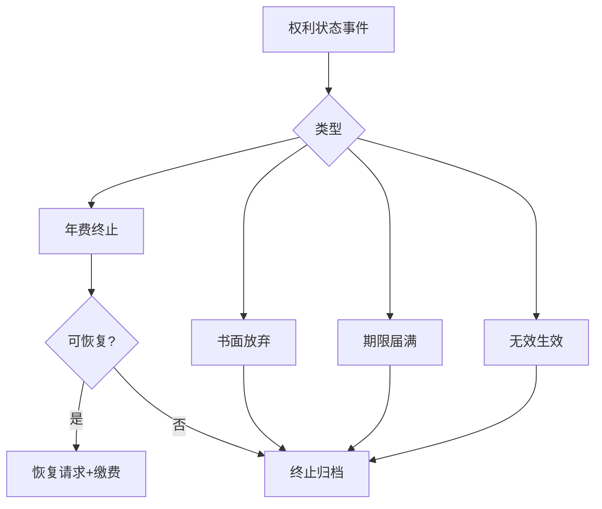

# 节点 23 · 终止 · 放弃 · 权利恢复（补建节点）

> **状态：仓内只做了「年费即将到期」的提醒，没有「终止 / 放弃 / 恢复」的业务路径。**
> 关联：[05-maintenance.md](05-maintenance.md)（年费与权利状态）· [11-docket-engine.md](11-docket-engine.md)（期限引擎）· [22-invalidation.md](22-invalidation.md)（无效导致的消灭）
>
> 法律口径：《专利法》（2020 修正）第 44 条；《专利法实施细则》（2023 修订）关于期限恢复、权利恢复的条款。凡条号与费用标 ⚠ 需按当期官方文本复核。

---

## 0. 一句话讲清这个节点

**专利不是「一次申请、终身有效」的资产，而是一份每年要续费的订阅。** 忘缴、主动放弃、被无效、到期，都会让权利消失——但消失的方式不同，可挽救的程度也完全不同。

这个节点能独立成产品，因为它是**成本中心里最容易被忽视、却最容易出事**的地方：

- **独立买方**：所有持有专利组合的企业（尤其是组合规模 100 件以上的）。
- **独立价值**：一件专利意外终止，损失可能是全部研发投入；恢复权利的费用远高于年费本身。
- **独立边界**：输入是「专利号 + 当前状态 + 缴费记录」，输出是「维持 / 放弃 / 恢复」的决策与执行。

> **最反直觉的一点**：大多数专利不是被无效掉的，是**忘记缴年费**掉的。这是行业里最常见的权利丧失原因，也是最容易用产品解决的。

---


## 0.1 人读：图 · 判定 · 依据

> 本节给人读：一张图看清本站怎么走；规则按 **A 法定 / B 程序 / C 商业 / D 质量**；判定与硬闸禁止拍脑袋。细节与编号规则仍以下文全文为准。

### 本站流程（进 → 活动 → 闸 → 出 → 下一站）



### 规则速查（类别：A 法定 · B 程序/期限 · C 商业 · D 质量/合规）

| ID | 类别 | 规则（一句话） | 依据 |
|---|---|---|---|
| R23-A1 | A | 未按规定缴年费或书面放弃 → 期限届满前终止 | 《专利法》44 |
| R23-B1 | B | 年费逾期后 6 个月补缴+滞纳金；期满未缴则终止 | 细则 115 |
| R23-B2 | B | 恢复权利有法定事由与期限/费用 ⚠ | 细则恢复权利条款 ⚠ 复核 |
| R23-D1 | D | 放弃/终止须留决策人与理由 | 资产治理 |

### 怎么判定 · 怎么推进

| 判据 | 条件（可检查） |
|---|---|
| **进入本站** | 出现应缴未缴、拟放弃、期限届满、无效决定生效等事件。 |
| **本站完成** | 状态变更已登记公告口径对齐；若恢复则手续与费用闭环；若终止则归档原因码。 |
| **推进下一站** | 回写组合与 05/08；不可恢复则关闭监控与转化路径。 |

### 硬闸（禁止拍脑袋）

- **禁止**把「还能补缴」当成「权利仍确定有效」而不评估风险。
- **禁止**无审批的批量放弃。
- **禁止**恢复窗口关闭后仍承诺客户「一定能救回」。

### 依据来源（调研摘要）

- 《专利法》44；细则 115 年费与滞纳金；恢复权利请求费与期限 ⚠ 复核细则条文。
- 行业：忘缴年费是最常见终止原因。

⚠ 未核到当期官方原文的条号/金额/天数，部署前须按 CNIPA / 条约/法院文本复核。

---
## 1. 节点定位与产品边界

### 1.1 在生命周期中的位置

```
授权登记 ──► 年费维持（每年） ──┬──► 持续有效 ──► 到期（保护期届满）
                              │
                              ├──► 未缴年费 ──► 宽限期（6 个月）──┬──► 补缴 + 滞纳金 ──► 恢复有效
                              │                                  └──► 逾期 ──► 终止
                              │
                              ├──► 主动放弃（声明）──► 终止
                              │
                              └──► 被无效 ──► 自始不存在（见 22）
```

### 1.2 四种「权利消失」的区别（这是本节点最重要的表）

| 类型 | 原因 | 是否可恢复 | 追溯力 | 法律后果 |
|---|---|---|---|---|
| **到期** | 保护期届满（发明 20 年、实用新型 10 年、外观 15 年 ⚠） | ❌ 不可 | — | 技术进入公有领域，任何人可实施 |
| **终止（欠费）** | 未缴年费且宽限期届满 | ✅ 可在一定期限内请求恢复 | 恢复后权利连续 | 终止期间他人实施不构成侵权 |
| **放弃** | 专利权人主动声明放弃 | ❌ 一般不可（除非意思表示瑕疵） | 自放弃日起 | 同上 |
| **无效** | 被宣告无效 | ❌ 不可 | **自始不存在** | 见 [22-invalidation.md](22-invalidation.md) |

> 学员最常混淆的是「终止」和「无效」：终止是**从终止日起**权利消失，终止前的权利仍有效，可以追究终止前的侵权；无效是**自始**不存在，等于从来没拥有过。

### 1.3 它是 / 不是

| 是 | 不是 |
|---|---|
| 权利**存续管理**（state management） | 年费**计算**（那是 05 的 `generateAnnuitySchedule`） |
| 终止后的**救济**（恢复权利） | 无效程序（那是 22） |
| 放弃**决策**（成本 vs 价值） | 主动的运用（许可/转让，那是 06） |
| 与年费引擎**联动** | 替代年费引擎 |

### 1.4 独立产品的形态

**产品名建议：权利状态中心 / Patent Status & Recovery**

| 模块 | 能力 | 谁用 |
|---|---|---|
| 状态总览 | 全组合的权利状态看板（有效/终止/恢复中/放弃/到期/无效） | IP 总监 |
| 年费续费 | 缴费日程、代缴、凭证归档 | IPR / 财务 |
| **放弃决策** | 成本 vs 剩余价值打分，批量放弃建议 | IP 总监 |
| 终止预警 | 欠费终止前的多级预警 | IPR |
| **恢复流程** | 终止后的恢复请求（正当理由 / 不可抗力） | IPR / 代理师 |
| 状态变更留痕 | 每次状态变化的证据链 | 法务 / 审计 |

**不做的**：不做年费金额计算（05 的职责）、不做无效（22）。

---

## 2. 角色与权限矩阵

| 角色 | 能做什么 | 不能做什么 |
|---|---|---|
| 企业 IPR | 发起缴费、发起放弃、发起恢复 | 不能替财务付款 |
| IP 总监 | 批准放弃决策、批准恢复投入 | — |
| 财务 | 付款、核销、发票 | 不能改权利状态 |
| 代理师 | 代办缴费、代办恢复请求 | 不能替客户决定放弃 |
| 法务 | 审核放弃/恢复的法律风险 | — |
| 系统 | 状态自动流转、预警 | — |

> **关键权限设计**：**放弃必须是双人复核**。这是不可逆操作，单人操作风险过高。产品上应强制「发起人 ≠ 批准人」。

### 2.1 决策权（谁有权决定放弃、恢复、缴费）

§2 回答「谁能操作」，本节回答「**谁能拍板**」。两者不是一回事：一个角色能在系统里点按钮，不等于他有权承担这个决定的后果。本节点的每一次状态变化都是**减法**（权利变少），减法比加法更需要授权。

**四种权力必须分开授予**：

| 权力 | 含义 | 能否单独改变结果 |
|---|---|---|
| 建议权（R） | 提出方案、给出评分与理由 | 不能 |
| 决定权（A） | 拍板并对后果负责 | 能，须留痕 |
| 否决权（V） | 单方面阻止决定生效 | 能，须书面理由 |
| 知情权（I） | 被通知、可提出异议 | 不能，但不通知即构成程序瑕疵 |

#### 表 2.1-A 决策权分配

| 决策 | 建议权 | 决定权 | 否决权 | 知情权 | 依据 |
|---|---|---|---|---|---|
| 单件是否继续缴年费 | IPR | IP 总监（可在额度内下放 IPR） | 法务（合规） | 财务、业务负责人 | 剩余价值 vs 维持成本 |
| 批量放弃一批专利 | IPR + 系统评分 | 按表 2.1-B 分级 | 法务（合规）、财务（预算） | 业务部门、审计 | 组合结构优化 |
| **主动声明放弃**（单件） | IPR | IP 总监 + 法务会签 | **法务负责人有最终否决权**；共有人/质权人/被许可人为法定否决 | 全体共有人、质权人、被许可人、发明人 | 不可逆 |
| 是否启动恢复程序 | 代理师 + IPR（成本测算） | IP 总监（超额度加签 CFO） | 法务 | 财务 | 恢复成本 vs 权利价值 |
| 恢复理由的定性 | 代理师（事实与证据） | **法务**（法律定性） | — | IP 总监 | 举证可行性 |
| 共有专利的放弃 | 任一共有人可提议 | **全体共有人一致同意** | 任一共有人可否决 | 全体共有人 | 处分共有财产 |
| 已许可 / 已质押专利的处置 | 法务（合同审查） | 权利人 + 被许可人/质权人书面同意 | 被许可人、质权人 | 业务、财务 | 合同与担保义务 |
| 终止后是否追究代理机构责任 | 法务 | IP 总监 + 法务负责人 | — | 采购、财务 | 委托合同 |

> **一行话记住**：**缴费是执行，放弃是处分，恢复是补救。** 执行可以下放，处分必须上收，补救必须限时。

#### 表 2.1-B 批量放弃的额度分级

| 档 | 单次件数 | 年化维持成本 ⚠ | 批准人 | 附加要求 |
|---|---|---|---|---|
| A | ≤ 3 件 | ≤ ¥5 万 | IP 总监 | 逐件复核 |
| B | 4–20 件 | ¥5 万–50 万 | IP 总监 + 法务会签 | 逐件复核，合规项 100% 核查 |
| C | 21–100 件 | ¥50 万–300 万 | 法务负责人 + CFO 联签 | 报 IP 委员会备案 |
| D | > 100 件 | > ¥300 万 | CEO / 董事会 | 单独决议，不得走批量流程 |

> 定档按「**件数与金额孰高**」原则，防止用「金额小」拆分规避高一级审批。上述金额为**企业内部阈值**（C 类商业规则，可配置），不是法定标准 ⚠。

#### 表 2.1-C 权限分离铁律

| # | 铁律 | 违反的后果 |
|---|---|---|
| 1 | **财务只能执行付款与核销，不能决定放弃**，也不得代填放弃理由 | 放弃退化为「没人负责的默认结果」 |
| 2 | 业务部门可主张继续维持并要求复议，但**不能否决法务的合规意见** | 带质押/许可负担的专利被放弃 → 违约 |
| 3 | 代理师只有建议权与执行权，**没有决定权** | 代理所替客户做资产决策，责任错位 |
| 4 | 系统只有执行权；**「到期未回复」不得由系统解释为放弃** | 沉默被当成同意，造成不可逆损失 |
| 5 | 放弃的发起人 ≠ 批准人，且不得是同一自然人的两个账号 | 四眼原则形同虚设 |
| 6 | 同一人不得对同一决策同时持有建议权与否决权 | 自己否自己，制衡失效 |

#### 表 2.1-D 必须被征询的人（知情权 → 征询义务）

| 对象 | 何时必须征询 | 形式 | 未征询的后果 |
|---|---|---|---|
| 共有人 | 放弃、许可、转让 | 书面同意（签章原件） | 对外放弃已生效，内部可被追责赔偿 |
| 质权人 | 放弃、转让、许可 | 书面同意 | 损害质权，银行可主张提前清偿 |
| 被许可人（独占/排他） | 放弃、转让 | 书面通知 + 按合同取得同意 | 许可合同违约 |
| 被许可人（普通） | 放弃 | 书面通知 | 视合同条款可能违约 |
| 发明人 | 放弃 | 告知 | 奖酬与署名争议 |
| 业务负责人 | 单件放弃 | 征询意见（可反对，不可否决合规） | 业务断供，事后扯皮 |

> **最容易被误解的一点**：放弃一经官方登记公告，**对外即不可逆**。共有人或质权人的同意解决的是**内部责任**，不是「撤销放弃」。因此征询必须发生在提交之前，事后补签救不回权利。

#### 表 2.1-E 决策权规则

| ID | 规则 | 现状 |
|---|---|---|
| R23-70 | 每一件年费决策必须有**具名决定人**；系统不得以「无人反对」替代决定 | ❌ |
| R23-71 | 财务角色不得持有放弃/恢复的决定权与否决权，仅可执行付款、核销、开票 | ❌ |
| R23-72 | 业务部门的「继续维持」主张须书面记录并可要求复议，但不得覆盖法务的合规否决 | ❌ |
| R23-73 | 放弃的发起人与批准人必须是不同自然人；切换角色不构成双人复核 | ❌ |
| R23-74 | 批量放弃按件数与年化维持成本**孰高**定档，达到 B 档及以上须法务 + 财务联签 | ❌ |
| R23-75 | 共有专利放弃须取得全体共有人书面同意并归档原件，未取得则闸门阻断 | ❌ |
| R23-76 | 已质押/已许可专利的放弃与恢复，须先完成征询并归档同意文件 | ❌ |
| R23-77 | 启动恢复程序由 IP 总监决定；代理师只能建议，不得代为决定 | ❌ |
| R23-78 | 恢复理由的法律定性以法务意见为准；代理师负责事实与证据，不负责定性 | ❌ |
| R23-79 | 决策记录须含决定人、时间、依据与**被否决的反对意见**；只记结论视为未留痕 | ❌ |

**§7 需新增的闸门**：本节表格中的每一项权力约束，都必须在 `evaluateGuardrails` 里有对应的 blocker 码，否则「谁批准」只是文案。闸门定义见 §7.1。

---

## 3. 业务对象（字段级）

### 3.1 `PatentStatusRecord`（权利状态记录）

| 字段 | 类型 | 必填 | 说明 |
|---|---|---|---|
| `patentNo` | string | ✅ | 专利号 |
| `caseId` | string | — | 关联案件 id |
| `status` | `PatentLegalStatus` | ✅ | 见 §6.1 |
| `statusSince` | string | ✅ | 当前状态起始日 |
| `grantDate` | string | ✅ | 授权公告日 |
| `expiryDate` | string | ✅ | 法定保护期届满日 |
| `lastAnnuityPaidYear` | number | — | 已缴至第几年 |
| `nextAnnuityDue` | string | — | 下次年费到期日 |
| `terminatedAt` | string? | 条件 | 终止日 |
| `terminationReason` | `TerminationReason`? | 条件 | 见 §3.2 |
| `recoveryDeadline` | string? | 条件 | 恢复请求的最后期限 |
| `recoveryFiledAt` | string? | — | 恢复请求提交日 |
| `abandonDeclaredAt` | string? | — | 放弃声明日 |
| `history` | `StatusChange[]` | 系统 | 状态变更历史 |

### 3.2 `TerminationReason`（终止原因）

| 值 | 含义 | 可恢复 |
|---|---|---|
| `non_payment` | 未缴年费 | ✅ |
| `abandonment` | 主动放弃 | ❌ 一般不可 |
| `expiry` | 保护期届满 | ❌ |
| `invalidation` | 被宣告无效 | ❌ |
| `failure_to_pay_fee` | 其他规费未缴（如恢复费本身） | ⚠ |

### 3.3 `RecoveryRequest`（恢复请求）

| 字段 | 类型 | 必填 | 说明 |
|---|---|---|---|
| `id` | string | 系统 | |
| `patentNo` | string | ✅ | |
| `grounds` | `'force_majeure' \| 'justified_reason'` | ✅ | 恢复理由类型 |
| `evidence` | `EvidenceItem[]` | ✅ | 证明材料 |
| `filedAt` | string | 系统 | |
| `feePaid` | boolean | 系统 | 恢复请求费 ⚠ |
| `result` | `'approved' \| 'rejected' \| 'pending'` | 系统 | |

### 3.4 与既有对象的映射

| 现有对象 | 复用方式 |
|---|---|
| `DocketEvent` | **直接复用**：`annuity` 规则已有 12 月 + 6 月宽限，需扩展「终止」「恢复期限」事件 |
| `PatentCase.risk` | 需扩展：终止应为独立状态而非 `risk` 字段 |
| `CaseInvoice` | 复用：年费、滞纳金、恢复费都走发票 |
| `DocketEscalationLevel` | 复用：终止前四级预警 |

---

## 4. 业务规则（编号）

### 4.1 年费与终止

| ID | 规则 | 现状 |
|---|---|---|
| R23-01 | 年费应在**上一年度期满前**缴纳；未缴可在**宽限期 6 个月**内补缴并缴滞纳金 ⚠ | ⚠ docket 有 |
| R23-02 | 宽限期届满仍未缴，专利权**自应缴年费期满之日起终止** | ❌ |
| R23-03 | 滞纳金按逾期时间**阶梯递增**（比例需按当期规定 ⚠） | ❌ |
| R23-04 | 终止后，系统须自动将案件状态置为 `terminated`，并联动组合看板 | ❌ |
| R23-05 | 终止前应至少提前 **90 / 60 / 30 / 7 天**四轮预警 | ⚠ 仅有 docket 单点提醒 |
| R23-06 | 一件专利终止不影响同族其他专利 | ❌ 无同族概念 |

### 4.2 恢复

| ID | 规则 | 现状 |
|---|---|---|
| R23-10 | 因**不可抗力**延误期限导致权利丧失的，可在障碍消除之日起 **2 个月内**、最迟自期限届满之日起 **2 年内**请求恢复 ⚠ | ❌ |
| R23-11 | 因**正当理由**延误期限的，可在收到通知之日起 **2 个月内**请求恢复 ⚠ | ❌ |
| R23-12 | 恢复请求须**缴纳恢复权利请求费** ⚠ | ❌ |
| R23-13 | 恢复请求须提交**证明材料**（不可抗力或正当理由） | ❌ |
| R23-14 | 恢复须同时**补办耽误的手续**（如补缴年费 + 滞纳金） | ❌ |
| R23-15 | 恢复获批后，权利视为**连续存在**（终止期间的行为不追溯为侵权） | ❌ |
| R23-16 | 恢复请求被驳回的，可在法定期限内申诉 | ❌ |

### 4.3 放弃

| ID | 规则 | 现状 |
|---|---|---|
| R23-20 | 放弃须由专利权人**书面声明** | ❌ |
| R23-21 | 放弃须**全体专利权人同意**（共有专利） | ❌ 无共有人模型 |
| R23-22 | 已许可他人的专利放弃，可能构成**违约**，须先核查许可合同 | ❌ |
| R23-23 | 已质押的专利放弃，须经**质权人同意** | ❌ |
| R23-24 | 放弃**不可逆**（除意思表示瑕疵） | ❌ |
| R23-25 | 放弃须**双人复核**（发起人 ≠ 批准人） | ❌ |
| R23-26 | 放弃决策须记录**理由与评分**，供日后审计 | ❌ |

### 4.4 到期

| ID | 规则 | 现状 |
|---|---|---|
| R23-30 | 保护期：发明 **20 年**、实用新型 **10 年**、外观设计 **15 年**，均自**申请日**起算 ⚠ | ❌ |
| R23-31 | 到期前 1 年应启动「到期处置」流程（是否续展同族、是否转技术秘密） | ❌ |
| R23-32 | 到期后专利进入公有领域，须从「有效组合」中移出 | ❌ |

### 4.5 联动

| ID | 规则 | 现状 |
|---|---|---|
| R23-40 | 终止/放弃/到期须联动更新 `07-monitoring` 的维权范围 | ❌ |
| R23-41 | 终止/放弃须联动更新 `06-commercialization` 的可许可资产清单 | ❌ |
| R23-42 | 终止须联动 `12-billing` 停止后续年费发票 | ❌ |

### 4.6 例外情形

正常路径是「到期 → 提醒 → 缴费 → 有效」。**真正出事的地方全在例外路径上**：期限已过、钱没到账、责任在别人、权利上还挂着别人的利益。本节把七类例外写成可执行的处置规格。

**统一原则**：例外情形**不得由系统自动推定**，必须有人具名判断；且判断必须在法定期限内完成——例外处理的首要约束不是「处理得对」，而是「来得及」。

#### 表 4.6-A 七类例外

| # | 例外条件 | 谁批准 | 风险 | 留痕 |
|---|---|---|---|---|
| 1 | 年费已过 6 个月宽限期，但仍在恢复期内 | IP 总监（走恢复快速通道） | 权利已终止，终止期间他人实施不构成侵权；恢复后也不能追溯索赔 | 终止日、恢复期限、恢复理由、批准人、补缴凭证 |
| 2 | 因代理机构失误导致逾期 | 法务定性 + IP 总监批准 | **能否构成正当理由实务有争议** ⚠；即使恢复成功，仍可能错过其他期限 | 代理机构书面说明、内部失误记录、法务意见、是否追责 |
| 3 | 系统 / 银行故障导致付款失败 | IP 总监（紧急通道，可先提交后补批） | 故障举证难；「已付款」与「已到账」不同 | 银行流水、系统故障日志/证明、提交时间戳、到账时间 |
| 4 | 已质押 / 已许可的专利已终止或拟放弃 | 法务 + 权利人；须质权人/被许可人书面同意 | 终止本身即可能构成违约；质权人可主张提前清偿 | 合同条款摘录、同意函、违约风险评估 |
| 5 | 同族中部分国家放弃、部分维持 | 按件分别批准（不得整族一刀切） | 各国法律独立；一国终止不影响他国，但可能影响族内优先权布局叙事 | 逐国决策记录、族内覆盖度说明 |
| 6 | 保护期届满后短期内才发现侵权 | 法务（诉讼可行性） | **到期不可恢复**；只能主张到期日**之前**的侵权行为 | 侵权发现日、证据固定日、到期日、可主张期间分析 |
| 7 | 恢复请求被拒 | IP 总监 + 法务 | 救济窗口短；救济期间权利仍为终止状态 | 驳回通知、救济方案、期限、最终结论 |

> **第 1 行最容易出错**：很多人以为「还在恢复期」等于「权利还在」。不是。恢复期内权利**已经终止**，只是存在救回的可能。这期间的对外许可、维权、融资尽调都必须按「已终止」披露，否则构成虚假陈述。

#### 表 4.6-B 例外的举证要求

| 例外类型 | 必须证明的三件事 | 常见无效举证 |
|---|---|---|
| 不可抗力 | 障碍客观存在 + 障碍与延误有因果 + 障碍消除日 | 只提交一份情况说明，无第三方证据 |
| 正当理由 | 延误原因不可归责于权利人 + 已尽合理注意 + 发现后及时补救 | 「工作忙」「人员离职交接不清」 |
| 代理机构失误 | 委托关系 + 失误事实 + 客户已尽监督义务 | 代理所单方道歉函，无往来记录 |
| 系统/银行故障 | 故障时间窗 + 与缴费时点重合 + 已及时重试 | 截图无时间戳、无银行回单 |
| 质权人/被许可人同意 | 有权签字人 + 签章真实 + 同意范围覆盖本次处分 | 邮件口头同意、无授权委托书的员工签字 |

> 举证的分水岭是**第三方证据**。当事人自己写的说明在任何程序里都只是「陈述」，不是「证明」。产品应把「证据类型」做成必填枚举，而不是一个自由文本框。

#### 表 4.6-C 例外处置规则

| ID | 规则 | 现状 |
|---|---|---|
| R23-80 | 权利已过宽限期即置为「已终止·可恢复」，不得继续显示为「有效」；恢复期内的一切对外披露按已终止口径 | ❌ |
| R23-81 | 例外处置须在**收到触发信息后 2 个工作日内**完成首次评估并指定责任人 | ❌ |
| R23-82 | 代理机构失误不得由系统自动认定为正当理由，须经法务书面定性；定性结论与理由入库 | ❌ |
| R23-83 | 系统 / 银行故障类例外，须同时留存「故障证据」与「重试记录」，仅有其一的不得提交恢复 | ❌ |
| R23-84 | 已质押/已许可专利的终止，无论是否故意，均须在 3 个工作日内通知质权人/被许可人并评估违约 | ❌ |
| R23-85 | 同族专利须**逐件独立**决策；批量操作不得跨国家/地区套用同一结论 | ❌ |
| R23-86 | 保护期届满后不启动任何恢复程序；侵权主张只能覆盖到期日前的行为 | ❌ |
| R23-87 | 恢复被拒后须在救济期限内给出「救济 / 放弃」的书面结论，不得静默结案 | ❌ |
| R23-88 | 例外处置记录须包含「为何未走正常路径」，否则审计视为流程缺陷 | ❌ |
| R23-89 | 同一案件 12 个月内出现两次及以上同类例外，须触发流程根因复盘 | ❌ 无统计 |

### 4.7 规则冲突与裁决

多条规则同时成立时，系统必须能给出**唯一**答案。没有裁决规则的后果不是「判错」，而是**每个角色按对自己有利的那条执行**——这比没有规则更危险。

#### 表 4.7-A 裁决总原则（按顺序适用，前者优先）

| 序 | 原则 | 含义 | 落到本节点 |
|---|---|---|---|
| P1 | **法定优先** | 法律强制 > 企业内部规则 > 效率偏好 | 期限、举证、同意要求不可被内部审批豁免 |
| P2 | **不可逆优先** | 不可逆动作的举证责任在主张方 | 放弃、到期后不恢复：谁主张谁举证，默认不做 |
| P3 | **负担优先** | 存在外部权利负担时，负担方利益优先于内部偏好 | 质押、许可、共有 > 成本节约 |
| P4 | **保权优先** | 争议未决且期限将至时，先保权利再算账 | 未裁决 = 先缴，事后追责，不得默认放弃 |
| P5 | **书面优先** | 有书面记录的决策覆盖口头指示 | 邮件/工单/会议纪要按时间与授权层级取信 |
| P6 | **时限优先** | 有法定期限的事项优先于内部 SLA | 恢复窗口 > 批量优化 |
| P7 | **升级兜底** | 在 SLA 内无法裁决的，自动升级一级 | 升级期间默认动作仍是「维持」 |

> **P4 是全节最值钱的一条**：它把「没人拍板」从「默认放弃」翻转为「默认保留」。因为放弃不可逆、缴费可承受，两种默认错误的代价完全不对称。产品上应把「超时未决」实现为**自动升级 + 暂缓提交放弃**，而不是自动执行任何一方。

#### 表 4.7-B 六组典型冲突

| # | 冲突 | 表现 | 裁决 | 依据 |
|---|---|---|---|---|
| 1 | 省钱放弃 vs 布局需要保留 | 财务按成本砍，IP 按覆盖度留 | **布局需要保留**，但须量化「保留的覆盖价值」并走额度审批；不得以「感觉重要」对抗成本 | P2 + 成本须可计算 |
| 2 | 业务部门要用 vs 法务认为价值低 | 业务称在售产品依赖该专利 | 业务主张**可启动复议并暂缓放弃**；但若存在质押/许可瑕疵，法务合规否决**优先** | P3 + §2.1 铁律 2 |
| 3 | 恢复成本高 vs 该专利正在维权中 | 恢复费 + 滞纳金高于年费数倍 | **恢复优先**：维权中的专利一旦终止，诉讼基础消灭，损失远大于恢复成本；且须评估终止对在诉案件的影响 | P2 + P4 |
| 4 | 批量效率 vs 逐件复核 | 一次处理上百件，逐件看不完 | 效率让步：**批量只做初筛，放弃动作必须逐件留痕**；A/B 档逐件复核，C/D 档逐件确认 + 抽样复核 | P2 |
| 5 | 系统自动催缴 vs 客户要求不打扰 | 客户要求少发通知 | **法定期限通知不可关闭**，只能改变渠道与频率；关闭的必须是「营销类」而非「期限类」 | P1 + P6 |
| 6 | 法律状态与业务阶段不一致 | `stage = maintenance` 但 `legalStatus = terminated` | **法律状态决定「能不能」**（能否许可、能否维权、能否缴费），业务阶段只决定「要不要」；对外一律以法律状态为准 | INV-4 |

#### 表 4.7-C 冲突未决时的默认动作

| 情形 | 默认动作 | 禁止动作 |
|---|---|---|
| 年费到期前 7 天仍无决策 | **先缴**，同时升级到 IP 总监 | 不得因「未批准预算」而放任逾期 |
| 放弃申请在途、批准未完成 | 暂缓提交官方声明；本期年费照缴 | 不得「先不缴，等批下来再说」 |
| 恢复 vs 放弃意见相持 | 在恢复期限内**先提交恢复** | 不得等意见统一后再动 |
| 共有人未回复同意 | 视为未同意，不得提交放弃 | 不得以「默示同意」推定 |
| 系统与人工记录冲突 | 以官方登记/官方通知为准，人工记录标「待核」 | 不得以内部记录覆盖官方状态 |

> **「先缴再吵」不是浪费钱**：一年的年费相对于一次不可逆终止是数量级更小的代价。产品的价值恰恰在于把这个不对称写进默认行为，而不是留给每个经办人的判断力。

#### 表 4.7-D 冲突裁决规则

| ID | 规则 | 现状 |
|---|---|---|
| R23-90 | 规则冲突按 P1→P7 顺序裁决，前序原则成立时不得援引后序原则 | ❌ |
| R23-91 | 争议未决且年费期限在 7 日内，系统默认执行「缴费」并升级，不得默认放弃 | ❌ |
| R23-92 | 放弃流程在途时，本期年费仍须照缴；不得以「待批准」为由停止缴费 | ❌ |
| R23-93 | 「布局需要保留」的主张必须附带覆盖度/族完整性说明，否则不构成有效对抗 | ❌ |
| R23-94 | 业务部门的复议请求须在 5 个工作日内答复，逾期视为维持原决定并留痕 | ❌ |
| R23-95 | 法务的合规否决不得被成本理由覆盖；如企业仍要执行，须由法务负责人书面确认风险自担 | ❌ |
| R23-96 | 法定期限类通知不得因客户偏好而关闭，只能调整渠道与频次 | ❌ |
| R23-97 | 法律状态与业务阶段冲突时，对外披露、许可、维权一律以法律状态为准 | ❌ |
| R23-98 | 官方登记状态与内部记录冲突时，以官方为准并将内部记录置「待核」，不得反向覆盖 | ❌ |
| R23-99 | 每次冲突裁决须记录：冲突双方、适用原则、裁决人、裁决时间、被否决方意见 | ❌ |

---

## 5. 法律底座

### 5.1 终止的法定情形（专利法第 44 条）

专利权在期限届满前终止的情形：

1. **没有按照规定缴纳年费**；
2. **专利权人书面声明放弃**其专利权。

**注意**：无效不属于「终止」，它是**自始不存在**，法律性质不同（见 22）。

### 5.2 保护期限

| 类型 | 期限 | 起算 |
|---|---|---|
| 发明 | 20 年 ⚠ | 申请日 |
| 实用新型 | 10 年 ⚠ | 申请日 |
| 外观设计 | 15 年 ⚠ | 申请日 |

> 2020 年修法将外观设计从 10 年延长至 15 年。**产品必须按申请日判断适用哪一版**——2021 年 6 月 1 日前申请的外观设计仍适用 10 年。这是一个很容易做错的边界。

### 5.3 恢复权利

**两种理由，两套期限，别混**：

| 理由 | 期限 | 起算 | 举证 |
|---|---|---|---|
| **不可抗力** | 障碍消除之日起 2 个月内，最迟期限届满之日起 2 年内 ⚠ | 障碍消除 / 期限届满 | 需证明不可抗力客观存在且导致延误 |
| **正当理由** | 收到通知之日起 2 个月内 ⚠ | 通知日 | 需说明合理理由 |

**实务要点**：

- 「忘了缴」**不是**正当理由。这是最常见的误解。
- 正当理由通常指：系统故障、代理机构失误、不可归责于申请人的客观障碍等。**代理机构失误是否构成正当理由，实务中存在争议** ⚠。
- 恢复必须**同时补办**耽误的手续，否则恢复无意义。

### 5.4 终止期间的第三方实施

**关键规则**：专利权终止后，任何人可以自由实施该技术。**恢复后，终止期间他人的实施行为不构成侵权**（因为当时权利不存在）。

**产品落点**：恢复成功后，系统应提示「终止期间的第三方实施不追溯」，避免客户误以为可以追责。

### 5.5 放弃的限制

放弃看似自由，实际有三道限制：

1. **共有专利**：须全体共有人同意。
2. **已许可**：放弃可能导致许可合同违约，须先审查合同。
3. **已质押**：须质权人同意，否则损害质权人利益。

---

## 6. 状态机

### 6.1 权利状态枚举 `PatentLegalStatus`

```
pending（审查中）
    │ 授权
    ▼
active（有效）──┬──► lapsed_pending_recovery（终止·可恢复）
    │           │              │
    │           │              ├──► active（恢复成功）
    │           │              └──► terminated（恢复失败/超期）
    │           │
    │           ├──► abandoned（主动放弃）
    │           ├──► expired（到期）
    │           └──► invalidated（被无效）
    │
    └──► 以上四类均为终态（除 lapsed_pending_recovery）
```

### 6.2 合法迁移表

| 当前 | 可迁往 | 触发 |
|---|---|---|
| `pending` | `active` | 授权登记 |
| `pending` | `abandoned` | 主动放弃申请 |
| `active` | `lapsed_pending_recovery` | 宽限期届满未缴 |
| `active` | `abandoned` | 书面声明放弃 |
| `active` | `expired` | 保护期届满 |
| `active` | `invalidated` | 无效决定生效 |
| `lapsed_pending_recovery` | `active` | 恢复获批 + 补缴费 |
| `lapsed_pending_recovery` | `terminated` | 恢复被拒 / 恢复期限届满 |
| 终态 | — | 不可迁出 |

### 6.3 与 `PatentCase.stage` 的关系

**必须分清**：`stage` 是**业务阶段**（在办到哪一步），`legalStatus` 是**法律状态**（权利还在不在）。

一件案子的 `stage` 可能仍是 `maintenance`（业务上还在维持），但 `legalStatus` 已经是 `terminated`。**两个维度正交，不能合并。**

> 当前代码只有 `stage` + `risk`，没有 `legalStatus`。这是本节点最根本的建模缺失。

---

## 7. 闸门与条件

| 闸门 | 触发 | 条件 | 失败文案 |
|---|---|---|---|
| `abandon_dual_control` | 声明放弃 | 发起人 ≠ 批准人 | `放弃须双人复核：当前操作人与批准人相同` |
| `abandon_license_check` | 声明放弃 | 无有效许可合同，或已获被许可人同意 | `存在有效许可，放弃前须核查合同并取得同意` |
| `abandon_pledge_check` | 声明放弃 | 无质押，或已获质权人同意 | `专利已质押，放弃须质权人同意` |
| `abandon_coowner_consent` | 声明放弃 | 全体共有人同意 | `共有专利放弃须全体共有人同意` |
| `recovery_deadline` | 提交恢复 | 未超过恢复期限 | `恢复期限已届满` |
| `recovery_grounds` | 提交恢复 | 理由属于不可抗力或正当理由，且有证据 | `恢复理由不成立或缺少证明材料` |
| `recovery_fee_paid` | 提交恢复 | 恢复请求费已缴 | `未缴恢复请求费` |
| `annuity_grace` | 年费补缴 | 在 6 个月宽限期内 | `宽限期已过，须走恢复程序` |

### 7.1 决策权与例外闸门（对应 §2.1 / §4.6 / §4.7）

| 闸门 | 触发 | 条件 | 失败文案 |
|---|---|---|---|
| `abandon_role_separation` | 声明放弃 | 发起人 ≠ 批准人，按**自然人**判定而非账号 | `放弃须由不同人员复核` |
| `abandon_batch_tier` | 批量放弃 | 已按「件数 / 金额孰高」取得对应层级批准 | `批量放弃超出当前审批额度` |
| `abandon_consent_evidence` | 放弃 / 恢复 | 共有人、质权人、被许可人同意文件已归档 | `缺少共有人/质权人/被许可人同意文件` |
| `recovery_decision_owner` | 提交恢复 | 有 IP 总监批准记录 + 法务定性意见 | `恢复决定未经授权` |
| `exception_owner_assigned` | 例外处置 | 已指定具名责任人且首次评估不超 2 个工作日 | `例外情形未指定责任人` |
| `notice_not_disabled` | 关闭通知 | 仅可关闭营销类；法定期限类只能改渠道频次 | `法定期限通知不可关闭` |
| `conflict_escalated` | 冲突未决 | 期限 ≤ 7 日时已升级且已执行「先缴」 | `存在未裁决冲突，须先缴费并升级` |
| `official_status_authority` | 状态写回 | 与官方登记冲突时，内部记录置「待核」 | `不得以内部记录覆盖官方状态` |

> **唯一入口原则同样适用**：上述闸门必须进 `evaluateGuardrails`，不得只做成按钮 disabled。按钮隐藏挡不住 API 直调，而放弃与恢复一旦被直调，是不可逆的。

---

## 8. 步骤序列

### 8.1 年费维持（正常路径）

| 步 | 动作 | 谁做 | 时点 | 产出 |
|---|---|---|---|---|
| 1 | 生成年度年费日程 | 系统 | 授权后 | 日程表 |
| 2 | 提前 90 天预警 | 系统 | T-90 | 待办 |
| 3 | 确认缴费决策（维持 / 放弃） | IPR | T-60 | 决策 |
| 4 | 付款 | 财务 / 代理 | T-30 | 缴费凭证 |
| 5 | 归档凭证、更新状态 | 系统 | T-0 | 状态记录 |

### 8.2 终止与恢复

| 步 | 动作 | 谁做 | 时点 | 产出 |
|---|---|---|---|---|
| 1 | 宽限期届满，权利终止 | 系统 | T | `lapsed_pending_recovery` |
| 2 | 终止通知 | 系统 → IPR / 总监 | T+1 | 通知 |
| 3 | 评估是否恢复 | IPR + 法务 | T+7 | 评估意见 |
| 4 | 准备恢复材料（不可抗力/正当理由） | 代理师 | T+15 | 证明材料 |
| 5 | 提交恢复请求 + 缴费 | 代理师 | 期限内 | 受理 |
| 6 | 补缴年费 + 滞纳金 | 财务 | 同步 | 缴费凭证 |
| 7 | 结果登记 | 系统 | 决定日 | `active` 或 `terminated` |

### 8.3 放弃决策

| 步 | 动作 | 谁做 | 产出 |
|---|---|---|---|
| 1 | 组合扫描：识别低价值专利 | 系统 | 候选清单 |
| 2 | 打分（成本 vs 价值） | 系统 + IPR | 评分 |
| 3 | 业务确认（是否仍在使用） | 业务部门 | 确认 |
| 4 | 法律核查（许可/质押/共有） | 法务 | 核查意见 |
| 5 | 批准（双人） | 总监 | 批准 |
| 6 | 提交放弃声明 | 代理师 | 声明 |
| 7 | 状态更新 + 归档 | 系统 | `abandoned` |

---

## 9. 写回与命令

| 动作 | 建议 CommandName | 写入 |
|---|---|---|
| 缴费登记 | `recordAnnuityPayment` | `lastAnnuityPaidYear`、`nextAnnuityDue`、发票核销 |
| 状态变更 | `updateLegalStatus` | `status`、`statusSince`、`history` |
| 声明放弃 | `declareAbandonment` | `abandonDeclaredAt`、`status: abandoned` |
| 提交恢复 | `fileRecovery` | `RecoveryRequest` |
| 恢复结果 | `recordRecoveryResult` | `status` 回归 `active` 或 `terminated` |
| 到期处理 | `expirePatent` | `status: expired` |

**联动写回**：状态变化须同步 `07-monitoring`（维权范围）、`06-commercialization`（可许可清单）、`12-billing`（停止后续年费发票）。

---

## 10. 期限与 SLA

| 期限 | 长度 | 起算 | 后果 |
|---|---|---|---|
| 年费缴纳 | 上一年度期满前 ⚠ | — | 逾期进宽限期 |
| 宽限期 | 6 个月 ⚠ | 应缴日 | 逾期终止 |
| 滞纳金 | 按逾期时长阶梯 ⚠ | 应缴日 | 增加成本 |
| 不可抗力恢复 | 障碍消除起 2 个月 / 期限届满起 2 年 ⚠ | — | 逾期不可恢复 |
| 正当理由恢复 | 收到通知起 2 个月 ⚠ | 通知日 | 逾期不可恢复 |

**SLA**：终止预警 90/60/30/7 天四级；恢复评估 7 天内出意见。

**与 docket 的关系**：`annuity` 规则（12 月 + 6 月宽限）已存在，但**没有「终止」和「恢复期限」事件**。建议新增：

- `annuity_grace_end`（宽限期届满 → 终止）
- `recovery_force_majeure`（不可抗力恢复期限）
- `recovery_justified`（正当理由恢复期限）

---

## 11. 边界与失败场景

| # | 场景 | 正确处置 | 现状 |
|---|---|---|---|
| 1 | 忘缴年费，宽限期内 | 补缴 + 滞纳金 | ⚠ 有 docket 提醒，无补缴路径 |
| 2 | 宽限期已过 | 走恢复程序 | ❌ |
| 3 | 恢复理由写「忘了缴」 | 不成立，需正当理由 | ❌ |
| 4 | 共有专利一方想放弃 | 须全体同意 | ❌ |
| 5 | 已许可的专利要放弃 | 先查合同，可能违约 | ❌ |
| 6 | 已质押的专利要放弃 | 须质权人同意 | ❌ |
| 7 | 代理机构失误导致逾期 | 是否构成正当理由有争议 ⚠ | ❌ |
| 8 | 恢复期间发现有人实施 | 终止期间实施不追溯 | ❌ |
| 9 | 外观设计 2020 年前申请 | 适用 10 年而非 15 年 | ❌ |
| 10 | 同族中一件终止 | 不影响其他件 | ❌ 无同族 |
| 11 | 到期后仍收到年费账单 | 应停止计费 | ❌ |
| 12 | 终止后案件仍出现在维权清单 | 应联动移除 | ❌ |
| 13 | 批量放弃 50 件 | 需批量工作流 + 逐件复核 | ❌ |
| 14 | 恢复被拒 | 评估是否申诉 | ❌ |
| 15 | 终止后想恢复但已过 2 年 | 不可恢复 | ❌ |

---

## 12. 指标

| 指标 | 定义 | 健康区间 | 说明 |
|---|---|---|---|
| **意外终止率** | 非计划终止数 / 有效专利数 | < 0.5% | **核心风控指标** |
| 宽限期内补缴率 | 宽限期补缴数 / 进入宽限数 | > 90% | 反映预警有效性 |
| 恢复成功率 | 恢复获批 / 恢复申请 | 50%–70% ⚠ | 视理由构成 |
| 放弃决策覆盖率 | 有评分记录的放弃数 / 总放弃数 | 100% | 审计要求 |
| 年费预算偏差 | 实际年费 / 预算 | ±10% | 财务指标 |
| 单件年均维持成本 | 年费 + 代理费 + 管理成本 | 视档位 ⚠ | 组合优化依据 |
| 组合有效率 | 有效专利 / 总专利 | 60%–85% | 过低说明维护了太多死专利 |

> 卖产品时讲 **「意外终止率」**——一次意外终止的损失，通常远超系统年费。

---

## 13. 产品化切分建议

| 层 | 内容 | 可独立交付 |
|---|---|---|
| L1 状态看板 | 全组合权利状态总览 | 是（最低配） |
| L2 年费管理 | 日程、预警、代缴、凭证 | 是 |
| L3 放弃决策 | 评分模型 + 批量放弃工作流 | 是（差异化） |
| L4 恢复流程 | 恢复请求、材料、期限 | 是（高价值低频） |
| L5 组合优化 | 基于成本/价值的组合结构调整建议 | 依赖数据积累 |

**定价锚点**：按专利件数计价（每年每件 X 元），或按年费代缴金额抽成。

**竞品**：Anaqua、CPA Global、Clarivate 都有年费管理；国内的智慧芽、incoPat 有年费监控。**空位在「放弃决策的量化模型」和「恢复流程的自动化」**——大多数工具只做到提醒，不做决策。

---

## 14. 现状差距表

| # | 差距 | 严重度 | 影响 |
|---|---|---|---|
| 1 | 无 `PatentLegalStatus` 对象 | **高** | 权利状态无法表达 |
| 2 | 无终止 / 放弃 / 到期 / 无效状态 | **高** | 组合看板失真 |
| 3 | 无恢复流程 | **高** | 权利丧失后无救济路径 |
| 4 | 无 docket「宽限期届满 / 恢复期限」事件 | 高 | 关键时点无人管 |
| 5 | 无滞纳金计算 | 中 | 补缴金额算不出 |
| 6 | 无放弃决策评分 | 中 | 无法批量优化组合 |
| 7 | 无放弃双人复核 | 中 | 不可逆操作风险 |
| 8 | 无许可/质押/共有检查 | 中 | 放弃可能违约 |
| 9 | 无同族概念 | 中 | 跨国组合管理缺失 |
| 10 | 外观设计期限版本判断 | 低 | 2020 年前申请的算错 |
| 11 | 状态未联动监控/运用/开票 | 中 | 数据不一致 |
| 12 | `risk` 字段被用来表达状态 | 中 | 语义混淆 |

**决策权、例外与冲突层（本次新增）：**

| # | 差距 | 严重度 | 影响 |
|---|---|---|---|
| 13 | 无决策权模型：放弃/恢复/缴费均无具名决定人 | **高** | 出了事找不到责任人 |
| 14 | 无批量放弃的额度分级与联签 | 中 | 百件级放弃可被单人放行 |
| 15 | 无例外情形处置路径（代理失误/银行故障/到期后侵权） | 高 | 例外全部退化为人治 |
| 16 | 无冲突裁决规则，无「超时默认先缴」 | **高** | 沉默被解释为放弃 |
| 17 | 无「禁止默示放弃」约束 | **高** | 不可逆损失的最高频来源 |

**优先补的三件事**：

1. **`PatentLegalStatus` 对象 + 状态机**（差距 1、2）——所有后续能力的基础。
2. **docket 两个新事件**（差距 4）——复用现成引擎，一天能接上。
3. **恢复流程**（差距 3）——高价值低频，但一旦需要就是救命的。

> **若只补一件**：补 **§4.7 的「超时默认先缴」**（差距 16、17）。它不需要新对象、不需要新接口，只是一条默认行为，却能一次性消灭「因为没人拍板而丢掉专利」这一整类事故。

---

## 15. 术语表

| 术语 | 含义 |
|---|---|
| 年费 / 维持费 | 授权后为维持专利权有效而按年缴纳的费用 |
| 宽限期 | 年费缴纳逾期后仍可补缴的 6 个月缓冲期 |
| 滞纳金 | 宽限期内补缴时额外缴纳的罚金，按逾期时长递增 |
| 终止 | 因未缴年费或主动放弃，专利权在期限届满前失效 |
| 恢复权利 | 因不可抗力或正当理由延误期限后，请求恢复权利的救济程序 |
| 放弃 | 专利权人书面声明放弃专利权 |
| 保护期届满 | 法定保护年限到期，权利自然终止 |
| 自始不存在 | 无效宣告的效力，权利视为从未存在 |
| 滞纳 | 逾期未缴的状态 |

**决策权与冲突侧：**

| 术语 | 含义 |
|---|---|
| 建议权（R） | 提出方案与依据，但不能单独改变结果 |
| 决定权（A） | 拍板并对后果负责，必须有具名记录 |
| 否决权（V） | 单方面阻止决定生效，须书面理由 |
| 知情权（I） | 被通知并可提出异议；未通知即程序瑕疵 |
| 四眼原则 | 发起人与批准人必须是两个不同自然人 |
| 默示放弃 | 「到期未回复即视为放弃」的推定；本节点**明确禁止** |
| 先缴再决 | 争议未决且期限将至时的默认动作：先保权利，后追责任 |
| 举证门槛 | 例外情形中必须提交第三方证据，自述说明不算证明 |

---

## 16. 来源

- [《专利法》（2020 年修正）· CNIPA](https://www.cnipa.gov.cn/art/2020/11/23/art_97_155167.html)
- [《专利法实施细则》（2023 年修订）· CNIPA](https://www.cnipa.gov.cn/art/2023/12/21/art_98_189197.html)
- [《专利审查指南》· CNIPA](https://www.cnipa.gov.cn/attach/0/%E4%B8%93%E5%88%A9%E5%AE%A1%E6%9F%A5%E6%8C%87%E5%8D%97.pdf)

> 年费金额、滞纳金比例、恢复请求费、保护期限的适用版本，**均需按当期《专利收费、集成电路布图设计收费标准》与现行法复核**。本文相关数字均标 ⚠。
