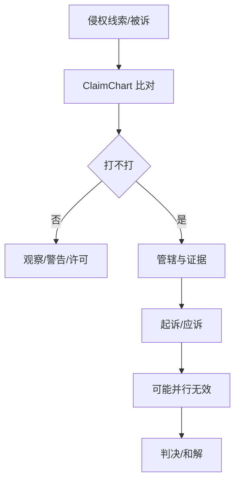

# 节点 24 · 诉讼与维权（补建节点）

> **状态：仓内完全未建模。** 本节点是 [lifecycle-coverage](../../architecture/lifecycle-coverage.md) 四个缺口中的最后一个。
> 关联：[07-monitoring.md](07-monitoring.md)（发现侵权）· [22-invalidation.md](22-invalidation.md)（无效作为反制）· [06-commercialization.md](06-commercialization.md)（许可谈判）· [01-research.md](01-research.md)（FTO 是镜像问题）
>
> 法律口径：《专利法》（2020 修正）第 65–75 条；最高人民法院关于审理专利纠纷案件适用法律问题的若干规定。凡条号、金额、期限标 ⚠ 需按当期文本复核。

---

## 0. 一句话讲清这个节点

**监控发现「有人可能侵权」，诉讼节点回答「打不打、怎么打、能拿回多少」。**

它是全生命周期里**唯一直接产生正向现金流**的节点（许可谈判与损害赔偿），也是**风险最高**的节点：打错一次，不仅赔钱，还可能把自己的专利打掉（对方反诉无效）。

产品化三条件：

1. **有独立买方**：企业法务部（预算科目独立于 IP 部门）、律所、被诉方（应诉）。
2. **有独立价值**：一件胜诉的侵权案，赔偿 + 许可费 + 市场排他，量级远超申请阶段的全部投入。
3. **有独立边界**：输入是「涉案专利 + 侵权证据」，输出是「诉状/应诉状 + 证据链 + 判决」，不与撰写、年费耦合。

> 讲给实习生的一句话：**FTO 是「我会不会踩别人的线」，诉讼是「别人踩了我的线，我怎么收钱」。** 同一套侵权判定规则，方向相反。

---


## 0.1 人读：图 · 判定 · 依据

> 本节给人读：一张图看清本站怎么走；规则按 **A 法定 / B 程序 / C 商业 / D 质量**；判定与硬闸禁止拍脑袋。细节与编号规则仍以下文全文为准。

### 本站流程（进 → 活动 → 闸 → 出 → 下一站）



### 规则速查（类别：A 法定 · B 程序/期限 · C 商业 · D 质量/合规）

| ID | 类别 | 规则（一句话） | 依据 |
|---|---|---|---|
| R24-A1 | A | 侵权赔偿与计算方式法定 | 《专利法》65 及司法解释 ⚠ |
| R24-A2 | A | 诉前保全等程序有条件 | 民诉法 + 专利司法解释 ⚠ |
| R24-B1 | B | 比对必须用统一 ClaimChart（25） | 对象规格 |
| R24-C1 | C | 对方常反诉无效（22） | 行业攻防 |
| R24-D1 | D | FTO 报告可作非故意等抗辩材料之一 | 与 01b 联动 |

### 怎么判定 · 怎么推进

| 判据 | 条件（可检查） |
|---|---|
| **进入本站** | 有涉案专利与被控方案/行为；监控或业务已触发决策。 |
| **本站完成** | 策略决定留痕；若诉：诉状/证据链/管辖选择齐；若和：协议归档。 |
| **推进下一站** | 胜诉/和解 → 06 许可或执行；败诉/专利被无效 → 23/08 复盘。 |

### 硬闸（禁止拍脑袋）

- **禁止**无 ClaimChart 就立案起诉。
- **禁止**忽视对方无效反制。
- **禁止**把行政查处与诉讼路径混为一谈不选策略。

### 依据来源（调研摘要）

- 《专利法》65–75 及相关司法解释；管辖与证据规则 ⚠ 按最高法规定复核。
- 与 07 线索、22 无效、06 许可谈判交叉。

⚠ 未核到当期官方原文的条号/金额/天数，部署前须按 CNIPA / 条约/法院文本复核。

---
## 1. 节点定位与产品边界

### 1.1 在生命周期中的位置

```
自有专利(03/04/05) ──┐
                     ├──► 【24 诉讼维权】──► 判决/和解 ──► 赔偿/许可费 ──► 现金流
侵权线索(07 监控) ───┘         │
                              ├──► 反制：对方提无效 ──► 22 无效宣告
                              ├──► 反制：我方提无效（对方专利）──► 22
                              └──► 谈判：以诉促谈 ──► 06 许可

被诉（我方是被告）──► 【24 应诉】──► 不侵权抗辩 / 现有技术抗辩 / 无效抗辩
```

### 1.2 与相邻节点的边界（最容易混的三组）

| 对比 | 区别 |
|---|---|
| **07 监控 vs 24 诉讼** | 监控产出「线索 + 评级」；诉讼产出「法律行动」。监控不判定侵权，诉讼必须判定 |
| **01 检索 vs 24 诉讼** | 01 是**可专利性**检索（我的方案新不新）；诉讼需要**侵权比对**（对方产品落不落入我的权项） |
| **22 无效 vs 24 诉讼** | 无效是行政程序（打掉对方权利），诉讼是民事程序（索赔）。两者常并行，可申请中止 |
| **06 许可 vs 24 诉讼** | 许可是交易，诉讼是杠杆。实务中「以诉促谈」是常态，两者不是替代关系 |

### 1.3 它是 / 不是

| 是 | 不是 |
|---|---|
| 侵权判定 + 救济实现的完整链条 | 发一封律师函（那只是维权动作之一） |
| 民事 + 行政 + 刑事（假冒专利）三条轨 | 只有民事诉讼 |
| 双向业务（原告 / 被告） | 只有主动维权 |
| 与无效程序强联动 | 独立于确权程序 |

### 1.4 独立产品的形态

**产品名建议：维权与应诉工作台 / Enforcement & Defense Desk**

| 模块 | 能力 | 谁用 |
|---|---|---|
| 侵权比对 | 权项要素分解 × 被控产品特征，逐项对照 | 代理师 / 律师 |
| 证据管理 | 公证购买、网页取证、展会取证、鉴定报告 | 法务 |
| 诉前策略 | 发函 / 协商 / 行政投诉 / 诉讼 / 无效 的选择与组合 | 法务 + 外部律师 |
| 案件管理 | 立案、举证、开庭、判决、执行 | 法务 |
| 应诉管理 | 抗辩体系、无效反制、和解评估 | 法务 |
| 赔偿测算 | 四种计算方式 + 惩罚性赔偿 | 财务 + 律师 |
| 执行跟踪 | 判决执行、财产线索 | 法务 |

**不做的**：不做无效请求书撰写（22）、不做日常监控（07）、不做许可合同起草（06）。

---

## 2. 角色与权限矩阵

| 角色 | 能做什么 | 不能做什么 |
|---|---|---|
| 企业法务 | 决策是否起诉/应诉、批准预算、选择外部律师 | 不直接出庭（非法定代理人） |
| 企业 IPR | 提供专利权项解释、稳定性评估、无效反制方案 | 不决定诉讼策略 |
| 外部律师 | 代理诉讼、出庭、举证、和解谈判 | 不替客户决定商业目标 |
| 专利代理师 | 侵权比对技术分析、无效请求 | 民事诉讼代理需律师资格 ⚠ |
| 业务部门 | 提供市场损失数据、侵权产品信息 | 不接触诉讼策略 |
| 财务 | 赔偿测算、诉讼预算、执行回款 | — |

> **产品权限核心**：诉讼是**高度保密**的业务。系统必须支持「仅法务 + 外部律师可见」的隔离视图，连 IPR 都可能看不到完整策略。

### 2.1 决策权（谁拍板）

> §2 回答的是「角色能做什么」，本节回答「角色能**决定**什么」。诉讼是全生命周期里单次决策代价最高的节点：一次错误的起诉可能赔掉整条产品线，一次擅自的对外发声可能让和解在签字前破裂。**能力清单不能替代决策权清单**，这是原型里完全缺失的一层。

#### 2.1.1 四种权力

| 权力 | 定义 | 管理含义 | 系统表现 |
|---|---|---|---|
| **建议权** | 可提交方案与理由，不产生约束 | 专家意见；决定人不采纳须书面说明 | 可建提案，无签署权 |
| **决定权** | 唯一签署人，签署后产生内部约束与对外授权 | 谁签字谁负责，不得「集体署名」 | `decidedBy` 唯一，一人 |
| **否决权** | 可否决已作出的决定，须书面理由与替代方案 | 只给财务、合规、披露三条线 | 置 `vetoed`，强制退回上一环节 |
| **知情权** | 只读可见，不参与决策 | 保密前提下知会，不承担决策责任 | 只读视图，不进决策记录 |

**单一签署人原则**：任何决策的 `decidedBy` 只能有一个主体。委员会可以存在，但必须收敛到一个签署人，否则事后无法追责、也无法判断「当时是谁拍的板」。

#### 2.1.2 决策权矩阵

| 决策 | 提议 | 决定 | 否决 | 知情 |
|---|---|---|---|---|
| 是否起诉 | 法务 + 外部律师 | **法务负责人** | 业务负责人（商业理由）、财务（预算） | CEO / 董秘 |
| 诉前动作顺序（发函/协商/行政/平台/诉讼） | 外部律师 | **法务负责人** | 业务负责人（客户关系） | IP 负责人 |
| 索赔金额 | 外部律师测算 + 财务校核 | **法务负责人**（授权额度内） | 财务（数据无来源时） | 业务负责人 |
| 是否接受和解 | 外部律师 + 法务 | **法务负责人**（额度内）/ CEO（超额度） | 业务负责人（战略客户） | 财务 |
| 和解让步幅度 | 法务 | 按 §2.1.4 分级 | 财务（跌破成本线） | CEO |
| 诉前禁令 / 证据保全 | 外部律师 | **法务负责人 + 财务双签** | 财务（担保占额度） | CEO |
| 对外发声（公告/媒体/平台声明） | PR + 法务 | **法务负责人**（口径终审） | 董秘（披露合规） | CEO |
| 应诉抗辩路线 | 外部律师 | **法务负责人** | — | 业务负责人 |
| 申请中止审理 | 外部律师 | **法务负责人** | — | IP 负责人 |
| 预算 / 外部律师选聘 | 法务 | 按 §2.1.4 分级 | 财务（超预算） | 采购 |
| 败诉后是否上诉 | 外部律师 | **法务负责人**；临期可先决后补 | 财务（追加预算） | CEO |

#### 2.1.3 三条不可让渡的铁律

1. **律师可建议，不能替客户决定商业目标。** 律师回答「法律上能不能赢、赢了能拿多少」；客户回答「值不值得打、打了对生意有什么影响」。外部律师无权单方接受和解、无权单方放弃诉请、无权对外发表策略性意见。系统中外部律师账号只有建议权与执行权，**决定权字段对其只读**。
2. **业务部门不得单独对外承诺。** 业务人员在客户拜访、展会、渠道沟通中，不得承诺「不追究」「授权使用」「以多少金额和解」「会撤诉」，也不得承认侵权。任何此类表述必须由法务出具书面口径后使用。
3. **PR 与法务必须联动，法务终审。** 对外发声的**内容与时机**均由法务终审；PR 可以决定「怎么讲更好听」，不能决定「讲不讲、讲什么」。上市公司还须叠加董秘的披露合规审查 ⚠。

> 讲给业务听的理由：诉讼里的每一次公开发声，都在替对方固定证据、替对方动员舆论、把自己的谈判底线暴露给对手。**沉默本身是一种筹码。**

#### 2.1.4 授权与额度分级

> 下表金额与天数为**示例阈值，企业可配置**，落地时按企业规模、案件量、行业惯例校准 ⚠。

| 层级 | 触发条件（示例）⚠ | 决定人 | 备案 |
|---|---|---|---|
| L1 程序性 | 单案预算 ≤ 20 万 ⚠ | 法务经理 | 季度汇总报法务负责人 |
| L2 常规诉讼 | 单案预算 20–100 万 ⚠ | 法务负责人 | 报 CFO |
| L3 重大诉讼 | 单案预算 > 100 万 ⚠ 或标的额 > 1000 万 ⚠ | CEO（必要时董事会） | 报董秘评估披露义务 |
| S1 小额和解 | 让步 ≤ 索赔额 20% ⚠ 且 ≤ 50 万 ⚠ | 法务负责人 | 决策记录留痕 |
| S2 大额和解 | 让步 > 20% ⚠ 或 > 50 万 ⚠ | CEO | 报财务 + 董秘 |
| S3 底线突破 | 低于成本线（已投入诉讼成本 + 机会成本）⚠ | CEO + 财务双签 | 须写明放弃理由 |
| A1 上诉 | 一审败诉且标的 > 100 万 ⚠ | 法务负责人；上诉期剩余 ≤ 3 日 ⚠ 时可先决后补 | 24 小时内补签 ⚠ |

**临时授权**：法定期限压力下（上诉期、答辩期、中止申请期），允许「先决定、后补签」，但必须同时满足三条——留 `deadlineDriven` 标记、24 小时内补签 ⚠、补签前该决定不得对外披露。

#### 2.1.5 决策留痕（`DecisionRecord`）

| 字段 | 必填 | 说明 |
|---|---|---|
| `decisionId` / `caseId` | ✅ | 一决策一记录，不复用案件状态字段 |
| `type` | ✅ | `sue / pre_suit_path / damages / settle / injunction / pr / defense / stay / budget / appeal` |
| `proposedBy` / `decidedBy` / `vetoedBy` | ✅ | 三种权力分别落字段；`decidedBy` 唯一 |
| `authorityBasis` | ✅ | 依据 §2.1.4 的哪一级授权；超授权即无效 |
| `materials` | ✅ | 决策依据的材料引用（比对表、稳定性意见、赔偿测算、风险评估） |
| `alternatives` | ✅ | **被否决的备选方案及否决理由**——事后复盘与追责的唯一依据 |
| `deadlineDriven` | — | 是否因法定期限被迫决策 ⚠ |
| `revisions` | — | 只可追加更正，不可覆盖原记录 |

> 关键设计：`alternatives` 必填。**没有备选方案的决策记录不是决策，只是一个结果。** 它同时是「当时为什么不打/为什么让步」的唯一可举证材料。

#### 2.1.6 决策权规则

| ID | 规则 | 现状 |
|---|---|---|
| R24-50 | 每个决策必须有且仅有一个 `decidedBy`；委员会决议须收敛到单一签署人 | ❌ |
| R24-51 | 外部律师仅有建议权与执行权；接受和解、放弃诉请、对外表态须客户书面授权 | ❌ |
| R24-52 | 起诉审批前须有业务部门书面确认的商业目标（市场排他/许可费/阻止竞品/维护客户关系），缺失不得提交立案审批 | ❌ |
| R24-53 | 对外发声须法务事前书面批准；未经批准即发布视为越权 | ❌ |
| R24-54 | 和解让步或预算超出 §2.1.4 授权额度的，系统必须阻断，不得以「先签后补」绕过 | ❌ |
| R24-55 | 诉前禁令 / 证据保全须同时取得担保额度审批（财务）与策略审批（法务），缺一不得提交 | ❌ |
| R24-56 | 因法定期限被迫作出的决策须标 `deadlineDriven`，并在期限届满后 5 个工作日内 ⚠ 补全材料 | ❌ |
| R24-57 | 决策记录不可覆盖；更正以追加方式记录，保留原值与更正理由 | ❌ |

---

## 3. 业务对象（字段级）

### 3.1 `EnforcementCase`（维权案件）

| 字段 | 类型 | 必填 | 说明 |
|---|---|---|---|
| `id` | string | 系统 | |
| `side` | `'plaintiff' \| 'defendant'` | ✅ | 原告 / 被告 |
| `patentNos` | string[] | ✅ | 涉案专利（可多件） |
| `accusedProduct` | string | ✅ | 被控侵权产品/方法 |
| `accusedParty` | string | ✅ | 被控方 |
| `forum` | `'court' \| 'admin' \| 'customs' \| 'platform'` | ✅ | 管辖渠道 |
| `court` | string? | 条件 | 具体法院/行政执法部门 |
| `claimsAsserted` | string[] | ✅ | 主张的权利要求（**必须指明具体权项**） |
| `infringementType` | `'literal' \| 'equivalent' \| 'both'` | ✅ | 相同侵权 / 等同侵权 |
| `evidence` | `EvidenceItem[]` | ✅ | 证据清单 |
| `damagesClaimed` | number? | — | 索赔金额 |
| `damagesMethod` | `'actual_loss' \| 'infringer_profit' \| 'license_multiple' \| 'statutory'` | 条件 | 计算方式 |
| `status` | `LitigationStatus` | 系统 | 见 §6 |
| `filedAt` / `judgmentAt` | string? | — | |
| `invalidationLinked` | string[] | — | 关联的无效案（22） |
| `stayRequested` | boolean | — | 是否申请中止审理 |

### 3.2 `ClaimChart`（侵权比对表 · 共享对象）

**本对象已统一为共享规格，见 [25-claim-chart.md](25-claim-chart.md)。** 诉讼使用其中 `purpose: 'infringement'`（原告）或 `'defense'`（被告）两种配置：

| 字段 | 诉讼用途下的取值/要求 |
|---|---|
| `purpose` | `'infringement'` 或 `'defense'` |
| `targetClaim` | 涉案专利的**具体权项全文**；每项单独建图（含从属权项） |
| `subject` | `{ kind: 'accused_product', description, evidenceRefs }` |
| `elements` | 逐要素；`match ∈ {identical, equivalent, absent, different, unresolved}` |
| `verdict` | **由 elements 推导**；任一要素缺失即 `not_covered` |
| `basis` | `'literal'` / `'equivalent'` / `'mixed'` |
| `reviewedBy` | **必填**（诉讼证据的效力前提） |

**判定铁律**（规则见 [25 §2](25-claim-chart.md)）：**全面覆盖原则**——被控方案必须包含权项的**每一个**技术特征，少一个就不侵权。比对表必须逐项填，不能只写结论；结论不得手填。

> 早期版本在本文里定义了独立的 `ClaimChart` / `ClaimElement`，与 FTO 侧的枚举不一致，已合并到 25。

### 3.3 `EvidenceItem`（证据）

| 字段 | 类型 | 说明 |
|---|---|---|
| `type` | `'notarized_purchase' \| 'web_capture' \| 'exhibition' \| 'sale_record' \| 'expert_report' \| 'financial'` | 证据类型 |
| `obtainedAt` | string | 取得时间 |
| `notarized` | boolean | 是否公证 |
| `chainComplete` | boolean | 证据链是否完整（时间、地点、主体、内容） |
| `admissibility` | `'high' \| 'medium' \| 'low'` | 可采性评估 |

### 3.4 `DamagesModel`（赔偿测算）

| 方式 | 计算口径 | 举证难度 | 适用 |
|---|---|---|---|
| 实际损失 | 销量减少 × 单件利润 | 高（因果难证） | 权利人销量数据完整 |
| 侵权获利 | 侵权销量 × 单件利润 | 中（可申请调取账册） | 侵权人账目可查 |
| 许可费倍数 | 可比许可费 × 合理倍数 | 中 | 有可比许可 |
| 法定赔偿 | 3 万–500 万 ⚠ | 低（法院酌定） | 前三种都难证 |
| 惩罚性赔偿 | 上述基数 × 1–5 倍 ⚠ | 需证「故意 + 情节严重」 | 恶意侵权 |

---

## 4. 业务规则（编号）

### 4.1 侵权判定

| ID | 规则 | 现状 |
|---|---|---|
| R24-01 | 必须**全面覆盖**：被控方案缺少任一技术特征即不侵权 | ❌ |
| R24-02 | 等同判定须满足「基本相同的手段、实现基本相同的功能、达到基本相同的效果」且**本领域普通技术人员无需创造性劳动**即可联想 | ❌ |
| R24-03 | 禁止反悔：专利权人在审查/无效程序中放弃的内容，不得在诉讼中重新纳入 | ❌ |
| R24-04 | 捐献原则：说明书披露但未写入权项的方案，视为捐给公众 | ❌ |
| R24-05 | 必须**指明具体权利要求**，不能笼统主张「该专利」 | ❌ |
| R24-06 | 比对表须逐特征填写，不得只写结论 | ❌ |

### 4.2 程序与时效

| ID | 规则 | 现状 |
|---|---|---|
| R24-10 | 诉讼时效 **3 年**，自知道或应当知道侵权及侵权人之日起算 ⚠ | ❌ |
| R24-11 | 超过 3 年起诉且侵权仍在持续的，赔偿自起诉之日向前推算 3 年 ⚠ | ❌ |
| R24-12 | 可申请**诉前禁令**（情况紧急、不采取措施将造成难以弥补的损害）⚠ | ❌ |
| R24-13 | 可申请**证据保全**（证据可能灭失或难以取得）⚠ | ❌ |
| R24-14 | 方法专利涉及**新产品**的，举证责任倒置（由被控方证明方法不同）⚠ | ❌ |
| R24-15 | 对方提无效的，可申请**中止审理**；但原告可提供担保请求不中止 | ❌ |

### 4.3 抗辩体系

| ID | 规则 | 现状 |
|---|---|---|
| R24-20 | 不侵权抗辩：缺少必要技术特征 / 不构成等同 | ❌ |
| R24-21 | 现有技术抗辩：被控方案实施的是**申请日前的现有技术** ⚠ | ❌ |
| R24-22 | 无效抗辩：涉案专利应被宣告无效（须走 22 程序） | ❌ |
| R24-23 | 权利用尽：合法售出后的使用、销售、进口不侵权 ⚠ | ❌ |
| R24-24 | 先用权：申请日前已制造相同产品/使用相同方法且仅在原范围内继续 ⚠ | ❌ |
| R24-25 | 科研实验例外、Bolar 例外、临时过境 ⚠ | ❌ |
| R24-26 | 诉讼时效抗辩 | ❌ |

### 4.4 赔偿

| ID | 规则 | 现状 |
|---|---|---|
| R24-30 | 赔偿顺位：实际损失 → 侵权获利 → 许可费倍数 → 法定赔偿 ⚠ | ❌ |
| R24-31 | 法定赔偿区间 3 万–500 万 ⚠ | ❌ |
| R24-32 | 故意侵权且情节严重 → 1–5 倍惩罚性赔偿 ⚠ | ❌ |
| R24-33 | 可主张合理开支（律师费、公证费、鉴定费）⚠ | ❌ |
| R24-34 | 赔偿测算须有**数据来源**，不得估算填空 | ❌ |

### 4.5 联动

| ID | 规则 | 现状 |
|---|---|---|
| R24-40 | 涉案专利被无效 → 诉讼基础消失，须联动 22 更新 | ❌ |
| R24-41 | 诉讼结果须回写 05 权利状态（如专利被反诉无效） | ❌ |
| R24-42 | 胜诉后可作为 06 许可谈判的筹码，须留痕 | ❌ |
| R24-43 | 败诉/被认定不侵权 → 须回写 07 监控规则（避免重复误报） | ❌ |

### 4.6 例外情形

> 前面的规则都假设「标准案件」：境内被告、专利稳定、证据齐全、愿意出面、有财产可执行。真实案件里**至少有一半不满足这些前提**。例外情形必须有**显式通道**，否则业务只能绕开系统线下决策——那正是失控的开始。
>
> 每条例外的统一格式：**例外条件 → 谁批 → 风险 → 留痕**。例外不是放宽规则，是**换一条更严格的审批路径**。

#### 4.6.1 时效将过但证据不足

| 项 | 内容 |
|---|---|
| **例外条件** | 距诉讼时效届满 ≤ 90 日 ⚠，且关键证据（侵权比对、销售数据）未固定完成 |
| **谁批** | 法务负责人 + 外部律师书面意见（双签） |
| **风险** | 先起诉后补证：可能因证据不足被驳回，且**同一事实再诉受限**；也可能打草惊蛇导致对方销毁证据、转移财产 |
| **留痕** | `limitationUrgent` 标记 + 起诉时已知的证据缺口清单 + 补救计划与时限 |

**处置顺序**：先申请**证据保全**（比起诉更快、破坏性更小）→ 再起诉 → 起诉同时申请延期举证。只有在证据保全也不可行时才走「先诉后补」。

#### 4.6.2 对方是境外主体

| 项 | 内容 |
|---|---|
| **例外条件** | 被告住所地、侵权行为地或财产所在地在境外，或判决需域外执行 |
| **谁批** | 法务负责人 + 涉外法务/境外律师意见；标的 > 500 万 ⚠ 加 CEO |
| **风险** | 管辖冲突、送达周期长、**判决承认与执行不确定**（无司法协助条约时基本无法执行）；境外诉讼成本可为境内数倍 ⚠ |
| **留痕** | 管辖分析意见 + 可执行财产检索结果 + 「胜诉但无法执行」的书面风险确认 |

**决策要点**：境外诉讼的第一问不是「能不能赢」，而是「**赢了能不能拿到钱**」。若无可执行财产，转海关扣留、平台投诉、许可谈判更实际（跨境阻断价值 > 赔偿价值）。

#### 4.6.3 涉案专利自身正被无效

| 项 | 内容 |
|---|---|
| **例外条件** | 涉案专利已被提起无效宣告（22），或我方预判稳定性不足 |
| **谁批** | 法务负责人（中止/继续二选一必须书面） |
| **风险** | 中止 → 周期拉长 6–18 个月 ⚠、证据灭失、对方继续侵权扩大损失；继续 → 专利被无效则全部诉请落空，且已缴诉讼费不退 ⚠ |
| **留痕** | 稳定性评估意见 + 中止/继续的理由 + 对方是否同意 + 若继续须提交不中止的担保（R24-15） |

**判断口径**：专利权被宣告无效的概率 > 50% 时倾向中止；侵权损失仍在快速扩大、或对方正在抢市场窗口时倾向继续并申请不中止。

#### 4.6.4 同一侵权事实多被告

| 项 | 内容 |
|---|---|
| **例外条件** | 制造商 + 销售商 + 平台 + 进口商等多主体涉同一侵权链 |
| **谁批** | 法务负责人（合并/分案方案） |
| **风险** | 合并 → 管辖争议、审理周期受最慢被告拖累；分案 → 判决互相矛盾、总成本翻倍、被各被告分别和解瓦解 |
| **留痕** | 被告清单与角色（制造/销售/使用/进口）+ 选择合并或分案的理由 + 各案进度同步表 |

**实务口径**：**先打制造商**（源头），销售商能提供合法来源的可免责（⚠ 需核实具体规则），平台走投诉通道更快。多被告时保留「分别和解」的可能，但和解条件须内部统一，防止被逐个击破。

#### 4.6.5 客户不愿出面

| 项 | 内容 |
|---|---|
| **例外条件** | 权利人与实际受害主体不一致（关联公司、被许可方、境外母公司），或权利人顾虑商业关系不愿当原告 |
| **谁批** | 法务负责人 + 权利人书面授权 |
| **风险** | **原告主体不适格**（非专利权人且无独占许可）→ 驳回；关联公司起诉可能被质疑权利基础；许可方起诉须证明已登记备案的独占许可 ⚠ |
| **留痕** | 权属/许可链条文件 + 起诉主体选择理由 + 权利人授权书 |

**替代路径**：独占被许可人可自行起诉（⚠ 以许可合同约定与登记情况为准）；普通被许可人通常须权利人同意或共同起诉。**不允许「借用主体」起诉**——主体不适格是硬伤，一打就废。

#### 4.6.6 涉密技术

| 项 | 内容 |
|---|---|
| **例外条件** | 涉案技术涉及国家秘密、商业秘密、国防专利，或产品配方/工艺不宜公开 |
| **谁批** | 法务负责人 + 保密办/合规；涉国家秘密须按保密规定报批 ⚠ |
| **风险** | 公开审理导致技术方案进入公开裁判文书 → **不可逆的技术泄露**，损失可能远超赔偿所得 |
| **留痕** | 不公开审理申请 + 卷宗密级标注 + 知悉人员名单 + 裁判文书公开前的脱敏申请 |

**决策口径**：涉密技术的诉讼，**保密价值应优先于赔偿价值**。若无法获得不公开审理，宁可放弃诉讼转许可谈判或行政查处（行政程序公开度更低）。裁判文书上网前的脱敏申请须在判决前提出，判决后往往已来不及 ⚠。

#### 4.6.7 平台投诉被反通知

| 项 | 内容 |
|---|---|
| **例外条件** | 电商/应用商店/内容平台投诉后，被投诉方提交不侵权声明（反通知），平台恢复链接 |
| **谁批** | 法务经理（转诉讼须法务负责人） |
| **风险** | 反复投诉可能被平台判定滥用 → 账号受限；直接转诉讼则成本陡增；若不转诉讼，链接恢复后侵权继续 |
| **留痕** | 反通知内容 + 「是否在合理期限内起诉」的决定 + 平台规则版本 |

**实务口径**：平台规则通常要求在收到反通知后一定期限内**起诉或投诉至行政机关**，否则链接恢复且不得重复投诉 ⚠。因此平台投诉前必须先答一题：**是否准备好为这条链接打官司？** 没准备好就不要投。

#### 4.6.8 对方无财产可执行

| 项 | 内容 |
|---|---|
| **例外条件** | 诉前财产检索显示被告无可执行财产、已是被执行人、或明显空壳 |
| **谁批** | 法务负责人 + 财务（投入产出核算） |
| **风险** | 赢了判决拿不到钱，**诉讼费、律师费、公证费全部沉没**；但不起诉则侵权持续、市场被蚕食、许可价值受损 |
| **留痕** | 财产检索报告 + 投入产出测算（成本 vs 预期回款 × 到位率）+ 替代方案 |

**替代方案优先级**：停止侵害（禁令价值）> 以诉促谈（换许可/交叉许可）> 行政查处 > 海关扣留 > 纯赔偿诉讼。**当被告无财产时，诉讼目标应从「拿钱」改为「拿市场」。**

#### 4.6.9 标准必要专利（SEP）的 FRAND 义务 ⚠

| 项 | 内容 |
|---|---|
| **例外条件** | 涉案专利已被声明为标准必要专利，权利人有 FRAND 许可承诺 ⚠ |
| **谁批** | 法务负责人 + 反垄断/竞争法意见；重大案件加 CEO |
| **风险** | **禁令受限**：权利人未履行 FRAND 义务（未按公平合理无歧视条件许可）时，法院通常不支持禁令 ⚠；强行申请可能触发反垄断风险；许可费主张受 FRAND 约束，不能按普通侵权全额索赔 |
| **留痕** | FRAND 承诺文本 + 许可要约与谈判记录 + 可比许可费率依据 + 是否已履行谈判义务的书面说明 |

**这是本节点风险最高的例外**：SEP 诉讼不是「侵权 → 赔偿」的简单模型，而是「**谈判是否诚信 → 是否可获得禁令 → 费率是否合理**」的三段式。谈判记录本身就是最重要的证据，**没有完整的要约-反要约记录，SEP 诉讼基本无法推进**。具体规则须按最新司法实践与反垄断指南复核 ⚠。

#### 4.6.10 例外情形规则

| ID | 规则 | 现状 |
|---|---|---|
| R24-60 | 时效将过且证据不足的，优先申请证据保全；只有证据保全不可行才可「先诉后补」，且须双签 | ❌ |
| R24-61 | 境外被告须先做可执行财产检索；无可执行财产的，诉讼目标改为阻断而非赔偿 | ❌ |
| R24-62 | 中止/继续的选择必须书面化，不得默认中止 | ❌ |
| R24-63 | 多被告案件须先定「打源头还是打渠道」，且和解条件内部统一 | ❌ |
| R24-64 | 原告须与专利权人或独占被许可人一致；不得借用主体起诉 | ❌ |
| R24-65 | 涉密技术案件须在开庭前提出不公开审理申请；无法获得时评估放弃诉讼 | ❌ |
| R24-66 | 平台投诉前必须确认「是否准备为此起诉」，否则不得投诉 | ❌ |
| R24-67 | SEP 案件须先完成 FRAND 谈判记录整理，未履行谈判义务不得申请禁令 ⚠ | ❌ |
| R24-68 | 所有例外必须记录「例外条件、批准人、风险确认、替代方案」四项，缺一不得放行 | ❌ |

### 4.7 规则冲突与裁决

> 前面每一条规则单独看都对。冲突发生在**同时成立**的时候。产品如果只给规则不给裁决顺序，用户看到的是一堆互相矛盾的提示，最后一定绕开系统。
>
> 本节给的是**裁决顺序**，不是「权衡一下」。权衡等于没有规则。

#### 4.7.1 五条裁决原则（按优先级，自上而下）

| # | 原则 | 含义 | 为什么排这个位置 |
|---|---|---|---|
| P1 | **期限优先** | 法定期限届满不可逆，任何冲突先保期限 | 错过上诉期/答辩期，实体权利再好也归零 |
| P2 | **不可逆优先** | 不可逆动作（公开、销毁、放弃权利、对外承诺）优先于可逆动作 | 可逆的错了还能改，不可逆的错了没有第二次 |
| P3 | **法律风险优先于商业偏好** | 合规、披露、保密义务压过商业诉求 | 商业损失可量化，违法/泄密/披露违规的代价不可控 |
| P4 | **对外口径统一，法务终审** | 无论内部怎么争，对外只有一个声音 | 两个口径等于送给对方两份证据 |
| P5 | **留痕优先于效率** | 冲突未决时先记录，再决策 | 事后无法复盘 = 无法改进 = 同类冲突必然重演 |

#### 4.7.2 七组具体冲突

| 冲突 | 表现 | 裁决 | 理由 |
|---|---|---|---|
| **快速止损 vs 取证完整** | 平台投诉能立刻下架，但会惊动对方、证据灭失 | **先保全后行动**：先做公证购买/网页取证（不可逆动作已完成），再投诉 | 取证窗口只有一次；下架可以晚 3 天 |
| **打赢官司 vs 维护客户关系** | 被告是重要客户/供应商/渠道伙伴 | **先算总账**：诉讼收益 vs 关系损失（可量化部分由业务出具），交法务负责人+业务负责人联签；无法量化则不打 | 单案赔偿通常小于长期客户价值；但联签保证责任共担 |
| **索赔最大化 vs 和解快速回款** | 高额索赔拖长周期，对方可能转移财产 | **看偿付能力**：有财产 → 可追求高索赔；无财产/在恶化 → 优先快速回款 | 判决金额 × 执行到位率才是真实收益（§12） |
| **公开谴责 vs 保密谈判** | 业务想发声明施压，法务想保密谈 | **谈判期间默认保密**；确需发声须法务终审并评估对谈判的影响 | 公开发声会锁死让步空间，等于自断退路 |
| **业务要发声 vs 法务要沉默** | 市场部要借诉讼做营销 | **法务终审**（P4）。法务否决须书面，PR 不得自行发布 | 发声时机与内容都是策略，不是传播问题 |
| **多案并行资源分配** | 同时多案，预算与人力不够 | **按「回款期望 × 胜诉概率 ÷ 周期」排序**；期限冲突时 P1 优先 | 资源有限时必须排序，排序必须有公式 |
| **执行到位率低是否继续投入** | 已胜诉但回款无望，是否继续追加执行成本 | **设止损线**：追加投入 > 预期回款 × 到位率预估时停止，转财产线索监控或打包处置 | 沉没成本不是继续投入的理由 |

#### 4.7.3 冲突裁决的落地要求

| 要求 | 说明 |
|---|---|
| 冲突必须被**显式登记** | 不得在系统外「内部协调」，否则无法统计哪类冲突最常发生 |
| 裁决人必须是 §2.1 矩阵中的**有权人** | 无权人「协调」出的结果无效 |
| 被牺牲的一方**须书面确认** | 例：业务负责人确认接受客户关系损失；PR 确认接受不发声 |
| 裁决结果回写规则库 | 同类冲突重复出现 ≥ 3 次 ⚠，应升级为默认规则或修改流程 |

#### 4.7.4 冲突裁决规则

| ID | 规则 | 现状 |
|---|---|---|
| R24-70 | 冲突按 P1 期限 → P2 不可逆 → P3 法律风险 → P4 口径统一 → P5 留痕 的顺序裁决 | ❌ |
| R24-71 | 取证与止损冲突时，取证优先；止损动作不得早于证据固定 | ❌ |
| R24-72 | 被告为战略客户/供应商时，起诉须法务与业务负责人联签，业务须书面确认关系损失 | ❌ |
| R24-73 | 索赔策略须以「判赔 × 执行到位率」为口径评估，不得只比索赔金额 | ❌ |
| R24-74 | 谈判期间对外发声默认禁止；例外须法务终审并记录对谈判的影响评估 | ❌ |
| R24-75 | 多案资源分配须有书面排序公式与当期预算上限，不得按「先来先做」 | ❌ |
| R24-76 | 执行阶段须设止损线；继续追加执行成本须重新审批 | ❌ |
| R24-77 | 任何冲突裁决须登记冲突类型、裁决人、被牺牲方确认、裁决依据 | ❌ |

---

## 5. 法律底座

### 5.1 侵权判定的三层结构

```
第 1 层  权项解释      权利要求用语的边界是什么（以说明书为字典）
   │
第 2 层  全面覆盖      被控方案是否包含每一个技术特征
   │
第 3 层  等同判定      不相同但「基本相同」的，是否构成等同
```

**任何一层出问题，结论都不成立。** 实务中大量败诉发生在第 1 层——权项解释错误。

### 5.2 等同原则的四道限制

等同不是万能扩张，有四道闸：

| 限制 | 含义 |
|---|---|
| **禁止反悔** | 审查/无效中放弃的，不能靠等同拿回来 |
| **捐献原则** | 说明书写了但没进权项的，算捐给公众 |
| **现有技术抗辩** | 等同到现有技术范围内的，不构成侵权 |
| **特意排除** | 权项明确排除的，不能再等同进来 |

### 5.3 救济方式

| 类型 | 内容 | 特点 |
|---|---|---|
| **停止侵害** | 判令停止制造、使用、销售、许诺销售、进口 | 最常见 |
| **赔偿损失** | 填平 + 惩罚性 | 核心诉求 |
| **诉前禁令** | 诉讼前先制止 | 需担保，门槛高 |
| **证据保全** | 固定证据 | 防止销毁 |
| **消除影响** | 登报声明等 | 较少用 |
| **合理开支** | 律师费、公证费、鉴定费 | 可单独主张 |

### 5.4 三条救济轨道

| 轨道 | 机关 | 手段 | 优势 | 劣势 |
|---|---|---|---|---|
| **民事** | 法院（知识产权法院/法庭） | 禁令 + 赔偿 | 赔偿高 | 周期长（1–2 年） |
| **行政** | 管理专利工作的部门 | 责令停止、查处 | 快、便宜 | 不判赔偿 |
| **海关** | 海关 | 扣留进出口货物 | 阻断跨境 | 需备案 |
| **平台** | 电商平台 | 下架链接 | 极快 | 易被反通知 |

**实务策略**：通常组合使用——平台投诉快速止损，行政查处固定事实，民事诉讼索赔。

### 5.5 管辖与审级

| 层级 | 机关 |
|---|---|
| 一审 | 知识产权法院（北京、上海、广州、海南）、各地中级法院知识产权法庭、部分基层法院 |
| 二审 | 最高人民法院知识产权法庭（技术类案件）⚠ |
| 再审 | 最高人民法院 |

### 5.6 涉外诉讼（简要）

| 法域 | 特点 |
|---|---|
| 美国 | 联邦地区法院 + ITC 337 调查（进口禁令）；赔偿含三倍惩罚 |
| 德国 | 二元制（侵权与无效分离）；禁令快 |
| 欧洲统一专利法院 UPC | 2023 起运行，可跨成员国 ⚠ |

> 涉外诉讼须单独立项，本节点只覆盖中国境内。

---

## 6. 状态机

### 6.1 原告（主动维权）

```
线索评估 ──► 证据准备 ──► 诉前动作 ──► 立案 ──► 举证 ──► 开庭 ──► 判决 ──► 执行
   │            │            │                      │                  │
   └─ 放弃      └─ 证据不足   ├─ 发函/协商 ──► 和解     │                  └─ 上诉
                            ├─ 行政投诉                └─ 对方提无效 ──► 中止
                            └─ 平台投诉
```

### 6.2 被告（应诉）

```
收到起诉/警告函 ──► 评估 ──► 抗辩策略 ──► 举证 ──► 开庭 ──► 判决 ──► 执行/上诉
                     │           │
                     │           ├─ 不侵权抗辩
                     │           ├─ 现有技术抗辩
                     │           ├─ 无效反制 ──► 22
                     │           └─ 和解
                     └─ 不理（缺席判决风险）
```

### 6.3 状态枚举 `LitigationStatus`

| 状态 | 含义 |
|---|---|
| `evaluating` | 线索评估中 |
| `evidence_prep` | 证据准备 |
| `pre_suit` | 诉前动作（发函/投诉/协商） |
| `filed` | 已立案 |
| `evidence_exchange` | 举证质证 |
| `hearing` | 开庭 |
| `stayed` | 中止审理（等无效结果） |
| `judgment` | 已判决 |
| `appeal` | 上诉中 |
| `enforcement` | 执行中 |
| `settled` | 和解结案 |
| `closed` | 结案 |

---

## 7. 闸门与条件

| 闸门 | 触发 | 条件 | 失败文案 |
|---|---|---|---|
| `claim_chart_complete` | 立案 | 比对表逐特征填完，且结论与证据一致 | `侵权比对表不完整（n/m 项未判定）` |
| `claims_asserted` | 立案 | 明确主张的权利要求号 | `未指明主张的权利要求` |
| `patent_valid` | 立案 | 涉案专利有效 | `涉案专利已终止/无效，无诉讼基础` |
| `evidence_chain` | 举证 | 关键证据已公证或证据链完整 | `关键证据未公证，可采性不足` |
| `limitation_check` | 立案 | 未超 3 年诉讼时效 | `已过诉讼时效` |
| `damages_basis` | 主张赔偿 | 赔偿计算有数据来源 | `赔偿金额缺数据来源` |
| `dual_side_isolation` | 任何读写 | 原告/被告视图隔离 | — |
| `confidentiality` | 查看策略 | 仅法务与授权律师可见 | `无权限查看诉讼策略` |

---

## 8. 步骤序列

### 8.1 主动维权（原告）

| 步 | 动作 | 谁做 | 耗时 | 产出 |
|---|---|---|---|---|
| 1 | 线索评估（是否值得打） | 法务 + IPR | 3–7 天 | 评估意见 |
| 2 | 权项稳定性评估（能否扛住无效） | 专利律师 | 5–10 天 | 稳定性意见 |
| 3 | 侵权比对（claim chart） | 代理师 | 5–15 天 | 比对表 |
| 4 | 证据固定（公证购买等） | 法务 + 公证处 | 7–30 天 | 公证书 |
| 5 | 诉前动作（发函/协商/投诉） | 法务 | 7–30 天 | 函件/投诉回执 |
| 6 | 立案 | 外部律师 | 1–7 天 | 受理通知 |
| 7 | 举证质证 | 律师 | 1–3 个月 | 证据交换 |
| 8 | 开庭 | 律师 | 1 天 | 庭审记录 |
| 9 | 判决 | 法院 | 1–6 个月 | 判决书 |
| 10 | 执行 | 律师 | 视情况 | 回款 |

### 8.2 应诉（被告）

| 步 | 动作 | 谁做 | 耗时 | 产出 |
|---|---|---|---|---|
| 1 | 收到起诉状/警告函 | 法务 | — | — |
| 2 | 评估风险（败诉概率 × 金额） | 法务 + 律师 | 3–7 天 | 风险评估 |
| 3 | 抗辩体系搭建 | 律师 | 7–15 天 | 抗辩方案 |
| 4 | 无效反制（可选） | 专利律师 | 同步 | 无效请求（22） |
| 5 | 申请中止审理 | 律师 | — | 中止裁定 |
| 6 | 举证应诉 | 律师 | 1–3 个月 | 答辩状 + 证据 |
| 7 | 开庭 / 和解 | 律师 + 法务 | — | — |

---

## 9. 写回与命令

**当前无实现。** 建议新增：

| 动作 | 建议 CommandName | 写入 |
|---|---|---|
| 创建维权案 | `createEnforcementCase` | `EnforcementCase` |
| 登记比对表 | `saveClaimChart` | `ClaimChart` |
| 登记证据 | `addLitigationEvidence` | `evidence[]` |
| 立案 | `fileLitigation` | `status: filed` + docket |
| 申请中止 | `requestStay` | `stayRequested` |
| 登记判决 | `recordJudgment` | `status: judgment` + 赔偿 |
| 执行回款 | `recordEnforcement` | `enforcement` |

**联动写回**：判决结果 → 05 权利状态（若专利被无效）；胜诉 → 06 许可筹码；败诉 → 07 监控规则校准。

---

## 10. 期限与 SLA

| 期限 | 长度 | 起算 | 后果 |
|---|---|---|---|
| 诉讼时效 | 3 年 ⚠ | 知道或应当知道侵权 | 丧失胜诉权 |
| 答辩期 | 收到起诉状副本起 15 日 ⚠ | 送达日 | 不影响实体，但丧失程序利益 |
| 举证期限 | 法院指定（常 30 日）⚠ | 送达日 | 逾期证据可能不被采纳 |
| 上诉期 | 判决书送达起 15 日 ⚠ | 送达日 | 判决生效 |
| 申请执行 | 2 年 ⚠ | 判决生效 | 丧失强制执行权 |
| 诉前禁令 | 法院裁定后 30 日内须起诉 ⚠ | 裁定日 | 解除禁令 |

**SLA**：线索评估 7 天 / 比对表 15 天 / 证据固定 30 天。

**docket 新增规则**：`litigation_answer`（答辩期）、`litigation_appeal`（上诉期）、`litigation_enforce`（申请执行期）、`preliminary_injunction_suit`（禁令后起诉期）。

---

## 11. 边界与失败场景

| # | 场景 | 正确处置 | 现状 |
|---|---|---|---|
| 1 | 只主张「该专利」不指明权项 | 必须明确权项号 | ❌ |
| 2 | 比对表只写结论 | 逐特征填 | ❌ |
| 3 | 权项在审查中被缩小过 | 禁止反悔，不能靠等同拿回 | ❌ |
| 4 | 说明书写了但没进权项 | 捐献原则，已捐给公众 | ❌ |
| 5 | 涉案专利被对方提无效 | 申请中止 / 准备继续 | ❌ |
| 6 | 涉案专利自己先被无效 | 诉讼基础消失 | ❌ |
| 7 | 超过 3 年才发现侵权 | 只能主张起诉前 3 年 | ❌ |
| 8 | 证据未公证 | 可采性受质疑 | ❌ |
| 9 | 对方是境外主体 | 需评估执行可行性 | ❌ |
| 10 | 赔偿无数据来源 | 只能走法定赔偿 | ❌ |
| 11 | 我方是被告且产品确实侵权 | 评估和解 vs 无效反制 | ❌ |
| 12 | 对方提平台投诉反通知 | 需准备反通知材料 | ❌ |
| 13 | 判决胜诉但对方无财产 | 执行不能，需提前评估偿付能力 | ❌ |
| 14 | 涉密技术进入诉讼 | 需申请不公开审理 | ❌ |
| 15 | 同一专利多被告 | 可合并或分案，需协调 | ❌ |

---

## 12. 指标

| 指标 | 定义 | 健康区间 | 说明 |
|---|---|---|---|
| 胜诉率 | 支持诉请的案件 / 结案数 | 60%–80% ⚠ | 视案件质量 |
| 判赔/索赔比 | 实际判赔 / 主张金额 | 30%–60% ⚠ | 法定赔偿普遍低于主张 |
| 平均周期 | 立案到一审判决 | 6–18 个月 ⚠ | 影响商业决策 |
| 单案成本 | 律师费 + 公证 + 鉴定 | 视复杂度 ⚠ | |
| 执行到位率 | 实际回款 / 判赔金额 | — | 最容易被忽略的指标 |
| 无效反制成功率 | 对方专利被无效 / 反制数 | — | 应诉核心武器 |
| 诉前化解率 | 发函/协商解决 / 总线索 | > 50% | 高说明诉前策略有效 |

> 卖产品时讲 **「执行到位率」**——很多系统只算到判决，不算到回款，这是法务真正的 KPI。

---

## 13. 产品化切分建议

| 层 | 内容 | 可独立交付 |
|---|---|---|
| L1 案件层 | 维权/应诉案件管理、期限、文档 | 是（最低配） |
| L2 比对层 | claim chart 工作台、要素分解 | 是（差异化最强） |
| L3 证据层 | 证据链管理、公证跟踪 | 是 |
| L4 测算层 | 赔偿测算模型 | 是（财务买单） |
| L5 策略层 | 诉前路径选择、以诉促谈 | 依赖专家 |
| L6 执行层 | 判决执行跟踪、财产线索 | 是（常被忽略） |

**定价锚点**：按案件计价，或按「涉案标的额」比例。**比对层**是最有差异化的能力。

**竞品**：Anaqua、CPA Global 有诉讼模块但偏 Docket；国内工具几乎没有 claim chart 工作台。**空位在「比对 + 测算」**。

---

## 14. 现状差距表

| # | 差距 | 严重度 | 影响 |
|---|---|---|---|
| 1 | 无 `EnforcementCase` 对象 | **高** | 整个节点不存在 |
| 2 | 无 `ClaimChart` 比对表 | **高** | 无法做侵权判定 |
| 3 | 无证据链管理 | 高 | 证据可采性无保障 |
| 4 | 无赔偿测算 | 高 | 无法评估诉讼价值 |
| 5 | 无诉讼 docket 规则 | 高 | 时效/上诉期无人管 |
| 6 | 无双轨（原告/被告）视图 | 中 | 无法服务应诉 |
| 7 | 无与无效程序的联动 | 中 | 中止/反制无法协同 |
| 8 | 无保密隔离 | 中 | 策略泄露风险 |
| 9 | 无执行跟踪 | 中 | 判决不等于回款 |
| 10 | 无涉外诉讼支持 | 低 | 出海企业缺口 |

**优先补的三件事**：

1. **`ClaimChart` 比对表**（差距 2）——这是整个节点的技术核心，也是最有差异化的部分。
2. **诉讼 docket 规则族**（差距 5）——复用现成引擎，快速见效。
3. **赔偿测算**（差距 4）——直接支撑「打不打」的决策。

---

## 15. 术语表

| 术语 | 含义 |
|---|---|
| 全面覆盖原则 | 被控方案须包含权项的每一个技术特征才构成侵权 |
| 等同原则 | 虽不相同，但手段/功能/效果基本相同且显而易见，构成侵权 |
| 禁止反悔 | 审查或无效中放弃的内容，诉讼中不得重新主张 |
| 捐献原则 | 说明书披露但未写入权项的方案，视为捐给公众 |
| claim chart | 权利要求与被控产品逐特征对照表 |
| 诉前禁令 | 诉讼前申请的停止侵害裁定 |
| 证据保全 | 诉讼前固定可能灭失的证据 |
| 现有技术抗辩 | 被控方案实施的是申请日前现有技术，不侵权 |
| 先用权 | 申请日前已实施且仅在原范围内继续，不视为侵权 |
| 权利用尽 | 专利产品合法售出后，后续使用销售不侵权 |
| 法定赔偿 | 损失难以确定时法院酌定的赔偿额 |
| 惩罚性赔偿 | 对故意侵权在基数上加倍 |
| 中止审理 | 因专利被提无效而暂停侵权诉讼 |

---

## 16. 来源

- [《专利法》（2020 年修正）· CNIPA](https://www.cnipa.gov.cn/art/2020/11/23/art_97_155167.html)
- [最高人民法院知识产权法庭](https://ipc.court.gov.cn/)
- [《专利审查指南》· CNIPA](https://www.cnipa.gov.cn/attach/0/%E4%B8%93%E5%88%A9%E5%AE%A1%E6%9F%A5%E6%8C%87%E5%8D%97.pdf)

> 诉讼时效、赔偿区间、惩罚性赔偿倍数、答辩与上诉期限，均需按现行《专利法》及司法解释复核。本文相关数字均标 ⚠。

---

## 17. 与其他缺口的关系

本节点补齐后，[lifecycle-coverage](../../architecture/lifecycle-coverage.md) 记录的四个缺口全部有了业务规格：

| 缺口 | 规格文档 | 状态 |
|---|---|---|
| 无效/异议程序 | [22-invalidation.md](22-invalidation.md) | 已补规格 |
| PCT / 国际进入 | [09-pct-international.md](09-pct-international.md) | 已补规格 |
| 诉讼维权独立化 | **本文** | 已补规格 |
| 终止/放弃路径 | [23-termination-recovery.md](23-termination-recovery.md) | 已补规格 |

**注意**：四者均只有文档，代码中仍全部未实现。
