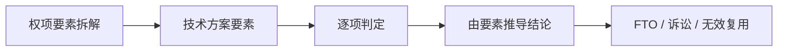

# 节点 25 · 权利要求比对表 `ClaimChart`（共享对象规格）

> **这是一个共享对象，不是流程节点。** 三个地方都要用它：
> - [01b FTO](01b-fto.md)：我的产品会不会落入他人有效权项
> - [24 诉讼](24-litigation.md)：被控产品落不落入我方（或对方）权项
> - [22 无效](22-invalidation.md)：权项相对现有技术是否成立
>
> 本文取代此前分散在三处的三份定义（`ClaimChart` / `ClaimComparison` / 无效理由中的比对）。三处枚举不一致，是同一概念的三次重复建模，必须合并。

---

## 0. 为什么必须统一

此前三处的定义：

| 位置 | 对象名 | 要素判定枚举 | 结论枚举 |
|---|---|---|---|
| 24 诉讼 | `ClaimChart` | `identical / equivalent / absent / different` | `infringed / not_infringed / partial` |
| 01b FTO | `ClaimComparison` | `present / absent / different` | `covered / not_covered / needs_review` |
| 22 无效 | 无独立对象（散在 `InvalidationGround` 里） | — | — |

**三个问题**：

1. **同一概念三种枚举**：`identical` 与 `present` 说的是一回事；`not_infringed` 与 `not_covered` 也是。跨模块对接要写映射表，映射表迟早出错。
2. **结论可以手填**：三处都允许直接写结论，不强制由要素推导。这正是「矩阵只写结论」这一事故的根源。
3. **无效场景没有对象**：导致无效理由里的比对无法复用、无法审计。

---


## 0.1 人读：图 · 判定 · 依据

> 本节给人读：一张图看清本站怎么走；规则按 **A 法定 / B 程序 / C 商业 / D 质量**；判定与硬闸禁止拍脑袋。细节与编号规则仍以下文全文为准。

### 本站流程（进 → 活动 → 闸 → 出 → 下一站）



### 规则速查（类别：A 法定 · B 程序/期限 · C 商业 · D 质量/合规）

| ID | 类别 | 规则（一句话） | 依据 |
|---|---|---|---|
| R25-A1 | A | 发明/实用新型保护范围以权利要求为准 | 《专利法》64 |
| R25-A2 | A | 全面覆盖 / 等同原则等司法规则适用侵权 | 司法解释 ⚠ |
| R25-D1 | D | 结论必须由要素判定推导，禁止手填结论 | 本对象设计硬闸 |
| R25-D2 | D | 三处枚举必须统一，禁止并行三种模型 | 规格合并目标 |

### 怎么判定 · 怎么推进

| 判据 | 条件（可检查） |
|---|---|
| **进入本站** | 有目标权项文本 + 被比对象（产品/现有技术/被控方案）。 |
| **本站完成** | 每项要素有判定枚举 + 结论由规则推导 + 引用证据锚点。 |
| **推进下一站** | 输出给 01b / 22 / 24 消费；不得各写各的表。 |

### 硬闸（禁止拍脑袋）

- **禁止**只写「构成侵权」无要素行。
- **禁止** identical/present 等多套同义枚举并存。
- **禁止**修改结论却不改要素行。

### 依据来源（调研摘要）

- 《专利法》64；侵权判定司法实践（全面覆盖、等同）⚠。
- 无效侧用对比文件特征覆盖权项；FTO 侧用产品特征覆盖他人权项——同一表、方向不同。

⚠ 未核到当期官方原文的条号/金额/天数，部署前须按 CNIPA / 条约/法院文本复核。

---
## 1. 统一后的结构

```ts
interface ClaimChart {
  id: string
  /** 用途决定「比对什么」和「适用哪条规则」 */
  purpose: 'fto' | 'infringement' | 'defense' | 'invalidation'
  caseId?: string        // 诉讼/无效
  projectId?: string     // FTO

  /** 被比对的权项（左侧） */
  targetClaim: {
    patentNo: string
    claimNo: string
    jurisdiction?: string       // FTO 必需：权项只在授权国有效
    claimText: string           // 全文；不许用摘要代替
    isIndependent: boolean
    dependsOn?: string          // 从属权项的引用基础
    prosecutionRefs?: string[]  // 审查档案，判断禁止反悔必需
  }

  /** 比对对象（右侧），三种形态 */
  subject: ClaimChartSubject

  /** 逐要素对照（核心） */
  elements: ClaimElement[]

  /** 结论：必须由 elements 推导，不可手填 */
  verdict: ClaimVerdict
  basis?: 'literal' | 'equivalent' | 'mixed'   // 仅 infringement/fto 有意义
  designAround?: string                        // 规避建议（fto/infringement）

  /** 过程留痕 */
  preparedBy: string
  reviewedBy?: string
  reviewedAt?: string
}

type ClaimChartSubject =
  | { kind: 'own_product';     projectId: string; productVersion: string; features: ProductFeature[] }
  | { kind: 'accused_product'; description: string; evidenceRefs: string[] }
  | { kind: 'prior_art';       pubNo: string; disclosureRefs: string[] }

interface ClaimElement {
  id: string
  /** 权项中该要素的原文（左侧） */
  text: string
  /** 比对对象的对应内容（右侧）；为空表示右侧无对应 */
  subjectRef?: string
  /** 判定 */
  match: ElementMatch
  /** 论证要点：为什么是这个判定 */
  note: string
  evidenceRefs?: string[]
}

type ElementMatch =
  | 'identical'    // 字面相同（权项用语在比对对象中直接出现）
  | 'equivalent'   // 字面不同，但手段/功能/效果基本相同且显而易见
  | 'absent'       // 比对对象中不存在该要素
  | 'different'    // 存在对应物，但实质不同且不构成等同
  | 'unresolved'   // 信息不足，需补材料

type ClaimVerdict =
  | 'covered'      // 落入 / 成立（按 purpose 解释）
  | 'not_covered'  // 不落入 / 不成立
  | 'undetermined' // 待定
```

---

## 2. 结论推导规则（不可手填）

**这是本对象最重要的约束。** `verdict` 必须是 `elements` 的函数，任何 UI 不得提供「直接选结论」的入口。

### 2.1 侵权类（`fto` / `infringement` / `defense`）

```
if elements 中存在 'unresolved'          → 'undetermined'
else if elements 中存在 'absent' 或 'different' → 'not_covered'   （全面覆盖原则：缺一即不落入）
else if elements 全部为 'identical'       → 'covered'，basis = 'literal'
else if elements 含 'equivalent'（无 absent/different） → 'covered'，basis = 'equivalent'
```

**三条关键性质**：

1. **短路**：任一要素 `absent` 或 `different`，结论立即为 `not_covered`，后面不必再比。
2. **不可抵消**：不存在「大部分相同所以覆盖」——全面覆盖原则没有权重概念。这是比对表与评分表的本质区别。
3. **等同降级**：`fto` 用途下，若结论依赖 `equivalent`，`basis` 必须标 `equivalent`，且报告须注明「等同认定权在法院，本结论仅供参考」。诉讼用途下同理。

### 2.2 无效类（`invalidation`）

规则不同，不能套用上面的推导：

```
新颖性：单一对比文件必须公开权项的每一个要素
  → 全部 'identical' 才算成立；任一 absent 即不破坏新颖性

创造性：不要求单篇全覆盖，看区别特征是否显而易见
  → 允许 'different'，但须另附「为何显而易见」的论证（非本对象字段，见 22 §5）
```

**所以 `purpose: 'invalidation'` 时，`verdict` 的语义是「该理由是否成立」，不是「是否落入」。** 这一点必须在 UI 上明示，否则会误导。

---

## 3. 同一个结构，三种测试

统一的是**结构**，不是**判定标准**。下表说明哪里可以复用、哪里必须分开：

| | FTO | 侵权诉讼 | 无效宣告 |
|---|---|---|---|
| 左侧 | 他人有效权项 | 涉案专利权项 | 涉案专利权项 |
| 右侧 | 我方产品 | 被控产品 | 现有技术文献 |
| 核心测试 | 全面覆盖 | 全面覆盖 | 新颖性=单篇全覆盖 / 创造性=组合 |
| 等同适用 | 提示性（标注待定） | 是，但受禁止反悔等限制 | 不适用 |
| 时间基准 | 计划上市日 | 侵权行为日 | 申请日 / 优先权日 |
| 结论落点 | 能否实施 | 是否侵权 | 权利是否成立 |
| 复用程度 | **结构 100% 复用；判定规则独立** | | |

> **设计结论**：对象统一，**判定引擎按 `purpose` 分派**。不要试图写一个「通用侵权判定器」，那会把三种测试混成一种，全部出错。

---

## 4. 业务规则

| ID | 规则 | 说明 |
|---|---|---|
| R25-01 | `verdict` 必须由 `elements` 推导，UI 不得提供直接选结论的入口 | 防止「只写结论」 |
| R25-02 | `targetClaim.claimText` 必须是全文，不得用摘要或标题代替 | 无数值即无比对 |
| R25-03 | 必须指明 `claimNo`；不得以「该专利」笼统指代 | 一件专利多个权项，保护范围各不相同 |
| R25-04 | 任一要素 `unresolved` → 整体 `undetermined`，不得跳过 | 信息不足不能算通过 |
| R25-05 | `note` 为空时不允许设 `identical` / `equivalent` / `different` | 判定必须给理由 |
| R25-06 | `equivalent` 必须额外说明「手段/功能/效果基本相同」三项 | 等同不是「看起来像」 |
| R25-07 | 从属权项须单独建图，不得用独权结论代替 | 独权不落入 ≠ 从权也不落入 |
| R25-08 | `prosecutionRefs` 非空时，须核对是否触发禁止反悔 | 审查中放弃的特征不能靠等同拿回 |
| R25-09 | 图发布须有 `reviewedBy` 且复核人具备代理师/律师资格 ⚠ | 抗辩证据的效力前提 |
| R25-10 | 图与结论一旦发布即锁定；修改须新建版本并说明原因 | 诉讼中改图会被质疑 |
| R25-11 | 不得跨 `purpose` 复用同一张图 | 时间基准与测试规则不同 |
| R25-12 | `invalidation` 用途下不得出现 `equivalent` | 等同是侵权概念，与新颖性/创造性无关 |

---

## 4.1 决策权：谁对这张图负责

比对图是三种程序的**共同证据**，所以它的决策权必须比普通文档更严——因为它一旦被采信，就直接决定「侵不侵权」「权利成不成立」。按 [decision-rights.md](../decision-rights.md) 对齐：

| 决策 | 建议权 | 决定权 | 否决权 | 级别 |
|---|---|---|---|---|
| 权项如何解释（术语边界） | 代理师 / 律师 | **代理师或律师**（专业判断，不可由客户定） | — | L2 |
| 要素如何切分 | 代理师 | 代理师 | — | L1 |
| 单个要素的判定 | 技术专家、检索人 | **代理师 / 律师** | — | L2 |
| 整体结论（是否落入） | 系统推导 | **不由人选**——由要素推导（R25-01） | — | — |
| 是否采用等同（放宽结论） | 代理师 | 代理师 + 客户书面知悉风险 | 法务（若放宽导致不利后果） | **L3** |
| 规避建议（FTO） | 代理师 + 研发 | 客户（是否接受改设计） | 业务（改设计影响产品） | L3 |
| 图能否对外（诉状 / 投资方 / 客户） | 代理师 | **法务** | — | **L4** |
| 发布后修改 | 代理师 | 代理师 + 复核人双签 | — | **L4** |

### 4.1.1 三条界线

| 误解 | 正确口径 |
|---|---|
| 「客户最懂自己的产品，要素判定听客户的」 | 客户提供**产品事实**（右侧是什么），代理师做**法律判定**（是否落入）。两者不可互换 |
| 「结论是律师的意见，所以律师可以定」 | 结论**不是意见，是推导结果**。律师可以争论要素判定，但不能绕过要素直接给结论（R25-01） |
| 「内部先出一版，对外再让律师看」 | 对外版本必须由具资质者复核签署（R25-09）。内部草稿与对外版本必须可区分，不得混用 |

### 4.1.2 不可逆性

比对图本身的修改是**可逆**的（新建版本即可），但它支撑的**对外行为**不可逆：

| 行为 | 不可逆点 |
|---|---|
| 作为诉状附件提交 | 一旦提交即入卷，后续改图须说明理由，易被质疑 |
| 作为无效请求书附件 | 同上，且理由与证据绑定后难以更换 |
| 提供给投资方 / 客户 | 构成陈述，若与事实不符可能承担缔约过失责任 |
| 作为「已尽注意义务」的抗辩证据 | 图的质量直接决定抗辩成立与否（见 [01b §5.2](01b-fto.md)） |

> **一句话**：图可以改，但**提交出去的那一刻就定了**。所以对外发布是 L4，内部迭代是 L1–L2——两者不能共用一条审批流。

---

| 字段 | fto | infringement | defense | invalidation |
|---|---|---|---|---|
| `targetClaim.jurisdiction` | **必填** | 必填 | 必填 | 必填 |
| `subject` 形态 | `own_product` | `accused_product` | `accused_product` | `prior_art` |
| `basis` | 必填（若 covered） | 必填 | 必填 | **禁止** |
| `designAround` | **必填**（若 not_covered） | 可选 | 可选 | 不适用 |
| `evidenceRefs`（要素级） | 可选 | **必填** | **必填** | 必填 |
| `reviewedBy` | 建议 | **必填** | **必填** | **必填** |
| 发布后用途 | 报告附件 | 诉状附件 | 答辩状附件 | 无效请求书附件 |

> **`designAround` 在 FTO 里是必填**：FTO 的目的不是「告诉你侵权」，而是「告诉你怎么办」。只给结论不给路径，产品价值少一半。

---

## 6. 与既有对象的关系

| 对象 | 关系 |
|---|---|
| `ProductFeature`（01b） | FTO 用途下作为 `subject.features` 的来源 |
| `ObstaclePatent.claims`（01b） | `targetClaim` 的来源 |
| `EvidenceItem`（24） | 要素级 `evidenceRefs` 指向它 |
| `InvalidationGround`（22） | 引用本图的 `verdict` 作为理由成立性依据 |
| `ResearchHit`（01） | **不直接引用**：检索命中是文献，不是权项比对 |

---

## 7. 失败场景

| # | 场景 | 正确处置 |
|---|---|---|
| 1 | 只填结论不填要素 | 规则 R25-01 阻断 |
| 2 | 用摘要代替权项全文 | 规则 R25-02 阻断 |
| 3 | 一件专利只比独权 | 从权须单独建图（R25-07） |
| 4 | 要素判定为「相同」但无论证 | R25-05 阻断 |
| 5 | 等同判定写成「功能类似」 | 须说明手段/功能/效果三项（R25-06） |
| 6 | 图里有 unresolved 却出了确定结论 | R25-04 阻断 |
| 7 | 诉讼中改了图但没留版本 | R25-10 阻断 |
| 8 | 拿 FTO 图直接当诉讼证据 | R25-11 阻断（时间基准不同） |
| 9 | 无效理由里写「等同」 | R25-12 阻断 |
| 10 | 结论依赖等同但报告未提示 | 见 §2.1 第 3 条 |

---

## 8. 现状差距

| # | 差距 | 严重度 |
|---|---|---|
| 1 | 三处定义枚举不一致 | **高** |
| 2 | 结论可手填，无推导约束 | **高** |
| 3 | 无效场景无独立比对对象 | **高** |
| 4 | 无从属权项单独建图的能力 | 中 |
| 5 | 无 `prosecutionRefs`（禁止反悔）字段 | 中 |
| 6 | 无版本锁定 | 中 |
| 7 | FTO 原型用「特征 × 文献」矩阵，结构上无法表达本对象 | **高** |

> 第 7 条是原型最需要改的地方：矩阵是二维的，本对象是三维的（专利 → 权项 → 要素）。矩阵无法表达「一件专利的多个权项分别判定」。

---

## 9. 术语

| 术语 | 含义 |
|---|---|
| 要素 | 权利要求分解后的单个技术特征；全面覆盖原则的最小判定单位 |
| 全面覆盖 | 每个要素都被覆盖才落入；缺一即不落入 |
| 字面相同 | 权项用语在比对对象中直接出现 |
| 等同 | 字面不同但手段/功能/效果基本相同且显而易见 |
| 禁止反悔 | 审查或无效中放弃的内容，不得再通过等同主张 |
| 从属权项 | 引用其他权项并附加技术特征的权项 |
| 独立建图 | 每个权项单独一张比对表，不共用结论 |

---

## 10. 来源

- [《专利法》（2020 年修正）· CNIPA](https://www.cnipa.gov.cn/art/2020/11/23/art_97_155167.html)
- [《专利审查指南》· CNIPA](https://www.cnipa.gov.cn/attach/0/%E4%B8%93%E5%88%A9%E5%AE%A1%E6%9F%A5%E6%8C%87%E5%8D%97.pdf)
- [最高人民法院知识产权法庭](https://ipc.court.gov.cn/)

> 等同原则的具体适用标准、禁止反悔的认定边界，需按当期司法解释与判例复核。
