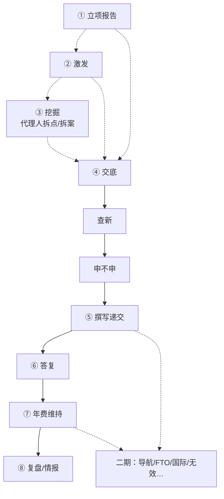

# 全生命周期业务地图（浅表）

> **用途**：产品讨论用「全景目录」——每站一句话，标清谁做、小企业是否常做、产物是什么。  
> **不做**：不在此展开规则细则、不谈工程实现。  
> **产品边界（已对齐讨论）**：  
> - **总目标** = 专利**全生命周期**链路（地图会持续补站，八环节不是终点）。  
> - **第一期范围** = 老板材料的**八个节点都要做**（后面再补 FTO/无效/诉讼/PCT/国际等）。  
> - **梳理顺序** = **一节点一文档**（[一期节点/](一期节点/README.md)）；先写清 **[④ 交底](一期节点/04-交底.md)**，其余站按同模板补齐。  
> **上游老板材料**：`INNOPARA研发创新服务包.总纲/客户册.V0801`（八环节）；`业务逻辑说明.md`（专利挖掘产品路径）。  
> **建立**：2026-10-28 · 业务讨论稿 · 可改。

---

## 0a. 三层边界（怎么说就不迷糊）

| 层 | 是什么 | 不是什么 |
|---|---|---|
| **全生命周期总图** | 专利从研发保护意向 → 确权 → 维持 → 运用/攻防的完整链路；**可持续加站** | 不等于第一期全做完 |
| **第一期 = 八节点** | ①研发立项 ②激发 ③挖掘(+**拆案排案**) ④交底 ⑤申请 ⑥答复 ⑦维护 ⑧复盘/情报；**查新、单案申请决策**挂在链上作井沿/必留拍板 | 不等于八站一样厚；不等于生命周期到此结束；③「布局」≠二期导航 |
| **第一口井（做透）** | 建议仍以 **④ 交底**（发明人成稿 + 企业 IPR 可跳过）为验收核心；③挖掘为并列强候选 | 不等于只做交底、其余七站不做 |

```
全生命周期总图（会变长）
    └── 第一期范围：八节点（+ 查新/申请决策作链上接口）
            └── 本期做透：交底 A→B（及与上下游交接）
            └── 本期做通/可薄：其余一期站
            └── 二期及以后：FTO、无效、诉讼、PCT/国际、组合运营加厚…
```

---

## 0b. 完整专利全生命周期链路（总图 · 有）

> **有总图。** 站与站的**产品事实**以 [`一期节点/`](一期节点/README.md) + 实产品 handoff / `各产品开发` 为准。  
> [`lifecycle/README`](../lifecycle/README.md) / [`business-spine`](../lifecycle/business-spine.md) 可作导览对照；[`nodes/`](../lifecycle/nodes/) **多为模型稿，不当业务真理**。

### 总图怎么读

```
【拿专利主链 · 常感知】交底 → 查新 → 申不申 → 撰写递交 → 答复 → 年费
【前面可挂】立项报告 / 激发 / 挖掘（代理人拆点）——常可跳过
【后面可挂】复盘情报；二期：导航 / FTO / 国际 / 无效 / 诉讼 / 运用…
【横切】谁确认、期限、商务
```

### 完整站清单（业务浅表）

| 顺序感 | 站 | 一句话 | 必经分层 | 第一期？ |
|---|---|---|---|---|
| 前 | **研发立项（技术路线）** | 课题/路线做不做（老板①） | 条件 / 经营侧 | ✅ 一期① |
| 前 | **创新激发** | 还有什么技术方向 | 条件 | ✅ 一期② |
| 前 | **捕获入池** | 技术事实进池 | 条件；常不单列 | 并入挖掘/交底 |
| 前 | **专利挖掘** | 代理人从研发资料拆点、去向、**拆案排案** | 条件（小企业常弱） | ✅ 一期③ |
| 前 | **战略/行业布局** | 赛道全景怎么布（导航） | 条件 | ❌ 二期导航；**≠** ③拆案 |
| 主 | **发明交底** | 发明人成稿 +（有岗）企业 IPR 审核；交代理后的理解对齐在⑤接案 | 业务必经 | ✅ 一期④ **建议做透**（见 [04](一期节点/04-交底.md) B） |
| 主 | **查新 / 可专利性** | 能不能授权 | 业务强烈建议 | ✅ 建议一期挂链（鉴新） |
| 支 | **FTO 自由实施** | 能不能安全卖/实施 | 条件；≠查新 | ❌ 二期+ |
| 主 | **单案申请决策** | 这一案申不申、类型、委托（≠研发立项） | 业务必经（形式可薄） | ✅ 一期接口（井沿） |
| 主 | **撰写 + 附图** | 权项/说明书/图 → 定稿 | 业务必经 | ✅ 一期⑤ |
| 法 | **递交与程序** | 递交、补正、实审等程序 | 法律必经 | 并入⑤或单列程序 |
| 法 | **审查答复** | OA 策略与答复 | 法律必经（有 OA 时） | ✅ 一期⑥ |
| 法 | **授权维持 / 年费** | 缴费、维持或放弃 | 法律必经 | ✅ 一期⑦ |
| 法 | **终止与恢复** | 终止后救不救得回来 | 条件 | 可挂⑦后段 |
| 后 | **运用转化** | 许可/转让/质押等变现 | 支线 | ⑧可薄覆盖意向 |
| 后 | **监控预警** | 竞对与侵权线索 | 条件 | ⑧/情报相关 |
| 后 | **无效宣告** | 打掉他人权利 | 支线 | ❌ 二期+ |
| 后 | **诉讼与维权** | 主张与抗辩 | 支线 | ❌ 二期+ |
| 贯 | **PCT / 国际** | 海外路径与国家阶段 | 条件 | ❌ 二期+ |
| 贯 | **资产复盘 / 情报** | 年清、策略、竞对（老板⑧） | 条件 / 经营 | ✅ 一期⑧ |
| 切 | **交接·确认 / 期限 / 商务** | 谁确认、法定钟、钱的口袋 | 横切，每站要用 | 一期随站带，不必当「第九业务站」抢叙事 |

**默认「拿专利」主链（小企业可感知）：**  
**交底 → 查新 → 申不申 → 撰写递交 → 答复 → 维持。**  
①立项报告 / ②激发 / ③挖掘 = **按需挂上，不是必经**；导航/FTO/国际/无效诉讼 = 二期+。

**图示（实线=常走主链；虚线=可跳过）：**



站事实：[一期节点](一期节点/README.md)；导览对照可看 lifecycle README/spine（**nodes 勿当真**）。

---

## 0. 先把三个「立项」拆开（避免继续混）

老板材料与专利实务里，「立项」至少有三种，**不是同一步**：

| 称呼 | 实际在问什么 | 在老板八环节 | 小企业常见吗 |
|---|---|---|---|
| **A. 研发立项 / 技术路线决策** | 这条研发课题/技术路线做不做、选哪条 | ① 立项有依据（《研发立项决策论证报告》） | 有研发就会有，但很少买正式论证报告 |
| **B. 专利挖掘后的保护决策** | 这个创新点：申请 / 秘密 / 公开 / 放弃 | ③ 成果不埋没（四出口） | 常口头一句，少正式决策单 |
| **C. 单案申请决策（专利立项）** | 这一案：申不申、发明还是实用、谁出钱委托 | 八环节未单独命名；夹在③→④→⑤之间 | **几乎总有人拍板**，形式很随意（老板一句话） |

下文「申请决策」专指 **C**。说「小企业不做立项」时，多半指不做 **A 的正式报告** 或 **B 的正式四出口**，不是「没人决定要不要申专利」。

---

## 1. 老板八环节 ↔ 业务一句话地图

对齐总纲 / 客户册的 **①～⑧**，并补上「查新 / 申请决策 / **拆案排案（≠导航布局）**」等易混点。

| # | 环节（老板口径） | 一句话干什么 | 主要谁 | 关键产物 | 小企业 | 大企业/有IP部 | 本期挖井建议 |
|---|---|---|---|---|---|---|---|
| ① | 研发立项有依据 | 技术路线/课题该不该上、专利空间与风险初判 | 老板/总工 + 顾问 | 《研发立项决策论证报告》 | 少买正式报告；决策常靠经验 | 更常要依据链 | **地图占位**（旗舰/销售钩子） |
| ② | 研发有思路（激发） | **低密度×在研**命题 +（可选）创见会话展开 | 研发自助；顾问交报告喂料 | 命题素材 / 方向卡 | **少专项用**；有则偶发 | 可作日常工具 | **可薄**；见 [02](一期节点/02-创新激发.md) · 报告喂料已有、会话在仓外 |
| — | 查新 / 可专利性（鉴新） | 这方案大概能不能授权 | 代理/IP/研发 | 查新或新创性意见 | 看预算；常简化或交给代理 | 较规范 | **井沿**：交底后接；可弱可跳过（人认风险） |
| ③ | 成果不埋没（挖掘+拆案建议） | 代理人从材料拆点、去向、**拆几案怎么排** | **代理人主操**；研发供料 | 点清单、去向、拆案建议、双口径报告 | **少做**；常直写交底 | 常做 | **做通**；见 [03](一期节点/03-专利挖掘.md) |
| ④ | 交底过得硬 | **④-a** 发明人成稿；**④-b** 企业 IPR 审核（有岗走、无岗跳） | 研发写；有岗则 IPR 审 | 交底书 +（有岗）IPR 批准 | **主战场** | 有模板+IPR | **第一口井（做透）**；细节见 [04](一期节点/04-交底.md) |
| — | 申请决策（单案 Go） | 这一案办不办、类型、委托 | 老板/负责人拍板 | 决策留痕（可很薄） | **必有人拍**，形式随意 | 评审会 | **井沿**：常在⑤接案后、开写前 |
| ⑤ | 申请有高手 | 代理开案后：接案审交底 → 查新/决策 → 撰写递交 | 代理主操；发明人配合 | 接案放行、申请包、递交凭证 | 外包代理 | 所内或外包 | **第三口井**；见 [05](一期节点/05-申请.md) |
| ⑥ | 答复有策略 | OA 怎么答、争/限缩/放不放弃 | 代理建议 + 客户拍板 | 策略建议书、答复包 | 有 OA 才发生 | 同左 | **后置**；按案发 |
| ⑦ | 权利不掉线 | **确权资产托管**：期限提醒、年费/官费、费用明白账 | 系统提醒；旗舰+顾问巡检 | 期限台账+明白账 | 需要但不优先买单 | 刚需 | **可薄**；见 [07](一期节点/07-维护.md) · 老板册；养/砍策略多在⑧ |
| ⑧ | 资产年年清（复盘） | 年度盘点/复盘；维持放弃；下年策略 | 顾问主动交；客户拍板 | 盘点或复盘报告 | 少买正式复盘 | 组合管理要 | **可薄**；见 [08-复盘](一期节点/08-复盘.md)；情报官见 [接口-情报](一期节点/接口-情报.md) |

**查新为什么像「两段」：** ③挖掘里检索 = 代理人拆点时对照现有技术（证据分层，非正式终局）；⑤开案后查新 = 可专利性结论喂「申不申」和撰写。详见 [接口-查新](一期节点/接口-查新.md)。  
**FTO**：≠ 查新 → 二期。

### 1.1 二期及以后（第一期不做进八节点，但生命周期要有 · 已开目录）

目录：[`二期节点/`](二期节点/README.md)。

| 候选站 | 一句话 | 为何不进第一期八节点 | 文档 |
|---|---|---|---|
| **专利导航** | 全景、导航图、空白/短板、战略布局（攻防补强） | 旗舰/出海/平台型才厚买；**≠** ③拆案排案 | [01](二期节点/01-专利导航.md) 薄稿 |
| FTO | 特定产品在特定市场能不能较安全实施 | 与查新易混，宜单列 | [02](二期节点/02-FTO.md) 待写 |
| PCT / 国际 | 去哪国、30 个月窗口 | 出海子集 | [03](二期节点/03-PCT国际.md) 待写 |
| 无效 | 打掉他人权利 | 低频攻防 | [04](二期节点/04-无效.md) 待写 |
| 诉讼 / 维权 | 主张与抗辩 | 低频；资质边界 | [05](二期节点/05-诉讼维权.md) 待写 |
| 运用 / 许可转让 | 权利变现 | ⑧可先薄 | [06](二期节点/06-运用.md) 待写 |
| 监控预警 | 竞对与侵权线索 | 可从⑧长出 | [07](二期节点/07-监控预警.md) 待写 |

---

## 2. 两条真实主路径（不要捏成一条）

### 2.1 中小企业（没 IP 部）——默认主路径

```
（偶发：研发卡壳用激发 / 老板拍研发课题）
        ↓
有一项要保护的技术
        ↓
【井】④-a：发明人从 0 写出第一版并确认
        ↓
【井】④-b：企业 IPR 审核（有岗走；SME 常跳过）
        ↓
交卷开案 → 【⑤ A】代理接案理解对齐（防 AI↔AI 对搓）
        ↓
（建议）查新 —— 可弱、可跳过但须人认风险
        ↓
申请决策 —— 老板/负责人确认申不申
        ↓
撰写申请 → 递交 →（日后）答复 / 年费
```

- **激发 / 体系挖掘 / 多案拆案排案 / 研发立项正式报告**：小企业**一般不做专项**；产品可挂「更多/按需」，勿当第一周必经。  
- **第一次成功（研发）**：齐套交底 + 本人确认；有岗则过 IPR。  
- **第一次成功（代理）**：开案后发出本人认过的追问/批注；对齐后能进入查新或申请决策。

### 2.2 挖掘产品路径（老板「智掘」/ `业务逻辑说明`）——另一口井

```
研发资料（刻意不叫交底书）
  → 创新点提炼与确认
  →（检索证据）
  → 拆案排案 / 组合（产品 UI 常叫「布局」）
  → 双口径报告
```

- 解决的是 **③ 成果不埋没**，不是 **④ 交底陪写**。  
- **「布局」三义**：③ UI = **拆案排案**；旗舰图2-4 = 落点优先级（喂挖掘任务）；二期导航 = 赛道/组合战略——**勿混**。  
- 与交底井 **衔接**：挖掘里「建议申请」的点 → ④-a/④-b → ⑤ 接案 → 申请决策 → 撰写。  
- 不要把挖掘四步当成小企业唯一上手路径。

---

## 3. 交底切分（已定 B）· 查新不塞进④

| 段 | 是什么 | 不是什么 |
|---|---|---|
| **④-a 发明人成稿** | 不会写的研发产出齐套交底并确认 | 不是写申请文件；不是代理接案 |
| **④-b 企业 IPR** | 有岗：齐套/合规/批准交底包；无岗跳过 | 不是申请决议；不是代理侧审核 |
| **⑤ A 接案** | 开案后代理读懂、追问、放行 | 不是企业侧「成稿」产品 |
| **⑤ 查新** | 开案后、开写前（可弱）；可专利性终局向 | 不塞进④；≠ ③挖点时的证据检索 |
| **③ 检索** | 代理人拆点时对照现有技术 | ≠ 正式查新包 / 申不申终局 |

---

## 4. 业务节奏：全生命周期 ↔ 第一期八节点 ↔ 做透

| 步骤 | 做什么 | 深度 |
|---|---|---|
| 1 | **总图**：专利全生命周期列全，并持续补站（§1.1） | 浅：一句话 + 是否一期 |
| 2 | **第一期范围钉死为八节点**（+ 查新、申请决策作链上接口） | 八站都在产品范围里 |
| 3 | **一期內分档**：做透 / 做通 / 可薄 | 见下表 |
| 4 | **二期**：导航、FTO、国际、无效…（见 [`二期节点/`](二期节点/README.md)） | 有材料先薄稿，再加深 |

### 4.1 第一期八节点 · 建议分档（可改）

| 分档 | 节点 | 业务含义 |
|---|---|---|
| **做透** | ④ 交底（④-a 成稿 + ④-b IPR 可跳过） | 小企业第一成功；有岗防空壳外推 |
| **做通（建议同期有完整场景）** | ③ 挖掘；查新；申请决策；⑤ 申请（至少能交到撰写/看见交接） | 全链能讲通、能走通，厚度可次于交底 |
| **可薄 / 人工+系统提醒** | ① 研发立项报告；② 激发；⑥ 答复；⑦ 维护；⑧ 复盘/情报 | 一期在册、有交付口径；系统可浅，顾问可补 |

**反对**：把「第一期八个」理解成「八个同等完善才算一期完成」。  
**赞成**：**总图做专利全生命周期；一期先吃进这八个；一期验收看主路径走通 + 交底井做透。**

---

## 5. 与拟人化理念的对齐（业务句，不谈壳）

- **公司**：这一案（或这一包服务）的作业空间；全生命周期站多了，公司视图仍是「一案一条业务线」。  
- **部门**：总图上每一站；第一期默认亮八站，二期新站进「更多部门」或新部。  
- **专家**：站内辅助；**签字/确认永远是人**（总纲红线）。  
- **产品要防的真痛点**：交底阶段 AI↔AI 对搓，无人认领技术事实与专业判断。

---

## 6. 已钉 / 仍可后锁

| 项 | 状态 |
|---|---|
| 一期八节点 = 老板 ①～⑧；查新 / 单案申请决策 = **链上接口**（不另占对外第八+站） | **已钉** |
| 做透锁定 **④**；③ **做通**；①②⑥⑦⑧ **可薄** | **已钉**（见一期节点文） |
| ① 一期默认人工报告为主、系统可浅 | **已钉**于 [01](一期节点/01-研发立项.md) |
| 主路径图 = 交底起实线；①②③虚线可跳 | **已钉**（本文 §0b） |
| ③ 代理人主操；UI「布局」=**拆案排案** ≠导航；实现数字标可变 | **已钉**于 [03](一期节点/03-专利挖掘.md) |
| ⑦＝确权资产托管；⑧＝复盘；情报官＝贯穿（≠检索） | **已钉** |

---

## 7. 修订

| 日期 | 说明 |
|---|---|
| 2026-10-28 | 初稿：对齐老板八环节 + 小企业主路径 + 交底 A/B + 三立项拆分；业务浅表，不谈工程 |
| 2026-10-28 | **④/⑤ 对齐 B**：成稿+企业IPR（可跳）/ 代理开案；地图 §3 与八环节表已改 |
| 2026-10-28 | **对齐口径**：总目标=专利全生命周期（可补站）；第一期范围=八节点；期内仍分做透/做通/可薄；增 §0a、§1.1、§4.1 |
| 2026-10-28 | **增 §0b**：完整全生命周期总图一页表 + mermaid；标明权威在 `docs/lifecycle/`；与老板八环节对照 |
| 2026-10-28 | **①②③ 节点文已写**；§6 待确认收束为已钉表；余 ⑦⑧ |
| 2026-10-28 | **开二期目录**：专利导航薄稿 + FTO/国际/无效/诉讼/运用/监控占位；§1.1 更新 |
| 2026-10-28 | **纠偏**：主路径图改为交底起实线；lifecycle nodes 不当权威；查新双段说明；③拆案用语 |
| 2026-10-28 | **⑦⑧**：对齐 creative_report（2.3 / 基线+表4-2 / 续篇未建） |
| 2026-10-28 | **布局用词/数字**：③=拆案排案；三义对照；实现数字标可变；地图/README/05/07 同步 |
| 2026-10-28 | **②**：对齐 creative_report（低密度×在研=命题；会话仓外） |
| 2026-10-28 | **收口**：⑤A「SKU」→产品；①无独立立项产品；③链⑧→复盘；④⑤⑥增老板册对齐；README 禁超卖清单 |
